# Lecture 16 — Deep Generative Models III: slide-by-slide

Text and figures of all 84 pages of
[`mit6_7960_f24_lec16.pdf`](https://ocw.mit.edu/courses/6-7960-deep-learning-fall-2024/mit6_7960_f24_lec16.pdf),
transcribed from the deck (speaker: Phillip Isola; the title slide reads "Lecture 16: Deep Generative Models III", and the
recording's title is "Generative Models: Conditional Models"). Cite these as "slide N" — the printed number equals the PDF page
number for slides 1–83; page 84 is OCW's appended end page and prints 84. Diagrams, plots and pictures are described in prose since
the KB is read as text. Many equations are LaTeXiT images, whose text layer is base64 junk; all were read from the page, never from
the text layer.

**Images.** 29 slides carry a whole-slide render under their heading: 5, 6, 10, 13, 14, 32, 33, 36, 38, 40, 41, 42, 43, 45, 46, 49, 56, 57, 60, 61, 62, 63, 64, 65, 66, 67, 68, 69 and 80. Not rendered: the 16 slides with an OCW exclusion notice (3, 7, 8, 11, 70 to 79, 81 and 82); slides 12 and 18 to 31, which reuse excluded images (slide 11's photograph, and the pictures of slide 73); build steps or repeats that a rendered slide supersedes (34, 35, 37, 44, 47 and 48); text, equations, screenshots of text and section slides this file reproduces (2, 4, 9, 15, 16, 17, 39, 50 to 55, 58, 59 and 83); the title, slide 1; and the end page, 84.

Companion pages: [wiki page for this lecture](../../wiki/16-generative-models-conditional-models.md) · [transcript](../transcripts/16-generative-models-conditional-models.md)

**Signposting slides you can skip.** Slide 1 is the title; slide 2 is the outline (structured prediction: image-to-image,
text-to-text, image-to-text, text-to-image; unpaired translation); slides 16, 17, 39, 51, 55, 59 and 71 are section slides (71 with
a cartoon); slides 50 and 83 are yellow "Concept" banners; slide 84 is the OCW end page. The deck prints no lecture number but its
own.

Some slides are **build steps** or repeats, transcribed individually with a note of what they add: 9 and 15 (the learner, with the
red box moved from the hypothesis space to the objective); 10 and 34 (the same Andrew Ng chart); 12 and 13 (two per-pixel
objectives in the same layout); 14 and 37 (the same input and blurry output, retitled "Unstructured prediction (L1)"), then 38; 18 to
30 (the conditional GAN built up one element at a time: the generator, the discriminator, its objective, the generator's, the
min-max game, the discriminator as a loss, and the discriminator that sees pairs); 35 and 36 (the cartoon chart, with a third
curve); 40 and 41; 43 to 48 (the moving box: training with three different targets, then sampling three different predictions);
52 and 53; 60 to 62 (the general strategy, then image to text, then text to image); 63 and 64 (training, then sampling); 65 and 67;
72 to 77 (paired, then unpaired translation); and 78 and 79. Slides with no printed title are headed here with a description: 5, 6,
11, 14, 18 to 30, 37, 38, 42 to 48, 50, 72 to 77 and 83.

**Printed slips and oddities**, kept as printed: slide 5 letters its four plots a, b, d, c in reading order; slide 13's objective
writes the target as a plain $y_i$ where its data are bold $\mathbf{y}$ and slide 12 has $\mathbf{y}_ i$; slide 13 is titled
"Sat2Map" while its $\mathbf{x}$ is the map and its $\mathbf{y}$ the aerial photograph, the map-to-photo direction that slides 14,
37 and 38 and the lecturer (≈20:08) also run; slide 61 is titled "Text-to-image" while its diagram runs from image space to text
space (slide 62 then reverses it); slide 57's ChatGPT screenshot prints "enalbling"; slide 67 prints "Ouput"; and slide 74 writes the objective with capital $G$ and $D$ where its
diagram labels the networks $g_{\theta}$ and $d_{\phi}$. Slides 20 to 30 and 73 write the discriminator as the probability that its
input is synthetic, so its objective is $\log d_{\phi}(g_{\theta}(\mathbf{x})) + \log(1 - d_{\phi}(\mathbf{y}))$ (slide 20's
"synthetic (0.9)" and "real (0.1)"), as the lecturer says (≈24:59). Slide 81's right-hand matrix may be a slip in its source figure, on an assumption about the maps' form that the slide does not state; its entry says so. Hidden, not visible on the page: slide 13's $f_{\theta}(\mathbf{x})_ i$ is pasted over an earlier $f_{\theta}(x_i)$, which the text layer keeps; slide 42's raster holds three more rows of its source figure, clipped away; slide 64's text layer holds a word "Classifier" under the robin drawing; and slides 61 to 63 keep invisible white "c" glyphs inside their trapezoids.

**OCW licence notices** are on slides 3, 7, 8, 11, 70, 71, 72 to 79, 81 and 82, sixteen in all, all typed and in the text layer: the
four example pictures of slide 3, slide 7's and slide 8's photographs, slide 11's photograph of flying birds ("© Fred Durand"; its
credit line prints "Fredo Durand"), slide 70's VQGAN figure, slide 71's cartoon, the CycleGAN material of slides 72 to 79 ("© Zhu,
et al.", the deck's "[Includes slides from Jun-Yan Zhu, Taesung Park]"), slide 81's plots and slide 82's figure. A scan for notices
drawn as glyph outlines found none. Each is transcribed as an `*OCW notice: …*` line with the picture it covers. Two notices reach
further than their own page. Slide 12 draws slide 11's excluded photograph again (the same embedded image) among its examples. And
slide 73 repeats slide 30 exactly, image for image, under its "© Zhu, et al." notice, so the label map and the two building
photographs of the conditional-GAN build, slides 18 to 31, are the images that notice covers.

## Contents

| Slides | Section |
| ------ | ------- |
| 1–2 | Title, outline |
| 3–8 | Structured prediction: four examples, the definition, colourization by regression, a Gaussian and a softmax, per-pixel predictions and the two properties of generative models; "Real or fake?" |
| 9–15 | Deep learning in 2012 as a hypothesis space; Andrew Ng's chart; per-pixel objectives for semantic segmentation and Sat2Map, and a blurry output; an objective that can model structure |
| 16–38 | Image-to-image with conditional GANs: generator, discriminator, their objectives, the discriminator as a learned loss, the pair discriminator, the L1 term, labels to facades, the patch discriminator, why structured objectives, L1 against cGAN |
| 39–50 | Conditional VAEs: multiple possible outputs, the moving box, what $\mathbf{z}$ learns, sampling, BicycleGAN; Concept: explicit inputs or latent variables |
| 51–54 | Text-to-text with autoregressive models: training, predicting, GPT-3 |
| 55–58 | Image-to-text: a captioning transformer with cross-attention; ChatGPT on the slide |
| 59–70 | Text-to-image: the general strategy for domain translation, the text-to-image VAE (DALL-E 1), the text-to-image diffusion model, VQA, LLaVA, Taming Transformers |
| 71–83 | Unpaired translation: paired against unpaired data, the GAN loss as an admissible set, CycleGAN, cycle consistency, "Unique solution?", unpaired translation in language; Concept: paired data is not always necessary for grounding |
| 84 | OCW end page |

## Slide 1 — Lecture 16: Deep Generative Models III

Title: "Lecture 16: Deep Generative Models III". Subtitle: "Speaker: Phillip Isola".

At the lower right, a pair of pictures joined by a black arrow pointing right. On the left is a black-on-white line drawing of a sitting cat seen from the side, head turned to the left with two pointed ears, two drawn eyes (the left one with a small frown mark below it), a rounded back, front legs as vertical lines, and a tail at the lower right. On the right of the arrow is a photo-like, fuzzy grey-brown image of a sitting cat, one eye a clear yellow and the other a hazy grey, in the same pose, on a white background. Credit under the pictures: "Created with edges2cats; Pix2Pix."

Footer bar (grey): MIT logo, "6.7960 Deep Learning" (red), "https://phillipi.github.io/6.7960" (underlined), right side "Fall 2024". The printed slide number "1" sits just below the end of the URL.

## Slide 2 — Deep generative models III

Title: "Deep generative models III". Bullets, with the first and last at the top level and four indented sub-bullets under the first:

- Structured prediction
  - Image-to-image
  - Text-to-text
  - Image-to-text
  - Text-to-Image
- Unpaired translation

## Slide 3 — Data prediction problems ("structured prediction")

*OCW notice: © Long et al., Glass, Reed et al., AlphaFold, Jumper et al. All rights reserved. This content is excluded from our Creative Commons license. For more information, see https://ocw.mit.edu/help/faq-fair-use/ (small print at the lower left of the slide, overlapping the printed slide number; it covers all four example pictures).*

Title: "Data prediction problems" followed by the smaller text ("structured prediction"). Four examples in a 2 by 2 layout, each with a heading and a citation under it.

Top left, heading "Semantic segmentation": a photo of a person in a grey jacket and black riding helmet on a brown horse on a grass field, with parked cars and trees behind and a dark blue banner at the left; a short black arrow points right to a segmentation mask of the same size, on a black background, in which the horse is magenta and the rider a dusty pink. Citation: "[Long et al. 2015, ...]".

Top right, heading "Automatic speech recognition": a black audio waveform (a horizontal line with several bursts of amplitude) followed by a black arrow pointing right and the monospace text "computers that talk". Citation: "[Glass 2007, ...]".

Bottom left, heading "Text-to-photo": the quoted text "this small bird has a pink breast and crown..." (printed with quote marks and an ellipsis), a black arrow pointing right, and a small blurry generated image of a bird with an orange-pink breast and grey-blue wings perched on a branch against a dark green background. Citation: "[Reed et al. 2014, ...]".

Bottom right, heading "Protein folding": a small person icon at the left of a red line carrying six coloured markers (blue square, red circle, blue square, purple arrow, yellow diamond, purple arrow) labelled "Input sequence"; a dark blue arrow pointing right to a blue ribbon-diagram of a folded protein (with a blue arrow and an orange arrow drawn over it), labelled "3D structure". Citation: "[AlphaFold, Jumper et al. 2021, ...]".

## Slide 4 — Structured prediction

Title: "Structured prediction". Text and equations:

- "Model *joint* distribution of high-dimensional data" (the word "joint" in italics), followed at the right by $P(\mathbf{X} | \mathbf{Y} = \mathbf{y})$. Above the equation the text $\mathbf{X}$ is high-dimensional (bold X) has a dotted curved arrow pointing at the $\mathbf{X}$ in the equation.
- "In deep learning this is usually what we are interested in"
- "Unstructured:" followed by $\prod_i p(X_i | \mathbf{Y} = \mathbf{y})$, with the index $i$ under the product sign.

## Slide 5 — (no title; an observation of a grey T-shirt and four ways to predict a colour distribution)

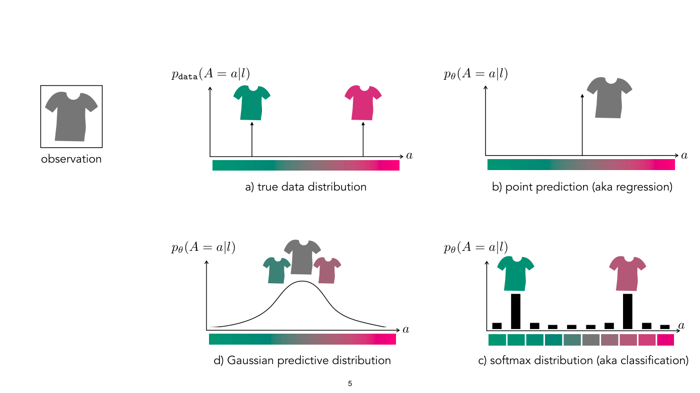

The slide shows a single observation and four small plots of a distribution over a colour $a$ given the observation $l$.

At the left, a grey T-shirt silhouette in a black-outlined square, labelled "observation". Each of the four plots has a vertical axis with an arrowhead and a horizontal axis labelled $a$, with a colour bar under the horizontal axis that runs from green (left) through grey to magenta/pink (right). The bar is the same smooth gradient in plots a, b and d; in plot c it is split into 10 discrete squares separated by thin white gaps (four shades of green, then grey-teal, grey, grey-mauve, mauve, pink-mauve and magenta).

Top middle, plot a, caption "a) true data distribution", axis title $p_{\texttt{data}}(A = a | l)$: two vertical black arrows (spikes), one over the green part of the bar (about a fifth of the way along) with a green T-shirt above it and one over the pink part (about four fifths along) with a magenta T-shirt above it, i.e. two modes. The slide does not say what $l$ is; the lecturer conditions on "the luminance value, the grayscale value" (≈6:05).

Top right, plot b, caption "b) point prediction (aka regression)", axis title $p_\theta(A = a | l)$: a single vertical arrow at the middle of the colour bar with a grey T-shirt above it.

Bottom middle, plot d, caption "d) Gaussian predictive distribution", axis title $p_\theta(A = a | l)$: a single bell curve centred on the middle of the colour bar, with three T-shirts above its peak (a grey one at the centre, a green-grey one at the left, a mauve one at the right).

Bottom right, plot c, caption "c) softmax distribution (aka classification)", axis title $p_\theta(A = a | l)$: 10 black bars over 10 colour squares. Two bars are tall, the second (a green T-shirt above it) and the eighth (a pink-mauve T-shirt above it); the others are small, about equal, with the bars at positions 1, 3, 7 and 9 slightly taller than those at 4, 5, 6 and 10. 

Printed as: the captions are lettered a, b, d, c in reading order (the bottom left plot is "d" and the bottom right is "c").

## Slide 6 — (no title; per-pixel colour distributions on a T-shirt, and two properties of generative models)

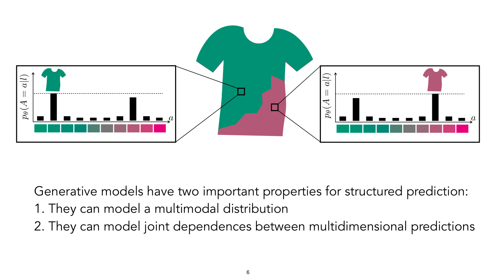

Builds on slide 5's softmax plot (c): the same ten-bar colour histograms are now attached to individual pixels of one large T-shirt.

At the centre top, a large T-shirt silhouette, mostly green, with a pink-mauve region covering its lower right (a jagged boundary running from the lower left of the shirt up and to the right). A small black square marks one spot in the green region and another marks a spot in the pink region. Thin black lines lead from each square to a black-bordered box at the left and at the right respectively.

Left box: a plot with vertical axis label $p_\theta(A = a | l)$ (rotated) and horizontal axis $a$, a green T-shirt icon at the top, ten black bars over a colour bar of ten squares (green, through grey, to pink). The second bar is the tallest (a dotted horizontal line marks its height) and the eighth is the second tallest; the rest are small.

Right box: the same plot with a pink-mauve T-shirt icon; the eighth bar is the tallest (dotted line at its height), the second bar is the second tallest, the rest are small.

Text at the bottom:

Generative models have two important properties for structured prediction:
1. They can model a multimodal distribution
2. They can model joint dependences between multidimensional predictions

## Slide 7 — Real or fake?

*OCW notice: © painmakers. All rights reserved. This content is excluded from our Creative Commons license. For more information, see https://ocw.mit.edu/help/faq-fair-use/ (small print at the lower left, over the lower edge of the picture; it covers the photograph).*

A tall photograph at the left, of five dark blue cylindrical drums stacked in two layers (two on top, three below) on a wooden floor in front of a pale wall. The upper two drums' labels read "SURVIVAL SUPPLIES", "OFFICE OF CIVIL DEFENSE", "DEPARTMENT OF DEFENSE" (the left one also "DRINKING WATER") and "17½ GALLONS"; the labels on the lower three are partly distorted and blurred, with red-tinted lettering on the middle one. A rotated watermark at the upper right of the photo reads "© 2002 Painmakers". At the right of the slide: "Real or fake?"

## Slide 8 — Real or fake?

*OCW notice: © color_byangelina. All rights reserved. This content is excluded from our Creative Commons license. For more information, see https://ocw.mit.edu/help/faq-fair-use/ (small print at the lower middle, to the right of the photograph; it covers the photograph).*

A tall colourised photograph at the left of a smiling woman with long brown hair and glasses, in a short brown striped dress and dark strapped shoes, standing in a room beside a stack of bound printed paper volumes about as tall as she is, which she holds with both hands just below its top volume. Behind her are a door, a coat stand with a hanger and a chalkboard with handwritten text. A watermark at the lower right of the photo reads "@COLOR_BYANGELINA". At the right of the slide: "Real or fake?"

## Slide 9 — Deep learning in 2012

Title: "Deep learning in 2012". Text: "Use a **hypothesis space** that can model complex structure" (the words "hypothesis space" bold), with the line "(e.g., a CNN, nearest-neighbor)" under it. A long black arrow runs from just under the words "hypothesis space" down and to the right to a red dotted box.

Diagram: the word "Data" with an arrow pointing right into a black-outlined box, and from the box an arrow pointing right to $f$. The box has a grey header "Learner" and three lines of text, top to bottom: "Objective", "Hypothesis space" (inside the red dotted box that the arrow points to) and "Optimizer".

## Slide 10 — Why deep learning

[Slide credit: Andrew Ng]

White-on-black slide. Title: "Why deep learning". A line chart with vertical axis label "Performance" and horizontal axis label "Amount of data" (both axes are white arrows, no tick labels or numbers). Two series:

- Blue curve, labelled "Deep learning": starts at the origin, rises steeply, passes the red curve about a third of the way along the horizontal axis and keeps rising roughly linearly to the highest point of the plot at the right.
- Red curve, labelled "Older learning algorithms": starts slightly above the blue one, rises a little faster at first, and flattens out into a horizontal plateau after the crossing point, a little below the middle height of the plot (the blue curve ends at about five sixths of it).

Question at the bottom: "How do data science techniques scale with amount of data?" Credit at the lower right: "[Slide credit: Andrew Ng]".

## Slide 11 — (no title; a photo of flying birds mapped by $\mathcal{F}$ to a segmentation, and the objective)

*OCW notice: © Fred Durand. All rights reserved. This content is excluded from our Creative Commons license. For more information, see https://ocw.mit.edu/help/faq-fair-use/ (small print at the lower left; it covers the photograph of birds on the left, and the segmentation on the right is drawn from it).*

At the top left, a black-framed photograph of a pale blue-grey sky with ten large birds in flight (white bodies, long wings with dark outer halves): one near the upper right corner, the rest in the lower half (a row of three left of centre, a pair right of centre, three at the left edge, one of them cut off, and one cut off at the bottom edge). Credit under it: "[Photo credit: Fredo Durand]". In the middle, a white block arrow with a black outline pointing right, containing $\mathcal{F}$. At the top right, a black-framed image of the same size with a saturated bright blue background in which each bird of the photo is a light grey silhouette with a thin black outline, in the same position (ten in all). Caption under it: "(Colors represent one-hot codes)".

Below, centred, the objective

$$\arg\min_{\mathcal{F}} \mathbb{E}_ {\mathbf{x},\mathbf{y}} \left[ L(\mathcal{F}(\mathbf{x}), \mathbf{y}) \right]$$

with the subscript $\mathcal{F}$ under "arg min". A black arrow from the text "Hypothesis space" (below left) points up to the $\mathcal{F}$ under the arg min, and a black arrow from the text "Objective function (loss)" (the second line is "(loss)") points up to $L$.

## Slide 12 — Semantic Segmentation

Title: "Semantic Segmentation". A diagram of data, a learner and the result, left to right.

Left, the heading "Data" and a column of two example pairs, each in curly braces, with column labels $\mathbf{x}$ and $\mathbf{y}$ above the first pair. First pair: the sky photo with flying birds and its blue-and-grey segmentation (small copies of slide 11's pictures). Second pair: a photo of a small bird with a blue head, a yellow-green back, dark grey-brown wings and a red underside, perched on a piece of bark, and beside it a segmentation with a tomato-red bird silhouette (thin black outline) on a pale sage-green background with a brown band of bark along the bottom. A vertical ellipsis (three dots) under the pairs. Under that:

$$\mathbf{x} \in \mathbb{R}^{H \times W \times 3}$$

$$\mathbf{y} \in \mathbb{R}^{H \times W \times K}$$

A black arrow points right into a black-outlined box with a grey header "Learner" and three entries: "Objective" with

$$f^{\ast} = \arg\min_{f \in \mathcal{F}} \sum_{i=1}^{N} H(\mathbf{y}_ i, \hat{\mathbf{y}}_ i)$$

then "Hypothesis space" with "Convolutional neural net", then "Optimizer" with "Stochastic gradient descent". A black arrow points right out of the box to $f$.

## Slide 13 — Sat2Map

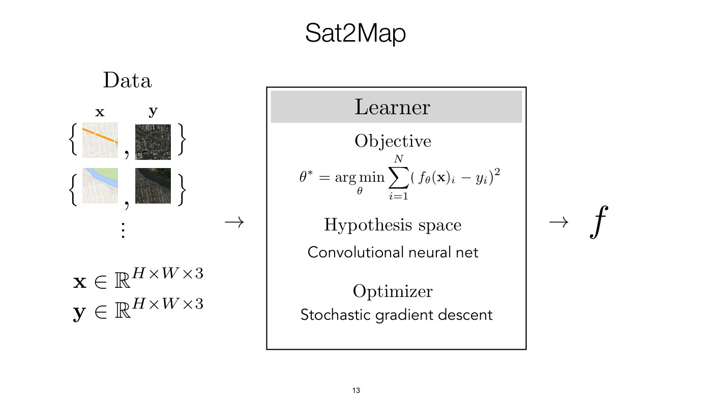

Title: "Sat2Map". Same layout as slide 12, with different data and objective.

Left, the heading "Data", column labels $\mathbf{x}$ and $\mathbf{y}$, and two example pairs in curly braces: the first pair is a map tile (an orange highway running diagonally from upper left to right, small green patches and a dense grid of city blocks) and a dark aerial photo of dense rooftops, the elevated highway and a rail line; the second pair is a map tile (a blue river running diagonally across the upper part, a green park above it and a pale rail yard of long blocks below) and a dark aerial photo of the river, a wooded park and rail yards. A vertical ellipsis. Under it:

$$\mathbf{x} \in \mathbb{R}^{H \times W \times 3}$$

$$\mathbf{y} \in \mathbb{R}^{H \times W \times 3}$$

An arrow points right into the "Learner" box (grey header) with: "Objective"

$$\theta^{\ast} = \arg\min_{\theta} \sum_{i=1}^{N} \left( f_\theta(\mathbf{x})_ i - y_i \right)^2$$

"Hypothesis space" with "Convolutional neural net", "Optimizer" with "Stochastic gradient descent". An arrow points right out of the box to $f$.

The term $f_\theta(\mathbf{x})_ i$ is pasted on a white patch over an earlier $f_\theta(x_i)$, which is still in the text layer; the patch cuts off the right half of the opening parenthesis. Printed as: the objective writes the target as a plain $y_i$ (not bold), while the data are written $\mathbf{y}$ and slide 12's objective used $\mathbf{y}_ i$.

## Slide 14 — (no title; the headings "Input" and "Deep net output" over a map and a blurry aerial image)

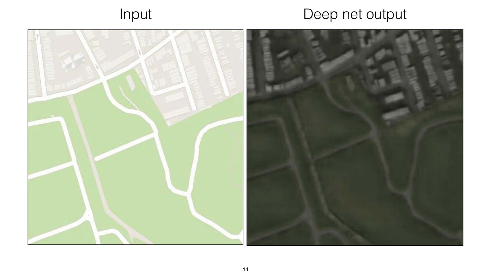

Two large square images side by side, each with a thin black border. Heading above the left one: "Input". Left image: a map section with pale beige blocks of buildings and white roads at the top, and a large light green park area below with white paths. Heading above the right one: "Deep net output". Right image: a blurry, dark greyscale-green aerial-style image with the same layout (grey building blocks at the top, dark green fields below, faint paths in the same positions), without crisp detail.

## Slide 15 — Structured prediction

Builds on slide 9's learner diagram (Data, Learner with Objective, Hypothesis space, Optimizer, output $f$); the red dotted box is now around "Objective" instead of "Hypothesis space".

Title: "Structured prediction". Text: "Use an **objective** that can model structure! (e.g., a graphical model, a GAN, etc)" (the word "objective" bold, the parenthesis in smaller type). A black arrow from the word "objective" points down and to the right at the red dotted box around "Objective". Diagram: "Data" with an arrow pointing right into a black-outlined box with the grey header "Learner" and, top to bottom, "Objective" (in the red dotted box), "Hypothesis space", "Optimizer"; an arrow points right out of the box to $f$.

## Slide 16 — Image-to-image

A section slide with a grey horizontal band across the middle holding the large title "Image-to-image". Under the title, two bracket-style black arrows branch from a vertical line at the left of the title and point right at two lines of text: "with conditional GANs" and "with conditional VAEs".

## Slide 17 — Conditional GAN

A section slide: a grey horizontal band across the middle with the large title "Conditional GAN".

## Slide 18 — (no title; the generator of a conditional GAN, with the pix2pix example)

At the top left, a row of three items. The label $\mathbf{x}$ is above a square picture of a blue label map with coloured rectangles (a red horizontal bar near the top, a yellow-green strip above it, a yellow box, three columns of light-blue windows with cyan sills, a large lime green rectangle and small yellow boxes). A black arrow points right through three tall narrow white rectangles (three layers side by side), labelled $g_\theta$ above and "Generator" below, and ends at a square picture labelled $g_\theta(\mathbf{x})$ above, of a pale blurry building facade with a grey roof and several windows and a balcony. At the lower left of the slide: "For example: pix2pix [Isola et al. 2017]".

## Slide 19 — (no title; adding a discriminator to the conditional GAN)

Builds on slide 18: the generator's output now feeds a second network.

The same row as slide 18 (the $\mathbf{x}$ label map, a black arrow through three rectangles labelled $g_\theta$ and "Generator", and the generated facade labelled $g_\theta(\mathbf{x})$ above it), and then a black arrow pointing right from the facade through a second group of three tall white rectangles labelled $d_\phi$ above and "Discriminator" below, ending in the text "real or synthetic?". Below, two lines of text:

g tries to synthesize fake images that fool d

d tries to identify the fakes

## Slide 20 — (no title; training the discriminator on a generated image and a real image)

Builds on slide 19: the discriminator's output on the generated image is now given a value, a real image is added below, and the discriminator's objective is written out.

Top row, as in slide 19: $\mathbf{x}$ label map, arrow through the generator $g_\theta$ (three rectangles), the generated facade $g_\theta(\mathbf{x})$, an arrow through the discriminator $d_\phi$ (three rectangles) and then the text "synthetic (0.9)" with the word "synthetic" in red and "(0.9)" in black. A blue dashed horizontal line separates the top row from the bottom row. Bottom row: the label $\mathbf{y}$ above a picture of a real red brick apartment building with fire escapes and a street-level shopfront, an arrow through a second copy of the discriminator ($d_\phi$, three rectangles) and the text "real (0.1)" with "real" in green and "(0.1)" in black.

Across the bottom, the equation

$$d^{\ast}_ \phi = \arg\max_{\phi} \mathbb{E}_ {\mathbf{x},\mathbf{y}} \left[ \log d_\phi(g_\theta(\mathbf{x})) + \log(1 - d_\phi(\mathbf{y})) \right]$$

in which the term $\log d_\phi(g_\theta(\mathbf{x}))$ is boxed in red (matching the red "synthetic") and the term $\log(1 - d_\phi(\mathbf{y}))$ is boxed in green (matching the green "real"). The slide does not say what the number in parentheses is; read with the equation, $d_\phi$ outputs the probability that its input is synthetic.

## Slide 21 — (no title; the generator's objective: fool the discriminator)

Builds on slide 19's generator and discriminator diagram: the picture fed to the discriminator is now a sharp real photograph of a pale blue-grey four-storey building with a dark grey mansard roof and dormers, a central balcony, bare trees in front and black wedges at the corners where the photo was straightened (slides 22, 23 and 31 use the same photograph) (which the slide labels $g_\theta(\mathbf{x})$ as before), the discriminator output is "real or synthetic?", and an orange dotted arrow is added.

Top row: $\mathbf{x}$ label map, black arrow through three rectangles labelled $g_\theta$, the facade picture labelled $g_\theta(\mathbf{x})$, black arrow through three rectangles labelled $d_\phi$, then "real or synthetic?". Just below the black arrows, an orange dotted arrow runs leftwards from below the tip of the discriminator's output arrow, behind both networks and the facade picture (so it shows only in the gaps), to an arrowhead pointing left just right of the $\mathbf{x}$ label map, below where the generator's input arrow starts (the direction in which the error signal flows back to $g$).

Text: "g tries to synthesize fake images that *fool* d:" (the word "fool" in italic orange). Equation:

$$g^{\ast}_ \theta = \arg\min_{\theta} \mathbb{E}_ {\mathbf{x},\mathbf{y}} \left[ \log d_\phi(g_\theta(\mathbf{x})) \right]$$

with the "arg min" and its subscript $\theta$ inside an orange box.

## Slide 22 — (no title; the minimax objective with min over $\theta$ and max over $\phi$)

Builds on slide 21: the orange dotted arrow is gone, and the objective now includes the discriminator's term and its maximisation.

Top row as in slide 21 (label map $\mathbf{x}$, generator $g_\theta$, facade labelled $g_\theta(\mathbf{x})$, discriminator $d_\phi$, "real or synthetic?").

Text: "g tries to synthesize fake images that *fool* the *best* d:" (the word "fool" in italic orange, the word "best" in italic blue). Equation:

$$\arg\min_{\theta} \max_{\phi} \mathbb{E}_ {\mathbf{x},\mathbf{y}} \left[ \log d_\phi(g_\theta(\mathbf{x})) + \log(1 - d_\phi(\mathbf{y})) \right]$$

with "min" and its subscript $\theta$ in an orange box and "max" and its subscript $\phi$ in a blue box.

## Slide 23 — (no title; the discriminator seen as a learned loss function)

Builds on slide 22's diagram: the discriminator is redrawn as a box.

Top row: $\mathbf{x}$ label map, black arrow through three rectangles labelled $g_\theta$, the generated facade labelled $g_\theta(\mathbf{x})$ (the blue-grey building), and a black arrow pointing right into a black-outlined box with the text "Loss Function" and $d_\phi$ under it. A black dashed curved arrow starts just right of the $\mathbf{x}$ image's lower right corner, sags under the generator and the facade, and ends with an arrowhead at the lower left corner of the same box (the input $\mathbf{x}$ also goes to the loss).

Text: "g's perspective: d is a loss function." and "Rather than being hand-designed, it is *learned* and *highly structured*." (the words "learned" and "highly structured" in italics).

## Slide 24 — (no title; the minimax objective, with a real image shown to the discriminator)

Builds on slide 22: the picture between the networks is now the real red brick building with fire escapes (the same image as $\mathbf{y}$ on slide 20), still labelled $g_\theta(\mathbf{x})$; no colour boxes, and the line "g tries to synthesize fake images that fool the best d:" is gone.

Top row: $\mathbf{x}$ label map, black arrow through $g_\theta$ (three rectangles), the red building picture labelled $g_\theta(\mathbf{x})$, black arrow through $d_\phi$ (three rectangles), then "real or synthetic?". Equation at the bottom:

$$\arg\min_{\theta} \max_{\phi} \mathbb{E}_ {\mathbf{x},\mathbf{y}} \left[ \log d_\phi(g_\theta(\mathbf{x})) + \log(1 - d_\phi(\mathbf{y})) \right]$$

## Slide 25 — (no title; the discriminator answers "real!")

Builds on slide 24: the discriminator's answer replaces the question.

Same diagram as slide 24 (the red building picture labelled $g_\theta(\mathbf{x})$ goes to the discriminator $d_\phi$), with the output now the word "real!" in green. The same equation sits at the bottom:

$$\arg\min_{\theta} \max_{\phi} \mathbb{E}_ {\mathbf{x},\mathbf{y}} \left[ \log d_\phi(g_\theta(\mathbf{x})) + \log(1 - d_\phi(\mathbf{y})) \right]$$

## Slide 26 — (no title; the discriminator sees pairs of label map and image)

Builds on slide 24: a second picture, the input label map, is placed beneath the generated image and both go to the discriminator together.

Top: $\mathbf{x}$ label map, black arrow through $g_\theta$ (three rectangles), the red building picture labelled $g_\theta(\mathbf{x})$. Below it, a copy of the blue label map (the same as $\mathbf{x}$) reached by a black dashed curved arrow from under the original $\mathbf{x}$. A tall black bracket at the right of the two stacked pictures joins them, and a black arrow runs from just right of the bracket through three white rectangles (the same size as before, now drawn lower, level with the bracket's middle) labelled $d_\phi$ to the text "real or synthetic *pair* ?" (the word "pair" in italics, on a second line). Equation at the bottom, unchanged from slide 24:

$$\arg\min_{\theta} \max_{\phi} \mathbb{E}_ {\mathbf{x},\mathbf{y}} \left[ \log d_\phi(g_\theta(\mathbf{x})) + \log(1 - d_\phi(\mathbf{y})) \right]$$

## Slide 27 — (no title; the equation rewritten with pairs, the label map highlighted in purple)

Builds on slide 26: the copy of the label map gets a purple dotted border, and the equation is rewritten so that $d_\phi$ takes the pair.

The diagram is as in slide 26. Two thick purple dotted arrows run from the purple-bordered label map down to two purple boxes around the $\mathbf{x}$ inside $d_\phi$ in the equation:

$$\arg\min_{\theta} \max_{\phi} \mathbb{E}_ {\mathbf{x},\mathbf{y}} \left[ \log d_\phi(\mathbf{x}, g_\theta(\mathbf{x})) + \log(1 - d_\phi(\mathbf{x}, \mathbf{y})) \right]$$

The first purple box surrounds the first $\mathbf{x}$ in $d_\phi(\mathbf{x}, g_\theta(\mathbf{x}))$ and the second the $\mathbf{x}$ in $d_\phi(\mathbf{x}, \mathbf{y})$. The question text is "real or synthetic *pair* ?".

## Slide 28 — (no title; the pair discriminator answers "synthetic pair")

Builds on slide 27: the discriminator's output text changes from the question to the answer "**synthetic** *pair*" ("synthetic" bold red, "pair" italic black). Everything else (diagram, purple dotted border and arrows, equation with $d_\phi(\mathbf{x}, g_\theta(\mathbf{x}))$ and $d_\phi(\mathbf{x}, \mathbf{y})$ and the two purple boxes) is as on slide 27.

## Slide 29 — (no title; the pair discriminator answers "real pair")

Builds on slide 28: the output text changes to "**real** *pair*" ("real" bold green, "pair" italic black). Everything else is as on slide 27 and 28: the purple-bordered label map with purple dotted arrows to the two boxed $\mathbf{x}$ in

$$\arg\min_{\theta} \max_{\phi} \mathbb{E}_ {\mathbf{x},\mathbf{y}} \left[ \log d_\phi(\mathbf{x}, g_\theta(\mathbf{x})) + \log(1 - d_\phi(\mathbf{x}, \mathbf{y})) \right]$$

## Slide 30 — (no title; the conditional GAN objective, boxed)

Builds on slide 27: the purple dotted arrows and the purple boxes in the equation are removed, the output text is again "real or synthetic *pair* ?", and the whole equation is surrounded by a red rectangle. The diagram is as on slide 27 (label map $\mathbf{x}$, generator $g_\theta$, red building picture labelled $g_\theta(\mathbf{x})$, the purple-dotted-bordered copy of the label map joined to it by a bracket, discriminator $d_\phi$). The boxed equation:

$$\arg\min_{\theta} \max_{\phi} \mathbb{E}_ {\mathbf{x},\mathbf{y}} \left[ \log d_\phi(\mathbf{x}, g_\theta(\mathbf{x})) + \log(1 - d_\phi(\mathbf{x}, \mathbf{y})) \right]$$

## Slide 31 — Training Details: Loss function

Title: "Training Details: Loss function". Equation at the top:

$$g^{\ast}_ \theta = \arg\min_{\theta} \max_{\phi} \mathcal{L}_ {\texttt{cGAN}}(\theta, \phi) + \lambda \mathcal{L}_ {\texttt{L1}}(\theta)$$

with the last term $\lambda \mathcal{L}_ {\texttt{L1}}(\theta)$ inside a magenta rectangle.

Diagram below: the label map $\mathbf{x}$ (blue map with a red bar, yellow and lime green rectangles, light blue windows), a black arrow through three tall white rectangles labelled $g_\theta$, and then, inside a second magenta rectangle, a difference between two double-bar norm signs: the generated facade labelled $g_\theta(\mathbf{x})$ (a pale blurry building, the generated picture of slides 18–20), a minus sign, and the real photograph labelled $\mathbf{y}$ (a blue-grey building with a dark roof, balcony and bare trees, with black borders at the corners; the photograph that slides 21–23 show between the networks), the pair enclosed by a pair of double vertical bars (a norm). Text under the diagram: "Stable training + fast convergence". At the lower right: "[c.f. Pathak et al. CVPR 2016]".

## Slide 32 — Labels → Facades

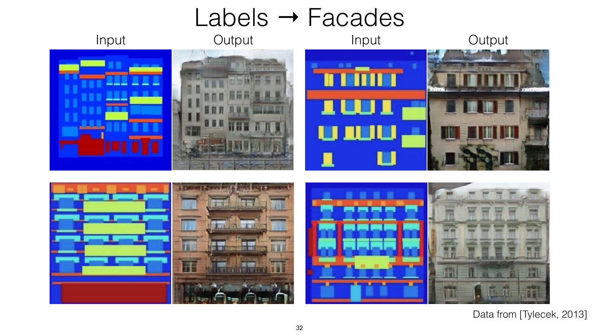

Title: "Labels → Facades". A 2 by 2 grid of input and output pairs, each pair a colour label map followed by a building image; the column headings "Input", "Output", "Input", "Output" are printed once at the top. Four pairs:

- Top left pair: a label map (blue background, lime green and red-orange bars, rows of small light blue windows, dark red blocks at the bottom) and an output of a row of grey multi-storey buildings with a blurred ground floor of shopfronts.
- Top right pair: a label map (blue background, red-orange bars, rows of yellow-and-blue window shapes, lime green balcony blocks at the right) and an output of a cream-coloured building with dark red shutters, a distorted grey roof and dark greenery on the ground floor.
- Bottom left pair: a label map (orange top strip, rows of light blue and cyan windows, four wide lime green bars, a dark red block at the bottom) and an output of a brown-orange stone building with balconies and a dark ground floor with arches.
- Bottom right pair: a label map (blue, with orange-red horizontal bars and red pillars framing three bays of light blue and cyan windows, a lime green block with small orange squares below the windows, and a dark red block and a small dark red square at the left edge) and an output of a pale grey-white building with rows of small windows and an arched doorway at the centre of the ground floor.

Credit at the lower right: "Data from [Tylecek, 2013]".

## Slide 33 — Patch Discriminator

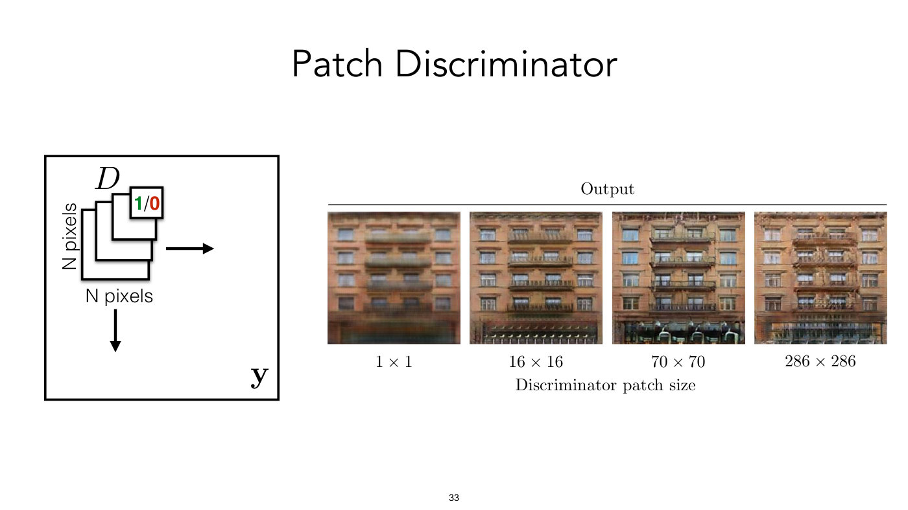

Title: "Patch Discriminator". Left: a large black-bordered square labelled $\mathbf{y}$ at its lower right corner (an image). Near its upper left corner, four stacked black-outlined squares with drop shadows, each smaller than the one behind and offset up and to the right, like a sliding window, labelled $D$ above; the smallest, front square carries the label "1/0" (a bold green "1", a thin black "/", a bold red "0"). The rearmost, largest square's sides are labelled "N pixels" (rotated along its left side and horizontal below it). A black arrow points right from the window and a black arrow points down below it (the window slides across and down the image).

Right: a row of four generated images of the same brown apartment building with balconies, with the heading "Output" over them (with a black line under it), and under them the labels $1 \times 1$, $16 \times 16$, $70 \times 70$, $286 \times 286$ and the axis caption "Discriminator patch size". The first image (patch size 1 by 1) is very blurry, the second (16 by 16) is sharper but with local artefacts, the third (70 by 70) is sharp, and the fourth (286 by 286) is sharp but blotchy, with distorted ornament and a garbled sign band over the ground floor (sharpness judged by eye; the slide prints only the sizes). The $70 \times 70$ output is slide 32's bottom left output.

## Slide 34 — Why deep learning

[Slide credit: Andrew Ng]

Repeat of slide 10: a white-on-black chart titled "Why deep learning" with vertical axis "Performance" and horizontal axis "Amount of data" (no numbers). Two series:

- Blue curve, labelled "Deep learning": rises from the origin, crosses the red curve at about a quarter of the horizontal axis, and keeps rising to the highest point at the right.
- Red curve, labelled "Older learning algorithms": starts slightly above blue, then flattens into a horizontal plateau at about the middle height.

Question at the bottom: "How do data science techniques scale with amount of data?" Credit at the lower right: "[Slide credit: Andrew Ng]".

## Slide 35 — Why structured objectives

Title: "Why structured objectives" with the subtitle "(cartoon)". A chart with black axes: vertical axis "Performance", horizontal axis "Amount of data" (no numbers). Two series, both short, close to the origin at the lower left, each ending in an arrowhead:

- Blue curve with arrowhead, labelled "Deep learning": rises steeply and curves up and to the right, ending a little over a quarter of the way up the vertical axis. The red curve starts slightly above the blue one, and the blue crosses it just above the origin.
- Red curve with arrowhead, labelled "Older learning algorithms": rises less and flattens, ending about a sixth of the way up.

The upper and right parts of the plot are empty.

## Slide 36 — Why structured objectives

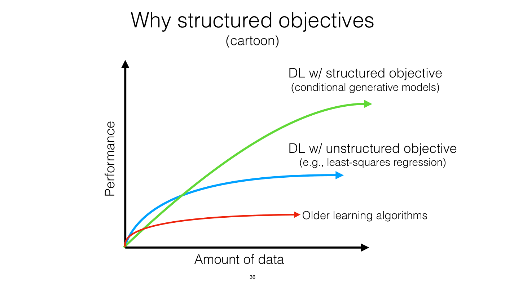

Builds on slide 35: the same title ("Why structured objectives", "(cartoon)"), the same axes, the same blue and red curves (the blue curve now extends to the right and levels off, the red one levels off lower, the blue curve is relabelled, and the labels have moved to the new ends), and a third curve is added. Three series, all starting at the origin and ending in arrowheads:

- Red curve, labelled "Older learning algorithms": rises a little and plateaus lowest (about a sixth of the way up).
- Blue curve, labelled "DL w/ unstructured objective" with the second line "(e.g., least-squares regression)": rises faster than red, then levels off about two fifths of the way up, ending about nine tenths of the way along.
- Green curve, labelled "DL w/ structured objective" with the second line "(conditional generative models)": starts more slowly than both other curves, crosses red early (under a tenth of the way along) and blue at about a quarter of the horizontal axis, and keeps rising to the highest end point, about four fifths of the way up at the right end of the axis, flattening slightly at the right.

## Slide 37 — (no title; the map input and an unstructured L1 prediction)

Two large square images side by side, with headings "Input" over the left and "Unstructured prediction (L1)" over the right. Left: the same map section as slide 14 (beige building blocks and white roads at the top, a large light green park below with white paths). Right: a blurry, dark, desaturated aerial-style image with the same layout (grey building blocks at the top and dark green below, faint paths), the same as the "Deep net output" of slide 14.

## Slide 38 — (no title; the map input and a structured cGAN prediction)

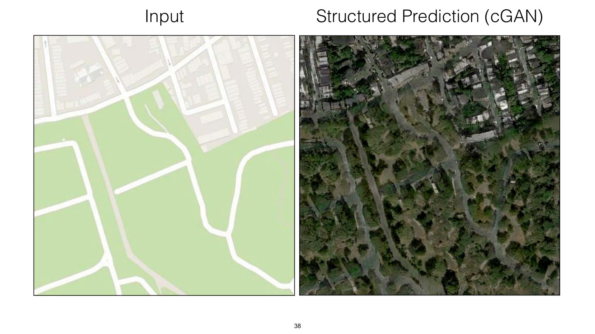

Builds on slide 37: the right image is replaced. Headings: "Input" over the left and "Structured Prediction (cGAN)" over the right. Left: the same map section as slide 37. Right: a sharp, detailed aerial-style image of the same layout, with houses and grey roofs at the top, and below, dense dark green trees and bushes with grey winding paths, olive-brown ground showing between the trees, in the places where the map shows the park's paths.

## Slide 39 — Conditional VAE

A section slide: a grey horizontal band across the middle with the large title "Conditional VAE".

## Slide 40 — Modeling multiple possible outputs

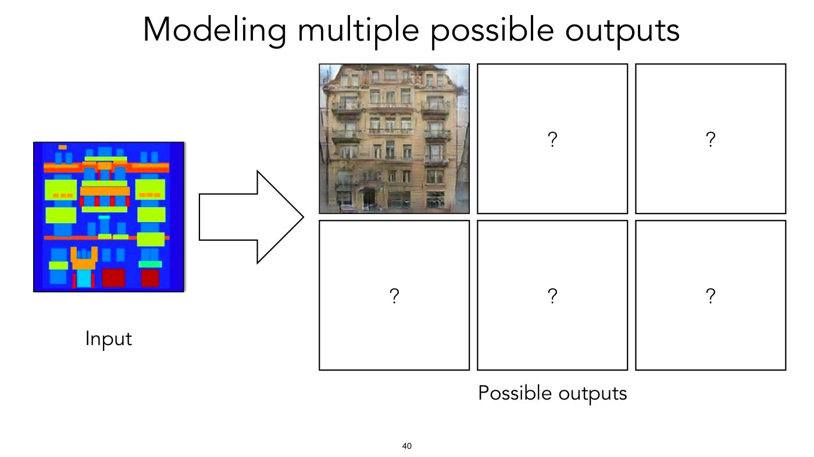

Title: "Modeling multiple possible outputs". At the left, a label map (blue background with red-orange bars, lime green and light-blue blocks, dark red squares at the bottom and an orange U-shaped shape at the lower left) labelled "Input" below it. A large white block arrow with black outline points right from it to a 2 by 3 grid of six black-bordered squares labelled "Possible outputs" below. The top left square holds a blurry generated image of a tall cream-brown building with balconies; the other five squares are empty white with a question mark "?" in the centre.

## Slide 41 — Modeling multiple possible outputs

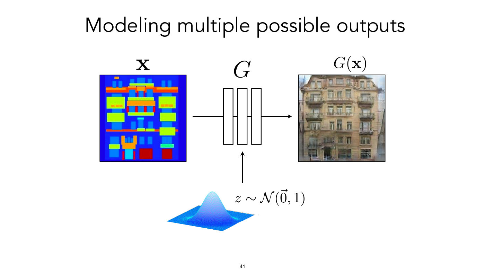

Builds on slide 40: a generator with a noise input is shown for the same example.

Title: "Modeling multiple possible outputs". Left, the label $\mathbf{x}$ (the blue label map of slide 40, with red-orange bars, lime green and light blue blocks, dark red squares and an orange U-shape). A black arrow runs from it through three tall white rectangles labelled $G$ and ends at a picture labelled $G(\mathbf{x})$ (the cream-brown building with balconies from slide 40). A thin black arrow points up from below into the middle of the three rectangles; at its foot, to the right of a 3D plot of a blue two-dimensional bell-shaped (Gaussian) surface over a flat square mesh, is the text $z \sim \mathcal{N}(\vec{0}, 1)$.

## Slide 42 — (no title; a context frame, ground-truth frames, and blurry predictions from Finn et al. (2016))

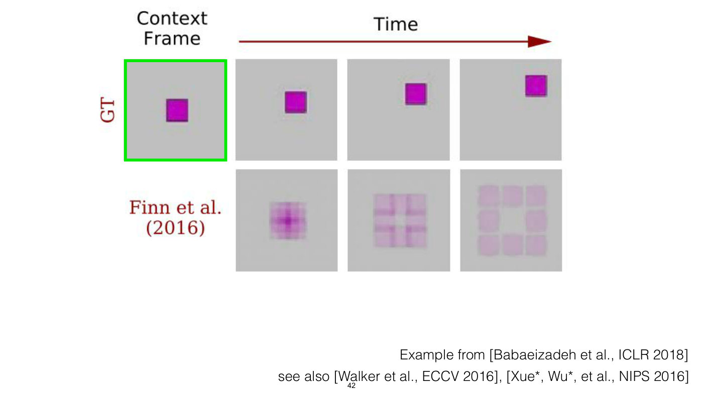

A grid of image frames with grey backgrounds. Column headings: "Context Frame" over the first column (with a bright green border around the first frame in the top row), and "Time" over the other three columns with a dark red arrow pointing right under it. Row labels at the left: "GT" (rotated, dark red) for the top row and "Finn et al. (2016)" (dark red, two lines: "Finn et al." and "(2016)") for the bottom row.

Top row (GT, ground truth): four frames each with one small magenta square on grey. In the context frame it is at the centre; in the next three frames it moves up and to the right, ending in the upper right of the last frame (well inside it).

Bottom row (Finn et al. (2016)): no frame in the context column; three frames of pale blurry magenta patches. The first is a blurry magenta cross-shaped smear near the centre (darkest at the centre); the second is a larger pale 3 by 3 grid-like blur with a lighter hole at the centre; the third is a pale ring of eight faint squares around an empty centre, spread wider. The row is meant to show a prediction that averages over possible futures.

Text at the lower right: "Example from [Babaeizadeh et al., ICLR 2018]" and "see also [Walker et al., ECCV 2016], [Xue*, Wu*, et al., NIPS 2016]". The printed slide number "42" overlaps the second line of this text.

## Slide 43 — (no title; predicting a purple box's motion from an observation, with the latent z pointing up and to the right)

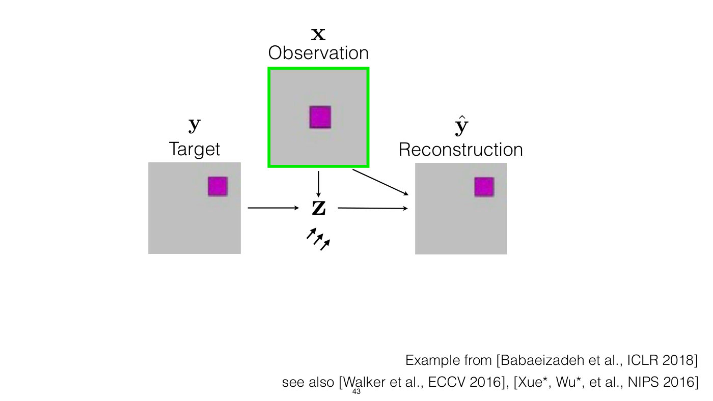

A diagram on a white background with three grey square images, the labels $\mathbf{x}$ and "Observation" above the top one, $\mathbf{y}$ and "Target" above the left one, and $\hat{\mathbf{y}}$ and "Reconstruction" above the right one.

- Top centre: the observation $\mathbf{x}$, a grey square with a thick bright-green border containing one small magenta square at its centre.
- Left: the target $\mathbf{y}$, a grey square (no border) with the magenta square near its upper right.
- Right: the reconstruction $\hat{\mathbf{y}}$, a grey square (no border) with the magenta square near its upper right, in the same place as in the target.
- Middle, just below the observation: the bold letter $\mathbf{z}$. Arrows: a short arrow from the observation down to $\mathbf{z}$; a long arrow from the target right to $\mathbf{z}$; a long arrow from $\mathbf{z}$ right to the reconstruction; and a diagonal arrow from the lower right corner of the observation to the reconstruction's upper left.
- Below $\mathbf{z}$: a cluster of three small black arrows, staggered diagonally (each lower and to the right of the previous one), each pointing up and to the right (a direction in which the purple box moves).

Footer text at the lower right: "Example from [Babaeizadeh et al., ICLR 2018]" and "see also [Walker et al., ECCV 2016], [Xue*, Wu*, et al., NIPS 2016]". The printed slide number "43" sits at bottom centre, overlapping the second footer line.

## Slide 44 — (no title; the same diagram with the purple box moving down)

Builds on slide 43: the target and the reconstruction now show the magenta square near the bottom centre of the grey square (the observation still shows it at the centre), and the three small arrows below $\mathbf{z}$ now point straight down. Everything else is as on slide 43: the labels $\mathbf{x}$ "Observation" (green-bordered square), $\mathbf{y}$ "Target", $\hat{\mathbf{y}}$ "Reconstruction", the bold $\mathbf{z}$ with arrows from the observation and the target into it, from it to the reconstruction, and the diagonal arrow from the observation to the reconstruction.

Footer: "Example from [Babaeizadeh et al., ICLR 2018]" and "see also [Walker et al., ECCV 2016], [Xue*, Wu*, et al., NIPS 2016]".

## Slide 45 — (no title; the same diagram with a caption saying what z learns)

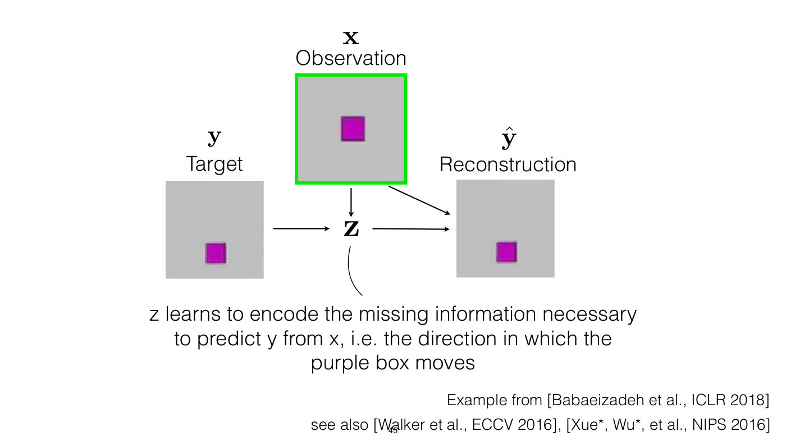

Builds on slide 44 (target and reconstruction with the magenta square near the bottom; three small arrows below $\mathbf{z}$ are gone). A thin curved line leaves the bottom of $\mathbf{z}$ and curves down to a caption, which reads: "z learns to encode the missing information necessary to predict y from x, i.e. the direction in which the purple box moves". The rest of the diagram is as on slide 44 ($\mathbf{x}$ Observation with the green border, $\mathbf{y}$ Target, $\hat{\mathbf{y}}$ Reconstruction, $\mathbf{z}$ with its arrows).

Footer: "Example from [Babaeizadeh et al., ICLR 2018]" and "see also [Walker et al., ECCV 2016], [Xue*, Wu*, et al., NIPS 2016]".

## Slide 46 — (no title; z sampled from a Gaussian at test time, box predicted moving down)

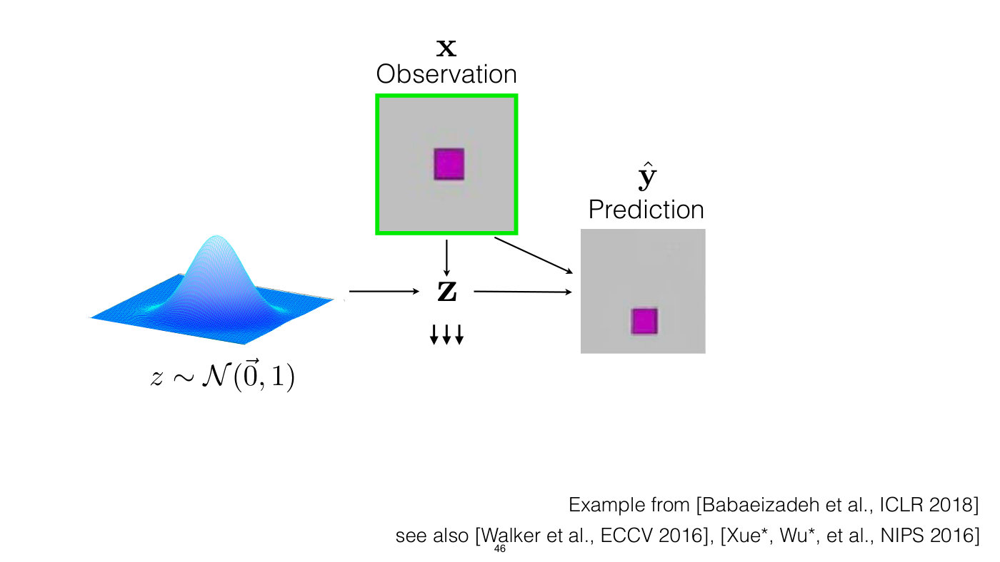

Builds on slide 44. The target square is replaced by a picture of a blue 3D surface plot of a two-dimensional bell-shaped (Gaussian) density on a flat square base, with the caption $z \sim \mathcal{N}(\vec{0}, 1)$ below it. The label over the right-hand square is now $\hat{\mathbf{y}}$ with "Prediction" (it was "Reconstruction"). An arrow runs from the Gaussian picture right to $\mathbf{z}$; the observation $\mathbf{x}$ (green-bordered square, magenta square at its centre, labelled "Observation") points down to $\mathbf{z}$ and diagonally to the prediction; $\mathbf{z}$ points right to the prediction. The prediction shows the magenta square near the bottom centre. Three small black arrows below $\mathbf{z}$ point straight down.

Footer: "Example from [Babaeizadeh et al., ICLR 2018]" and "see also [Walker et al., ECCV 2016], [Xue*, Wu*, et al., NIPS 2016]".

## Slide 47 — (no title; the same with a different sample of z, box predicted moving up)

Builds on slide 46: the same diagram, but the three small arrows below $\mathbf{z}$ now point straight up, and the prediction $\hat{\mathbf{y}}$ shows the magenta square near the top centre of its grey square (higher than the centre). Labels as on slide 46: Gaussian surface with $z \sim \mathcal{N}(\vec{0}, 1)$, $\mathbf{x}$ Observation, $\mathbf{z}$, $\hat{\mathbf{y}}$ Prediction.

Footer: "Example from [Babaeizadeh et al., ICLR 2018]" and "see also [Walker et al., ECCV 2016], [Xue*, Wu*, et al., NIPS 2016]".

## Slide 48 — (no title; the same with a third sample of z, box predicted moving up and to the right)

Builds on slide 47: the three small arrows below $\mathbf{z}$ now point up and to the right (staggered diagonally, as on slide 43), and the prediction $\hat{\mathbf{y}}$ shows the magenta square near the upper right of its grey square. Everything else is as on slide 46.

Footer: "Example from [Babaeizadeh et al., ICLR 2018]" and "see also [Walker et al., ECCV 2016], [Xue*, Wu*, et al., NIPS 2016]".

## Slide 49 — Modeling multiple possible outputs

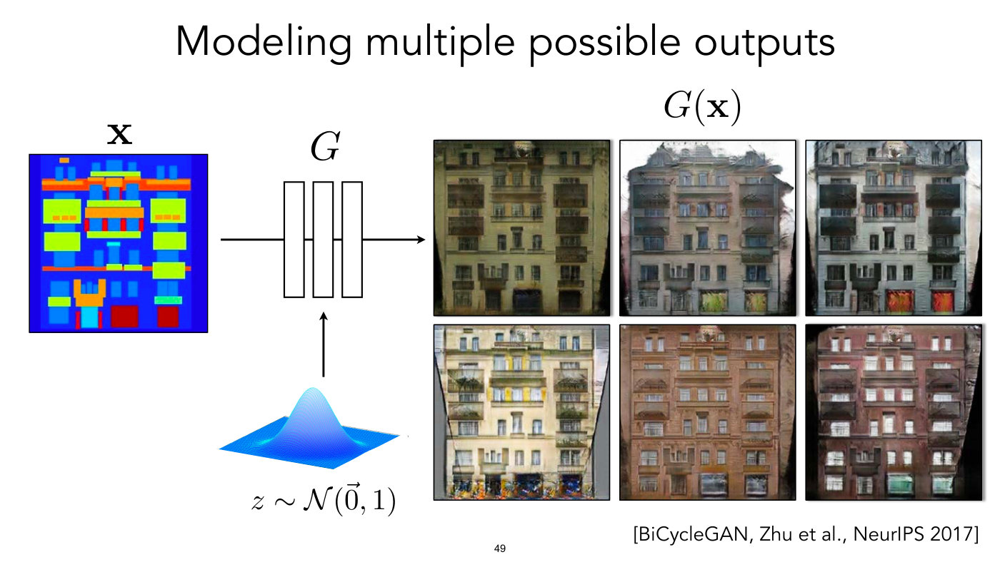

Title: "Modeling multiple possible outputs".

At the left, labelled $\mathbf{x}$ above it, a colourful label-map image of a building facade: flat blocks of colour (a deep blue background, with rectangles of light blue, yellow-green, orange, red and cyan arranged symmetrically as windows, balconies, a door and a roof line). A horizontal line runs from it right into a network drawn as three tall white rectangles side by side, labelled $G$ above; an arrow leaves the network to the right toward a grid of images. A vertical arrow points up into the middle rectangle from below, where a blue 3D bell-shaped surface plot sits with the caption $z \sim \mathcal{N}(\vec{0}, 1)$.

At the right, labelled $G(\mathbf{x})$ above it, a grid of six photograph-like generated images of the same building facade, 3 columns by 2 rows, each with the same layout of windows and balconies as the label map but in a different colour scheme and texture: top row, a dark olive-yellow facade, a pinkish grey facade with greenish shop fronts, a pale grey facade with red shop fronts; bottom row, a cream-yellow facade, a brown-orange facade, a dark reddish-brown facade with white windows. The picture shows one input producing many different outputs depending on the sampled $z$.

Credit at lower right: "[BiCycleGAN, Zhu et al., NeurIPS 2017]". The printed slide number "49" is at bottom centre.

## Slide 50 — (no title; a yellow concept banner)

A pale-yellow banner with a grey outline across the middle of the slide, reading: "Concept: **You can control your data either via explicit inputs or latent variables**" (the word "Concept:" in light type, the rest in bold).

## Slide 51 — Text-to-text

A section-title slide: a wide light-grey band across the slide with the large title "Text-to-text". Below the band, an arrow leaves the band's lower left, runs down and turns right to point at the words "with autoregressive models".

## Slide 52 — Autoregressive models are conditional generative models

Title: "Autoregressive models are conditional generative models".

At the left: "1. **Training**" (the word "Training" in bold). To its right a left-to-right diagram: the monospaced text "Colorless green ideas sleep ____" (in quotation marks, with a blank line at the end) has an arrow to a grey box labelled "Language model", which has an arrow to the monospaced text "furiously" (in quotation marks). Under the box: "(Predict next characters)".

## Slide 53 — Autoregressive models are conditional generative models

Builds on slide 52 (same title and layout). At the left: "2. **Predicting**" (the word "Predicting" in bold). To its right: the monospaced text "[Review] + "The sentiment in this review is ____"" (the quoted part begins at "The", ends with a blank line and a closing quote) has an arrow to the grey box "Language model", which has an arrow to the monospaced text "positive" (in quotation marks). Under the box: "(Predict next characters)".

## Slide 54 — GPT-3

Title: "GPT-3", followed on the same line by "[Brown et al., 2020]" and the URL "https://arxiv.org/pdf/2005.14165.pdf".

The slide shows a screenshot of text (no other figure); the underscores around "five" are printed. The text reads: "I had a horrible experience with this airline. The flight was delayed \_five\_ hours. Then, they lost my luggage. I had to wait a whole week to get the luggage back. I didn't have any changes of clothes so I wasted a lot of money to buy a few things to wear. When I finally got my luggage back, it was missing half my things. I will never fly with this airline again." After a blank line: "The sentiment in this review is negative." The word "negative." is highlighted with a pale-green background (the model's completion).

## Slide 55 — Image-to-text

A section-title slide in the same style as slide 51: a wide light-grey band with the large title "Image-to-text", and below it an arrow leaving the band's lower left, running down and turning right to point at the words "with an autoregressive model".

## Slide 56 — (no title; an image-captioning transformer with an image encoder and a text decoder)

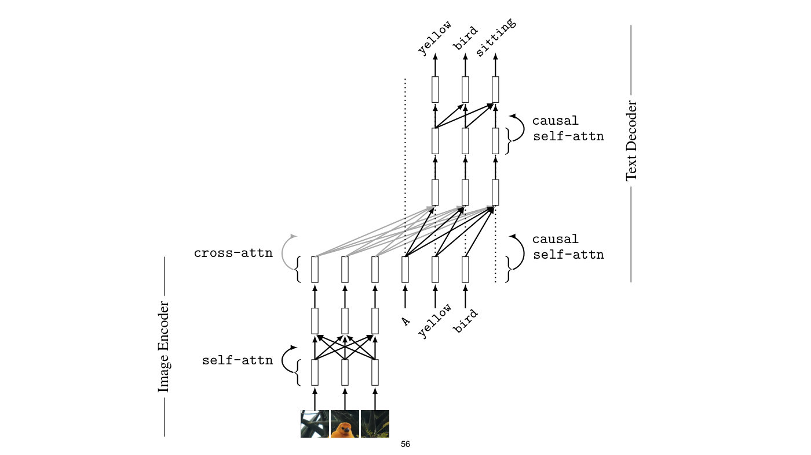

A vertical diagram drawn bottom to top, with all boxes thin white upright rectangles (token vectors) joined by arrows. The monospaced labels are in a typewriter font.

- Bottom: three small square picture patches side by side (the first a dark tangle of branches on a pale background, the second showing a small orange-yellow bird with a dark beak against dark foliage, the third dark with a few leaves). An arrow rises from each patch to a rectangle. This is the first row of three rectangles; a brace at the left of the row with a curved arrow pointing up and labelled "self-attn" marks the self-attention layer. Above this row, arrows run from each of the three rectangles to each of the three rectangles in the next row (a full set of crossing arrows, every token attends to every token). The second row of three rectangles has an arrow up to a third row of three rectangles. A vertical label at the far left, with lines above and below it, reads "Image Encoder" and spans these three rows.
- The third row of image rectangles sits at the same height as three more rectangles to its right, the text tokens, fed from below by arrows from the words "A", "yellow" and "bird" (written at an angle, going up to the right). So the row at the "cross-attn" level has six rectangles: three image tokens (left) and three text tokens (right). Four dotted vertical lines rise through the text side: one from the top of the "A" token up to the height of the top row, two above the "yellow" and "bird" tokens, and one to the right of the "bird" token, in the column of the decoder's third output. The decoder's upper columns sit one column to the right of the input tokens, above "yellow", "bird" and an empty slot, so every black arrow from a token is diagonal.
- To the left of this six-rectangle row, a brace with a curved grey arrow pointing up is labelled "cross-attn" and the grey lines from the three image tokens fan out up and to the right, each reaching the three text positions above (grey arrows, three from each image token, nine in all); black arrows from the text tokens go up and to the right to the same positions above: the first text token ("A" position) reaches the three positions, the second reaches two, the third one, which is the causal pattern. A brace at the right of the row labelled "causal self-attn" with a curved arrow marks this layer.
- Above, three columns of text-side rectangles: a row of three rectangles at the cross-attention output, an arrow up to a second row of three, a second brace labelled "causal self-attn" (with a curved arrow) beside the row that sends black arrows from the first rectangle to the second and third positions above and from the second rectangle to the third (causal), and a top row of three rectangles each with an arrow pointing up to an output word, written at an angle: "yellow", "bird", "sitting".
- A vertical label at the far right, with lines above and below it, reads "Text Decoder" and spans the text columns.

Printed slide number "56" at bottom centre. The slide shows the model reading the image and the words so far ("A yellow bird") and predicting the next words ("yellow bird sitting").

## Slide 57 — (no title; a ChatGPT-made picture: a screenshot in which ChatGPT is asked about slide 56)

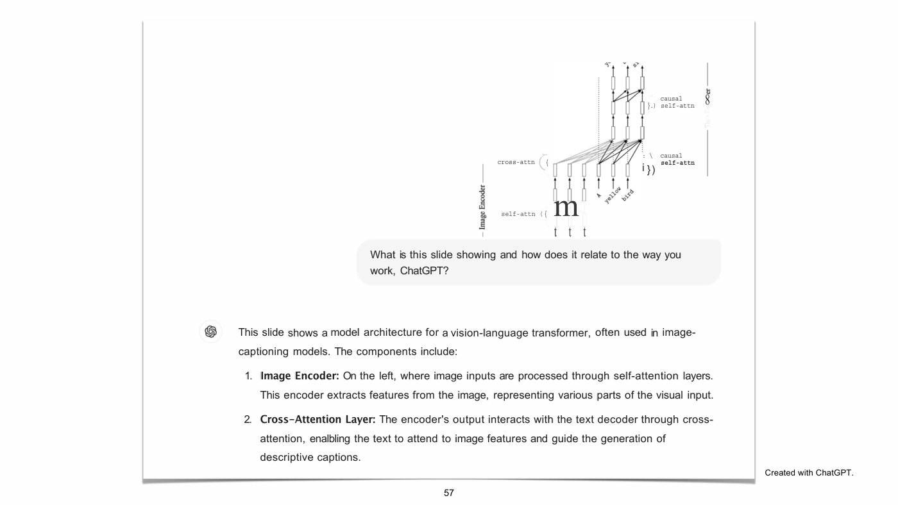

A caption at the lower right reads "Created with ChatGPT." The slide is a screenshot of a chat on a white card with a soft shadow. At the upper right, a small, garbled copy of slide 56's diagram (labels legible in places: "Image Encoder", "self-attn", "cross-attn", "causal self-attn" twice, and "A", "yellow", "bird" under the text tokens; the picture patches are missing, with three large "t"s in their place, a large "m" covers the encoder's lower rows, the output words are cut off at the top, the braces are garbled into stray punctuation, and the "Text Decoder" label is faded apart from "er", with a stray "8" beside it). Below it, a grey speech bubble (the user's message): "What is this slide showing and how does it relate to the way you work, ChatGPT?" Below, with the round ChatGPT logo at the left, the reply: "This slide shows a model architecture for a vision-language transformer, often used in image-captioning models. The components include:" followed by a numbered list: "1. **Image Encoder:** On the left, where image inputs are processed through self-attention layers. This encoder extracts features from the image, representing various parts of the visual input." and "2. **Cross-Attention Layer:** The encoder's output interacts with the text decoder through cross-attention, enalbling the text to attend to image features and guide the generation of descriptive captions." The card ends after item 2. Printed as "enalbling" (for "enabling") in item 2.

## Slide 58 — Does ChatGPT know how its own brain works?

Title: "Does ChatGPT know how its own brain works?". Caption at the lower right: "Created with ChatGPT."

The slide is a screenshot of a text card with a soft shadow, with a bold heading "How This Relates to How I Work" and a paragraph: "Similar to this architecture, my responses often involve "attention" to different parts of your input. Instead of visual data, I focus on your conversational context and keywords, determining the next part of the response based on previous parts of the conversation. In this way, I function similarly to a text decoder with attention mechanisms to retain consistency and relevance in dialogue. However, unlike this model's image encoding, I don't process visual data directly, but rely on text representations and information you share about images."

## Slide 59 — Text-to-image

A section-title slide in the same style as slide 51: a wide light-grey band with the large title "Text-to-image", and below it an arrow leaving the band's lower left, running down and turning right to point at the words "with all models combined!".

## Slide 60 — General strategy for domain translation

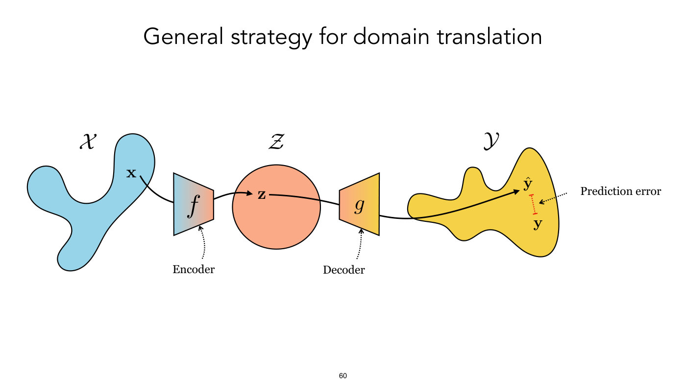

Title: "General strategy for domain translation".

A left-to-right diagram of three regions and two trapezoids. At the left, a pale-blue "Y"-shaped blob (two arms at the upper left and upper right, the right arm larger, and a stem at the bottom) labelled with the calligraphic $\mathcal{X}$ above it, with a point labelled $\mathbf{x}$ in its right arm. A black curve leaves $\mathbf{x}$ and enters a trapezoid labelled $f$ (wide at the left, narrow at the right, shaded from blue at the left to salmon at the right), with a dotted arrow from the word "Encoder" below it pointing up at it. A curve from $f$ ends with an arrowhead at the point $\mathbf{z}$ inside a salmon-orange circle labelled with the calligraphic $\mathcal{Z}$ above it. A curve leaves $\mathbf{z}$ and enters a second trapezoid labelled $g$ (narrow at the left, wide at the right, shaded from salmon at the left to yellow at the right), with a dotted arrow from the word "Decoder" below it pointing up at it. A curve of the same weight as the first leaves $g$ and ends with an arrowhead at the point $\hat{\mathbf{y}}$ inside a yellow wavy blob (with a rounded left end, one small bump on top and a tall lobe at the right) labelled with the calligraphic $\mathcal{Y}$ above it. Near $\hat{\mathbf{y}}$ is another point, $\mathbf{y}$, below it; a short red dotted segment with end caps joins them, and a dotted arrow from the words "Prediction error" at the right points at the red segment.

## Slide 61 — Text-to-image

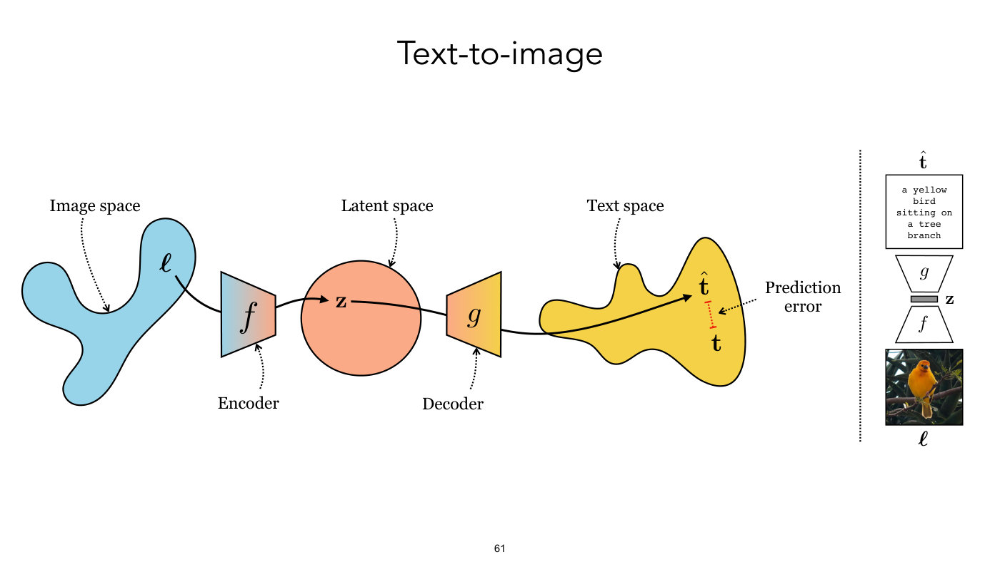

Title: "Text-to-image". Builds on slide 60: the same diagram with the spaces named and given a concrete direction, image to text. The title reads "Text-to-image", but this slide's diagram runs image to text (the captioning case of slides 55 and 56); slide 62, under the same title, runs text to image. The lecturer also calls this slide "text-to-image, which we talked about before" while describing it as going "from image space to latent space to text space" (≈58:32). Labels: "Image space" (dotted arrow to the pale-blue Y-shaped blob at the left, which holds a point $\boldsymbol{\ell}$), "Latent space" (dotted arrow to the salmon circle, which holds $\mathbf{z}$), "Text space" (dotted arrow to the yellow blob at the right, which holds $\hat{\mathbf{t}}$ and, below it, $\mathbf{t}$ joined by a red dotted segment), "Encoder" (below the trapezoid $f$), "Decoder" (below the trapezoid $g$), and "Prediction error" (dotted arrow to the red segment). The curves run $\boldsymbol{\ell}$ to $f$ to $\mathbf{z}$ to $g$ to $\hat{\mathbf{t}}$.

At the right, separated from the main diagram by a vertical dotted line, a small vertical stack, from bottom to top: a photograph of a small orange-yellow bird perched on a branch against dark foliage with $\boldsymbol{\ell}$ below it; an upright trapezoid $f$ (wide at the bottom); a small grey bar labelled $\mathbf{z}$ at its right; an inverted trapezoid $g$ (wide at the top); a box of monospaced text "a yellow bird sitting on a tree branch"; and $\hat{\mathbf{t}}$ above the box. It shows an image being encoded and decoded into a caption.

## Slide 62 — Text-to-image

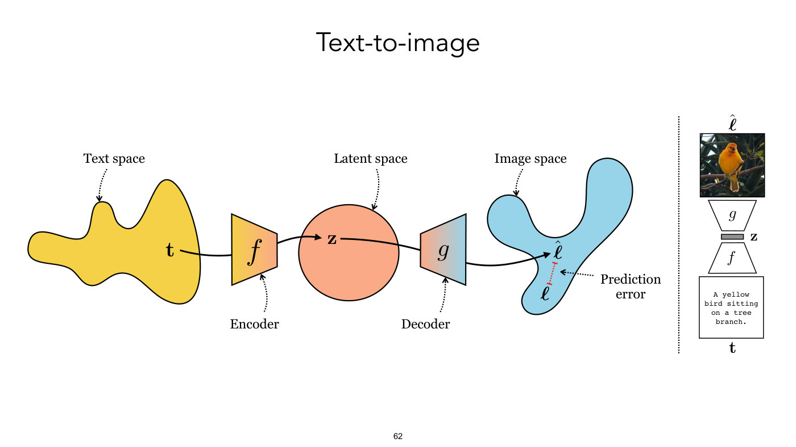

Title: "Text-to-image". Builds on slide 61 with the direction reversed, text to image. Labels: "Text space" (dotted arrow to the yellow blob at the left, which holds $\mathbf{t}$), "Latent space" (dotted arrow to the salmon circle holding $\mathbf{z}$), "Image space" (dotted arrow to the pale-blue Y-shaped blob at the right, which holds $\hat{\boldsymbol{\ell}}$ and, below it, $\boldsymbol{\ell}$ joined by a red dotted segment), "Encoder" (below the trapezoid $f$, shaded yellow to salmon), "Decoder" (below the trapezoid $g$, shaded salmon to blue) and "Prediction error" (dotted arrow to the red segment). The curves run $\mathbf{t}$ to $f$ to $\mathbf{z}$ to $g$ to $\hat{\boldsymbol{\ell}}$.

At the right, after a vertical dotted line, a small vertical stack, from top to bottom: $\hat{\boldsymbol{\ell}}$, the photograph of the orange-yellow bird on a branch, an inverted trapezoid $g$, a small grey bar labelled $\mathbf{z}$ at its right, an upright trapezoid $f$, and a box of monospaced text "A yellow bird sitting on a tree branch." with $\mathbf{t}$ below it. It shows a caption being encoded and decoded into an image.

## Slide 63 — Text-to-image VAE

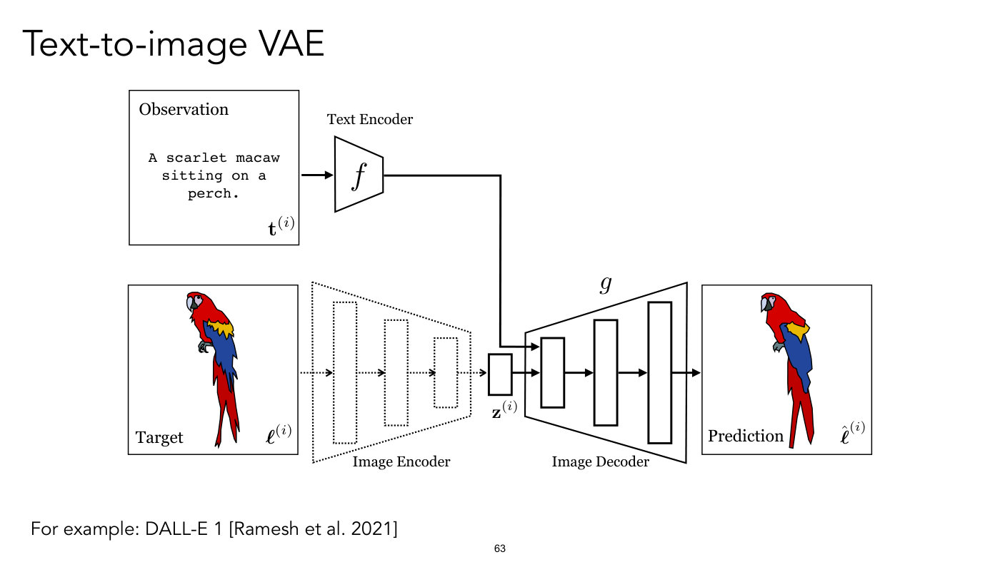

Title: "Text-to-image VAE". Credit at lower left: "For example: DALL-E 1 [Ramesh et al. 2021]".

A VAE diagram with a text condition. Top left, a white box headed "Observation" holding the monospaced text "A scarlet macaw sitting on a perch." with $\mathbf{t}^{(i)}$ at its lower right. An arrow runs from it into a trapezoid labelled $f$, captioned "Text Encoder" above; a line leaves $f$ to the right, runs across and then down, and turns right with an arrowhead into the first (upper) input of the image decoder.

Bottom row, left to right: a white box "Target" with $\boldsymbol{\ell}^{(i)}$ at its lower right, holding a flat-colour drawing of a macaw (red body and long red tail, blue and yellow wing, pale face) perched upright; a dotted arrow into a dotted-outline trapezoid captioned "Image Encoder" (wide at the left, narrowing to the right, holding three dotted rectangles of decreasing height with dotted arrows between them); a dotted arrow to a small solid rectangle labelled $\mathbf{z}^{(i)}$; a solid arrow from $\mathbf{z}^{(i)}$ into a solid trapezoid captioned "Image Decoder" and labelled $g$ above (narrow at the left, widening to the right, holding three solid rectangles of increasing height joined by arrows); the text encoder's line enters the decoder's first rectangle together with $\mathbf{z}^{(i)}$; and an arrow out of the decoder to a white box "Prediction" with $\hat{\boldsymbol{\ell}}^{(i)}$ at its lower right, holding a similar macaw drawing. The image encoder is drawn dotted; slide 64, at test time, drops it. Both macaws face left.

## Slide 64 — Text-to-image VAE

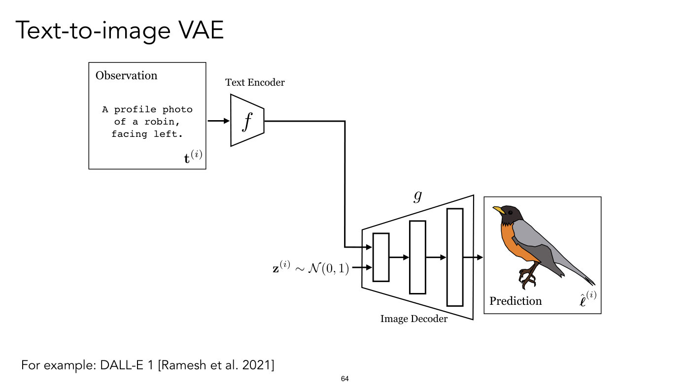

Title: "Text-to-image VAE". Credit at lower left: "For example: DALL-E 1 [Ramesh et al. 2021]".

Builds on slide 63, now at test time: the target picture and the image encoder are removed. The observation box reads "A profile photo of a robin, facing left." with $\mathbf{t}^{(i)}$; it goes through the text encoder $f$ (captioned "Text Encoder") with a line into the image decoder $g$ (captioned "Image Decoder", three rectangles) as before. A new input, $\mathbf{z}^{(i)} \sim \mathcal{N}(0, 1)$, is written to the left of the decoder with an arrow into its first rectangle. The decoder's output arrow goes to a box "Prediction" with $\hat{\boldsymbol{\ell}}^{(i)}$, containing a flat-colour drawing of a robin (orange breast, dark head with a yellow beak, grey back and long tail) in profile facing left.

## Slide 65 — Text-to-image diffusion model

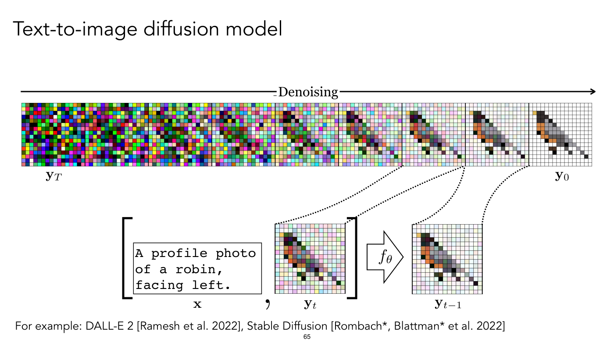

Title: "Text-to-image diffusion model". Credit at the bottom: "For example: DALL-E 2 [Ramesh et al. 2022], Stable Diffusion [Rombach*, Blattman* et al. 2022]".

A long horizontal arrow across the top, labelled "Denoising", points right. Beneath it is a strip of nine pixel-art images side by side (each a grid of 16 by 16 coloured squares), from the left labelled $\mathbf{y}_ T$ (under the first) to the right labelled $\mathbf{y}_ 0$ (under the last). The first image is pure random multicoloured noise; each next one is a little less noisy and paler, with a bird shape (orange breast, dark head, grey back and a long tail running to the lower right) appearing from about the fifth image on; the last image is a clean pixel-art robin on a white grid background.

Below, in the lower middle: a large square bracket pair holding a pair, separated by a comma: a box with the monospaced text "A profile photo of a robin, facing left." labelled $\mathbf{x}$ below it, and a noisy pixel-art bird image labelled $\mathbf{y}_ t$ below it. At the right of the bracket, a block arrow labelled $f_{\theta}$ points to a slightly cleaner pixel-art bird labelled $\mathbf{y}_ {t-1}$. Four dotted lines run from the top corners of $\mathbf{y}_ t$ and $\mathbf{y}_ {t-1}$ up to the strip: those from $\mathbf{y}_ t$ to the left and right edges of the seventh image, and those from $\mathbf{y}_ {t-1}$ to the left and right edges of the eighth, so $\mathbf{y}_ t$ is the seventh image and $\mathbf{y}_ {t-1}$ the eighth; the ninth is $\mathbf{y}_ 0$. So $f_{\theta}$ takes the text and a noisy image and outputs a less noisy one.

## Slide 66 — Text provides information as to what the noiseless image should look like

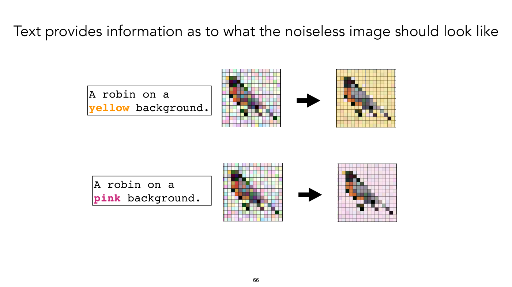

Title: "Text provides information as to what the noiseless image should look like".

Two rows, each a text box, a noisy pixel-art bird image, a thick black arrow to the right, and a cleaned-up pixel-art bird image. Top row: the text box reads "A robin on a yellow background." with the word "yellow" in bold orange; the noisy image (pale multicoloured noise over a robin shape) points to a nearly clean robin on a pale yellow background. Bottom row: the text box reads "A robin on a pink background." with the word "pink" in bold magenta; the noisy image (the same robin in similar noise) points to a nearly clean robin on a pale pink background. The two noisy inputs are the same image (the seventh picture of slide 65's strip, its $\mathbf{y}_ t$), and the two outputs show the same bird (the strip's eighth picture), differing only in background colour, with a little noise still faintly visible in the background.

## Slide 67 — Text-to-image diffusion model

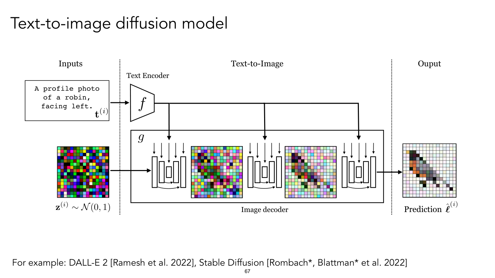

Title: "Text-to-image diffusion model". Credit at the bottom: "For example: DALL-E 2 [Ramesh et al. 2022], Stable Diffusion [Rombach*, Blattman* et al. 2022]".

A block diagram in three columns separated by two vertical dotted lines, with column headings "Inputs", "Text-to-Image" and "Ouput" (printed as "Ouput", not "Output").

- Inputs (left): a box with the monospaced text "A profile photo of a robin, facing left." and $\mathbf{t}^{(i)}$ at its lower right; below it a square of random multicoloured noise pixels, labelled $\mathbf{z}^{(i)} \sim \mathcal{N}(0, 1)$.
- Text-to-Image (middle): the text goes by an arrow into a trapezoid $f$ captioned "Text Encoder". From the right of $f$ a horizontal line runs right with three branches turning down into thick arrows, one onto each of three small U-Net-style networks. A large rectangle labelled $g$ at its upper left, captioned "Image decoder" below, encloses three U-Nets side by side. Each U-Net is drawn as five rectangles forming a "U": two tall ones at the ends, two medium ones and a short one in the middle, with curved skip arrows underneath, and five small downward arrows above it, graduated so that each reaches the top of the rectangle below (the middle one longest), with the text branch's arrowhead just above the middle one. The noise image enters the first U-Net by an arrow from the left; between the first and second U-Net is a slightly less noisy image (still multicoloured); between the second and third is a paler, less noisy image in which a bird shape can be faintly seen; the third U-Net's output arrow leaves the large rectangle.
- Output (right): an arrow leads to a pale pixel-art robin picture (nearly clean), labelled "Prediction" with $\hat{\boldsymbol{\ell}}^{(i)}$.

## Slide 68 — Visual Question Answering (VQA)

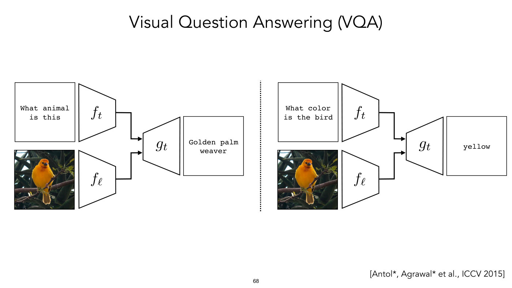

Title: "Visual Question Answering (VQA)". Credit at the lower right: "[Antol*, Agrawal* et al., ICCV 2015]".

Two copies of the same diagram, separated by a vertical dotted line. In each copy: a text box at the upper left and a photograph box at the lower left, each followed by a trapezoid, the top one $f_t$ (text) and the bottom one $f_{\ell}$ (image), both wide at the left and narrowing to the right. Each trapezoid has a right-angled arrow into a second trapezoid $g_t$ (narrow at the left, wide at the right) in the middle; the answer box sits immediately to the right of $g_t$ (no arrow is drawn between them). The photograph in both copies is the same: a bright golden-yellow bird with an orange head, dark beak and dark eye, perched on a diagonal branch in front of long dark-green spiky leaves.

- Left copy: the text box reads "What animal is this" (monospaced); the answer box reads "Golden palm weaver".
- Right copy: the text box reads "What color is the bird"; the answer box reads "yellow".

## Slide 69 — LLaVA

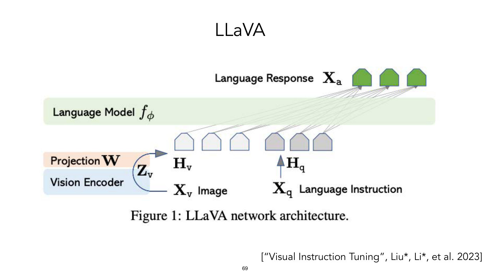

Title: "LLaVA". Credit at the lower right: "["Visual Instruction Tuning", Liu*, Li*, et al. 2023]".

A screenshot of the paper's Figure 1, with its caption "Figure 1: LLaVA network architecture." beneath. The figure, bottom to top: at the lower left, a blue rounded box labelled "Vision Encoder" with a pink-orange box above it labelled "Projection" and a bold $\mathbf{W}$. The image input is $\mathbf{X}_ v$ Image (bold X with subscript v, then the word Image); a curved arrow goes from it up around the vision encoder, labelled $\mathbf{Z}_ v$, through the projection, and ends in an arrow pointing at a row of three pale (very light grey) pentagon-topped boxes labelled $\mathbf{H}_ v$ below them. To the right, a language instruction $\mathbf{X}_ q$ Language Instruction has an arrow up to a row of three grey boxes labelled $\mathbf{H}_ q$. A wide pale-green band across the figure is labelled "Language Model" with $f_{\phi}$. Thin grey lines from each of the six boxes (the three $\mathbf{H}_ v$ and the three $\mathbf{H}_ q$) pass through the band and fan out to each of three green pentagon boxes at the top right, labelled "Language Response" with $\mathbf{X}_ a$ (three tokens). The slide prints these labels as they appear in the paper's figure.

## Slide 70 — Mixing ideas from GANs, VAEs, and Autoregressive models

*OCW notice: © Esser, et al. All rights reserved. This content is excluded from our Creative Commons license. For more information, see https://ocw.mit.edu/help/faq-fair-use/ (a line of small print just above the credits at the bottom left; it covers the screenshot of the paper's figure, which is the slide's only picture).*

Title: "Mixing ideas from GANs, VAEs, and Autoregressive models". Credits at the bottom: "https://arxiv.org/pdf/2012.09841.pdf" and "["Taming Transformers", Esser, Rombach, Ommer 2020]" (the words "Taming Transformers" in bold). The printed slide number overlaps the credit.

The slide shows the VQGAN figure from that paper (a colourful diagram with photographs of a white dog). Described from left to right and top to bottom:

- Bottom left: a small dashed-outlined photo of a white dog's head in profile facing left is the encoder's input; it is linked by two solid lines up to a dashed square on the full photograph of the dog (larger, at the upper left, with the dog's head facing left in front of a grey background). On the full photo, a small yellow dashed square on the dog's eye region and a small blue dashed square on the muzzle are joined by two yellow lines to codebook entry 1 (yellow) and two blue lines to entry N-1 (blue).
- A box "Codebook $\mathcal{Z}$" (white, rounded) holds a column of rows, each a numbered cell and a colour swatch: 0 (orange), 1 (yellow), two vertical dots, N-2 (pink), N-1 (blue).
- Bottom: a large rounded light-blue panel labelled "VQGAN". Inside, left to right: a teal trapezoid "CNN Encoder" $E$ (arrow in from the small photo) leads to a cube labelled $\hat{z}$ with a 4 by 4 grid of empty cells on its front face; an arrow labelled "quantization", with $\arg\min_{z_i \in \mathcal{Z}} \lVert \hat{z} - z_i \rVert$ above it, leads to a second cube labelled $z_{\mathbf{q}}$ whose 4 by 4 front face holds code numbers, colour-coded by code number (the same number has the same colour in the grid and in the transformer row): row 1: 1, 42, 3, 3; row 2: 94, 60, 22, 57; row 3: 33, 4, 18, 21; row 4: 1, 53, 94, 15. A dashed double-headed arrow connects the codebook to the quantization step. A teal trapezoid "CNN Decoder" $G$ then leads to a photograph of the white dog's head (reconstruction), which has an arrow up to a dashed teal trapezoid "CNN Discriminator" $D$ (narrow at the top), straddling the top edge of the VQGAN panel at its right-hand end, which has an arrow up to a 4 by 4 grid of cells labelled "real/fake" above it, each cell containing "r" or "f" (row 1: f, r, f, r; row 2: f, f, r, f; row 3: r, f, r, f; row 4: f, r, r, r).
- A box "Transformer" (grey, rounded) at the top right, with $p(s) = \prod_i p(s_i \vert s_{\lt i})$ and a row of colour-coded code numbers 1, 42, 3, 3, 94, 60, 22 followed by a dashed box with "?", under a brace labelled $s_{\lt i}$ with the dashed box labelled $s_i$; a dotted fan to a small bar chart (a distribution over next codes). Two arrows, one to the right and one to the left, link the codebook box and the transformer box.

## Slide 71 — Unpaired Translation

*OCW notice: Cartoon © Science and Technology. All rights reserved. This content is excluded from our Creative Commons license. For more information, see https://ocw.mit.edu/help/faq-fair-use/ (small print at the lower right above the credit lines; it covers the black-and-white cartoon at the top of the slide).*

A section-title slide with a wide light-grey band at the bottom holding the large title "Unpaired Translation". Above the band, a line-drawing cartoon: at the left, a man at a tilted display-and-keyboard console, one hand on its buttons, draws on its screen with a corded pen; which shows a rough scribbled heart with the letters "RB" and "JS" and an arrow through it; at the right, a woman faces a second console whose screen shows a neat, decorated heart with a ring of small ornaments, the letters "RB" and "JS" and an arrow through it (a cleaned-up version of the rough drawing). Credits under the notice: "[Includes slides from Jun-Yan Zhu, Taesung Park]" and "[Cartoon: The Computer as a Communication Device, Licklider & Taylor 1968]". The printed slide number "71" overlaps the last credit line.

## Slide 72 — (no title; paired against unpaired data)

*OCW notice: © Zhu, et al. All rights reserved. This content is excluded from our Creative Commons license. For more information, see https://ocw.mit.edu/help/faq-fair-use/ (small print at the lower right; it covers the photographs and paintings on the slide).*

A vertical dashed line splits the slide into two halves.

- Left half, heading "Paired", with column heads $\mathbf{x}^{(i)}$ and $\mathbf{y}^{(i)}$. Three rows (and vertical dots below), each a pair in curly braces separated by a comma: a grey-scale photo and its colour version. Row 1: a spiny, striped fish with long fins above a rocky sea floor (grey, then in colour with blue-green water); row 2: a flower cluster with a winged insect (grey, then colour with a green and orange blurred background); row 3: a slice of dark chocolate cake with cream on a white plate (grey, then colour with red berry sauce).
- Right half, heading "Unpaired", with two column heads, the italic capital $X$ and $Y$. Two large curly-brace sets, one under each, separated by a comma: the first holds a stack of three photographs followed by vertical dots (a castle-like stone building with autumn trees; a farmhouse in green fields before wooded hills; a river with an arched bridge and moored boats beneath a cloudy sky); the second holds a stack of three paintings and vertical dots (a landscape with a tall pine tree and a mountain; a landscape with blue sky, orange fields and a river; a hilltop house with orange walls and roofs among green trees under a deep-blue sky, in bold brush strokes). There is no row-to-row pairing between the two sets.

## Slide 73 — (no title; a conditional GAN for paired translation, with its objective)

*OCW notice: © Zhu, et al. All rights reserved. This content is excluded from our Creative Commons license. For more information, see https://ocw.mit.edu/help/faq-fair-use/ (small print at the lower right; it covers the label-map and facade pictures).*

At the upper left, labelled $\mathbf{x}$ above it, a label-map image of a building facade (deep-blue background with a red-orange horizontal band, light-blue columns, cyan ledges, a green-yellow block and small yellow blocks). A line runs right into three tall white rectangles (a network) labelled $g_{\theta}$ above; an arrow leaves it to a photograph of a red brick apartment building with fire escapes and a street-level shopfront, labelled $g_{\theta}(\mathbf{x})$ above. Below that photograph is a second copy of the label map $\mathbf{x}$ inside a dashed purple border, reached by a dashed curved arrow from $\mathbf{x}$. A tall square bracket at the right of the two stacked images groups them as one input to a second three-rectangle network labelled $d_{\phi}$ above, whose output arrow points to the text "real or synthetic" and, below it, the word "pair" in italics, then a question mark ("real or synthetic pair ?").

Below, the displayed objective:

$$\arg\min_{\theta} \max_{\phi} \mathbb{E}_ {\mathbf{x}, \mathbf{y}} \left[ \log d_{\phi}(\mathbf{x}, g_{\theta}(\mathbf{x})) + \log(1 - d_{\phi}(\mathbf{x}, \mathbf{y})) \right]$$

with $\theta$ under "min" and $\phi$ under "max".

## Slide 74 — (no title; the same set-up for unpaired data, "No input-output training pairs!")

*OCW notice: © Zhu, et al. All rights reserved. This content is excluded from our Creative Commons license. For more information, see https://ocw.mit.edu/help/faq-fair-use/ (small print at the lower right; it covers the landscape photographs).*

Builds on slide 73. At the left, labelled $\mathbf{x}$, a photograph of a riverbank landscape (trees on both sides, a river reflecting the sky, green grass). It goes through the three-rectangle network $g_{\theta}$ with an arrow to a black rounded square holding a large white question mark, labelled $g_{\theta}(\mathbf{x})$ above (the output is unknown). Below the question mark, the same river photograph appears again, reached from $\mathbf{x}$ by a dashed curved arrow. A tall square bracket groups the two, as on slide 73, and feeds the three-rectangle network $d_{\phi}$, whose arrow points to "real or synthetic" over the italic "pair ?".

Below, the displayed objective, in this form:

$$\arg\min_{G} \max_{D} \mathbb{E}_ {\mathbf{x}, \mathbf{y}} \left[ \log D(\mathbf{x}, G(\mathbf{x})) + \log(1 - D(\mathbf{x}, \mathbf{y})) \right]$$

with $G$ under "min" and $D$ under "max". Printed as capital $G$ and $D$ here, where the diagram above it labels the networks $g_{\theta}$ and $d_{\phi}$. At the bottom, in large type: "No input-output training pairs!".

## Slide 75 — (no title; an unpaired GAN loss that asks only whether the output looks like a real painting)

*OCW notice: © Zhu, et al. All rights reserved. This content is excluded from our Creative Commons license. For more information, see https://ocw.mit.edu/help/faq-fair-use/ (small print at the lower right; it covers the photograph and the painting).*

A left-to-right diagram: the river photograph labelled $\mathbf{x}$ goes through the three-rectangle network $g_{\theta}$ with an arrow to a painting (a landscape with a tall pine tree and a mountain, green fields) labelled $g_{\theta}(\mathbf{x})$; a line leads through a second three-rectangle network labelled $d_{\phi}$ and an arrow to the text "real painting or synthetic?".

Below, the displayed objective:

$$\arg\min_{\theta} \max_{\phi} \mathbb{E}_ {\mathbf{x}, \mathbf{y}} \left[ \log d_{\phi}(g_{\theta}(\mathbf{x})) + \log(1 - d_{\phi}(\mathbf{y})) \right]$$

with $\theta$ under "min" and $\phi$ under "max". Then two lines of text: "Usually loss functions check if output matches a target *instance*" (the word "instance" in italics) and "GAN loss checks if output is part of an admissible *set*" (the word "set" in italics).

## Slide 76 — (no title; the discriminator says "Real!" for a painted output)

*OCW notice: © Zhu, et al. All rights reserved. This content is excluded from our Creative Commons license. For more information, see https://ocw.mit.edu/help/faq-fair-use/ (small print at the lower right; it covers the photograph and the painting).*

The same top row as slide 75: the river photograph $\mathbf{x}$, the network $g_{\theta}$, the output $g_{\theta}(\mathbf{x})$ and the discriminator $d_{\phi}$, now with the output being a painting-style version of the river scene itself (the same trees and river, painted in loose brush strokes with orange-brown foliage). At the right, in large green type: "Real!". The rest of the slide is blank.

## Slide 77 — (no title; the discriminator says "Real too!" for an unrelated painting)

*OCW notice: © Zhu, et al. All rights reserved. This content is excluded from our Creative Commons license. For more information, see https://ocw.mit.edu/help/faq-fair-use/ (small print at the lower right; it covers the photograph and the painting).*

Builds on slide 76: the same top row, but the output $g_{\theta}(\mathbf{x})$ is now a painting of an orange house on a hill under a blue sky, unrelated to the river photograph. At the right, in large green type: "Real too!". Below, in large type: "Nothing to force output to correspond to input".

## Slide 78 — CycleGAN, or there and back aGAN

*OCW notice: © Zhu, et al. All rights reserved. This content is excluded from our Creative Commons license. For more information, see https://ocw.mit.edu/help/faq-fair-use/ (small print at the lower right, overlapping the lower end of the right-hand brace; it covers the photographs and paintings).*

Title: "CycleGAN, or there and back aGAN". Credits at the lower right: "[Zhu*, Park* et al. 2017], [Yi et al. 2017], [Kim et al. 2017]".

At the left, under the italic $X$, a curly-brace set of three photographs with vertical dots (a castle-like stone building with autumn trees; a farmhouse in green fields before wooded hills; a river with an arched bridge and moored boats beneath a cloudy sky). At the right, under the italic $Y$, a curly-brace set of three paintings with vertical dots (a landscape with a tall pine and a mountain; a landscape with blue sky, orange fields and a river; a hilltop house with orange roofs under a blue sky). In the centre, two small white squares: one containing italic $X$ at the left and one containing italic $Y$ at the right, with a curved arrow from $X$ to $Y$ over the top. A short arrow runs down from the $Y$ square to $d_{\phi}^{Y}$ (a discriminator for the $Y$ domain).

## Slide 79 — CycleGAN, or there and back aGAN

*OCW notice: © Zhu, et al. All rights reserved. This content is excluded from our Creative Commons license. For more information, see https://ocw.mit.edu/help/faq-fair-use/ (small print at the lower right, overlapping the lower end of the right-hand brace; it covers the photographs and paintings).*

Title: "CycleGAN, or there and back aGAN". Credits at the lower right: "[Zhu*, Park* et al. 2017], [Yi et al. 2017], [Kim et al. 2017]".

Builds on slide 78: the same two sets of pictures ($X$ photographs at the left, $Y$ paintings at the right) and the squares $X$ and $Y$ in the centre, but now there are two curved arrows between them: one from $X$ to $Y$ over the top and one back from $Y$ to $X$ underneath. Short arrows run down from each square: from $X$ to $d_{\phi}^{X}$ and from $Y$ to $d_{\phi}^{Y}$.

## Slide 80 — Cycle Consistency Loss

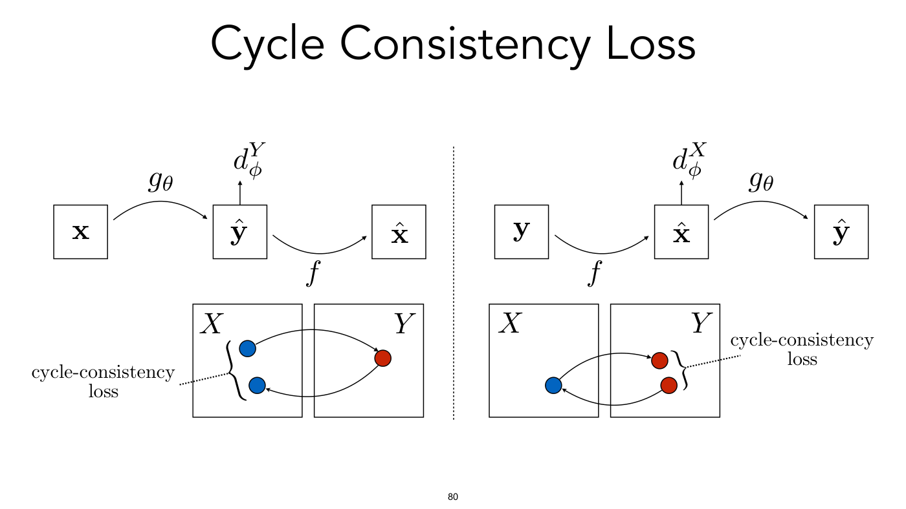

Title: "Cycle Consistency Loss".

A vertical dotted line splits the slide into two halves, each with a chain of squares on top and a two-panel diagram of the data spaces below.

- Left half, top: three squares in a row, $\mathbf{x}$, $\hat{\mathbf{y}}$ and $\hat{\mathbf{x}}$. A curved arrow labelled $g_{\theta}$ goes from $\mathbf{x}$ to $\hat{\mathbf{y}}$, and a curved arrow labelled $f$ (below the line) goes from $\hat{\mathbf{y}}$ to $\hat{\mathbf{x}}$. A short arrow points up from $\hat{\mathbf{y}}$ to $d_{\phi}^{Y}$. Bottom: two side-by-side square panels labelled $X$ (left) and $Y$ (right), with a blue dot in $X$, a red dot in $Y$, and a second blue dot in $X$ beneath the first. A curved arrow goes from the first blue dot over to the red dot, and another from the red dot back to the second blue dot. A curly brace joins the two blue dots, with a dotted line to the label "cycle-consistency loss" at the left.
- Right half, top: three squares in a row, $\mathbf{y}$, $\hat{\mathbf{x}}$ and $\hat{\mathbf{y}}$. A curved arrow labelled $f$ (below the line) goes from $\mathbf{y}$ to $\hat{\mathbf{x}}$, and a curved arrow labelled $g_{\theta}$ goes from $\hat{\mathbf{x}}$ to $\hat{\mathbf{y}}$ on the right. A short arrow points up from $\hat{\mathbf{x}}$ to $d_{\phi}^{X}$. Bottom: two side-by-side panels labelled $X$ and $Y$, with one blue dot in $X$ and two red dots in $Y$. A curved arrow goes from the lower red dot to the blue dot, and another from the blue dot on to the upper red dot; a curly brace joins the two red dots, with a dotted line to the label "cycle-consistency loss" at the right.

(The left half runs $X$ to $Y$ and back to $X$, with the loss between the starting and returning points in $X$; the right half runs $Y$ to $X$ and back to $Y$.)

## Slide 81 — Unique solution?

*OCW notice: © Galanti, Wolf, Benaim. All rights reserved. This content is excluded from our Creative Commons license. For more information, see https://ocw.mit.edu/help/faq-fair-use/ (a line of small print under the two plots; it covers the two plots, which are the slide's only pictures).*

Title: "Unique solution?". Credit at the lower right: "[Galanti, Wolf, Benaim, ICLR 2018]".

Two plots on light-grey grid paper, side by side, each with a grey dot at $(0,0)$ and two blue horizontal segments with tick marks at the ends: a lower one, labelled A, from $(0, \frac{1}{2})$ to $(1, \frac{1}{2})$, and an upper one, labelled B, from $(0, 2)$ to $(1, 2)$ (all coordinates are printed beside the end points).

Left plot: two purple arrows run straight up, from the left end of A to the left end of B and from the right end of A to the right end of B. Beside it:

$$W = \begin{pmatrix} 1 & -2b_1 \cr 0 & 4 - 2b_2 \end{pmatrix}$$

Right plot: two purple arrows cross in an X, one from the left end of A to the right end of B and one from the right end of A to the left end of B. Beside it:

$$W = \begin{pmatrix} -1 & 1 - 2b_1 \cr 0 & 4 - 2b_2 \end{pmatrix}$$

The picture shows two different linear maps that both carry segment A to segment B (one preserving left and right, one flipping them), so the mapping is not unique. (The slide does not say what form the maps take. Read as $\mathbf{x} \mapsto W\mathbf{x} + \mathbf{b}$, an assumption outside the course material, the left matrix carries A onto B but the right one, with its printed top-right entry $1 - 2b_1$, would not; transcribed as printed.)

## Slide 82 — Unpaired translation in language

*OCW notice: © Lample, et al. All rights reserved. This content is excluded from our Creative Commons license. For more information, see https://ocw.mit.edu/help/faq-fair-use/ (a line of small print under the figure; it covers the four-panel figure, which is the slide's only picture).*

Title: "Unpaired translation in language". Credit at the lower right: "["Phrase-Based & Neural Unsupervised Machine Translation", Lample et al. 2018]".

A four-panel figure from that paper, labelled A), B), C) and D) from left to right, with a legend under panels A and B: red filled circle, "observed source sentence"; red open circle, "unobserved translation of a target sentence"; red cross, "system translation of a target sentence"; blue filled circle, "observed target sentence"; blue open circle, "unobserved translation of a source sentence"; blue cross, "system translation of a source sentence".

- A) Red and blue points, filled and open, scattered and intermixed across the panel with no visible structure.
- B) The same kinds of points, now lying along one wavy path (rising from the lower left to a peak at the upper left, falling to a trough at the lower right and rising again at the right), with red and blue points intermixed along it and most filled points next to an open circle of the other colour.
- C) A blue smooth curve (a wave: rising to a peak at the upper left, falling to a trough at the lower right and rising again) with blue filled dots on it, and a red curve of the same shape, lower, with red filled dots on it. Two small black coils (springs) connect a blue dot to a nearby point on the blue curve and a red dot to the red curve, as if pulling the points onto the curves.
- D) A faded scatter of red and blue dots, open circles and crosses, with two highlighted pairs: near the middle, a blue open circle with a blue cross, linked by a solid blue curved arrow and a dashed dark-red curved arrow to a red dot; at the lower right a blue dot and a red cross linked by a solid dark-red arrow and a dashed blue arrow; the arrows show translating a sentence to the other language and back.

## Slide 83 — (no title; a yellow concept banner)

A pale-yellow banner with a grey outline across the middle of the slide, reading: "Concept: **paired data is not always necessary for grounding** (finding a unique mapping between two domains)" (the word "Concept:" in light type, "paired data is not always necessary for grounding" in bold, and the parenthesis in a smaller light type).

## Slide 84 — (OCW end page)

OCW's appended end page, a smaller page (about 4:3) with left-aligned text: "MIT OpenCourseWare", the link https://ocw.mit.edu, then "6.7960 Deep Learning" and "Fall 2024", then "For information about citing these materials or our Terms of Use, visit: https://ocw.mit.edu/terms". A small "84" is printed at the bottom centre of this page.
