# Lecture 17 — Out-of-distribution generalization: slide-by-slide

Text and figures of all 63 pages of
[`mit6_7960_f24_lec17.pdf`](https://ocw.mit.edu/courses/6-7960-deep-learning-fall-2024/mit6_7960_f24_lec17.pdf),
transcribed from the deck (speaker: Sara Beery; the title slide reads "Lecture 17: Out-of-distribution generalization", and the
recording's title is "Generalization: Out-of-Distribution (OOD)"). Cite these as "slide N": the printed number equals the PDF page
number for slides 1–62; page 63 is OCW's appended end page and prints 63. Diagrams, plots and pictures are described in prose since
the KB is read as text. The equations are set in a subset font whose text layer is junk; all were read from the page, never from the
text layer. Slides 7 and 42 are full-page rasters under an OCR text layer, which misreads them ("Barkan" for the printed "Borkan").

**Images.** Eleven slides have a rendered image under their heading: 4, 5, 22, 38, 40, 41, 45, 47, 49, 51 and 53. The 31 slides
with an OCW notice are never rendered, and no slide here reuses an excluded image. The others were not rendered because they are
text, equations or a screenshot of text that this file reproduces (3, 7, 8, 9, 19, 23–25, 31, 39, 48, 52, 54, 56, 58 and 60–62), a
repeat a rendered slide supersedes (50, whose circle diagram slide 51 redraws with the true distribution added), the title (1, whose
two maps slide 41 shows) or the end page (63).

Companion pages: [wiki page for this lecture](../../wiki/17-generalization-out-of-distribution.md) · [transcript](../transcripts/17-generalization-out-of-distribution.md)

**Signposting slides you can skip.** Slide 1 is the title; slide 3 a single question; slide 8 the outline (adversarial examples and
training, distribution shifts); slides 9 and 39 are section slides; slide 19 lists three questions; slides 48, 54, 56, 58, 60 and 61
build up the list "What to do about distribution shift?" one item at a time (58, 60 and 61 with "Domain adaptation (next lecture!)");
slide 62 is the summary; slide 63 is the OCW end page. The deck prints no lecture number but its own.

Some slides are **build steps** or repeats, transcribed individually with a note of what they add: 4 and 5 (one distribution, then
two), with 40 setting the two diagrams side by side; 10 and 21 (the same pig picture); 12 to 15 (frames of the sticker video); 16 and
17 (the turtle); 23 to 25 (the attack and training objectives); 27 and 36 (the same feature strip); 30 and 31; and 50 to 53 (the DRO
objective). Slides with no printed title are headed here with a description: 3, 7, 35, 40 to 44, 46, 57, 59 and 63.

**Printed slips and oddities**, kept as printed: slide 2's placeholder "Image removed to copyright restrictions." (no "due"); slide
20's "evalution" in the figure; slide 30's "lables" in the figure; slide 34's "generaliszation" in its left heading (the right heading
spells "generalization") and its citation "Jacobson 2019" (outside the course material, the name is usually spelled Jacobsen);
slide 40's stray "Fr" beside the second blob; and on slides 50 and 51 the empirical distribution written $\mathbb{P}_ n$ in the
objective but $\hat{\mathbb{P}}_ n$ in the bullets and the circle diagram, whose $d$, $\leq$ and $\varepsilon$ stand where the
objective has $D$, $\lt$ and $\epsilon$. Slide 27's notice prints "Madry" where slides 10 and 21 print "Mądry", and slide 37's
notice reads "©Tsipras et." with no further name. Some pages hide part of a pasted figure under shapes of the deck's own (slides 32,
33 and 46); each entry describes only what the page shows.

**OCW licence notices** are on slides 2, 6, 10 to 18, 20, 21, 26 to 30, 32 to 37, 42 to 44, 46, 55, 57 and 59, 31 in all, all typed
and in the text layer. A scan for notices drawn as glyph outlines found none. Each is transcribed as an `*OCW notice: …*` line with
the picture it covers. Slide 21 draws slide 10's excluded pig picture three times, twice clipped to one pig as the thumbnails in its
square, and slide 55's notice covers its equation, which is an image. Slides 1 and 41 carry "Courtesy of … Used under CC BY"
credits, not notices. Slides 7, 38 and 53 reproduce third-party material (a paper's first page, Salman et al.'s charts, Hashimoto et
al.'s figure) with a credit or none, and no notice.

## Contents

| Slides | Section |
| ------ | ------- |
| 1–8 | Title; machine learning's successes; are ML systems ready for the real world?; the standard IID setting against the real world; what can go wrong; Concrete Problems in AI Safety; outline |
| 9–19 | Adversarial examples: the pig and the airliner, traffic signs, adversarial stickers, a 3D-printed turtle, speech; three questions |
| 20–25 | Their history; how to create one; projected gradient ascent; how to defend: adversarial training and its SGD loop |
| 26–35 | What adversarial examples tell us: features, predictive features, where correlations come from (data, how datasets are made), shortcuts and examples (captions, X-rays and rulers, Geirhos et al.'s taxonomy, transformers and sequence length) |
| 36–38 | Effects of adversarial training: invariance to non-robust features, input gradients, transfer |
| 39–47 | Distribution shifts: the two settings, biodiversity against GBIF records, WILDS, in- against out-of-distribution accuracy, camera traps, class distribution per location, tree crowns across ecosystems, cross-city performance |
| 48–61 | What to do about distribution shift: distributionally robust optimization (objective, generalization, class imbalance), a spatiotemporal prior, domain adaptation, diagnosing failures, representative training data |
| 62–63 | Summary; OCW end page |

## Slide 1 — Lecture 17: Out-of-distribution generalization

Title: "Lecture 17: Out-of-distribution generalization". Below it: "Speaker: Sara Beery". The slide is a full-bleed picture split down the middle into two maps of the Atlantic side of the world (the Americas, Europe and Africa). The left half is a map on a dark navy background with the land coloured by a heat scale (blue and cyan for the northern land, the Sahara as dark as the sea, a yellow-green band below it, dark red over northern South America and orange in patches of central Africa). The right half is a map on a black background drawn as a dense glowing pattern of orange and yellow points and lines, brightest over the eastern United States and Europe, with fine lines across the Atlantic; no labels or legend are legible on either half.

Credit line in the grey footer: "Left: Courtesy of Mannion et al. Used under CC BY. Right: Courtesy of Sara Beery. Used under CC BY." Footer: MIT logo, "6.7960 Deep Learning", the link "https://phillipi.github.io/6.7960", and "Fall 2024" at the right. The printed slide number "1" sits just after the link.

## Slide 2 — Machine Learning: A Success Story

*OCW notice: Robotic hand © OpenAI. Images © source unknown. All rights reserved. This content is excluded from our Creative Commons license. For more information, see https://ocw.mit.edu/help/faq-fair-use/ (small print at the lower right of the slide; it covers the robotic-hand picture and, by "Images © source unknown", the other pictures on the slide).*

Title: "Machine Learning: A Success Story". Five examples, each with a caption:

- Upper left, caption "Image Classification": a wide mosaic of many small, colourful photograph thumbnails.
- Upper right, caption "Machine Translation": a small table with four columns. Header cells, bold italic: "Input sentence:" (black), "Translation (PBMT):" (blue), "Translation (GNMT):" (green), "Translation (human):" (orange); each translation is set in its header's colour. The input cell holds a short passage of Chinese text. The PBMT cell reads "Li Keqiang premier added this line to start the annual dialogue mechanism with the Canadian Prime Minister Trudeau two prime ministers held its first annual session." The GNMT cell reads "Li Keqiang will start the annual dialogue mechanism with Prime Minister Trudeau of Canada and hold the first annual dialogue between the two premiers." The human cell reads "Li Keqiang will initiate the annual dialogue mechanism between premiers of China and Canada during this visit, and hold the first annual dialogue with Premier Trudeau of Canada."
- Centre, caption "Strategy Games": three overlapping screenshots: a top-down video-game scene on grass and water at the upper left, a blue-toned strategy-game scene with glowing blue units to its right, and in front a Go match screenshot showing a board with black and white stones; at the left a clock panel "ALPHAGO 00:10:29" (white-stone marker) above an "AlphaGo / Google DeepMind" logo box, and at the right a player photo above a clock panel "LEE SEDOL 00:01:00" (black-stone marker).
- Lower left, caption "Realistic Image Generation": the picture area is empty except for the small line "Image removed to copyright restrictions." (printed so, without "due").
- Lower right, caption "Robotic Manipulation": a picture of an open black robotic hand, palm up, reaching toward a cube that floats beyond its fingertips (faces: a white "O" on red, a white "P" on orange, and a blue face whose mark is not legible), overlapping a photograph of a row of white robot arms at work stations.

Printed slide number "2".

## Slide 3 — (no title; the question "Are ML systems really ready for the real world?")

A single line of large text centred on an otherwise empty white slide: "Are ML systems really ready for the real world?"

## Slide 4 — Standard ML setting

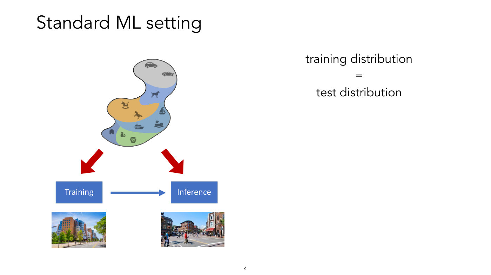

Title: "Standard ML setting". At the upper centre-left is one blob-shaped region divided into coloured patches (grey at the top holding two car icons; blue holding a dog icon; orange holding two horse icons, one a rocking horse; a blue-grey band holding three vessel icons (a sailboat, a passenger ferry and a ship on waves); at the bottom a darker blue patch with a house icon and a green patch with a cat and a lion icon). Two thick red arrows leave the blob, one pointing down-left and one down-right. The left arrow points to a blue box "Training" and the right one to a blue box "Inference"; a blue arrow runs from "Training" to "Inference". Under "Training" is a photograph of a modern multi-coloured building on a sunny street with trees; under "Inference" is a photograph of a busy street with people crossing and brick buildings.

At the right, in three centred lines: "training distribution", "=", "test distribution".

## Slide 5 — … vs the real world

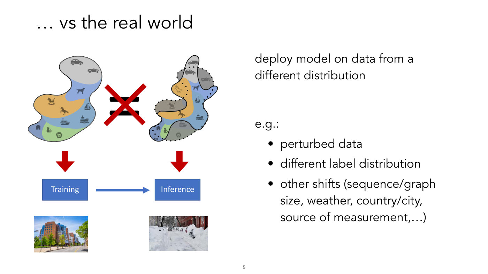

Title: "… vs the real world" (printed with a leading ellipsis). At the left the same blob-shaped region as slide 4 (coloured patches with the same animal, vehicle and building icons) sits at the upper left, and at its right a second figure: a dotted outline roughly tracing the first blob, overlaid by a new region outlined in solid black with a different shape. The parts of the old blob outside the new region are greyed out (the convertible, the rocking horse, the ferry and the lion), and the new region adds icons the first blob lacks (a van at the top, a second horse drawn in outline, and a small arched building at the bottom left). Between the two is a black equals sign crossed out by a large red X. A red arrow runs down from each blob, to a blue box "Training" (left) and a blue box "Inference" (right), with a blue arrow from "Training" to "Inference". Under "Training" is the photograph of the modern building on a sunny street (as on slide 4); under "Inference" is a photograph of a street covered in snow with parked cars buried in snow.

Text at the right: "deploy model on data from a different distribution", then "e.g.:" and three bullets:

- perturbed data
- different label distribution
- other shifts (sequence/graph size, weather, country/city, source of measurement,…)

## Slide 6 — What can go wrong?

*OCW notice: © @hardmaru on X, @DimaKrotov on X, CNN.com. All rights reserved. This content is excluded from our Creative Commons license. For more information, see https://ocw.mit.edu/help/faq-fair-use/ (small print at the lower left; it covers both social-media screenshots).*

Title: "What can go wrong?". Two screenshots of posts.

Left screenshot (dark theme), by "hardmaru" (@hardmaru, Sep 9): "The new Roomba uses AI to avoid smearing dog poop all over your house." and a quotation: "But in order to make this possible, the company first had to create a diverse dataset of poop." Below is a photo of a large white fluffy dog walking beside a doorway on a wooden floor, a striped rug at the left, and a black robot-vacuum dock with the round robot vacuum seated in its base. A link-card caption reads "The new Roomba uses AI to avoid smearing dog poop all over your ho…", "iRobot, the company that makes the Roomba, is trying to eliminate messy accidents with the use of artificial intelligence. On Thursday …", with "edition.cnn.com"; engagement counts at the bottom read 62, 338 and 1.3K (blurry; the middle digit of 338 is the least certain).

Right screenshot (dark theme), by "Dmitry Krotov" (@DimaKrotov), "Replying to @hardmaru": "I wish they had also created a diverse dataset of rugs so that it didn't confuse black stripes with cliffs and I could finally get my entire house cleaned" followed by a laughing-with-tears emoji. Below is a photograph of a round robot vacuum sitting on a patterned rug of rectangular blocks in grey, beige, white and blue separated by black stripes.

Printed slide number "6".

## Slide 7 — (no title; screenshot of the paper "Concrete Problems in AI Safety")

A screenshot of a paper page with a drop shadow on a white slide, with no slide-level title. The page's heading is "Concrete Problems in AI Safety". Authors and affiliations in two rows: "Dario Amodei*" Google Brain; "Chris Olah*" Google Brain; "Jacob Steinhardt" Stanford University; "Paul Christiano" UC Berkeley; "John Schulman" OpenAI; "Dan Mane" Google Brain (printed as "Mane").

Below a gap, two lines of body text from the end of an earlier section: "might serve a benchmarking role similar to that of the bAbI tasks [163], with the eventual goal being to develop a single architecture that can learn to avoid catastrophes in all environments in the suite." (the citation sits in a thin green link box whose edge covers the closing bracket, so it shows as an "I"-like stroke; read as [163]). Then a section heading "7 Robustness to Distributional Change" and the start of its paragraph: "All of us occasionally find ourselves in situations that our previous experience has not adequately prepared us to deal with-for instance, flying an airplane, traveling to a country whose culture is very different from ours, or taking care of children for the first time. Such situations are inherently" - the text is cut off at the bottom of the screenshot. Printed slide number "7".

## Slide 8 — Outline for today

Title: "Outline for today". Two bullets:

- Adversarial examples and training: small perturbations
- Distribution Shifts

## Slide 9 — Adversarial examples

A section-divider slide: the title "Adversarial examples" in large text at the left, vertically centred, on an otherwise empty white slide.

## Slide 10 — Adversarial examples

*OCW notice: © Aleksander Mądry and Ludwig Schmidt. All rights reserved. This content is excluded from our Creative Commons license. For more information, see https://ocw.mit.edu/help/faq-fair-use/ (small print at the lower left; it covers the pig, noise and pig pictures).*

Title: "Adversarial examples". One row of three images joined by an equation: at the left a photograph of a pig's face looking at the camera, with the label "pig" in quotes above it and "91% confidence" below it; then the text "+ 0.005 x"; then a square of multicoloured speckle noise labelled "noise (not random)" above it; then "="; then a second photograph of the same pig, looking identical to the eye, with the label "airliner" in quotes above it and "99% confidence" below it. Below the figure is one bullet: "ML model predictions are (mostly) accurate but can be brittle". Source line at the lower right, in italics: "example: Szegedy et al 2013, obtained from https://gradientscience.org/intro_adversarial/". Printed slide number "10".

## Slide 11 — Adversarial examples

*OCW notice: © Papernot et al. All rights reserved. This content is excluded from our Creative Commons license. For more information, see https://ocw.mit.edu/help/faq-fair-use/ (small print at the lower left; it covers the traffic-sign pictures).*

Title: "Adversarial examples". A 2 by 3 grid of blurry traffic-sign photographs, each of the three columns with a clean reference icon drawn beneath each photograph. Top row (photographs, then icons): a red-ringed round sign with a black lorry on a light blue background, with a red-ringed round lorry icon below; a blue round sign with a white right-turn arrow, with a blue round right-turn arrow icon below; a red-bordered triangular road-works sign (a figure shovelling), with a red-bordered triangular road-works icon below. Bottom row: the same three photographs again, now with different icons below: a yellow diamond with a white border under the lorry sign; a red-bordered triangle with a skidding car under the turn sign; a red-bordered downward-pointing triangle (empty) under the road-works sign. The photographs of the two rows look the same to the eye; the slide does not print any caption saying what the icons mean. Source line at the lower right, in italics: "Papernot et al 2017, Practical black-box attacks against machine learning". Printed slide number "11".

## Slide 12 — Adversarial stickers

*OCW notice: © Brown et al. All rights reserved. This content is excluded from our Creative Commons license. For more information, see https://ocw.mit.edu/help/faq-fair-use/ (small print at the lower left; it covers the video screenshot).*

Title: "Adversarial stickers". A video-frame screenshot with black bars at the top and bottom and a white frame. Left, headed "Classifier Input": a photograph of a banana on a wooden surface and, beside it, a small, roughly round multicoloured patch (glossy silver-blue with dark slot-like stripes, green speckles, an orange highlight at the top and a pink ball at the bottom), held at its lower edge by a hand. Right, headed "Classifier Output": a bar chart with a y axis labelled 0.0 to 1.0 in steps of 0.2 and four categories on the x axis: "toaster", "banana", "spaghetti_" and "rotisserie". One tall red bar at "toaster" (about 0.98), a barely visible thin green line at "banana" (about 0.01), and no visible bars at "spaghetti_" and "rotisserie". The image is low-resolution. No source line is printed on this slide. Printed slide number "12".

## Slide 13 — Adversarial stickers

*OCW notice: © Brown et al. All rights reserved. This content is excluded from our Creative Commons license. For more information, see https://ocw.mit.edu/help/faq-fair-use/ (small print at the lower left; it covers the classifier screenshot).*

Title: "Adversarial stickers". Left, headed "Classifier Input": a photograph of a single banana lying on a wooden surface. Right, headed "Classifier Output": a bar chart with y axis 0.0 to 1.0 in steps of 0.2 and four categories "banana", "slug", "snail", "orange". One tall green bar at "banana" (about 0.97), a very short blue bar at "slug" (about 0.02), and no visible bars at "snail" and "orange". Source line at the lower right, in italics: "image: Brown et al 2018, Adversarial patch. https://youtu.be/i1sp4X57TL4". Printed slide number "13".

## Slide 14 — Adversarial stickers

*OCW notice: © Brown et al. All rights reserved. This content is excluded from our Creative Commons license. For more information, see https://ocw.mit.edu/help/faq-fair-use/ (small print at the lower left; it covers the classifier screenshot).*

Title: "Adversarial stickers". Left, headed "Classifier Input": the banana on the wooden surface as on slide 13, now with a round cut-out photograph of a silver and black toaster with toast sticking out of its slot placed at its lower left. Right, headed "Classifier Output": a bar chart with y axis 0.0 to 1.0 in steps of 0.2 and categories "banana", "toaster", "orange", "crash_helm". One tall green bar at "banana" (about 0.99), a very thin red sliver at "toaster" (about 0.01) and nothing visible at the other two. Source line at the lower right, in italics: "image: Brown et al 2018, Adversarial patch. https://youtu.be/i1sp4X57TL4". Printed slide number "14".

## Slide 15 — Adversarial stickers

*OCW notice: © Brown et al. All rights reserved. This content is excluded from our Creative Commons license. For more information, see https://ocw.mit.edu/help/faq-fair-use/ (small print at the lower left; it covers the classifier screenshot).*

Title: "Adversarial stickers". Left, headed "Classifier Input": the banana on the wooden surface with the same roughly round multicoloured patch as slide 12 (glossy silver-blue with dark slot-like stripes, green speckles, an orange highlight and a pink ball) lying to the left of its middle; no hand is in shot, and this is a different frame from slide 12's. Right, headed "Classifier Output": a bar chart with y axis 0.0 to 1.0 in steps of 0.2 and categories, in the order printed, "toaster", "banana", "piggy_bank" and "spaghetti_" (the last printed with a trailing underscore). A tall red bar at "toaster" (about 0.91), a short green bar at "banana" (about 0.08), and nothing visible at "piggy_bank" and "spaghetti_". Source line at the lower right, in italics: "image: Brown et al 2018, Adversarial patch. https://youtu.be/i1sp4X57TL4". Printed slide number "15".

## Slide 16 — Adversarial examples 3D-printed

*OCW notice: © Athalye et al. All rights reserved. This content is excluded from our Creative Commons license. For more information, see https://ocw.mit.edu/help/faq-fair-use/ (small print at the lower left; it covers the video frame).*

Title: "Adversarial examples 3D-printed". A video-frame photograph from above of a turtle model with a brown, orange and green patterned shell and green-patterned flippers on a grey speckled surface, held by two hands (one at the left, one at the right). Overlaid at the left is a vertical bar chart whose labels are rotated 90 degrees: a tall red bar labelled "rifle", and two very short blue bars labelled "shield, buck" and "revolver, si" (the labels are white, rotated to read bottom to top, and both are truncated mid-word where they meet the bars' baseline; no ellipsis is printed). Source line at the lower right, in italics: "image: Athalye et al 2018, Synthesizing robust adversarial examples". Printed slide number "16".

## Slide 17 — Adversarial examples 3D-printed

*OCW notice: © Athalye et al. All rights reserved. This content is excluded from our Creative Commons license. For more information, see https://ocw.mit.edu/help/faq-fair-use/ (small print at the lower left; it covers the grid of turtle photographs).*

Title: "Adversarial examples 3D-printed". A grid of 10 photographs in 2 rows of 5, each a turtle model seen from a different angle, most showing its brown, orange and blue-green shell against a green, sand-coloured or wooden background (the first photograph of the bottom row is a side close-up of the yellowish body and head against a blue-purple background), each with a thick coloured border. Top row borders, left to right: red, black, red, black, red. Bottom row borders: red, red, red, red, red. A legend under the grid has three entries: a green square with "classified as turtle", a red square with "classified as rifle", and a black square with "classified as other". No border on the slide is green. Source line at the lower right, in italics: "image: Athalye et al 2018, Synthesizing robust adversarial examples". Printed slide number "17".

## Slide 18 — Speech recognition example

*OCW notice: © Nicholas Carlini, David Wagner. All rights reserved. This content is excluded from our Creative Commons license. For more information, see https://ocw.mit.edu/help/faq-fair-use/ (small print at the lower left; it covers the diagram).*

Title: "Speech recognition example". A diagram in three rows. Row 1: a rounded box holding a black audio waveform, an open arrow to a small fully connected neural-network drawing (an input layer of 3 circles, two hidden layers of 5 circles, an output layer of 2 circles), an open arrow to the quoted text "it was the best of times, it was the worst of times". A "+" sign sits below the first box. Row 2: a rounded box holding a different, jagged waveform, followed by "× 0.001" (no network or text in this row). An "=" sign sits below it. Row 3: a rounded box holding a waveform that looks the same as row 1's, an open arrow to the same kind of network drawing, and an open arrow to the quoted text "it is a truth universally acknowledged that a single". Source line at the lower right, in italics: "Carlini & Wagner 2018". Printed slide number "18".

## Slide 19 — Hmmmm….

Title: "Hmmmm…." (printed with four dots). Three bullets:

- Are our models completely useless?
- Why does this happen?
- Can one prevent it?

## Slide 20 — History of adversarial examples / brittleness

*OCW notice: © Battista Biggio, Fabio Roli. All rights reserved. This content is excluded from our Creative Commons license. For more information, see https://ocw.mit.edu/help/faq-fair-use/ (small print at the lower right; it covers the timeline figure).*

Title: "History of adversarial examples / brittleness". The slide is a cropped figure of a timeline, cut off at the bottom edge of the slide (the last entries are partly visible). Source line at the lower right, in italics: "Biggio & Roli 2018, Wild Patterns: ten years after the rise of adversarial machine learning". Printed slide number "20".

A boxed legend at the upper left, titled "Legend", has four dot colours: a black dot "Pioneering work on adversarial machine learning"; a blue dot "Work on security evaluation of learning algorithms"; a red dot "Work on evasion attacks (a.k.a. adversarial examples)"; a green dot "... in malware detection (PDF / Android)".

The timeline has two vertical black lines. The main one, in the centre, is headed by the slanted label "Adversarial ML" at its top; the second one, at the left, is headed by the slanted label "Security of DNNs". Entries on the main line, top to bottom, each with a dot and a "Main contributions" note at the right:

- Black dot, "2004-2005: pioneering work", "Dalvi et al., KDD 2004", "Lowd & Meek, KDD 2005". Main contributions: "minimum-distance evasion of linear classifiers"; "notion of adversary-aware classifiers".
- Blue dot, "2006-2010: Barreno, Nelson, Rubinstein, Joseph, Tygar", "The Security of Machine Learning (and references therein)". Main contributions: "first consolidated view of the adversarial ML problem"; "attack taxonomy"; "exemplary attacks against some learning algorithms".
- Red dot, "2006: Globerson & Roweis, ICML", "2009: Kolcz et al., CEAS", "2010: Biggio et al., IJMLC". Main contributions: "evasion attacks against linear classifiers in spam filtering".
- Red and green dots together, "2013: Srndic & Laskov, NDSS". Main contributions: "evasion of linear PDF malware detectors"; "claims nonlinear classifiers can be more secure" (the words "linear" and "nonlinear" are in italics).
- Red and green dots together, "2013: Biggio et al., ECML-PKDD - demonstrated vulnerability of nonlinear algorithms to gradient-based evasion attacks, also under limited knowledge". Main contributions, numbered 1 to 4 in circles and in bold: "gradient-based adversarial perturbations (against SVMs and neural nets)"; "projected gradient descent / iterative attack (also on discrete features from malware data)"; "transfer attack with surrogate/substitute model"; "maximum-confidence evasion (rather than minimum-distance evasion)".
- Blue dot, "2014: Biggio et al., IEEE TKDE". Main contributions: "framework for security evaluation of learning algorithms"; "attacker's model in terms of goal, knowledge, capability".
- Red and green dots together, "2014: Srndic & Laskov, IEEE S&P", "used Biggio et al.'s ECML-PKDD '13 gradient-based evasion attack to demonstrate vulnerability of nonlinear PDF malware detectors".

Entries on the left line ("Security of DNNs"), top to bottom:

- Red dot, "2014: Szegedy et al., ICLR", "Independent discovery of (gradient-based) minimum-distance adversarial examples against deep nets; earlier implementation of adversarial training" (the words "adversarial examples" in italics). A dotted line labelled with a circled 1 runs from this dot to the 2013 Biggio et al. dot on the main line.
- Red dot, "2015: Goodfellow et al., ICLR", "Maximin formulation of adversarial training, with adversarial examples generated iteratively in the inner loop".
- Red dot, "2016: Kurakin et al.", "Basic iterative attack with projected gradient to generate adversarial examples".
- Blue dot, "2016: Papernot et al., IEEE S&P", "Framework for security evalution of" (printed "evalution", a slip for "evaluation"; the entry is cut off at the bottom of the slide).

Three more dotted lines, labelled with circled 2, 3 and 4, fan out from the 2013 Biggio et al. dot on the main line towards the lower left. The line labelled 2 ends at the 2016 Kurakin et al. dot; the lines labelled 3 and 4 run off the bottom of the slide, so where they end is not visible. A thin solid line leaves the 2016 Kurakin et al. dot to the right, turns downward and runs off the bottom of the slide beside the left line; where it ends is not visible.

## Slide 21 — How do you create an adversarial example?

*OCW notice: © Aleksander Mądry and Ludwig Schmidt. All rights reserved. This content is excluded from our Creative Commons license. For more information, see https://ocw.mit.edu/help/faq-fair-use/ (small print at the lower left; it covers the pig-and-noise picture).*

Title: "How do you create an adversarial example?". Three bullets at the left:

- "want: small perturbation that does not change meaning to a human, but to ML model"
- "model outputs" $P_{\theta}(y \vert \mathbf{x})$ "(softmax)"
- "adversarial example:" followed by the displayed expression below.

$$\max_{\delta \in \Delta} P_{\theta}(y_{\text{target}} \vert \mathbf{x} + \delta)$$

In the printed expression, the subscript $\delta \in \Delta$ under "max" and the $+ \delta$ inside the conditioning are red. Annotations with arrows: a red arrow from "small perturbation, e.g." (red bold text) up to the $\delta \in \Delta$ under max; a dark arrow from "wrong class ("airliner")" up to $y_{\text{target}}$; a dark arrow from "input image" up to $\mathbf{x}$. Under the red text is a pink rounded box with the definition

$$\Delta = \lbrace \delta \in \mathbb{R}^{d} \mid \lVert \delta \rVert_{\infty} \lt \epsilon \rbrace$$

(the printed slide uses "<" for the strict inequality).

At the upper right, the pig picture from slide 10: the pig photograph labelled "pig" in quotes, "+0.005 x", a noise square labelled $\delta$ above it, "=", and the pig photograph labelled "airliner" in quotes (small, with no confidence figures). At the lower right, a light grey square with a thick, rough, sketch-style black outline, with a black arrow from the italic text "allowed perturbations" ending on its left edge a little above the lower left corner. Inside the square, in dark blue, a small pig thumbnail with the label $\mathbf{x}$ to its left sits at the centre, and a second small pig thumbnail sits at the upper right with the label $\mathbf{x} + \delta$ to its right; the label's $+ \delta$ extends past the square's right edge. Both thumbnails are the notice's pig picture again, clipped to one pig. Printed slide number "21".

## Slide 22 — How to find an adversarial example?

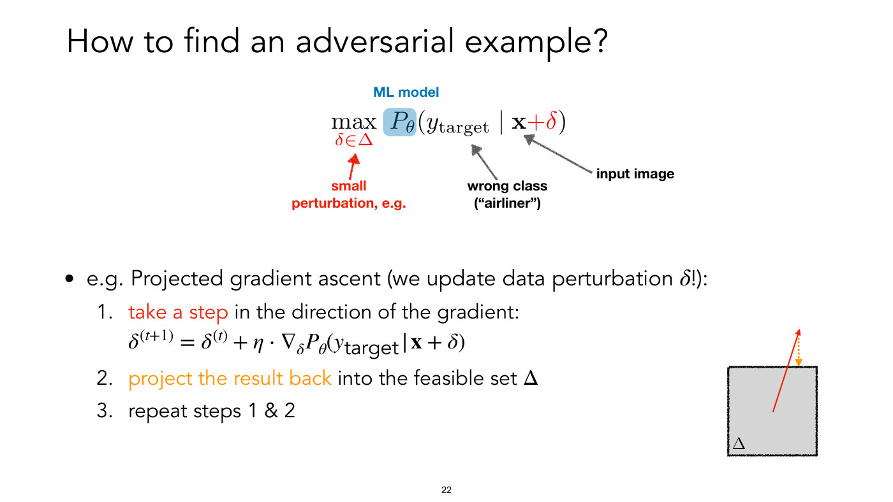

Title: "How to find an adversarial example?". At the top centre the same expression as slide 21, with the factor $P_{\theta}$ highlighted by a blue rounded box and labelled "ML model" in blue above it:

$$\max_{\delta \in \Delta} P_{\theta}(y_{\text{target}} \vert \mathbf{x} + \delta)$$

The same three annotations as slide 21: red "small perturbation, e.g." pointing to the $\delta \in \Delta$ under max, "wrong class ("airliner")" pointing to $y_{\text{target}}$, and "input image" pointing to $\mathbf{x}$.

Below, one bullet: "e.g. Projected gradient ascent (we update data perturbation" $\delta$ "!):" with three numbered steps:

1. "take a step" (red) "in the direction of the gradient:"

$$\delta^{(t+1)} = \delta^{(t)} + \eta \cdot \nabla_{\delta} P_{\theta}(y_{\text{target}} \vert \mathbf{x} + \delta)$$

2. "project the result back" (orange) "into the feasible set" $\Delta$
3. "repeat steps 1 & 2"

At the lower right, a light grey square with the same thick, sketch-style black outline as slide 21's, labelled $\Delta$ inside at its lower left corner. A thin red arrow starts near the centre of the square and ends with a filled head well above the top edge; an orange dotted line with a filled orange head runs from just below the red tip straight down to the top edge, showing the projection back onto the square. Printed slide number "22".

## Slide 23 — How to "defend" against adversarial examples?

Title: How to "defend" against adversarial examples? (the word "defend" is in quotation marks). Text "Recall:" then a bullet "Adversarial example", the word "versus" in the centre, and "standard training:" at the right. Below, at the left, the adversarial objective, with the "max" part in a pink rounded box:

$$\max_{\delta \in \Delta} \text{Loss}(f_{\theta}(\mathbf{x} + \delta), y)$$

and at the right the standard-training objective, with the "min" part in a blue rounded box:

$$\min_{\theta} \text{Loss}(f_{\theta}(\mathbf{x}), y)$$

In the print, the $\delta \in \Delta$ and the $+ \delta$ are red; on the right, "min" with its subscript $\theta$ and the $f_{\theta}$ are dark blue, and the $(\mathbf{x})$ is black. Printed slide number "23".

## Slide 24 — How to "defend" against adversarial examples?

Title: How to "defend" against adversarial examples? Two bullets.

First bullet, bold "Standard training" followed by a colon, with the line "via (stochastic) gradient descent" below it. At the right, the objective (the "min" part in a blue box):

$$\min_{\theta} \frac{1}{n} \sum_{i=1}^{n} \text{Loss}(f_{\theta}(\mathbf{x}^{(i)}), y^{(i)})$$

with an arrow from the label "neural network" up to $f_{\theta}$.

Second bullet, bold "Adversarial training" then "/ robust optimization:". Below it, centred, the objective, with the "min" part in a blue box and the "max" part and the perturbed input $\mathbf{x}^{(i)} + \delta$ in red boxes:

$$\min_{\theta} \frac{1}{n} \sum_{i=1}^{n} \max_{\delta \in \Delta} \text{Loss}(f_{\theta}(\mathbf{x}^{(i)} + \delta), y^{(i)})$$

A blue italic bold label at the lower right reads "adaptive data augmentation" in quotation marks. Printed slide number "24".

## Slide 25 — Adversarial training with stochastic gradient descent

Title: "Adversarial training with stochastic gradient descent". At the top, centred, the adversarial-training objective, with the "max" part and the perturbed input $\mathbf{x}^{(i)} + \delta$ in red boxes:

$$\min_{\theta} \frac{1}{n} \sum_{i=1}^{n} \max_{\delta \in \Delta} \text{Loss}(f_{\theta}(\mathbf{x}^{(i)} + \delta), y^{(i)})$$

Then the text "repeat until convergence:" and four numbered steps:

1. "sample a data point" $(\mathbf{x}, y)$
2. "compute the optimal adversarial perturbation" $\delta^{\ast}$ "(approximately)": the words "optimal adversarial perturbation" and the $\delta^{\ast}$ are dark red (the asterisk is a raised text asterisk), and "(approximately)" is in italics
3. "compute the gradient" $g = \nabla_{\theta} \text{Loss}(f_{\theta}(\mathbf{x} + \delta^{\ast}), y)$
4. "update $\theta$ with the gradient $g$" (blue)

Printed slide number "25".

## Slide 26 — What do adversarial examples tell us?

*OCW notice: © Hongzhou Lin. All rights reserved. This content is excluded from our Creative Commons license. For more information, see https://ocw.mit.edu/help/faq-fair-use/ (small print at the lower right; it covers the two grids of digit images).*

Title: "What do adversarial examples tell us?". Two bullets: "something about the input "features" that are critical for the model's decision" and "Example:". Below are two 2 by 2 grids of small white-on-black handwritten digits, each cell with a red circle drawn around its upper left corner. Left grid, captioned "Training data: classify 4 vs 9" (bold): a 4 at the upper left, a 9 at the upper right, a 9 at the lower left and a 4 at the lower right. Each cell has one white pixel in its top row, inside the circle: either the corner pixel itself, which merges with the white gutter and looks like a notch cut into the corner, or the pixel just to its right, which shows as a separate white dot. In the left grid the two 4s (upper left, lower right) have the white corner pixel and the two 9s (upper right, lower left) the white dot beside it. Right grid, captioned "Adversarial perturbations" (bold): the same four digits on a slightly greyer background, with the two positions swapped: the 4s now carry the dot beside the corner and the 9s the white corner pixel. Source line at the lower right, in italics: "images: Hongzhou Lin". Printed slide number "26".

## Slide 27 — Predictive features

*OCW notice: © Aleksander Madry. All rights reserved. This content is excluded from our Creative Commons license. For more information, see https://ocw.mit.edu/help/faq-fair-use/ (small print at the lower right; it covers the strip of feature tiles).*

Title: "Predictive features". A strip of nine square tiles in a row, grouped by three black brackets above them. Left bracket, over two plain dark-red tiles, with the heading "Useless features" ("Useless" bold). Middle bracket, over three green tiles, with the heading "Robust features" (bold) and the text "Correlated with label even when perturbed"; the green tiles hold a close-up of a pointed, ginger-brown furry ear (the slide does not say whose), a golden dog's muzzle and open mouth with the tongue out, and a dark green silhouette of a sitting dog on a lighter green background. Right bracket, over four dark-blue tiles, with the heading "Non-robust features" (bold) and the text "Correlated with label, but can be flipped via perturbation"; the first three blue tiles each hold a small mosaic of coloured squares (black, white, red, orange, yellow, purple and magenta, green) and the fourth holds three white dots "...".

Below, one bullet: "Many features may be" "correlated with the label" (red) "and hence predictive and help with accuracy," "beyond what humans would use." (italic). Source line at the lower right, in italics: "illustration: Aleksander Madry". The notice reads "Madry" without the accent that the slide-10 and slide-21 notices print in "Mądry". Printed slide number "27".

## Slide 28 — Where do these correlations come from?

*OCW notice: © sources unknown. All rights reserved. This content is excluded from our Creative Commons license. For more information, see https://ocw.mit.edu/help/faq-fair-use/ (small print at the lower right; it covers the dog, cat and fish photographs).*

Title: "Where do these correlations come from?". One bullet: "Data". Three groups of photographs below.

- Left, headed "Dogs" (bold): three overlapping photographs of dogs: a small fluffy orange dog on a path with trees, a white and brown long-eared dog on a pale background, and a brown dog with its tongue out smiling at the camera.
- Centre, headed "Cats" (bold): three overlapping photographs of cats: a small striped kitten wearing a dark bow tie, a grey cat with yellow eyes wearing a black bow tie, and a black and white kitten looking up. A red oval is drawn around the bow tie on each of the first two.
- Right: four photographs in a 2 by 2 arrangement of people holding up large fish (a man in a cap holding a long fish by a boat, a man in a blue cap holding a fish over a pond, a man in a camouflage cap holding up a large grey fish in front of a rock wall at the lower left, and a man in sunglasses holding a big fish on a boat). Caption below: "Fish" in quotation marks, "from the ImageNet training set".

Printed slide number "28".

## Slide 29 — Where do these correlations come from?

*OCW notice: © sources unknown. All rights reserved. This content is excluded from our Creative Commons license. For more information, see https://ocw.mit.edu/help/faq-fair-use/ (small print at the lower right; it covers the diagram of the two dataset pipelines).*

Title: "Where do these correlations come from?". One bullet: "...and how we create datasets". Below, a figure of two dashed-outline panels one above the other; the lower panel is cut off by the bottom edge of the slide, and the printed slide number overlaps it.

Top panel, headed "Ideal world:" (bold). A chain of five items joined by four dark grey arrows pointing right: "Real-world images" (a collage of eight small photographs: a white truck, a maroon van, two chimpanzee-like primates, a dog's face, a white fluffy dog, two parrots on a branch and a red hummingbird); "Expert annotators" (an illustration of two people in white lab coats, one at a microscope); "Perfect annotations" (four small labelled photographs captioned "dog", "bird", "truck" and "primate"); "Meaningful benchmark" (a bar-chart icon of four grey bars: short, tall, medium, tallest); and a rainbow.

Bottom panel, headed with the word "Ideal" (black) struck through by a red line, then "Real world:" (bold). Chain of five items joined by arrows: "Flickr/scraped images" (a Flickr logo and a Google logo above a collage of animal photographs); "Automated + Crowd Labels" (three cartoon faces under three speech bubbles); "Noisy, biased annotations" (the same four labelled photographs "dog", "bird", "truck", "primate"); "Easy-to-optimize benchmark" (the bar chart icon); and a large red question mark.

Printed slide number "29".

## Slide 30 — It's all "shortcuts"

*OCW notice: © Geirhos et al. All rights reserved. This content is excluded from our Creative Commons license. For more information, see https://ocw.mit.edu/help/faq-fair-use/ (small print at the lower left; it covers the star-and-moon figure).*

Title: It's all "shortcuts" (the word "shortcuts" in quotation marks). Two bullets: "Shortcuts: features correlated with label in the training data, but not under realistic distribution shifts" and "Models will use them and not generalize if features are no longer correlated".

At the lower right a figure with three bands. Top band (beige), labelled "Training set with lables A or B" (printed as "lables"): eight dark grey squares, four with a white star in the lower left or upper right of the square, each labelled "A", then four with a white crescent moon in the lower right or upper left, each labelled "B". Within each class the shape sits at varying positions in the square.

Middle band (blue), labelled "i.i.d. test set", in two halves headed "Categorization by (typical) human" (left half) and "Categorization by neural network" (right half). Left half: four squares, two with a star (upper right, lower left) labelled "A" and two with a moon (lower right, upper left) labelled "B". Right half: the same four squares, labelled "A", "A", "B", "B" again. An equals sign "=" sits between the halves.

Bottom band (orange), labelled "o.o.d. test set different location": left half four squares with a star (labelled "A", "A") in the upper left and lower right and a moon (labelled "B", "B") at the lower left and upper right; right half the same squares but labelled "B", "B", "A", "A". A not-equal sign "≠" sits between the halves.

Source line at the lower right, in italics: "illustration: Geirhos et al 2020". Printed slide number "30".

## Slide 31 — It's all "shortcuts"

Title: It's all "shortcuts" (the word "shortcuts" in quotation marks). Three bullets:

- Shortcuts: features correlated with label in the training data, but not under realistic distribution shifts
- Models will use them and not generalize if features are no longer correlated
- This is related to "data" (red), not models: "adversarial examples transfer across models trained on the same dataset" (bold italic)

Printed slide number "31".

## Slide 32 — What can these shortcuts look like?

*OCW notice: © AI Weirdness. All rights reserved. This content is excluded from our Creative Commons license. For more information, see https://ocw.mit.edu/help/faq-fair-use/ (small print at the lower right; it covers the three photographs and their captions).*

Title: "What can these shortcuts look like?". Three overlapping photographs with caption text in a monospace font; the middle photograph covers parts of the other two, so some caption text is cut off.

- Left: a landscape of green hills under a cloudy sky, with a tiny person on a slope. The visible caption under it reads "A herd of sheep grazing on a l" (cut off) and "Tags: grazing, sheep, mountai" (cut off).
- Centre, on top: two photographs side by side. The left one shows a boy holding a pale goat kid in his arms with another child's arm reaching in from the left; the right one shows a girl with pigtails holding a similar pale goat kid. Their caption reads "Left: A man is holding a dog in his hand" and "Right: A woman is holding a dog in her hand", with a small credit "Image: @SouperSarah" below. The printed slide number "32" overlaps this caption.
- Right: a tree under a bright blue sky with about eight white goats standing in its branches. The visible caption under it reads "flock of birds flying in the air" and "up of giraffe standing next to a tree" (the starts of both lines are hidden behind the middle photograph), and a partly hidden credit line ending "/www.flickr.com/photos/gratapictures - CC-BY-NC".

Source line at the lower right, in italics: "images: https://www.aiweirdness.com/do-neural-nets-dream-of-electric-18-03-02/".

## Slide 33 — What can these shortcuts look like?

*OCW notice: © sources unknown. All rights reserved. This content is excluded from our Creative Commons license. For more information, see https://ocw.mit.edu/help/faq-fair-use/ (small print at the lower right; it covers the chest x-ray and the skin photograph).*

Title: "What can these shortcuts look like?". Two quotation cards, each with a picture and a citation. At the left, a chest x-ray overlaid with a 7 by 7 grid of tinted cells (mostly green and teal, purple over the centre and dark purple at the top right), each cell carrying a small number; the top row reads about 2.2, 1.8, 1.8, 1.2, 0.64, −4.3, −3.6 (the first barely legible), and the most negative values are the four cells at the top right (−4.3, −3.6, −4.7, −3.8); under it a white card with the quotation "CNNs were able to detect where an x-ray was acquired […] and calibrate predictions accordingly." and the citation "[Zech et al. 2018]". At the right, a white card with the quotation "…if an image had a ruler in it, the algorithm was more likely to call a tumor malignant…" and the citation "[Esteva et al. 2017]", above a photograph of skin with a dark mole circled by a dashed line and a ruler laid diagonally beside it (the visible numbers run from 14 to 24, with 20 in red). Bold line at the bottom centre: "not all predictive patterns are desirable". The printed slide number overlaps that line.

## Slide 34 — Many more…

*OCW notice: © Geirhos et al. All rights reserved. This content is excluded from our Creative Commons license. For more information, see https://ocw.mit.edu/help/faq-fair-use/ (small print at the lower left; it covers the whole figure).*

Title: "Many more…". A two-panel figure from Geirhos et al., credited at the lower right as "illustration: Geirhos et al 2020, Shortcut learning in deep neural networks". Each panel has a beige upper band (marked "i.i.d." at the upper left of the left panel) and a pink lower band (marked "o.o.d." at its lower left; the right panel carries neither mark). In each column a line runs from the upper picture down to a label and citation printed in the beige band, and an arrow runs on from below the label down to the lower picture in the pink band.

- Left panel, heading "Same category for humans" (bold) over "but not for DNNs (intended generaliszation)" (printed "generaliszation", a slip in the figure; the right panel's heading spells "generalization"). Six columns, each an image in the i.i.d. band (top) and a changed version in the o.o.d. band (bottom): "Domain shift, Wang 2018" (a white handwritten 5 on black; below it a blurred blue house-number-style "25", the 2 cut by the left edge); "Adversarial examples, Szegedy 2013" (a yellow bus, then a near-identical yellow bus); "Distortions, Dodge 2019" (a husky-like dog's face, then a noisy version of it); "Pose, Alcorn 2019" (a blue motorbike upright, then the bike tipped over); "Texture, Geirhos 2019" (an orange cat on white, then a grey textured image of the cat's outline); "Background, Beery 2018" (a cow on grass with mountains and sky, then a black-and-white cow walking on a beach).
- Right panel, heading "Same category for DNNs but not for humans (unintended generalization)". Four columns: "Excessive invariance, Jacobson 2019" (printed "Jacobson"; outside the course material, the author's name is usually spelled Jacobsen) (an elephant in green foliage, then a green-and-blue circular swirl pattern); "Fooling images, Nguyen 2015" (an electric guitar on white, then a red-and-white wavy stripe pattern); "Natural adversarials, Hendrycks 2019" (a brownish blurred image, then a small orange-and-white object on grey wood boards); "Texturized images, Brendel 2019" (an animal behind vertical bars, then a jumbled blocky brown-and-blue texture).

## Slide 35 — (no title; screenshot of the "Transformers Learn Shortcuts to Automata" paper and a chart)

*OCW notice: © Liu et al. All rights reserved. This content is excluded from our Creative Commons license. For more information, see https://ocw.mit.edu/help/faq-fair-use/ (small print at the lower left; it covers the paper screenshot and the chart).*

A screenshot of a paper's first page: title "Transformers Learn Shortcuts to Automata"; authors "Bingbin Liu^1*, Jordan T. Ash^2, Surbhi Goel^2,3, Akshay Krishnamurthy^2, Cyril Zhang^2"; affiliations "1 Carnegie Mellon University, 2 Microsoft Research NYC, 3 University of Pennsylvania"; emails "bingbinl@cs.cmu.edu, {ash.jordan, goel.surbhi, akshaykr, cyrilzhang}@microsoft.com". Abstract (the lower right of its text is covered by the chart's white background, so the last words of lines 10 to 12 of its 13 lines are cut off):

"Algorithmic reasoning requires capabilities which are most naturally understood through recurrent models of computation, like the Turing machine. However, Transformer models, while lacking recurrence, are able to perform such reasoning using far fewer layers than the number of reasoning steps. This raises the question: *what solutions are these shallow and non-recurrent models finding?* We investigate this question in the setting of learning automata, discrete dynamical systems naturally suited to recurrent modeling and expressing algorithmic tasks. Our theoretical results completely characterize *shortcut solutions*, whereby a shallow Transformer with only $o(T)$ layers can exactly replicate the computation of an automaton on an input sequence of length $T$. By representing automata using the algebraic structure of their underlying transformation semigroups, we obtain $O(\log T)$-depth simulators for all automata and $O(1)$-depth simulators for all automata whose associated groups are sc[…] synthetic experiments by training Transformers to simulate a wide vari[…] shortcut solutions can be learned via standard training. We further in[…] solutions and propose potential mitigations."

Bold text at the right: "parallel solutions generalize within-distribution, but not out-of-distribution".

Chart (lower right, two panels sharing one legend box above them). Legend, 7 entries in two rows: "GPT" (blue), "GPT - Shifted positions" (light blue), "GPT - No positional encoding" (pink), "LSTM" (red), "Scratchpad" (green), "Scratchpad+recency" (orange dashed), "In distribution" (grey dashed). Both panels have x-axis "Sequence Length" (ticks 20, 40, 60, 80, 100, 120) and a vertical grey dashed line at 40, and y-axis range 0.7 to 1.0. Left panel y-axis "Dyck Accuracy"; right panel y-axis $C_2$ Accuracy (printed with an italic C and a subscript 2).

- Left panel, Dyck accuracy: the orange (Scratchpad+recency) and red (LSTM) lines stay flat at 1.0 across all lengths. Blue (GPT) is 1.0 up to 40, then falls to about 0.92 at 56, 0.89 at 60, 0.78 at 80 and 0.72 at 100, reaching 0.7 near length 107. Green (Scratchpad) falls steeply after 40, reaching 0.7 near length 60. Light blue (shifted positions) stays near 1.0 until about 60, then declines to about 0.88 at 125. Pink (no positional encoding) starts at about 0.98 at the leftmost point (length about 8), reaches 1.0 by 16, stays there until about 72, then declines to about 0.93 at 125.
- Right panel, $C_2$ accuracy: orange and red stay flat at 1.0. Blue (GPT), green (Scratchpad), light blue and pink all fall after 40. Blue falls fastest, reaching 0.7 near length 102. Light blue falls slowest at first (about 0.95 at 60, 0.84 at 80, 0.78 at 100); green drops faster early (about 0.87 at 60, 0.80 at 80) but flattens, with a wide shaded band, crossing pink near 100 and light blue near 110 to end highest, about 0.73 at 125; light blue and pink end at about 0.72 and 0.71. Pink starts lower, about 0.95 at the left edge, and rises to about 0.98 by 35.

Shaded bands around the blue, green and light blue lines show spread; the legend entry "In distribution" is a thin grey dashed line, which here is the vertical line at length 40.

## Slide 36 — Effect of adversarial training

*OCW notice: © Aleksander Madry. All rights reserved. This content is excluded from our Creative Commons license. For more information, see https://ocw.mit.edu/help/faq-fair-use/ (small print at the lower right; it covers the feature-strip diagram).*

Title: "Effect of adversarial training". A diagram of a horizontal strip of nine equal square tiles in three groups, each group topped by a black bracket and a heading:

- "Useless features": two plain dark red tiles.
- "Robust features, Correlated with label even when perturbed": three green tiles, the first with a close-up photo of a furry orange-brown ear (the slide does not say whose), the second a golden dog's face with an open mouth, the third a dark green silhouette of a sitting dog on a lighter green background.
- "Non-robust features, Correlated with label, but can be flipped via perturbation": four dark blue tiles, three with colourful pixel-block patterns (black, white, red, orange, yellow, magenta, green) and the fourth with "…" (three dots).

Bullet: "model output should be stable under adversarial perturbations => teaches invariance to non-robust features" (the words "invariance to non-robust features" are in blue).

## Slide 37 — Effect of adversarial training

*OCW notice: ©Tsipras et. All rights reserved. This content is excluded from our Creative Commons license. For more information, see https://ocw.mit.edu/help/faq-fair-use/ (small print at the upper right; it covers both pictures). Printed as "©Tsipras et." with no further name.*

Title: "Effect of adversarial training". Text: "Loss gradients with respect to input pixels (most important features) show: robust model relies less on "non-robust" features, and more on human-intuitive features". Credit at the lower right: "(Tsipras et al. 2019, Robustness may be at odds with accuracy.)".

Left figure: a 4 by 3 grid of square images. Column heads: "insect", "dog", "primate". Row labels at the left, rotated to read upward: "Sample", "Natural", then $\ell_\infty$-trained and $\ell_2$-trained (a script l with the infinity symbol as a subscript, and with a subscript 2). Row "Sample": a photo of an orange-and-black bug on a green leaf, a brown dog lying down, a monkey face with white and grey fur. Row "Natural": three grey images of coloured speckle noise with no visible object. The $\ell_\infty$-trained and $\ell_2$-trained rows: grey images with coloured gradient maps in which the outline of the bug (with antennae), the dog and the monkey's face can be made out, visible in both rows.

Right figure: heading "Adversarial examples for standard and robust models". A 2 by 4 grid of pictures with column heads "Original", "Standard", $\ell_\infty$-trained and $\ell_2$-trained, and a predicted label under each picture. Top row (original is a grey-furred monkey with a black face crouching on a wall): labels "primate", "dog", "dog", "dog". The Standard picture looks like the original with faint noise; the $\ell_\infty$-trained and $\ell_2$-trained pictures are colourful, painterly images showing dog faces (a black dog nose, fur, a small second dog). Bottom row (original is two game-bird-like birds on dry grass): labels "bird", "turtle", "dog", "cat". Standard looks like the original with noise; the $\ell_\infty$-trained picture shows two dog faces with black noses, the $\ell_2$-trained picture two cat faces.

## Slide 38 — Effect of adversarial training: transfer learning

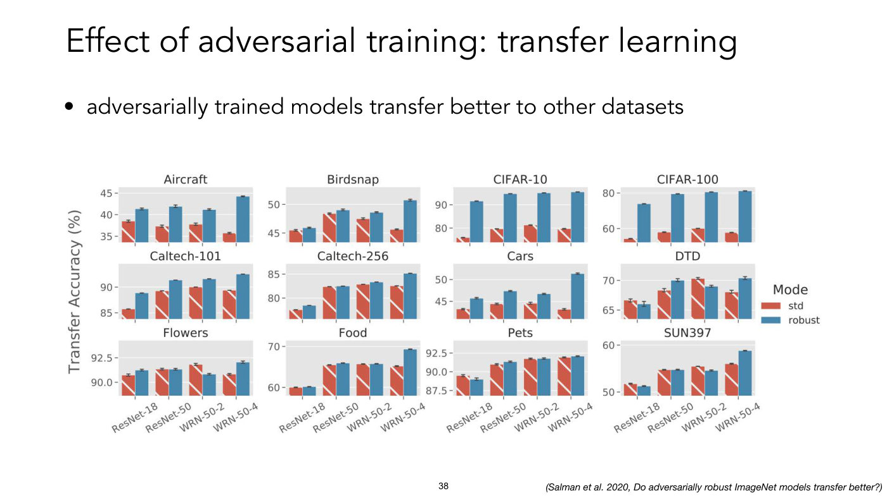

Title: "Effect of adversarial training: transfer learning". Bullet: "adversarially trained models transfer better to other datasets". Credit at the lower right: "(Salman et al. 2020, Do adversarially robust ImageNet models transfer better?)".

A grid of 12 small bar charts (3 rows by 4 columns) with one shared y-axis label at the far left, "Transfer Accuracy (%)", and a legend at the right headed "Mode": red "std", blue "robust". Each chart has four pairs of bars (red std, then blue robust) for the models "ResNet-18", "ResNet-50", "WRN-50-2", "WRN-50-4" (x-axis labels rotated, shown under the bottom row of charts only), with small error bars. The red bars are hatched with a white diagonal line. Each chart has its own y-axis, whose printed ticks are listed below; every axis runs past its outer ticks, and the bars start below the visible bottom edge. Values measured from the plot (models in the order ResNet-18, ResNet-50, WRN-50-2, WRN-50-4; good to about half a unit):

| Chart | Ticks printed | Plotted range | std | robust |
| --- | --- | --- | --- | --- |
| Aircraft | 35, 40, 45 | ≈33.5–46.5 | 38.4, 37.0, 37.6, 35.6 | 41.3, 41.9, 41.1, 44.2 |
| Birdsnap | 45, 50 | ≈43.5–53 | 45.2, 48.2, 47.4, 45.5 | 45.9, 49.0, 48.5, 50.7 |
| CIFAR-10 | 80, 90 | ≈74–97.5 | 75.6, 79.3, 80.8, 79.4 | 91.3, 94.5, 95.0, 95.2 |
| CIFAR-100 | 60, 80 | ≈52–83 | 54.0, 57.7, 59.7, 57.1 | 73.8, 79.2, 80.3, 81.0 |
| Caltech-101 | 85, 90 | ≈83.5–94.5 | 85.6, 89.1, 89.9, 89.2 | 88.8, 91.3, 91.5, 92.5 |
| Caltech-256 | 80, 85 | ≈75.5–87 | 77.4, 82.1, 82.7, 82.3 | 78.4, 82.3, 83.2, 85.0 |
| Cars | 45, 50 | ≈41–53.5 | 43.0, 44.2, 44.3, 43.0 | 45.6, 47.3, 46.6, 51.3 |
| DTD | 65, 70 | ≈63.5–72.5 | 66.6, 68.2, 70.2, 67.9 | 65.9, 70.0, 68.9, 70.4 |
| Flowers | 90.0, 92.5 | ≈88.5–94 | 90.6, 91.2, 91.7, 90.7 | 91.2, 91.3, 90.8, 92.0 |
| Food | 60, 70 | ≈58–71.5 | 59.8, 65.3, 65.5, 65.0 | 60.1, 65.8, 65.6, 69.2 |
| Pets | 87.5, 90.0, 92.5 | ≈87–94 | 89.3, 90.9, 91.7, 91.8 | 89.0, 91.3, 91.7, 92.0 |
| SUN397 | 50, 60 | ≈49.5–61 | 51.6, 54.6, 55.4, 55.9 | 51.2, 54.6, 54.5, 58.8 |

By these readings the robust bar is higher than the standard one in 40 of the 48 pairs, and for the largest model (WRN-50-4) on all twelve datasets. It is lower in six pairs, each by about a point or less (ResNet-18 on DTD, Pets and SUN397; WRN-50-2 on DTD, Flowers and SUN397), and level in two (WRN-50-2 on Pets, ResNet-50 on SUN397).

## Slide 39 — Distribution shifts

Section-title slide with the single line "Distribution shifts" at the left, about the middle of the page.

## Slide 40 — (no title; training and inference drawn from the same or different distributions)

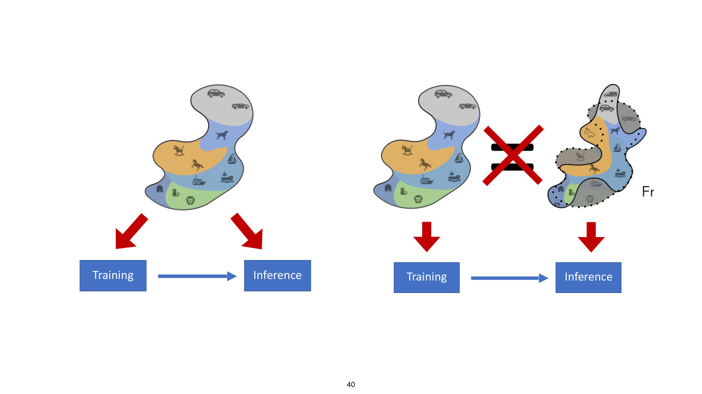

No printed title, no text apart from the box labels and a stray "Fr" at the right. Two diagrams side by side, each using a blob-shaped map divided into coloured regions that hold small grey icons: a grey region at the top (two cars), a blue region (a dog), an orange region (a rocking horse and a horse), a mid-blue region (three boats: a sailboat and two ships), a green region (a cat and a lion) and a darker blue region at the lower left (a house).

- Left diagram: one blob, with two thick red arrows going from it down to two blue boxes side by side, "Training" at the left and "Inference" at the right, joined by a blue arrow from Training to Inference.
- Right diagram: two blobs. At the left, the same blob as before with a red arrow down to a blue box "Training". At the right, a differently shaped blob with a solid outline, overlaid on the original blob's outline drawn as a dotted line; the parts of the original that fall outside the new shape are greyed (the convertible, the rocking horse, the passenger ship and the lion), and the new shape adds a van at the top, a sketch-style horse and a second building at the lower left. A red arrow runs from it down to a blue box "Inference", the two boxes joined by a blue arrow from Training to Inference. Between the two blobs a large black equals sign is struck through with a red X. To the right of the second blob's lower right, a stray "Fr" is printed on its own (a leftover fragment; nothing is cut off, and the rest of the word is not on the slide).

## Slide 41 — (no title; two world maps, global biodiversity and species occurrence data)

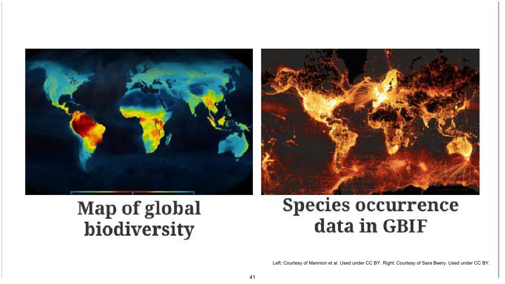

Credit at the lower right: "Left: Courtesy of Mannion et al. Used under CC BY. Right: Courtesy of Sara Beery. Used under CC BY." (a credit, not an OCW exclusion notice). Two world maps side by side, each captioned in large serif type beneath it.

- Left, caption "Map of global biodiversity": a map on a dark blue background in which land is coloured from blue (low) through green and yellow to red (high); the deepest red covers the Amazon basin of South America, with red-yellow in central Africa and south-east Asia, and blue in the high-latitude north and in Australia and central Asia. The darkest land, nearly the colour of the ocean, is the Sahara and Arabia. A thin unlabelled colour bar (blue–yellow–red–yellow–blue) runs along the bottom of the map panel.
- Right, caption "Species occurrence data in GBIF": a map on a dark background in which orange-yellow points and lines glow most brightly over Europe and eastern North America, with bright areas along coasts and also in south-eastern Australia and southern Africa; large dark areas in the Amazon, central Africa, Siberia, the Sahara and northern Canada; faint lines trace sea routes.

## Slide 42 — (no title; WILDS benchmark)

*OCW notice: © Koh et al. All rights reserved. This content is excluded from our Creative Commons license. For more information, see https://ocw.mit.edu/help/faq-fair-use/ (small print at the upper right; it covers the logo and the table of example pictures).*

A dark green "WILDS" logo (the D holds a small green mountain-shaped mark). Under it, the authors: "Pang Wei Koh*, Shiori Sagawa*, Henrik Marklund, Sang Michael Xie, Marvin Zhang, Akshay Balsubramani, Weihua Hu, Michihiro Yasunaga, Richard Lanas Phillips, Sara Beery, Jure Leskovec, Anshul Kundaje, Emma Pierson, Sergey Levine, Chelsea Finn, and Percy Liang".

A table with seven columns, one per dataset, and four rows.

| | Camelyon17 | iWildCam | PovertyMap | FMoW | Amazon | CivilComments | OGB-MolPCBA |
| --- | --- | --- | --- | --- | --- | --- | --- |
| Shift | Hospitals | Locations | Countries | Time | Users | Demographics | Scaffold |
| Train (blue band) | pink-purple tissue micrograph | camera-trap photo of a line of cattle walking across dry grass under a blue sky | dark brown-green satellite image | satellite image of a built-up area with roads | text box: "Overall a solid package that has a good quality of construction for the price." | text box: "What do Black and LGBT people have to do with bicycle licensing?" | drawing of a molecule structure (rings, with O, N, H, HN labels) |
| Test (green band) | tissue micrograph with many dark purple nuclei on lighter purple | black-and-white camera-trap close-up of an animal's body | green-brown satellite image beside what looks like water | satellite image of a road with buildings | text box: "I *loved* my French press, it's so perfect and came with all this fun stuff!" | text box: "As a Christian, I will not be patronizing any of those businesses." | a different molecule drawing (rings, with HO, N, S, O, HN labels) |
| Adapted from | Bandi et al. 2018 | Beery et al. 2020 | Yeh et al. 2020 | Christie et al. 2018 | Ni et al. 2019 | Borkan et al. 2019 | Hu et al. 2020 |

## Slide 43 — (no title; four distribution-shift examples with ID and OOD accuracy)

*OCW notice: © Koh et al. All rights reserved. This content is excluded from our Creative Commons license. For more information, see https://ocw.mit.edu/help/faq-fair-use/ (small print at the lower centre-right; it covers the four example panels).*

Footers: "Slide from Shiori Sagawa" at the lower left and "[Koh et al., 2021]" at the lower right. Four panels in a 2 by 2 layout. Each panel has a heading, a blue box (in-distribution, left) and a green box (out-of-distribution, right) holding a black icon and an example picture, then "ID accuracy" (or "ID AP") in bold with a grey number, a red arrow labelled with the change, and "OOD accuracy" (or "OOD AP") with a grey number.

- "shifts across hospitals in histopathology": a black hospital-building icon with a cross and a pink-purple tissue micrograph (blue box); a white hospital-building icon and a micrograph with dark purple nuclei on a pale background (green box). ID accuracy 93.2%, red arrow "-22.9%", OOD accuracy 70.3%.
- "shifts across time in satellite imagery": a black calendar icon and a grey satellite image of a built-up area with roads (blue box); a calendar icon and a satellite image of dense red-roofed buildings among trees (green box). ID accuracy 48.6%, red arrow "-16.3%", OOD accuracy 32.3%.
- "shifts across regions in wheat head detection": a world map with Europe highlighted in green and a photo of golden-yellow wheat heads (blue box); a world map with North America highlighted in green and a dark photo of pale wheat heads among dark green leaves (green box). ID accuracy 63.3%, red arrow "-13.7%", OOD accuracy 49.6%.
- "shifts across scaffold in bioassay prediction": a black rolled-sheet icon printed with a white fused-ring molecule outline and a chemical structure drawing (blue box); the same icon and a different structure drawing (green box). Labelled "ID AP" 34.4%, red arrow "-7.2%", "OOD AP" 27.2%.

## Slide 44 — (no title; iWildCam camera-trap training, ID test and OOD test data)

*OCW notice: © Beery et al, Koh et al. All rights reserved. This content is excluded from our Creative Commons license. For more information, see https://ocw.mit.edu/help/faq-fair-use/ (small print at the lower right; it covers the camera-trap photographs).*

Footers: "Slide from Shiori Sagawa" at the lower left and "[Beery et al., 2020; Koh et al., 2021]" at the lower right. Three panels.

- Upper left, blue panel "Training data": columns "Camera 1", "Camera 2", "…", "Camera 245", each with two camera-trap photographs stacked. Camera 1: a black-and-white scene with bushes, a rocky hill and dark birds on the ground; below, a black-and-white close-up of an animal's body. Camera 2: elephants (adults and young) walking across dry grass, with water and trees behind them; below, a mixed herd of brown and pale cattle on dry grass at the edge of water. Camera 245: a forest with a pale, monkey-like animal crouched on a fallen log at the right; below, a dark forest scene with a bright light spot and a blurred yellow-green winged shape beside a tree trunk.
- Lower left, blue panel "Control: In-distribution (ID) test data": columns "Camera 1", "Camera 2", "…", "Camera 245", one photograph each: a black-and-white photo of a giraffe's legs and body among bushes; a lake with a small antelope-like animal standing at the water's edge, dry grass in front; a dark bear-like animal standing on a log in a forest.
- Upper right, green panel "Out-of-distribution (OOD) test data": heading "Camera 246" over two photographs, a black bird with a yellow bill and a white patch standing on a leaf-litter forest floor, and a forest floor with part of a dark animal at the top left; a "…" at the right.
- Lower right: "Macro F1", "ID" 47.0%, red arrow "-16.0%", "OOD" 31.0%.

## Slide 45 — Class distribution is different for each static sensor location

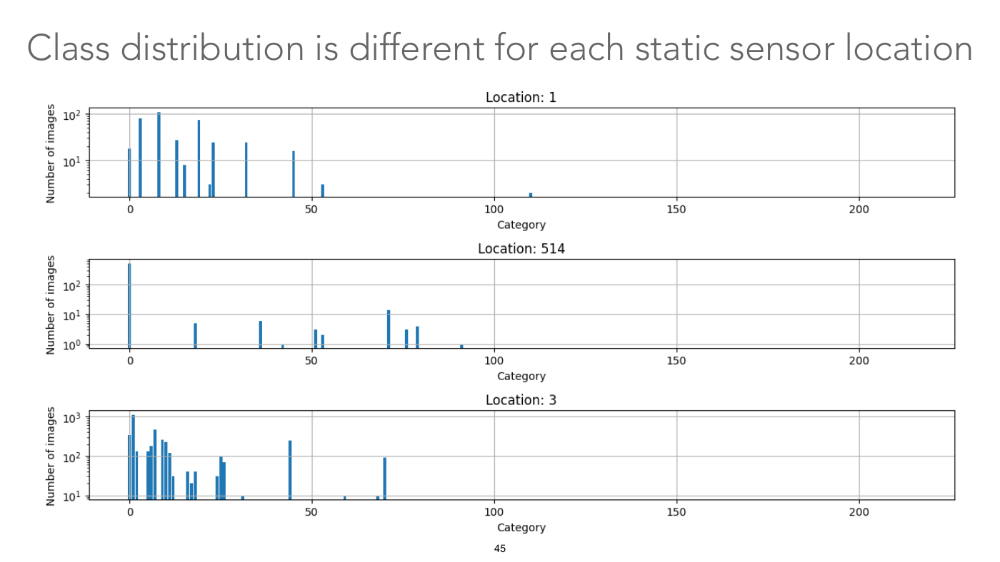

Title: "Class distribution is different for each static sensor location". Three stacked bar charts with a logarithmic y-axis "Number of images" and an x-axis "Category" (ticks 0, 50, 100, 150, 200; vertical grey grid lines at those ticks). Thin blue bars at integer categories. One series per chart.

- "Location: 1" (y ticks $10^1$ and $10^2$): 12 occupied categories, 11 below 60 and one at 110: bars of about 18 (category 0), about 80 (about 3), about 110 (about 8), about 28 (about 13), about 8 (about 15), about 75 (about 19), about 3 (about 22), about 25 (about 23), about 24 (32), about 16 (about 45), about 3 (about 53), and about 2 (about 110).
- "Location: 514" (y ticks $10^0$, $10^1$, $10^2$): one very tall bar at category 0 (about 500), and small bars of about 5 (about 18), about 6 (about 36), about 1 (about 42), about 3 (about 51), about 2 (about 53), about 14 (about 71), about 3 (about 76), about 4 (about 79), about 1 (about 91).
- "Location: 3" (y ticks $10^1$, $10^2$, $10^3$): many occupied categories (21), all but five below 30, the tallest about 1,100 (category 1) and several of 100 to about 470 (the next tallest about 470 at category 7 and 340 at category 0; also about 250 at 44 and about 90 at 70), with small bars of about 10 at 31, 59 and 68.

Values are approximate readings. No bar lies beyond category 110 in the first chart, 91 in the second or 70 in the third. Horizontal grey grid lines mark the y ticks.

## Slide 46 — (no title; NEON tree-crown dataset map with example aerial images)

*OCW notice: © Weinstein et al. All rights reserved. This content is excluded from our Creative Commons license. For more information, see https://ocw.mit.edu/help/faq-fair-use/ (small print at the lower right; it covers the map and aerial pictures).*

A black box at the top centre holds the white text "Different ecosystems have both subpopulation and visual distribution shifts". It covers part of an outline map of the United States including Alaska, dotted with grey site markers labelled with four-letter site codes (visible ones: BONA, DEJU, ABBY, ONAQ, REDB, WLOU, NIWO, RMNP, KONZ, SOAP, SJER, TEAK, MOAB, SRER, UKFS, OAES, CLBJ, TALL, DELA, LENO, JERC, OSBS, DSNY, SCBI, SERC, MLBS, BLAN, HARV, HOPB, BART; a bold "W" is cut off by the black box; BONA, SJER, DELA, OSBS and BART are in bold). Around the map are five aerial images of tree canopy with red bounding boxes drawn around trees, four with a count heading: "WREF: 5.2 million" (dense dark green conifer canopy, left), "SJER: 0.43 million" (sparse trees on pale olive ground, lower left), "DELA 2.64 million" (leafy green trees and dark water, bottom centre), "OSBS: 5.13 million" (scattered small trees on pale sandy ground with dark shadows, right), plus one image at the top right with no heading (a dense green and yellow-green canopy). At the lower right: "NEONCROWNS Dataset", the link "http://visualize.idtrees.org/", and "Weinstein et al., 2020". The printed slide number overlaps the DELA image. The black box and a white patch behind the dataset name cover parts of the underlying figure (a sixth aerial image, and the site labels YELL, WOOD, UNDE, LAJA, GUAN and CUPE), which the page does not show.

## Slide 47 — Performance has strong correlation with subpop. distribution similarity

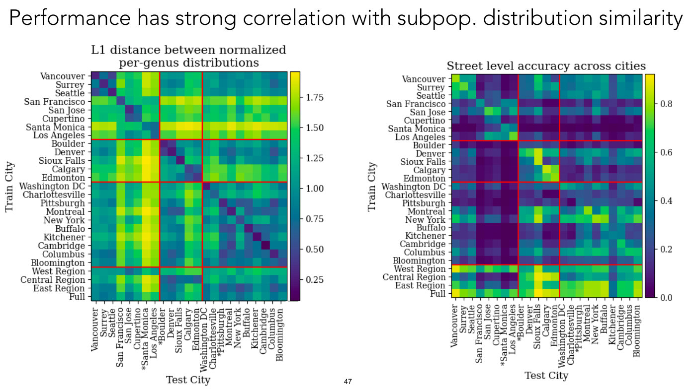

Title: "Performance has strong correlation with subpop. distribution similarity". Two heat-map matrices that share their axes. Rows ("Train City", 27 labels, top to bottom): Vancouver, Surrey, Seattle, San Francisco, San Jose, Cupertino, Santa Monica, Los Angeles, Boulder, Denver, Sioux Falls, Calgary, Edmonton, Washington DC, Charlottesville, Pittsburgh, Montreal, New York, Buffalo, Kitchener, Cambridge, Columbus, Bloomington, West Region, Central Region, East Region, Full. Columns ("Test City", 23 labels, left to right): the same 23 city names in the same order, with three of them starred in the column labels only: "*Santa Monica", "*Boulder", "*Pittsburgh" (the row labels carry no stars). Red lines divide the matrix: horizontally after the Los Angeles row, after the Edmonton row and after the Bloomington row (setting off the four region and "Full" rows); vertically after the Los Angeles column and after the Edmonton column.

- Left matrix, title "L1 distance between normalized per-genus distributions", colour bar ticked 0.25 to 1.75 (it runs from about 0.08 to 1.96; viridis-style, dark purple low, yellow high). The Central and East diagonal blocks are dark purple to teal (small distances), and so are the diagonal cells; the West block is dark only for Vancouver, Surrey and Seattle among themselves and for San Jose and Cupertino, and is bright where it meets Santa Monica and Los Angeles. The brightest cells (about 1.75 to 1.95, yellow) are in the "*Santa Monica" column and the "Santa Monica" row against cities outside the West block, followed by the "Los Angeles" column and the "San Francisco" row and column (about 1.5 to 1.85); the brightest of all (about 1.9 to 1.95) are where Santa Monica meets Sioux Falls, Calgary, Edmonton, Montreal and Kitchener. Most other cells are teal-green around 1.0 to 1.25.
- Right matrix, title "Street level accuracy across cities", colour bar ticked 0.0 to 0.8 (it runs to about 0.92; dark purple low, yellow high). Most cells are dark purple to blue (0.0 to 0.3). Bright cells (green to yellow, 0.6 to 0.9) lie on the diagonal blocks (for example the Boulder, Denver, Sioux Falls, Calgary and Edmonton block, with yellow at Sioux Falls) and in the four bottom rows: "West Region", "East Region" and "Full" are bright across most columns ("Full" brightest, up to about 0.9), "Central Region" in the Boulder–Edmonton columns; the Kitchener column stays dark (about 0.2 to 0.35) in all of them. Within the Boulder–Edmonton block the Boulder row is dark throughout, and the yellow cells are the Sioux Falls column in the Denver and Sioux Falls rows and Calgary against Calgary. The "*Santa Monica" column and the "Santa Monica" row are near 0.0 except Santa Monica's own cells (about 0.4 to 0.5).

Axis labels: "Train City" at the left of each matrix, "Test City" at the bottom. Values are approximate readings of the cell colours against the colour bars.

## Slide 48 — What to do about distribution shift?

Title: "What to do about distribution shift?" and nothing else on the page.

## Slide 49 — One path: distributionally robust optimization

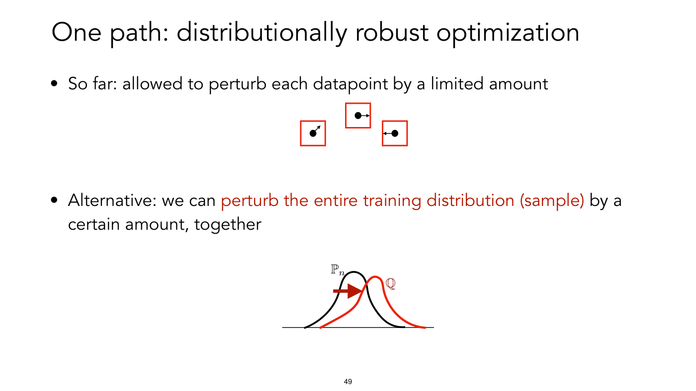

Title: "One path: distributionally robust optimization". Bullets:

- "So far: allowed to perturb each datapoint by a limited amount". Under it, three small red-outlined squares at staggered heights, each holding a black dot with a short black arrow pointing out of it: the left square's arrow points up and to the right, the top square's arrow points right, the right square's arrow points left.
- "Alternative: we can perturb the entire training distribution (sample) by a certain amount, together" (the words "perturb the entire training distribution (sample)" in red). Under it, a plot on a horizontal black baseline of two bell-shaped curves: a black curve labelled $\mathbb{P}_ n$ and a red curve labelled $\mathbb{Q}$ (in red), the red curve shifted to the right and slightly skewed, with a thick red arrow pointing right from the black curve's left flank towards the red curve.

## Slide 50 — Distributionally robust optimization

Title: "Distributionally robust optimization". Bullets and equations:

- "Standard training:"

$$\frac{1}{n} \sum_{i=1}^{n} \text{Loss}(f_{\theta}(\mathbf{x}^{(i)}), y^{(i)}) = \mathbb{E}_ {(\mathbf{x}, y) \sim \mathbb{P}_ n} \left[ \text{Loss}(f_{\theta}(\mathbf{x}), y) \right]$$

  The subscript $(\mathbf{x}, y) \sim \mathbb{P}_ n$ is highlighted by a light blue rounded patch, with the bold annotation under it: "allow a small perturbation of training sample (discrete distribution)".
- "Distributionally robust optimization (DRO):"

$$\min_{\theta} \mskip{5mu} \max_{\mathbb{Q}, \thinspace D(\mathbb{Q}, \mathbb{P}_ n) \lt \epsilon} \mskip{5mu} \mathbb{E}_ {(\mathbf{x}, y) \sim \mathbb{Q}} \left[ \text{Loss}(f_{\theta}(\mathbf{x}), y) \right]$$

  The "max" with its subscript, $\mathbb{Q}, D(\mathbb{Q}, \mathbb{P}_ n) \lt \epsilon$, and the $\mathbb{Q}$ in the expectation are in red. Red bold annotation under the max: "e.g. re-weight or perturb training data points".
- "Various choices of measuring "distance" between probability distributions: $\chi^2$-distance, Wasserstein distance, maximum mean discrepancy (MMD)…"

At the lower right, a dashed circle with a black dot at the centre labelled $\hat{\mathbb{P}}_ n$ (with a hat), a double-headed arrow from the dot to the circle labelled $\varepsilon$, and inside the circle the text $d(\mathbb{Q}, \hat{\mathbb{P}}_ n) \leq \epsilon$. Printed as: the centre is $\hat{\mathbb{P}}_ n$ (hatted) here, while the equations on the left use $\mathbb{P}_ n$ (no hat). The diagram also writes $d$ and $\leq$ where the equation has $D$ and $\lt$, and labels the radius $\varepsilon$ while the inequality uses $\epsilon$.

## Slide 51 — DRO and generalization

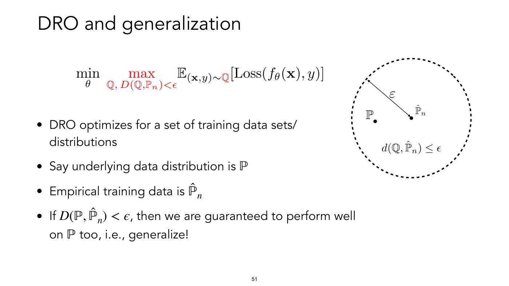

Title: "DRO and generalization". The DRO objective again:

$$\min_{\theta} \mskip{5mu} \max_{\mathbb{Q}, \thinspace D(\mathbb{Q}, \mathbb{P}_ n) \lt \epsilon} \mskip{5mu} \mathbb{E}_ {(\mathbf{x}, y) \sim \mathbb{Q}} \left[ \text{Loss}(f_{\theta}(\mathbf{x}), y) \right]$$

(max, its subscript and the $\mathbb{Q}$ under the expectation in red). Bullets:

- "DRO optimizes for a set of training data sets/distributions"
- "Say underlying data distribution is $\mathbb{P}$"
- "Empirical training data is $\hat{\mathbb{P}}_ n$"
- "If $D(\mathbb{P}, \hat{\mathbb{P}}_ n) \lt \epsilon$, then we are guaranteed to perform well on $\mathbb{P}$ too, i.e., generalize!"

At the right, a dashed circle with a dot at its centre labelled $\hat{\mathbb{P}}_ n$ (label at the dot's upper right), a double-headed arrow from that dot to the circle's upper left labelled $\varepsilon$, a second dot inside the circle to the left of centre labelled $\mathbb{P}$ (label at its upper left), and inside the circle the text $d(\mathbb{Q}, \hat{\mathbb{P}}_ n) \leq \epsilon$. Printed as: the objective writes $\mathbb{P}_ n$ (no hat) while the bullets and diagram write $\hat{\mathbb{P}}_ n$; the diagram writes $d$ and $\leq$ where the objective and the last bullet write $D$ and $\lt$, and labels the radius $\varepsilon$ while the inequalities use $\epsilon$.

## Slide 52 — Application: DRO and class imbalance

Title: "Application: DRO and class imbalance". Bullets: "Assume population has K sub-groups (example: K=2)." and "Usually: minimize "Empirical Risk" (average error)". Equation:

$$\min_{\theta} \mskip{5mu} \frac{1}{n} \left( \sum_{i \text{ in group 1}} \text{Loss}(x_i; \theta) + \sum_{j \text{ in group 2}} \text{Loss}(x_j; \theta) \right)$$

The first term (sum and Loss) is on a light green rounded patch with the bold green label "80%" under it; the second term is on a light blue patch with the bold blue label "20%". Further bullets: "Here, 50% error on minority group makes only 10% average error. (+ statistical patterns for minority may be different)" and "We can "ignore" minority group and still get decent loss!".

## Slide 53 — DRO and class imbalance

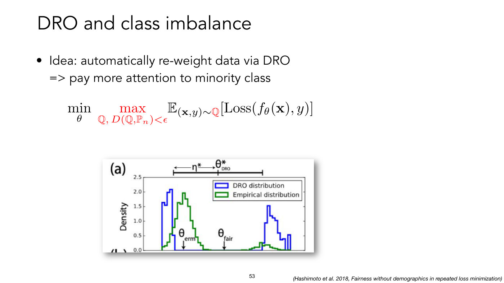

Title: "DRO and class imbalance". Bullet: "Idea: automatically re-weight data via DRO => pay more attention to minority class". Equation (max, its subscript and the $\mathbb{Q}$ under the expectation in red):

$$\min_{\theta} \mskip{5mu} \max_{\mathbb{Q}, \thinspace D(\mathbb{Q}, \mathbb{P}_ n) \lt \epsilon} \mskip{5mu} \mathbb{E}_ {(\mathbf{x}, y) \sim \mathbb{Q}} \left[ \text{Loss}(f_{\theta}(\mathbf{x}), y) \right]$$

Below it, a cropped screenshot of a figure panel marked "(a)" (the top of the panel below it, "(b)", is cut off at the bottom edge), with a credit at the lower right: "(Hashimoto et al. 2018, Fairness without demographics in repeated loss minimization)". The panel is a histogram plot with y-axis "Density" (ticks 0.0 to 2.5 in steps of 0.5) and an unlabelled x-axis. A legend lists two series: "DRO distribution" (blue outline) and "Empirical distribution" (green outline). Above the plot is a horizontal black bar with end ticks and a middle tick, with a left-right arrow labelled $\eta^{\ast}$ (printed "η*") to the left of the middle tick and the label $\theta^{\ast}_ {\text{DRO}}$ (printed "θ*" with subscript "DRO") at the middle tick.

- Green series, "Empirical distribution": a tall bump at the left peaking at about 2.0 (x position just right of the left blue bump), a long near-zero stretch across the middle, and a small bump of about 0.3 at the right.
- Blue series, "DRO distribution": a bump at the far left peaking at about 2.1 (with a stepped top, starting where the green one starts but rising at once, and ending before the green peak), nothing across the middle, and a bump on the right peaking at about 1.5 with a smaller spike of about 0.5 at the far right edge (the DRO distribution puts far more mass on the right-hand group than the empirical one).
- Two short black arrows pointing down to the x-axis carry the labels $\theta_{\text{erm}}$ (printed "θ" with subscript "erm", directly under the green left peak) and $\theta_{\text{fair}}$ (printed "θ" with subscript "fair", at about the middle of the plot, a little right of the $\theta^{\ast}_ {\text{DRO}}$ tick).

Which of the two groups the left and right clusters stand for is not stated on the slide.

## Slide 54 — What to do about distribution shift?

Title: "What to do about distribution shift?". One bullet: "Distributionally robust optimization".

## Slide 55 — Learn a spatiotemporal prior

*OCW notice: © Mac Aodha et al. All rights reserved. This content is excluded from our Creative Commons license. For more information, see https://ocw.mit.edu/help/faq-fair-use/ (small print at the lower right; it covers the equation image and the diagram with its pictures).*

Title: "Learn a spatiotemporal prior" (centred). Under it, the equation

$$P(y \mid I, \mathbf{x}) \propto P(y \mid I) \thinspace P(y \mid \mathbf{x})$$

Diagram with two rows. Top row: a photograph of a brown warty toad on gravelly ground with dry twigs with the watermark "Cesar Pollo BY CC-NC 4.0" at its lower left; a grey arrow to a blue box labelled above "Image Classifier" (a stack of six dark blue vertical bars and one short bar, drawn as a network); a grey arrow to a small bar chart (a histogram of five light-blue bars, the second and third tallest) labelled $P(y \mid \mathbf{I})$ (printed "P(y|I)" with a bold I). Bottom row: a black-outline world map with a red arrow pointing at a spot in Europe; a grey arrow to a pink-red box labelled above "Spatio-Temporal Prior" (three vertical bars and a short bar); a grey arrow to a bar chart (five light-pink bars, the middle one tallest) labelled $P(y \mid \mathbf{x})$ (printed "P(y|x)" with a bold x). Two orange arrows from the two bar charts point to the orange word "Combine" at the right. Under the map: $\mathbf{x}$ = (longitude, latitude, day) (printed "x = (longitude, latitude, day)", x in bold). Credit at the bottom: "Presence-Only Geographical Priors for Fine-Grained Image Classification, Mac Aodha et al., 2019" (the title in italics; the printed slide number overlaps it). In the equation the image is printed $I$ (italic), in the chart labels as a bold I.

## Slide 56 — What to do about distribution shift?

Title: "What to do about distribution shift?". Bullets: "Distributionally robust optimization"; "Learn (or use) a prior for subpopulation shift".

## Slide 57 — (no title; domain adaptation diagram)

*OCW notice: © He et al. All rights reserved. This content is excluded from our Creative Commons license. For more information, see https://ocw.mit.edu/help/faq-fair-use/ (small print at the lower right; it covers the diagram).*

A diagram of domain adaptation. At the upper left, a circle outlined in blue holding 16 solid blue shapes, four each of circles, stars, squares and triangles (the source domain). At the lower left, a circle outlined in green holding 16 hollow green outlines, four of each kind (the target domain). In the middle, a block arrow pointing right with the words "Domain" above it and "Adaptation" below it. At the right, the two circles overlap into one region (blue outline to the left, green to the right) holding three of each kind of shape from each domain, in which the solid blue shapes and hollow green shapes are mixed together by shape (solid and hollow stars together near the top, circles at the right, squares at the left, triangles at the bottom). Legend at the bottom: "Source domain:" with a solid blue circle, star, triangle and square, and "Target domain:" with a hollow green square, triangle, circle and star. URL at the lower right: "https://link.springer.com/article/10.1007/s10489-022-03709-8" (the printed slide number sits just left of it).

## Slide 58 — What to do about distribution shift?

Title: "What to do about distribution shift?". Bullets: "Distributionally robust optimization"; "Learn (or use) a prior for subpopulation shift"; "Domain adaptation (next lecture!)".

## Slide 59 — (no title; plates figure from Vendrow et al.)

*OCW notice: © Vendrow et al. All rights reserved. This content is excluded from our Creative Commons license. For more information, see https://ocw.mit.edu/help/faq-fair-use/ (small print at the lower right; it covers the whole figure).*

A figure with two parts and a URL at the lower right, "https://arxiv.org/abs/2302.07865".

Top part: two headings, "Original Plates" (over a 2 by 2 grid of four photographs under the caption "ImageNet": a plate of asparagus, egg and ham; a chef plating food; a yellow plate with roasted meat and orange slices; a plate of pink sliced meat with a knife) and, after a vertical divider, "Acquiring images of plates with utensils" over three 2 by 2 grids captioned "Bing" (photographs of empty white plates with forks and knives, one a hand holding a stack of pink plates with cutlery), "Stable Diffusion" (generated-looking images of grey and blue plates with spoons and forks), and "ImageNet*" (plates with food and cutlery, mostly on dark tables).

Bottom part: two groups of photographs of real plates, three columns each, with a predicted label under every image. Left group (empty plates): top row, a white plate on a beige stone-like surface, labelled in red "tray", "tray", "tray"; bottom row, a white plate on grass, labelled in red "tray", "bucket", "bucket". Right group (plates with grilled food and a red pepper): top row on the beige surface, labelled in green "plate", "plate", "plate"; bottom row on grass, labelled in green "plate", "plate", "plate". Caption: "Figure 8: Real images of plates, with and without food and either on a table or in the grass. Below each image is the predicted class by an ImageNet-trained ResNet50."

## Slide 60 — What to do about distribution shift?

Title: "What to do about distribution shift?". Bullets: "Distributionally robust optimization"; "Learn (or use) a prior for subpopulation shift"; "Domain adaptation (next lecture!)"; "Diagnose failures".

## Slide 61 — What to do about distribution shift?

Title: "What to do about distribution shift?". Bullets: "Distributionally robust optimization"; "Learn (or use) a prior for subpopulation shift"; "Domain adaptation (next lecture!)"; "Diagnose failures"; "Get training data that is representative of your test domain (works better than any algorithm)".

## Slide 62 — Summary

Title: "Summary". Bullets: "Out-of-distribution generalization: big challenge, but helps understand what NNs learn." with two indented sub-bullets: "Adversarial examples and training" and "Distribution shifts".

## Slide 63 — (OCW end page)

OCW's end page, a smaller page that is not lecture content: "MIT OpenCourseWare", "https://ocw.mit.edu", "6.7960 Deep Learning", "Fall 2024", "For information about citing these materials or our Terms of Use, visit: https://ocw.mit.edu/terms". The page prints the number 63 at the bottom centre.
