# Lecture 19 — Transfer Learning II: slide-by-slide

Text and figures of all 52 pages of
[`mit6_7960_f24_lec19.pdf`](https://ocw.mit.edu/courses/6-7960-deep-learning-fall-2024/mit6_7960_f24_lec19.pdf),
transcribed from the deck (speaker: Sara Beery; the title slide reads "Lecture 19: Transfer Learning II", and the recording's
title is "Transfer Learning: Data"). Cite these as "slide N": the printed number equals the PDF page number for slides 1–51;
page 52 is OCW's appended end page and prints 52. Diagrams, plots and pictures are described in prose since the KB is read as
text. The equations are LaTeXiT images whose text layer is base64 junk (slide 5's are real TeX glyphs); all were read from the
page, never from the text layer.

**Images.** Fifteen slides have a rendered image under their heading: 3, 4, 6, 10, 18, 22, 35, 37, 38, 39, 40, 43, 45, 47 and 48. The 20 slides with an OCW notice are never rendered, and five more are withheld because they reuse an excluded image: slide 23 draws slide 42's volcano grid; slides 29 and 30 draw slide 28's cat photograph, which sits under that slide's "© Lang et al." notice (Lang et al. are the authors of the paper the cat comes from); slide 31 shows the generator's reconstruction and edits of that photograph; and slide 36's tiger photographs are the ones lecture 18 excludes ("Tigers © source unknown"), here under a CC BY credit. The others were not rendered because they are text, equations or code that this file reproduces (2, 5, 32, 41, 44, 46, 50 and 51), build steps a rendered slide supersedes (11 by 6 and 10, 21 by 22), the title (1) or the end page (52).

Companion pages: [wiki page for this lecture](../../wiki/19-transfer-learning-data.md) · [transcript](../transcripts/19-transfer-learning-data.md)

**Signposting slides you can skip.** Slide 1 is the title; slide 2 the outline (transferring knowledge about the inputs:
generative models as data++; meta-learning), which slide 51 repeats; slide 3 is lecture 18's "Transfer Learning" banner with
"3. Knowledge about the inputs" in bold; slide 52 is the OCW end page. The deck prints no lecture number but its own.

Some slides are **build steps** or repeats, transcribed individually with a note of what they add: 6 and 7 (the generative model,
with a cat and then a bird); 8 and 9 (one latent direction, then two); 10 and 11 (into latent space, then back out); 16 and 17
(interpolation in data space, then in latent space); 21 to 23 (labels spreading through latent space); 29 to 31 (the classifier,
then the generator and encoder, then StylEx); 36 and 37 (contrastive learning, then with generative modelling); 38 and 39; 44 to 46
(MAML set up, its algorithm, then backprop through it); and 47 and 48. Slides with no printed title are headed here with a
description: 4, 8, 9, 13, 15, 18, 19, 21 to 23 (titled only "Labeling Data++"), 25, 26, 27, 29, 30, 31, 34 and 52.

**Printed slips and oddities**, kept as printed: slide 5's "et al. ," with a space before the comma; slide 24's "StyleGan" (inside
the pasted figure) and "see  also" with two spaces, and the "Zhang  et al." with two spaces in the notices of slides 24 to 26;
"Under under CC BY" in the credit of slides 35 to 39; slide 43's "Datastets"; and slide 44's "such just". Some pages hide things:
slide 3 and slides 36 and 40 hold white, invisible letters in the text layer; slides 30 and 31 stack earlier builds of the cat
photograph under the visible one; slide 34 holds charts and image grids drawn off the page; slides 47 and 48 hold clipped copies of
their diagrams; slide 45 covers lines 5, 6 and 8 of the pasted MAML algorithm with plain-language overlays (the covered lines,
which the embedded image still holds, are given in the entry); and slide 18's four plots have their captions and many tick labels
whited out under a visible OCR text layer. Slide 49's legend is cropped from another panel of the same paper figure. Each entry
describes what the page shows.

**OCW licence notices** are on slides 7, 8, 9, 12 to 17, 19, 20, 24 to 28, 33, 34, 42 and 49, 20 in all, all typed and in the
text layer; the slide file's set and the text layer's are the same. A scan for notices drawn as glyph outlines found none. Each is
transcribed as an `*OCW notice: …*` line with the picture it covers. Slide 27 carries a "Courtesy of Li et al. Used under CC BY"
credit for its X-ray figure beside its notice, slides 35 to 39 a "Courtesy of Jahanian et al." CC BY credit, and slides 6, 10 and
11 a credit for the StyleGAN2 cat photograph, "Made available under the Nvidia Source Code License-NC". Slide 32's picture was
removed by OCW ("Image of people removed due to copyright restrictions."). Slides 18 (the VAE plots of lecture 15's slide 40) and 45
(MAML's algorithm and figure, cited "[Finn, Abbeel, Levine 2017]") reproduce third-party material with no notice.

## Contents

| Slides | Section |
| ------ | ------- |
| 1–3 | Title; outline; transfer learning: knowledge about the inputs |
| 4–5 | Generative modelling turns data into data++; data as a first-class object, with interpolation, manipulation, composition and optimization |
| 6–14 | Latent variables as controls; BigGAN's bird directions; counterfactuals; ensembling with deep generative views; latent directions (zoom, shift, brighten, darken, word2vec); colour transformation vectors |
| 15–20 | Where to navigate: a traditional GAN against StyleGAN; interpolation in data space and in latent space; the VAE's seams; $\mathcal{Z}$ against $\mathcal{W}$; StyleSpace |
| 21–27 | Labeling data++; DatasetGAN and its Style-Interpreter; segmentation from a few labels |
| 28–34 | Explaining a classifier: StylEx; perceived age; retinal fundus; Dataset Interfaces |
| 35–42 | Generative models as a data source for multiview representation learning: latent views for contrastive learning, the results, and data++ summed up |
| 43–50 | Meta-learning: learning to learn; MAML; backpropagating through backward; TIML; meta-learning by sequence modeling |
| 51–52 | Summary outline; OCW end page |

## Slide 1 — Lecture 19: Transfer Learning II

Title: "Lecture 19: Transfer Learning II". Below it: "Speaker: Sara Beery". The footer band (light grey, across the bottom) carries the MIT logo at the left, "6.7960 Deep Learning" in red, the underlined URL "https://phillipi.github.io/6.7960" and, at the right, "Fall 2024". The printed slide number "1" is a tiny digit just under the end of the URL.

## Slide 2 — Transfer Learning II

Title: "Transfer Learning II". An outline in two bullet levels:

- Transferring knowledge about the inputs
  - Generative models as data++
- Meta-learning

Printed slide number "2".

## Slide 3 — Transfer Learning

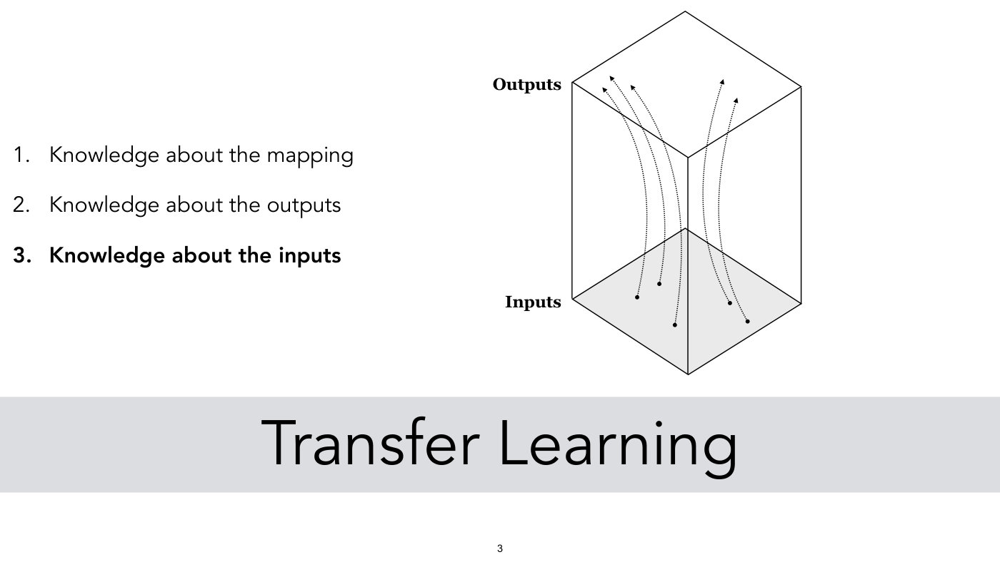

At the left, a numbered list: "1. Knowledge about the mapping", "2. Knowledge about the outputs", and, in bold, "3. Knowledge about the inputs". Across the bottom, in a light-grey band, large text: "Transfer Learning".

At the upper right, a line drawing of a tall box (a rectangular prism seen in perspective). Its top face is labelled "Outputs" (label at the upper left of the box) and its bottom face, shaded light grey, is labelled "Inputs" (label at the left of the box, level with the bottom face). Five dotted curves, each with an arrowhead at its upper end, run from five black dots on the bottom face up through the box to the top face (three curves rising on the left half and two on the right, bending slightly as they rise). (The text layer also holds two white “z” labels inside the box, one at each face, invisible on the page.) Printed slide number "3".

## Slide 4 — (no title; Dataset to Model via generative modeling, data to data++)

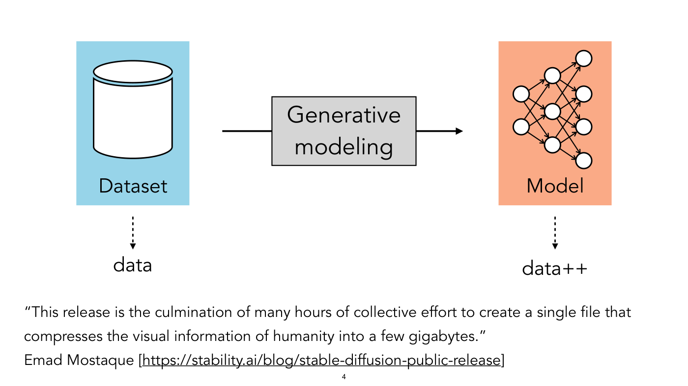

A diagram in three parts, left to right. At the left, a pale-blue rectangle holding a white database-cylinder icon, labelled "Dataset". A black arrow runs right through a grey box labelled "Generative modeling" to a pale-orange (salmon) rectangle at the right. That rectangle holds a small neural-network diagram (white circles in columns of 2, 3 and 4 nodes, joined by 16 arrows: each left node to all three middle nodes, and each middle node to the right column except the top middle to the bottom right node and the bottom middle to the top right node) and is labelled "Model". The horizontal arrow touches neither box: it starts to the right of the Dataset rectangle, passes through the "Generative modeling" box and ends short of the Model rectangle. Under the Dataset box a dotted arrow points down to the word "data"; under the Model box a dotted arrow points down to the word "data++".

Quotation at the bottom: "“This release is the culmination of many hours of collective effort to create a single file that compresses the visual information of humanity into a few gigabytes.”" followed by "Emad Mostaque [https://stability.ai/blog/stable-diffusion-public-release]" (URL underlined). Printed slide number "4".

## Slide 5 — Data++: making data a first class object

Title: "Data++: making data a first class object", with a short horizontal rule drawn under the word "Data++". Below the title, a displayed equation:

$$\mathbb{X} = \lbrace x, z, G, G^{-1} \rbrace$$

Four rows, each a label at the left, a formula in the middle and a citation at the right:

- "Interpolation:" $\alpha \mathbb{X}_ 1 + (1 - \alpha)\mathbb{X}_ 2 \rightarrow \mathbb{X}_ 3$
- "Manipulation:" $\mathbb{X}_ 1 + w \rightarrow \mathbb{X}_ 2$. At the right of this row, two citations stacked one above the other (nothing is printed to the right of the Interpolation row): "[Goetschalckx*, Andonian*, Oliva, Isola, ICCV 2019]" and "[Jahanian*, Chai*, Isola, ICLR 2020]".
- "Composition:" $\mathbb{X}_ 1[m] + \mathbb{X}_ 2[1 - m] \rightarrow \mathbb{X}_ 3$, with "[Chai, Wulff, Isola, ICLR 2021]".
- "Optimization:" $\arg\min_{\mathbb{X}} f(\mathbb{X})$ (the $\mathbb{X}$ set beneath "arg min"), with "[Lin, Florence, Barron, et al. , IROS 2021]" (printed with a space before the comma).

Last line, preceded by an arrow: "→ Graphics, visualization, data aug, counterfactual reasoning, …". Printed slide number "5".

## Slide 6 — Generative Models

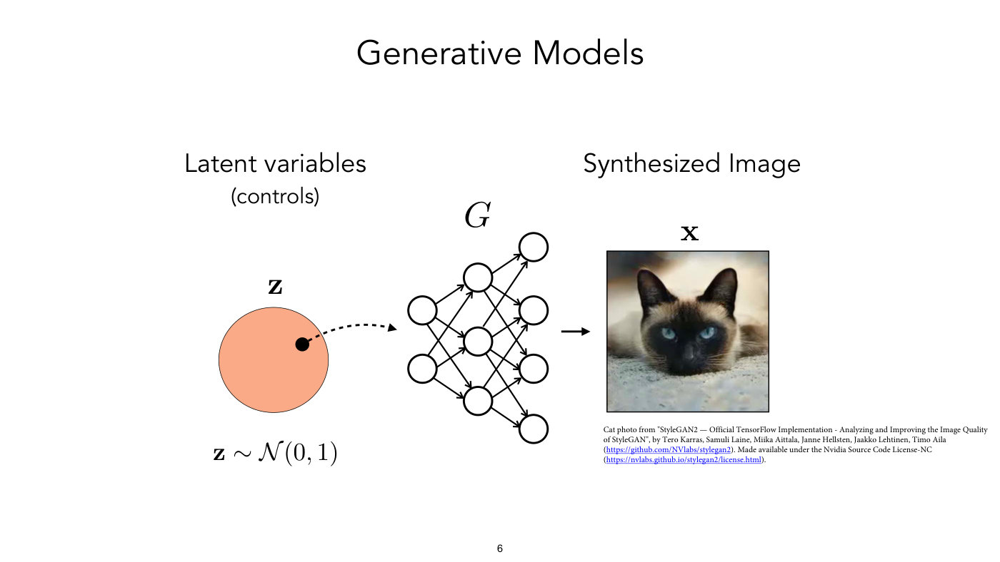

Title: "Generative Models". Left to right: the heading "Latent variables" with "(controls)" under it, above a pale-orange disc labelled "z" in bold, holding one black dot (right of centre); below the disc, "z ~ N(0, 1)" (bold z, calligraphic N). A dashed curved arrow runs from the dot to a neural-network diagram labelled with an italic "G" above it (circles in columns of 2, 3 and 4 nodes, joined by 16 arrows as on slide 4: not quite fully connected, since the top middle node has no arrow to the bottom right node and the bottom middle node none to the top right node). A short arrow leads from the network to a square photograph labelled "x" in bold, under the heading "Synthesized Image". The photograph shows the face of a cat with pale fur, a dark face mask and blue eyes, lying on a grey surface.

Credit below and to the right of the photograph, small print (the URLs in blue, underlined): "Cat photo from "StyleGAN2 — Official TensorFlow Implementation - Analyzing and Improving the Image Quality of StyleGAN", by Tero Karras, Samuli Laine, Miika Aittala, Janne Hellsten, Jaakko Lehtinen, Timo Aila (https://github.com/NVlabs/stylegan2). Made available under the Nvidia Source Code License-NC (https://nvlabs.github.io/stylegan2/license.html)." (this is a credit, not an OCW notice). Printed slide number "6".

## Slide 7 — Generative Models

*OCW notice: © Brock et al. All rights reserved. This content is excluded from our Creative Commons license. For more information, see https://ocw.mit.edu/help/faq-fair-use/ (small print at the lower left; the slide number overlaps its end; it covers the bird photograph).*

The same layout as slide 6: "Latent variables (controls)", the pale-orange disc "z" (here the black dot sits above centre, a little to the left, and the dashed arrow leaves it toward the network), "z ~ N(0, 1)", the network "G", and the heading "Synthesized Image" over a square photograph labelled "x". The photograph shows a small bird with a black cap, a white cheek patch and a pale grey body, perched on a thin branch against a blurred brown and green background; the bird also has a black throat under the white cheek. The photograph is the centre cell of slide 9's 5 × 5 grid, the same image drawn enlarged and clipped. Printed slide number "7".

## Slide 8 — (no title; one latent direction, bird orientation)

*OCW notice: © Brock et al. All rights reserved. This content is excluded from our Creative Commons license. For more information, see https://ocw.mit.edu/help/faq-fair-use/ (small print at the lower left; the slide number overlaps its end; it covers the bird photographs).*

At the left, "Latent variables (controls)" above a pale-orange disc with a black outline. Inside it a horizontal dashed double-headed arrow, labelled "u" at its right end, carries 5 black dots in a row. A solid arrow leads right from the disc toward the row of photographs, ending just left of the vertical axis. At the top right is the heading "Synthesized Images". At the right, a vertical dashed double-headed arrow labelled "v" at its top, and a horizontal dashed double-headed arrow labelled "u" at its right end, with the label "“Bird orientation”" beneath it. Halfway up the v axis, in a single row running in the u direction, are 5 square photographs of the same kind of bird (black cap, white cheek, pale body) on a branch, turned from facing left at the left end, through facing the viewer in the middle, to facing right at the right end. Nothing else is shown along the v axis. The row is the middle row of slide 9's grid image, clipped. Printed slide number "8".

## Slide 9 — (no title; two latent directions, bird orientation and background colour)

*OCW notice: © Brock et al. All rights reserved. This content is excluded from our Creative Commons license. For more information, see https://ocw.mit.edu/help/faq-fair-use/ (small print at the lower left; it covers the bird photographs).*

Same layout as slide 8, extended to two directions. At the left, "Latent variables (controls)" above the pale-orange disc, which now holds a 5 × 5 grid of black dots with a vertical dashed double-headed arrow labelled "v" and a horizontal one labelled "u" crossing at the centre dot. A solid arrow leads right from the disc to a 5 × 5 grid of square bird photographs (the same kind of bird as on slide 8), headed "Synthesized Images" at the top. Axes: "u" along the bottom, labelled "“Bird orientation”"; "v" up the left side, labelled (rotated) "“Background color”". Along each row the bird turns from facing left to facing right. Down each column the background changes: lighter grey and bluish-grey tones in the top rows (the blue-grey strongest at the left), darker brown and green tones towards the bottom row. Printed slide number "9".

## Slide 10 — Data++ supports counterfactual reasoning

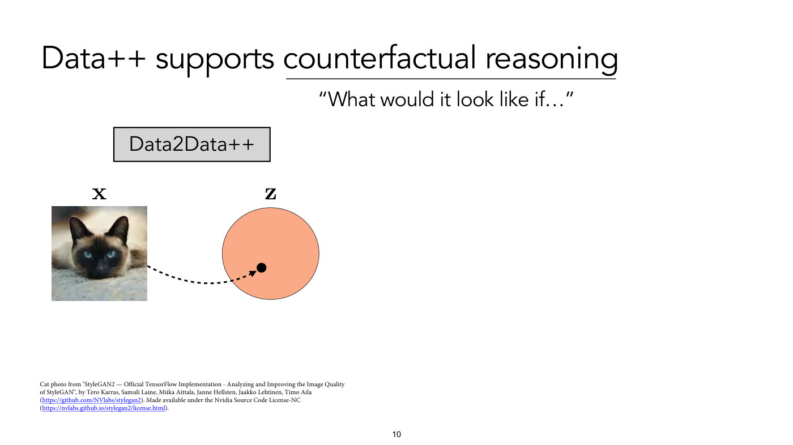

Title: "Data++ supports counterfactual reasoning", with a line drawn under "counterfactual reasoning". Under the title, at the right: "“What would it look like if…”". At the left, a grey box labelled "Data2Data++". Below it, a square photograph (the pale cat with the dark face and blue eyes from slide 6) labelled "x" in bold, and a pale-orange disc labelled "z" in bold with one black dot in its lower half. A dashed curved arrow runs from the photograph to the dot. The right half of the slide is empty (a build step).

Credit at the lower left, small print: "Cat photo from "StyleGAN2 — Official TensorFlow Implementation - Analyzing and Improving the Image Quality of StyleGAN", by Tero Karras, Samuli Laine, Miika Aittala, Janne Hellsten, Jaakko Lehtinen, Timo Aila (https://github.com/NVlabs/stylegan2). Made available under the Nvidia Source Code License-NC (https://nvlabs.github.io/stylegan2/license.html)." Printed slide number "10".

## Slide 11 — Data++ supports counterfactual reasoning

Title: "Data++ supports counterfactual reasoning", with a line drawn under "counterfactual reasoning"; under it "“What would it look like if…”". The "Data2Data++" box and the arrow from the photograph of slide 10 are gone. A pale-orange disc labelled "z" in bold, with one black dot in its lower half, at the left; a solid arrow points right to a large square photograph labelled "x" in bold: the pale cat with a dark face and blue eyes, lying on a grey surface (the same picture as on slides 6 and 10).

Credit at the lower right, small print: "Cat photo from "StyleGAN2 — Official TensorFlow Implementation - Analyzing and Improving the Image Quality of StyleGAN", by Tero Karras, Samuli Laine, Miika Aittala, Janne Hellsten, Jaakko Lehtinen, Timo Aila (https://github.com/NVlabs/stylegan2). Made available under the Nvidia Source Code License-NC (https://nvlabs.github.io/stylegan2/license.html)." Printed slide number "11".

## Slide 12 — Ensembling with Deep Generative Views

*OCW notice: © Chai et al. All rights reserved. This content is excluded from our Creative Commons license. For more information, see https://ocw.mit.edu/help/faq-fair-use/ (small print at the lower right; it covers the cat photographs).*

Title: "Ensembling with Deep Generative Views"; under it "Chai, Zhu, Shechtman, Isola, Zhang" and "CVPR 2021". The diagram runs bottom to top. Along the bottom, 4 square photographs of an orange-brown long-haired tabby cat, a head-and-shoulders view. The leftmost is labelled "Input Image" below it; the other three, at the right, are slightly different views of the same cat (different head angle, crop and fur detail, the last with the cat turned to the right and the body partly cut off) and share the label "GAN Generated Variations" beneath them. Above each photograph is a yellow trapezoid labelled "C" (4 in all), and above each trapezoid a small bar chart of 4 bars (light, medium and dark grey, then light grey again; a predicted distribution; charts 1 and 3 are identical, and the others differ slightly). A black line from each of the 4 charts runs up to a horizontal bar that meets a circled plus sign (⊕); above the ⊕ is one more, larger bar chart of 4 bars in the same greys, its third bar the tallest (the combined prediction; no line joins it to the ⊕). At the right, large text: "Improved accuracy and robustness". Printed slide number "12".

## Slide 13 — (no title; latent directions: word2vec analogy, zoom, shift, brighten, darken)

*OCW notice: © source unknown. All rights reserved. This content is excluded from our Creative Commons license. For more information, see https://ocw.mit.edu/help/faq-fair-use/ (small print along the bottom, under the photograph grid; the slide number overlaps it; it covers the four photographs at the right, and possibly the word-vector diagram, which is not stated; the word-vector diagram is itself a pasted raster).*

Three parts.

Upper left: a 3D coordinate frame (three axes from one origin) with 4 labelled points in monospace type. Yellow dots: "walking" and "swimming". Red dots: "walked" and "swam". An orange dashed arrow runs from "walking" to "walked" and another, parallel, from "swimming" to "swam". Under it: "[word2vec, Mikolov et al., 2013]" and "[DCGAN, Radford, Metz, Chintala, 2015]".

Lower left: a large red disc with 4 black dots. Two parallel dotted arrows point up and to the right, each from one dot to another. The words "Zoomed out" stand by the arrows' tails (under the upper arrow's tail, at the left) and "Zoomed in" by their heads (just below and right of the upper arrow's head), so both arrows run from zoomed out to zoomed in.

Right: a 2 × 2 grid of photographs; the top two are labelled above, the bottom two below. Top row: at the left, headed "Zoom", a grey tabby cat with a frowning face lying on a red cushion, with an orange smear above it and some illegible lettering at the lower right of the picture; at the right, headed "Shift", a close-up of an orange kitten's face with blue-grey eyes. Bottom row: at the left, labelled "Brighten" below, a building with a dome and cupola lit in yellow against a dark brown-black sky; at the right, labelled "Darken" below, a grey cone-shaped mountain with a plume of white cloud over a pale grey sky. Printed slide number "13", just left of the "Brighten" label, overlapping the word "This" in the notice.

## Slide 14 — Color transformation vectors

*OCW notice: © source unknown. All rights reserved. This content is excluded from our Creative Commons license. For more information, see https://ocw.mit.edu/help/faq-fair-use/ (small print along the bottom right; the slide number overlaps it; it covers the photograph pairs).*

Title: "Color transformation vectors". Four columns of picture pairs, each headed by a bold label and each holding 2 rows of an input photograph (left) with its output (right); under each column the words "input" and "output" are printed.

- "Winter to spring": row 1, a snow-covered mountain range under a blue sky becomes a similar range with green slopes and less snow; row 2, a small white furry animal on patchy snow and dry grass becomes the same animal on green grass.
- "Turning on the lights": row 1, a dark carved pumpkin glowing red-orange from inside becomes a brighter orange pumpkin lit from outside on a grey surface; row 2, a dark scene with a lit object and a bright flame becomes the same object, a silver device, on a beige background.
- "Day to night": row 1, a white building with a tall spire and bell tower in daylight, with grass and a blue sky, becomes the building at night with lit windows and an orange glow; row 2, a building with a large blue-grey dome and tall slender towers in daylight becomes the building at dusk with a golden dome.
- "Volcano!": row 1, a volcano under cloud on a green landscape becomes an erupting volcano with red lava and an orange sky; row 2, a blue-grey volcano with white smoke becomes a dark volcano with a bright orange eruption.

Text below: "There is a latent space “vector” for each of these transformations — the “spring vector”, the “volcano exploding vector”". Printed slide number "14".

## Slide 15 — (no title; Traditional GAN against StyleGAN)

*OCW notice: © Karras et al. All rights reserved. This content is excluded from our Creative Commons license. For more information, see https://ocw.mit.edu/help/faq-fair-use/ (small print at the bottom centre; the slide number sits under it; it covers the two architecture diagrams).*

Two panels separated by a vertical dotted line. Panel heading at the upper left: "Traditional GAN"; at the upper right: "StyleGAN". Each panel starts at the top with a red disc and ends at the bottom with a blue Y-shaped blob (the same blob shape in both).

Left panel (Traditional GAN): below the red disc, "Latent z ∈ Z" (bold z, calligraphic Z), then a downward arrow through a stack of blocks: a grey box "Normalize"; then a grey group box holding "Fully-connected" (light green), "PixelNorm" (grey), "Conv 3×3" (light green), "PixelNorm" (grey), with the group tagged "4×4"; then a second grey group box holding "Upsample" (grey), "Conv 3×3", "PixelNorm", "Conv 3×3", "PixelNorm", tagged "8×8"; then an arrow to "…" and to the blue blob.

Right panel (StyleGAN): below the red disc, "Latent z ∈ Z", an arrow to a grey box "Normalize", then the label "Mapping network f" beside a grey group box holding a stack of 8 light-green boxes, each "FC". An arrow leads from the stack to a cloud labelled "w ∈ W" (bold w, calligraphic W), with a yellow bean-shaped blob drawn just below the cloud. From the cloud, 4 curved arrows go to 4 light-green boxes "A" (one per AdaIN box on the right), each of which feeds a pale-blue box "AdaIN" with the word "style" on the arrow. At the right, headed "Synthesis network g", a column of grey group boxes: the first holds "Const 4×4×512", ⊕, "AdaIN", "Conv 3×3", ⊕, "AdaIN", tagged "4×4"; the second, below an arrow, holds "Upsample", "Conv 3×3", ⊕, "AdaIN", "Conv 3×3", ⊕, "AdaIN", tagged "8×8"; then an arrow to "…" and the blue blob. At the far right, 4 vertical lines headed "Noise" each turn left, with an arrowhead, into a light-green box "B", which feeds one of the 4 ⊕ nodes. Citation at the lower right: "[“StyleGAN”, Karras, Laine, Aila, 2018]". Printed slide number "15".

## Slide 16 — Interpolation in data space

*OCW notice: © Brock et al. All rights reserved. This content is excluded from our Creative Commons license. For more information, see https://ocw.mit.edu/help/faq-fair-use/ (small print at the lower right, just above the photographs, over the grey wedge; it covers the row of 8 photographs).*

Title at the upper left: "Interpolation in data space". At the top centre: "Data space (Natural image manifold)" and a bold "X". A blue blob shaped like a Y with a curved right arm and a long lower arm. Two black dots sit on the blob, one in its lower middle and one at the tip of the upper-right arm, joined by a straight dotted line that cuts across the gap between the arms, leaving the blue region where it passes through white space. A pale-grey wedge fans from the two dots down to a row of 8 photographs along the bottom. The row goes from a blue bird with dark wings perched on a branch against green foliage, through 6 progressively blended frames, in which a dark fly appears faintly over the bird as the bird fades, to a fly with red eyes on a pale background. The intermediate frames are overlays, with both objects partly visible at once. Printed slide number "16", over the fourth photograph.

## Slide 17 — Interpolation in latent space

*OCW notice: © Brock et al. All rights reserved. This content is excluded from our Creative Commons license. For more information, see https://ocw.mit.edu/help/faq-fair-use/ (small print at the lower left, over the diagram; it covers the row of 8 photographs).*

Title at the upper left: "Interpolation in latent space". Headings: "Latent space (Gaussian)" over a bold "z", and "Data space (Natural image manifold)" over a bold "X". A red disc holds 2 black dots joined by a straight dotted line; a thick arrow points right to the same blue blob as on slide 16. On the blob, the two dots (lower middle and upper-right tip) are joined by a dotted line that now curves along the inside of the blob, following its shape. Citation at the lower right: "[BigGAN, Brock et al. 2018]". A pale-grey wedge fans from the two dots to a row of 8 photographs, which start with the same blue bird on a branch at the left and end with the same fly with red eyes at the right. Here the frames in between show a realistic object that changes gradually: the bird's colour darkens, and then a dark winged insect-like form on a brown ground appears, with no overlay of two images. Printed slide number "17", over the fourth photograph, as on slide 16.

## Slide 18 — (no title; four plots of a latent-space distribution mapped onto a data-space shape)

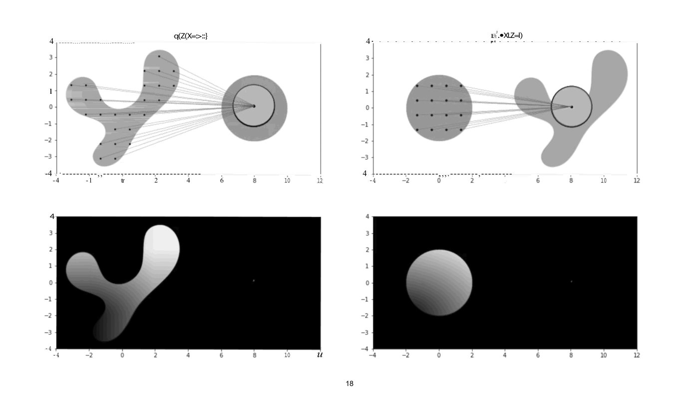

Four pasted greyscale plots in a 2 × 2 grid, one raster each. The rasters' own captions and many tick labels are whited out, and a visible OCR text layer is printed over them: it supplies the garbled captions, rows of "=" and "-" along the top and bottom plot borders, and some of the tick numbers. Nothing is taken from that layer but what is noted here. Each panel has a vertical axis with ticks from 4 down to −4 (the top right's lowest label prints "4" with no minus sign) and a horizontal axis with ticks at −4, −2, 0, 2, 4, 6, 8, 10, 12; some labels are garbled or missing (top left prints "-1" for −2 and "tr" for 0; top right has no label at 4; bottom left prints an italic "u" where 12 would be).

- Top left: a light-grey Y-shaped blob (the data-space shape of the earlier slides) on the left, with 26 small black dots in rows across it. On the right, centred near x = 8, y = 0, is a darker grey disc with a lighter inner disc bounded by a thick black circle, and a black dot at the centre. Thin grey dotted lines run from each dot on the blob to the centre dot, forming a fan. The caption above the panel is whited out; the OCR layer prints "q(Z(X=:>::}" over it.
- Top right: the same kind of plot with the roles reversed: a grey disc on the left holding 16 dots in a 4 × 4 grid, the Y-shaped blob on the right (spanning about x = 4.5 to 11.5), and a thick black circle, lighter inside, with a dot at the centre near x = 8, over the blob's middle; dotted lines connect each grid dot to the centre dot. The caption above is whited out; the OCR layer prints "·.•XI.Z=l)" over it, after stray marks.
- Bottom left: a black rectangle with the Y-shaped blob drawn in a grey gradient, from near-white at the upper tip of the right arm to near-black at the lower end of the long arm; an italic "u" in place of the 12 tick label (probably OCR noise); a faint small dot at about x = 8, y = 0.
- Bottom right: a black rectangle with a grey-gradient disc on the left (light at upper right, dark at lower left) centred near x = 0, y = 0; a faint small dot at about x = 8, y = 0.

No OCW notice, credit or source is printed on the page. Printed slide number "18". The same figure is lecture 15's slide 40.

## Slide 19 — (no title; Z to W to feature distribution, StyleGAN figure)

*OCW notice: © Karras et al. All rights reserved. This content is excluded from our Creative Commons license. For more information, see https://ocw.mit.edu/help/faq-fair-use/ (small print at the bottom centre; it covers the colour-grid figure in the lower row).*

Two rows of three shapes, each row with two right-pointing arrows. Top row (abstract shapes): a red disc, an orange-yellow bean shape, a blue Y-shaped blob. Bottom row (the StyleGAN figure): a disc filled with a colour gradient (yellow at the upper right, green-blue at the lower right, magenta at the lower left, with a distorted dark grid of curved lines), an arrow, a warped four-sided shape with a concave notch in its right side, carrying a less distorted curved grid in the same palette arranged differently (blue at the upper left, yellow at the upper right, magenta at the lower left, dark olive in the notch), an arrow, and an L-shaped region (a horizontal base with an upright arm on its right) with a regular square grid and the same colours (magenta at the lower left, blue at the lower right, yellow at the top of the arm). The three bottom shapes are one figure from the paper, placed three times and clipped, so the deck orders its panels (b), (c), (a). Captions under the three bottom shapes: "(b) Mapping from Z to features" (calligraphic Z), "(c) Mapping from W to features" (calligraphic W), "(a) Distribution of features in training set". Citation at the lower right: "[“StyleGAN”, Karras, Laine, Aila, 2018]". Printed slide number "19".

## Slide 20 — Different ways to navigate latent space

*OCW notice: © Wu et al. All rights reserved. This content is excluded from our Creative Commons license. For more information, see https://ocw.mit.edu/help/faq-fair-use/ (small print at the lower left; it covers the grid of car photographs).*

Title: "Different ways to navigate latent space". At the left, an orange-yellow bean-shaped region with a calligraphic "W" beside its upper-left edge, and a black dot in its lower left and a dotted arrow from the dot toward the upper right. At the right, a grid of 6 labelled pairs (3 rows by 2 columns) of car photographs; each pair is a "-" image on the left and a "+" image on the right, and a grey tab above each pair gives the attribute. White captions on a black strip at the bottom of each image give the code:

- "hood style": "9_191: -" and "9_191: +" (a silver hatchback whose front and hood change shape)
- "headlight": "9_355: -" and "9_355: +" (a silver hatchback with different headlights)
- "wheel angle": "8_420: -" and "8_420: +" (a dark blue-grey car with its front wheel turned differently)
- "background": "9_4: -" and "9_4: +" (the same dark car, a white building behind it at "-" and green trees at "+")
- "sky color": "12_76: -" and "12_76: +" (a silver car, with a pale, overcast white-grey sky at "-" and a blue sky at "+")
- "body color": "15_227: -" and "15_227: +" (a car in a beige tone at "-" and light blue at "+")

Citation at the lower right: "[“StyleSpace”, Wu, Lischinski, Shechtman, 2020]". Printed slide number "20".

## Slide 21 — Labeling Data++

Title: "Labeling Data++". A large red (coral) disc fills most of the slide, holding 11 black dots in three loose clusters: 3 at the upper left, 4 at the upper right and 4 at the lower left (counted from the page). Printed slide number "21", at the bottom edge of the disc.

## Slide 22 — Labeling Data++

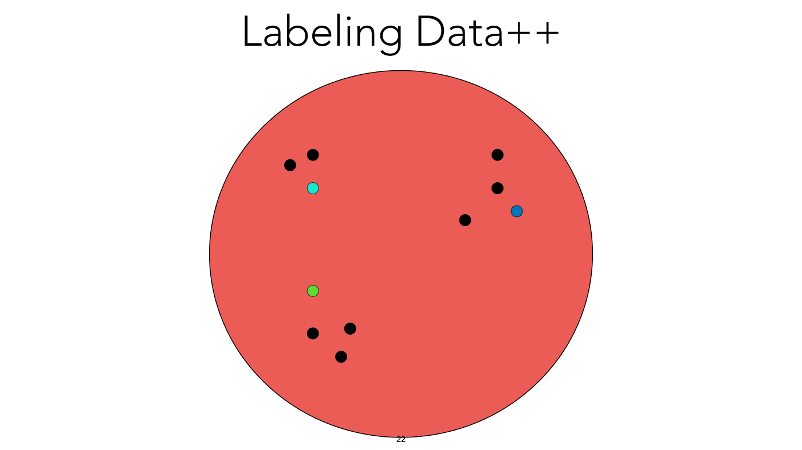

Title: "Labeling Data++". The same red disc and the same 11 dots as slide 21, with 3 of them now coloured: the lowest of the upper-left dots is cyan, the rightmost of the upper-right dots is blue, and the top of the lower-left cluster is green. The other 8 stay black. Printed slide number "22".

## Slide 23 — Labeling Data++

Title: "Labeling Data++". The same disc, now with all 11 dots coloured by cluster: the 3 upper-left dots cyan, the 4 upper-right dots blue, the 4 lower-left dots green. At the upper right, outside the disc, is a 5 × 5 grid of small photographs of the same scene, a volcano on a green landscape. The top-left frame is a dark night scene with a glowing red-orange eruption. From left to right along each row the red glow fades and the colour turns blue (the top-right frame is a dark blue night with only a pale light at the summit); from top to bottom down each column the scene brightens towards day (the bottom-left frame has an orange sky and still glows). The lower-right frame is a pale daytime scene under a white-grey sky with no glow. Two curved dotted lines join the grid to the disc: one from the topmost blue dot to the grid's upper-left corner, one from the rightmost blue dot to its lower-left corner, a callout from that region of the blue cluster. The grid is the image slide 42 shows under its OCW notice. Printed slide number "23".

## Slide 24 — DatasetGAN

*OCW notice: © Zhang et al. All rights reserved. This content is excluded from our Creative Commons license. For more information, see https://ocw.mit.edu/help/faq-fair-use/ (small print at the lower left; it covers the pasted four-panel figure; printed "Zhang  et al." with two spaces).*

Title: "DatasetGAN", then "[Zhang*, Ling*, Gao, Yin, Lafleche, Barriuso, Torralba, Fidler 2021]". A pasted four-panel figure, three boxed groups of panels joined by two large red right arrows.

Panel 1, "Train DatasetGAN" (numbered 1): "Latent z ∈ Z" feeds a box "Mapping Network", then a cloud "w ∈ W" (the printed letters are bold italic w and plain W), then a pink trapezoid "StyleGan Generator" (printed "StyleGan"). From it two outputs go right: "Label-branch", giving a car image coloured by part, and "Image-branch", giving a photograph of a dark blue car. A red arrow points down from the cloud into panel 2, and a red arrow points up from panel 2 to the branches; a cartoon girl in a pink dress with yellow hair stands between them holding a pencil-like tool.

Panel 2, "Manual annotation of few generated images" (numbered 2): a large part-labelled car drawing with the part names around it: Roof, Mirror, Front door window, Back door window, Back door, Back handle, Car body, Windshield, Car light left, Hood, Logo, Back bumper, Running board, Front handle, Front door, Fender, License plate, Grille, Bumper, Front wheel, Spoke, Wheelhub. At the right, a column of 4 small car photographs, each with its coloured part-label map beside it.

Panel 3, "Sample from the DatasetGAN a large synthetic dataset" (numbered 3): a grid of image/label pairs, each a synthesized photograph beside its coloured part map, in four rows: 3 cars; 5 faces (a large one of a smiling young woman, then a smiling woman and 3 men); 5 birds; and 3 bedrooms with 2 cats in the bottom row.

Panel 4, "Train on synthetic and test on Real Images" (numbered 4): two rows. Top, a photograph of an orange car at an exhibition (with a small, barely legible watermark at its lower right) beside its coloured part map; bottom, a photograph of a smiling young man's face beside its coloured face-part map.

Text at the lower right: "see also [Tritrong*, Rewatbowornwong*, Suwajanakorn, CVPR 2021]" (printed with two spaces after "see") and "[Li, Yang, Kries, Torralba, Fidler, CVPR 2021]". Printed slide number "24".

## Slide 25 — (no title; the DatasetGAN Style-Interpreter architecture)

*OCW notice: © Zhang et al. All rights reserved. This content is excluded from our Creative Commons license. For more information, see https://ocw.mit.edu/help/faq-fair-use/ (small print at the lower left; it covers the architecture diagram and the two pictures at its right; printed "Zhang  et al." with two spaces).*

A pasted diagram, left to right. "Latent z ∈ Z" feeds a grey box "Mapping Network", then a cloud "w ∈ W" (bold italic w, plain W). From the cloud, 2 arrows enter green boxes "A", each feeding a blue box "AdaIN". The group is a grey column of boxes: "AdaIN", "Conv" (green), "AdaIN", "Conv", "Upsample" (orange), with "…" above and below, and it is labelled "Style-based Generator" beneath. From each AdaIN, an arrow goes right into an orange box "Up-sample" (printed with a hyphen, "Up- sample"). The "Style-Interpreter" is a dashed box. Inside it, 3 stacked cubes in red, blue and green (with "…" above them) are labelled "Feature maps ( 256 x 256 x 5056 )"; a red square marks a "pixel" in the red cube. From that pixel a line leads to a thin bar that joins red, blue and green segments, labelled "Pixel feature vector ( 1 x 1 x 5056 )" (a green line runs from the green cube's top to the bar's green end). An arrow leads to a stack of 4 offset cards labelled "Ensemble classifiers", each holding Fully-conn., ReLU, BatchNorm, Fully-conn., ReLU, BatchNorm, Fully-conn. A rounded box "Vote" follows, with an arrow to a tall vertical blue bar labelled "Pixel classif." with some cells in other colours (light blue, orange, red, pale yellow). At the right, a photograph of a tabby cat labelled "Synthesized image" (joined by a line back to the generator at the top), and under it a coloured part map of the cat in purple, blue and green labelled "Synthesized label"; a red line runs from the red cell of the pixel-classifier bar to a red square on the map.

Citation at the lower right: "[Zhang*, Ling*, Gao, Yin, Lafleche, Barriuso, Torralba, Fidler, CVPR 2021]". Printed slide number "25" (overlapping the citation).

## Slide 26 — (no title; DatasetGAN car labels and the labeled-image comparison)

*OCW notice: © Zhang et al. All rights reserved. This content is excluded from our Creative Commons license. For more information, see https://ocw.mit.edu/help/faq-fair-use/ (small print at the bottom centre-right, under the large text; it covers the car figure, the photograph grid, the bar list and the chart; printed "Zhang  et al." with two spaces).*

Three pasted figure parts and a text line.

Upper left, panel "d)": a coloured part-map of a car, with the labels Roof, Mirror, Front door window, Back door window, Back door, Back handle, Car body, Windshield, Car light left, Hood, Logo, Back bumper, Running board, Front handle, Front door, Fender, License plate, Grille, Bumper, Front wheel, Spoke, Wheelhub.

Upper right, panel "e)": a grid of 4 rows by 8 columns of small pictures, in pairs of a car photograph (silver, blue, white, red, grey and black cars from several angles) with its coloured part map to the right, so 16 pairs.

Far right, panel "f)": a long horizontal bar chart with a red bar for each of many part names in very small print, sorted from the longest bar at the top to the shortest at the bottom; the names and values are not legible.

Lower left: a line chart. The y-axis is labelled "#mIOU", with ticks 10, 20, 30, 40. The x-axis is labelled "#Image Annotation", with ticks 0, 5, 10, 15, 20, 25, 30. Grey dash-dot grid lines. Four series (the legend sits at the lower right inside the plot):

- "Our method" (blue line with round markers): about 34 at 1, 41 at 7, 43.5 at 13, 47 at 19, 47.5 at 25, 47.5 at 31.
- "Transfer learning" (orange line with round markers): about 3 at 1, 18.5 at 7, 26.5 at 13, 29 at 19, 29 at 25, 30 at 31.
- "Semi-supervised learning" (green line with round markers): about 6.5 at 1, 25 at 7, 29 at 13, 32 at 19, 36 at 25, 38.5 at 31.
- "Fully supervised (2K)" (red dash-dot horizontal line, no markers): about 47 from x = 1 to x = 31; the blue line touches it at 19 and is on or just above it at 25 and 31.

The marker positions at x = 1, 7, 13, 19, 25, 31 are read from the picture; the values are approximate. At the right, large text: "1 labeled GAN image is worth ~100 labeled regular images!". Printed slide number "26".

## Slide 27 — (no title; two segmentation figures)

*OCW notice: © Tritrong  et al. All rights reserved. This content is excluded from our Creative Commons license. For more information, see https://ocw.mit.edu/help/faq-fair-use/ (small print below the right-hand figure; it covers the horse-and-rider figure and its segmentations, not the chest X-ray figure, which carries a CC BY credit).*

Left: a grid of 4 rows by 4 columns of square tiles, arranged as two image/mask pairs per row. In each pair the first tile is a greyscale chest X-ray and the tile to its right is a black square with two purple lung-shaped regions (the lungs segmented). That gives 8 X-ray and mask pairs in all. Caption below: "[Li, Yang, Kries, Torralba, Fidler, CVPR 2021]". Credit at the lower left: "Courtesy of Li et al. Used under CC BY."

Right: three column headings above a wide strip, "1 manual label", "5 manual labels", "10 manual labels". The strip holds, at its left, a colour photograph of a person in a helmet riding a brown horse across green grass under a turquoise sky with clouds (a gold script "Walk" watermark at its upper left), followed by three black panels, one under each heading. Each panel shows the horse and rider as coloured regions on black: pink for the horse's body, dark green for the rider and the horse's head, yellow for the legs, and light blue in a strip along the back of the hindquarters and tail (panels 1 and 3) and at a front hoof (panel 1). The panels differ in how the rider is segmented: in the first the rider is a dark green shape above the pink body, with small yellow patches; in the second the rider is reduced to a detached dark green blob at the helmet and a few fragments; in the third the rider is absent, with a stray dark green patch on the horse's belly. Caption: "[Tritrong\*, Rewatbowornwong\*, Suwajanakorn, CVPR 2021]". Printed slide number "27".

## Slide 28 — Explaining in Style: Training a GAN to Explain a Classifier

*OCW notice: © Lang et al. All rights reserved. This content is excluded from our Creative Commons license. For more information, see https://ocw.mit.edu/help/faq-fair-use/ (small print at the right, below the row of portraits; it covers the portraits).*

Title: "Explaining in Style: Training a GAN to Explain a Classifier". Authors: "Oran Lang\*, Yossi Gandelsman\*, Michal Yarom\*, Yoav Wald\*, Gal Elidan, Avinatan Hassidim, William T. Freeman, Phillip Isola, Amir Globerson, Michal Irani, Inbar Mosseri" and "ICCV 2021".

A row of 10 head-and-shoulders portrait photographs of people runs across the slide. Below left, a diagram: a yellow trapezoid (wide at the bottom, narrow at the top) labelled "C", with an arrow from its top to the monospace word "Cat"; under it a photograph of a grey-and-white cat is the input. A long arrow from the trapezoid points right to the text "Why was this image classified as a cat?". Lower right: the logo of "Research at Google". Printed slide number "28".

## Slide 29 — (no title; classifier diagram)

At the upper left: the monospace word "Cat", an arrow pointing up into it from a yellow trapezoid labelled "C" (wide at the bottom), and below the trapezoid a photograph of a grey-and-white cat. The rest of the slide is empty. Printed slide number "29".

## Slide 30 — (no title; classifier, generator and encoder stack)

A vertical stack at the left, top to bottom: the monospace word "Cat" with an arrow up into it from a yellow trapezoid "C"; the cat photograph; a blue inverted trapezoid (wide at the top) labelled "G"; and a pink trapezoid (wide at the bottom) labelled "E". A curly brace to the right of G and E encloses them and points to a grey box labelled "Data2Data++". Beside the cat photograph, the text "Data++". Near the bottom, to the right of the stack and below the level of E, aligned under "Data++", the text "Data". Printed slide number "30".

## Slide 31 — (no title; StylEx)

At the top left: the label "Predicted class" next to a small boxed bar chart with two black bars (the left one, labelled "Cat" on a rotated axis label, slightly shorter than the right one, labelled "Dog"); an arrow points up to it from a photograph of a grey-and-white cat. The photograph is a manipulated version of the cat of slides 28–30, with the ears lowered and rounded (the page stacks three earlier builds of the photograph and its bar chart underneath, hidden by this one). Three red rectangles are drawn on the cat: one over the top of the head and ears, one over the eyes, one over the nose and mouth. Below the photograph is a blue inverted trapezoid labelled "G", with three left-pointing arrows aimed at it from the right (they stop short of it), beside the text "Manipulate latent variables" and, in smaller text, "[“StyleSpace”: Wu, Lischinski, Shechtman 2020]". At the right, in bold: "StylEx", then "Find top-K StyleSpace directions that most affect predicted class". Printed slide number "31".

## Slide 32 — Class-specific explanation

Title: "Class-specific explanation". Subheading in coral red: "Perceived Age Classifier:". In the middle of the slide the printed text "Image of people removed due to copyright restrictions." is an OCW placeholder where a picture was removed; no picture is shown. Printed slide number "32".

## Slide 33 — Class-specific explanation

*OCW notice: © source unknown. All rights reserved. This content is excluded from our Creative Commons license. For more information, see https://ocw.mit.edu/help/faq-fair-use/ (small print along the bottom edge, running across the slide number; it covers the retinal images).*

Title: "Class-specific explanation". Subheading in coral red: "Retinal Fundus Classifier:". Four panels in a row, each a 2 by 2 grid of round retinal photographs (orange-brown on black), each photograph with a number in a white box at its upper left. In panels 1 and 3 each photograph also has a small square outline on the retina joined by lines to an enlarged inset square at its upper right; panels 2 and 4 have no insets. Captions under the panels:

- "Attribute #1" / "“Exudates”": numbers 0.008, 0.166 (top row), 0.150, 0.116 (bottom row).
- "Attribute #2" / "“Cotton Wool”": numbers 0.123, 0.077 (top row), 0.039, 0.011 (bottom row).
- "Attribute #3" / "“Hemorrhages”": numbers 0.004, 0.054 (top row), 0.055, 0.387 (bottom row).
- "Attribute #4" / "“Clustered Exudates”": numbers 0.008, 0.004 (top row), 0.469, 0.407 (bottom row).

Printed slide number "33" (overlapped by the notice).

## Slide 34 — (no title; plates and utensils)

*OCW notice: © Vendrow et al. All rights reserved. This content is excluded from our Creative Commons license. For more information, see https://ocw.mit.edu/help/faq-fair-use/ (small print at the top right; it covers the photographs).*

Top: the heading "Original Plates" above a 2 by 2 grid of photographs of plated food (one shows a cook in a white jacket plating a dish), labelled underneath "ImageNet"; a vertical grey line; then the heading "Acquiring images of plates with utensils" above three more 2 by 2 grids, labelled underneath "Bing" (four photographs of empty white or plain plates with forks, knives or spoons, one showing a hand holding a stack of plates), "Stable Diffusion" (four images of grey or blue-grey plates with spoons, forks or knives) and "ImageNet\*" (four images of plates with food, with utensils beside them).

Bottom: two rows of 6 photographs. The left three of each row show an empty white plate with a blue rim, each with a red label beneath; the right three show the same plate with a meal of grilled meat, a roasted red pepper and roasted vegetables, each with a green label beneath. Top row (plate on a grey stone surface): left three labelled in red "tray", "tray", "tray"; right three labelled in green "plate", "plate", "plate". Bottom row (plate on grass): left three labelled in red "tray", "bucket", "bucket"; right three labelled in green "plate", "plate", "plate".

Citation along the bottom, in bold: "Dataset Interfaces: Diagnosing Model Failures Using Controllable Counterfactual Generation, Vendrow et al., 2023" (overlapping the slide number "34").

## Slide 35 — Generative Models as a Data Source for Multiview Representation Learning

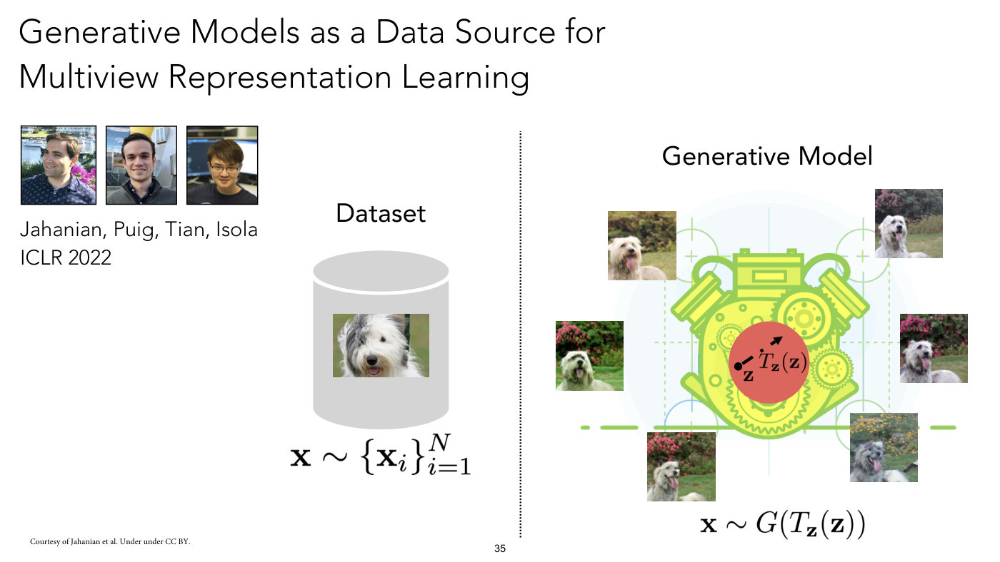

Title: "Generative Models as a Data Source for Multiview Representation Learning". At the left, three portrait photographs of people, with the text "Jahanian, Puig, Tian, Isola" and "ICLR 2022". A dotted vertical line splits the slide. Left half: the heading "Dataset" above a grey cylinder (a database icon) containing a photograph of a shaggy white-and-grey dog; below it $\mathbf{x} \sim \lbrace \mathbf{x}_ i \rbrace_{i=1}^{N}$. Right half: the heading "Generative Model" above a green-and-yellow engine illustration with a red disc at its centre in which a black dot labelled $\mathbf{z}$, with a dashed arrow from it pointing up and to the right and the label $T_{\mathbf{z}}(\mathbf{z})$ beside the arrow (no second point is drawn); around the engine are six pictures of a shaggy dog, varying in coat colour, pose and position, on grass in front of flowering bushes. Below it: $\mathbf{x} \sim G(T_{\mathbf{z}}(\mathbf{z}))$. Credit at the lower left: "Courtesy of Jahanian et al. Under under CC BY." (printed as "Under under"; a credit, not an OCW notice). Printed slide number "35".

## Slide 36 — Contrastive Learning

Title: "Contrastive Learning". At the left, the heading "Data space" over a blue blob with three lobes; two black dots in its upper lobe are joined by a dotted curve. An arrow from the upper dot points to a photograph of a tiger in a green frame; an arrow from the lower dot points to a second photograph, of a tiger's striped legs as it walks through water, also in a green frame. Each photograph has an arrow to a white trapezoid labelled $f$ (an encoder, wide on the left and narrow on the right) followed by a dark grey rectangle. From each output rectangle an arrow points into a large grey circle labelled "Representation space" at the right, both arrows ending at the same single green dot near the circle's upper left. Below, a photograph of an elephant in a red frame has a long arrow, passing under the encoders, to a red dot in the same circle, lower right of the green dot and apart from it. Credit at the lower left: "Courtesy of Jahanian et al. Under under CC BY." (printed as "Under under"). Printed slide number "36".

## Slide 37 — Contrastive learning + Generative modeling

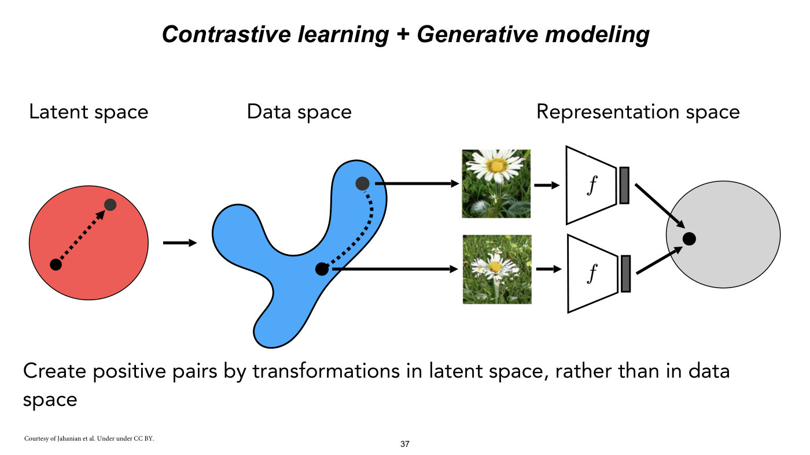

Title: "Contrastive learning + Generative modeling" (bold italic). Three headings across the top: "Latent space", "Data space", "Representation space". At the left, a red disc containing two black dots joined by a dotted arrow that points from the lower-left dot to the upper-right dot. A solid arrow leads right to a blue three-lobed blob (the data space) holding two black dots joined by a dotted curve. From each dot a solid arrow points right to a photograph of a white flower with a yellow centre in grass (two different photographs, one above the other). Each photograph has an arrow to a white trapezoid labelled $f$ followed by a dark grey rectangle, and from each of those an arrow points to the same single black dot inside a large grey circle at the right (the representation space). Caption at the bottom: "Create positive pairs by transformations in latent space, rather than in data space". Credit at the lower left: "Courtesy of Jahanian et al. Under under CC BY." (printed as "Under under"). Printed slide number "37".

## Slide 38 — Contrastive learning + Generative modeling

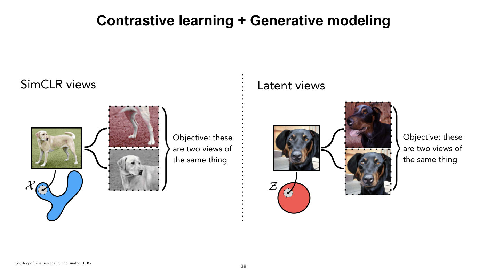

Title: "Contrastive learning + Generative modeling". A dotted vertical line splits the slide into two halves.

Left half, heading "SimCLR views": a photograph of a pale yellow dog standing on grass, with a line down to a small grey dotted circle on a blue blob labelled $\mathcal{X}$ (the label is a script X). Two curly arms from the photograph point to two tiles with dotted borders: the upper shows a close crop of a dog's legs on a reddish-tinted ground, the lower shows a greyscale close-up of the dog's head. A brace to the right encloses both, with the text "Objective: these are two views of the same thing".

Right half, heading "Latent views": a photograph of a black-and-tan dog's face, with a line down to a small grey dotted circle inside a red disc labelled $\mathcal{Z}$ (script Z). Two curly arms point to two tiles with dotted borders: the upper shows a black-and-tan dog with its head turned to the side and its tongue out against a reddish background; the lower is the original photograph again. A brace encloses both, with the text "Objective: these are two views of the same thing". Credit at the lower left: "Courtesy of Jahanian et al. Under under CC BY." (printed as "Under under"). Printed slide number "38".

## Slide 39 — Contrastive learning + Generative modeling

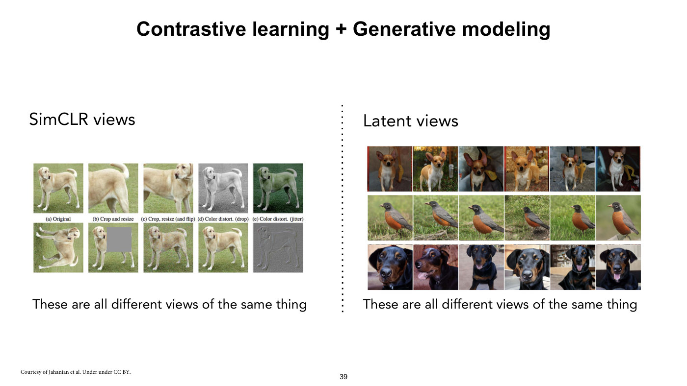

Title: "Contrastive learning + Generative modeling". A dotted vertical line splits the slide into two halves.

Left half, heading "SimCLR views": a 2 by 5 grid of photographs of a pale yellow dog on grass, with the captions printed between the rows (in small serif type) "(a) Original", "(b) Crop and resize", "(c) Crop, resize (and flip)", "(d) Color distort. (drop)", "(e) Color distort. (jitter)". The top row shows the original, a close crop of the rear half, a flipped and cropped version, a greyscale version and a green-tinted version. The bottom row, which has no captions, shows five further variants: a rotated version, a version with a grey square pasted over the middle, a noisy version, a version that looks almost the same as the original, and a grey embossed edge-like version. Under it: "These are all different views of the same thing".

Right half, heading "Latent views": a 3 by 6 grid of photographs, each row showing the same subject six times with different backgrounds, poses and viewpoints: a small tan-and-white dog with large upright ears (top row), a bird with a black head, grey back and orange-red breast, on grass in every tile (middle row), a black-and-tan dog (bottom row). Under it: "These are all different views of the same thing". Credit at the lower left: "Courtesy of Jahanian et al. Under under CC BY." (printed as "Under under"). Printed slide number "39".

## Slide 40 — Contrastive learning + Generative modeling

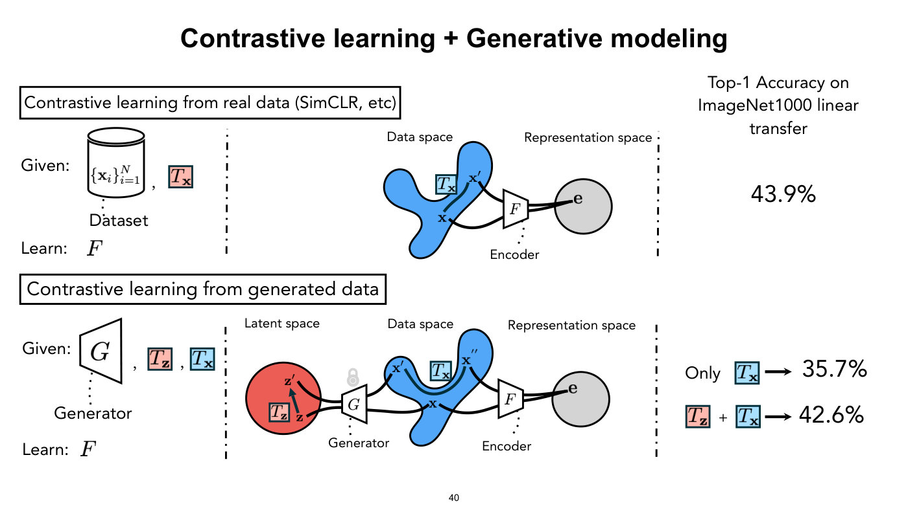

Title: "Contrastive learning + Generative modeling". Two panels, one above the other, each under a boxed heading, with dash-dotted vertical dividers within each. The header "Top-1 Accuracy on ImageNet1000 linear transfer" stands at the top right, level with the first heading.

Top panel, boxed heading "Contrastive learning from real data (SimCLR, etc)". Left: "Given:" followed by a cylinder icon containing $\lbrace \mathbf{x}_ i \rbrace_{i=1}^{N}$ with the label "Dataset" below, a comma, and a pink square containing $T_{\mathbf{x}}$; "Learn:" followed by $F$. Middle: a diagram with the labels "Data space" and "Representation space": a blue blob with two points $\mathbf{x}$ and $\mathbf{x}'$ joined by a curve labelled with a light-blue square $T_{\mathbf{x}}$; from both points lines lead into a trapezoid labelled $F$ (with the label "Encoder" below it), whose output goes to a single point $\mathbf{e}$ in a grey circle. At the right: "Top-1 Accuracy on ImageNet1000 linear transfer" and "43.9%".

Bottom panel, boxed heading "Contrastive learning from generated data". Left: "Given:" followed by an inverted trapezoid $G$ (label "Generator" below), a comma, a pink square $T_{\mathbf{z}}$, a comma, and a light-blue square $T_{\mathbf{x}}$; "Learn:" followed by $F$. Middle: a diagram with the labels "Latent space", "Data space", "Representation space": a red disc containing points $\mathbf{z}$ and $\mathbf{z}'$ joined by an arrow labelled with a pink square $T_{\mathbf{z}}$; both points go into a trapezoid $G$ (shown with a grey padlock above it and the label "Generator" below), whose outputs reach the blue blob at points $\mathbf{x}$ and $\mathbf{x}'$; a further point $\mathbf{x}''$ is joined to $\mathbf{x}'$ by a curve labelled with a light-blue square $T_{\mathbf{x}}$. Lines from $\mathbf{x}$ and $\mathbf{x}''$ lead into the trapezoid $F$ ("Encoder"), whose output goes to the single point $\mathbf{e}$ in a grey circle. At the right: "Only" followed by a light-blue square $T_{\mathbf{x}}$, an arrow, "35.7%"; and a pink square $T_{\mathbf{z}}$ "+" a light-blue square $T_{\mathbf{x}}$, an arrow, "42.6%". Printed slide number "40".

## Slide 41 — Contrastive learning + Generative modeling

Title: "Contrastive learning + Generative modeling". Two paragraphs: "Deep generative views improve contrastive learning beyond only using standard data augmentation." and "When the generative model is high quality, can even outperform learning from real data." Printed slide number "41".

## Slide 42 — Data++

*OCW notice: © source unknown. All rights reserved. This content is excluded from our Creative Commons license. For more information, see https://ocw.mit.edu/help/faq-fair-use/ (small print along the bottom edge, running across the slide number; it covers the grid of volcano images).*

Title: "Data++". At the left, a small graphical-model diagram: a circle labelled $z$ with four dotted arrows radiating outward from it to the corners, and a solid arrow down to a grey-filled circle labelled $x$; the caption "Datapoint++". Below it, a 5 by 5 grid of photographs of a volcano in a landscape, varying along the rows and columns: brightness rises both down the rows and across the columns, from a dark scene with a glowing red crater (upper left), through a dark blue night scene with a whitish glow at the summit (top right) and an orange-lit dusk scene with a red crater (lower left), to bright daylight under a very pale sky with a pale summit (lower right). At the right, three paragraphs: "Samples from implicit generative models act like decorated data, *data++*, with extra functionality." / "With special operators, you can *interpolate*, *extrapolate*, *manipulate*, *compose*, *optimize*, and *label* these datapoints." / "Everything you can do with regular data, you can also try with data++. It might work better!" (the words data++ in the first paragraph, and interpolate, extrapolate, manipulate, compose, optimize and label, are in italics). Printed slide number "42" (overlapped by the notice).

## Slide 43 — Meta-learning: learning to learn fast

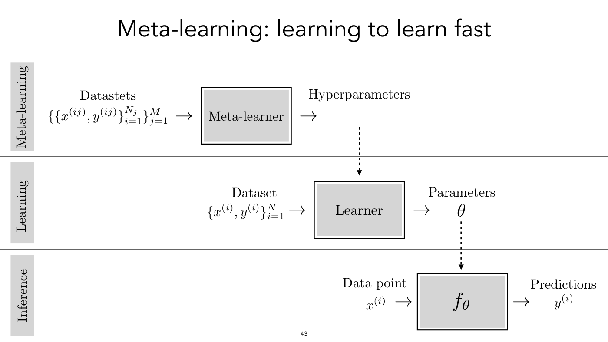

Title: "Meta-learning: learning to learn fast". Three horizontal bands separated by thin grey lines, each with a rotated grey label at the far left: "Meta-learning" (top), "Learning" (middle), "Inference" (bottom).

- Meta-learning band: the label "Datastets" (printed as "Datastets") above $\lbrace \lbrace x^{(ij)}, y^{(ij)} \rbrace_{i=1}^{N_ j} \rbrace_{j=1}^{M}$, then an arrow into a grey box "Meta-learner", then an arrow to the label "Hyperparameters". A dotted arrow runs down from the Hyperparameters label into the Learner box in the next band.
- Learning band: the label "Dataset" above $\lbrace x^{(i)}, y^{(i)} \rbrace_{i=1}^{N}$, an arrow into a grey box "Learner", then an arrow to the label "Parameters" above $\theta$. A dotted arrow runs down from $\theta$ into the box in the next band.
- Inference band: the label "Data point" above $x^{(i)}$, an arrow into a grey box containing $f_{\theta}$, then an arrow to the label "Predictions" above $y^{(i)}$.

Printed slide number "43".

## Slide 44 — MAML: Model-Agnostic Meta-Learning

Title: "MAML: Model-Agnostic Meta-Learning". Citation below the title: "[Finn, Abbeel, Levine 2017]". Bullets:

- "So far we saw transfer learning as: given some prior model/representation, how can we quickly adapt it?"
- "Could we *learn* to do transfer learning?" (learn in italics)
- "Consider finetuning: given an init, update it with SGD"
- "MAML: *learn* an init such just a few steps of SGD will update it very effectively" (learn in italics; "such just" as printed)

Printed slide number "44".

## Slide 45 — MAML: Model-Agnostic Meta-Learning

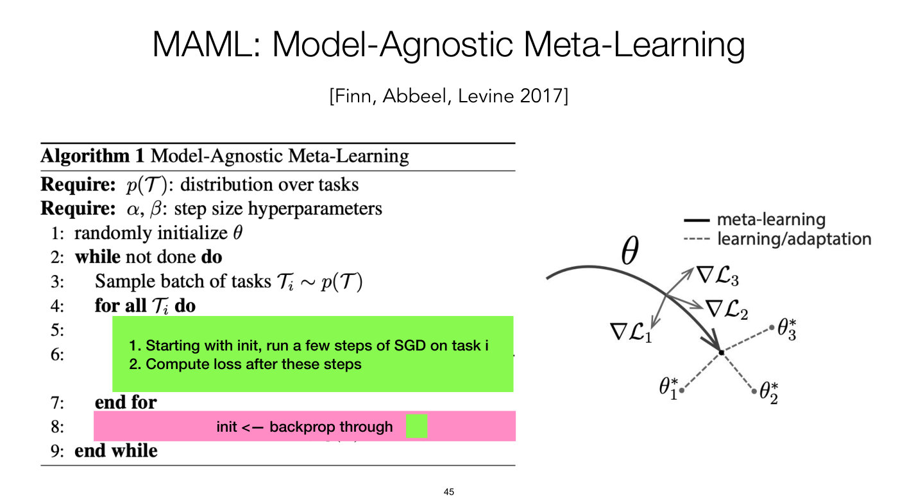

Title: "MAML: Model-Agnostic Meta-Learning". Citation: "[Finn, Abbeel, Levine 2017]". At the left, a pasted algorithm box from the paper, headed "Algorithm 1 Model-Agnostic Meta-Learning":

- "Require: $p(\mathcal{T})$: distribution over tasks"
- "Require: $\alpha$, $\beta$: step size hyperparameters"
- "1: randomly initialize $\theta$"
- "2: while not done do"
- "3: Sample batch of tasks $\mathcal{T}_ i \sim p(\mathcal{T})$"
- "4: for all $\mathcal{T}_ i$ do"
- Lines 5 and 6 are hidden under a bright green rectangle that reads "1. Starting with init, run a few steps of SGD on task i" and "2. Compute loss after these steps". Only the line numbers "5:" and "6:" are visible.
- "7: end for"
- Line 8 is hidden under a pink bar that reads "init <— backprop through" followed by a small green square; only the line number "8:" is visible (a few stray marks of the hidden formula show beneath the bar).

  The pasted algorithm is one image, and it still holds the covered lines, which the page does not show: "5: Evaluate $\nabla_{\theta} \mathcal{L}_ {\mathcal{T}_ i}(f_{\theta})$ with respect to $K$ examples", "6: Compute adapted parameters with gradient descent: $\theta_ i' = \theta - \alpha \nabla_{\theta} \mathcal{L}_ {\mathcal{T}_ i}(f_{\theta})$" and "8: Update $\theta \leftarrow \theta - \beta \nabla_{\theta} \sum_{\mathcal{T}_ i \sim p(\mathcal{T})} \mathcal{L}_ {\mathcal{T}_ i}(f_{\theta_ i'})$" (read by the audit from the embedded image).
- "9: end while"

At the right, a figure from the paper: a legend with a thick solid line "meta-learning" and a dashed line "learning/adaptation". A thick dark grey curved arrow labelled $\theta$ sweeps from the left down to a black point, ending in an open arrowhead. From a point on that curve three thin grey arrows radiate outward, each with one arrowhead, to the labels $\nabla \mathcal{L}_ 3$ (up and to the right), $\nabla \mathcal{L}_ 2$ (to the right) and $\nabla \mathcal{L}_ 1$ (down and to the left); from the black point three dashed grey lines lead to small grey dots labelled $\theta_{3}^{\ast}$ (upper right), $\theta_{2}^{\ast}$ (lower right) and $\theta_{1}^{\ast}$ (lower left). The pasted algorithm and figure carry no credit or OCW notice beyond the citation. Printed slide number "45".

## Slide 46 — MAML: Model-Agnostic Meta-Learning

Title: "MAML: Model-Agnostic Meta-Learning". Citation: "[Finn, Abbeel, Levine 2017]". The pink bar "init <— backprop through" followed by a small green square. Then "How to backprop through" followed by a green square and "?". Then:

"1 step SGD:" followed by a green square and a line of code-like text (the words forward and backward are monospace, forward in green, backward in red):

`= forward(x, backward(forward(x, θ)) + θ)`

"2 steps SGD:" followed by a green square and:

`= forward(x, backward(forward(x, backward(forward(x, θ)) + θ), θ) + θ)`

Printed slide number "46".

## Slide 47 — You can backprop through backward!

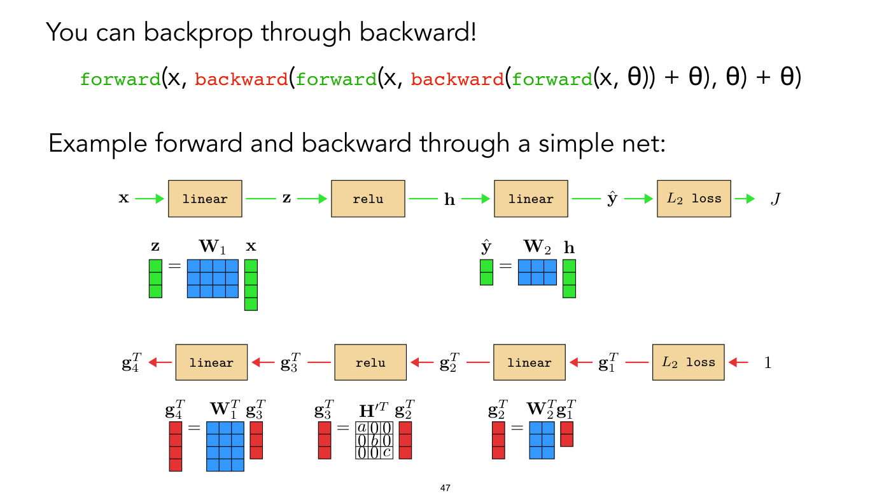

Title: "You can backprop through backward!". Below it, in code-like text (forward in green, backward in red, monospace; the arguments in a sans-serif face):

`forward(x, backward(forward(x, backward(forward(x, θ)) + θ), θ) + θ)`

Then: "Example forward and backward through a simple net:".

Forward diagram (green arrows, left to right): $\mathbf{x}$ → tan box "linear" → $\mathbf{z}$ → tan box "relu" → $\mathbf{h}$ → tan box "linear" → $\hat{\mathbf{y}}$ → tan box $L_2$ loss → $J$. Under the first "linear" box, a matrix picture: $\mathbf{z}$ (a column of 3 green cells) $=$ $\mathbf{W}_ 1$ (a blue grid, 3 rows by 4 columns) times $\mathbf{x}$ (a column of 4 green cells). Under the second "linear" box: $\hat{\mathbf{y}}$ (a column of 2 green cells) $=$ $\mathbf{W}_ 2$ (a blue grid, 2 rows by 3 columns) times $\mathbf{h}$ (a column of 3 green cells).

Backward diagram (red arrows, right to left): "1" → $L_2$ loss → $\mathbf{g}_ 1^T$ → "linear" → $\mathbf{g}_ 2^T$ → "relu" → $\mathbf{g}_ 3^T$ → "linear" → $\mathbf{g}_ 4^T$. Under the boxes, three matrix pictures: $\mathbf{g}_ 4^T = \mathbf{W}_ 1^T \mathbf{g}_ 3^T$ (red column of 4 cells, a blue grid of 4 rows by 3 columns, a red column of 3 cells); $\mathbf{g}_ 3^T = \mathbf{H}'^T \mathbf{g}_ 2^T$ (red column of 3 cells, a 3 by 3 grid with $a$, $b$, $c$ on the diagonal and 0 elsewhere, a red column of 3 cells); $\mathbf{g}_ 2^T = \mathbf{W}_ 2^T \mathbf{g}_ 1^T$ (red column of 3 cells, a blue grid of 3 rows by 2 columns, a red column of 2 cells). (Cell counts confirmed from the vector data.) Each arrow runs from one box to the next with its variable printed over its middle, and its arrowhead at the next box. Printed slide number "47".

## Slide 48 — You can backprop through backward!

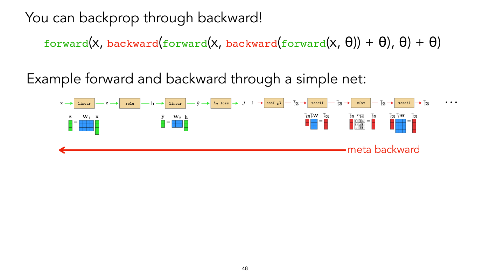

Title: "You can backprop through backward!". The same code-like line as slide 47:

`forward(x, backward(forward(x, backward(forward(x, θ)) + θ), θ) + θ)`

and "Example forward and backward through a simple net:". Below, one long, small-scale diagram combining slide 47's two diagrams on a single row: the green forward chain $\mathbf{x}$ → "linear" → $\mathbf{z}$ → "relu" → $\mathbf{h}$ → "linear" → $\hat{\mathbf{y}}$ → $L_2$ loss → $J$, then a red backward chain that continues from it, starting at "1" and running through $L_2$ loss, $\mathbf{g}_ 1^T$, "linear", $\mathbf{g}_ 2^T$, "relu", $\mathbf{g}_ 3^T$, "linear", $\mathbf{g}_ 4^T$, followed by three dots "…". The boxes and labels of the red chain (and the matrix pictures under them) are printed mirror-reversed (flipped left to right), which reads as the backward pass drawn as a reflection of the forward pass; the red arrows point right. The forward matrix pictures from slide 47 ($\mathbf{z} = \mathbf{W}_ 1 \mathbf{x}$ and $\hat{\mathbf{y}} = \mathbf{W}_ 2 \mathbf{h}$) sit under the green chain, and the three backward matrix pictures (mirror-reversed) sit under the red chain. No line joins $J$ to the "1"; there is a gap between the two chains. Below the whole diagram a long red arrow points left, its open arrowhead under the diagram's left end at $\mathbf{x}$ and its tail ending under the red chain's "relu" box, where the red label "meta backward" begins and runs on to the right; arrow and label together span the diagram. Printed slide number "48".

## Slide 49 — Task-Informed MAML for Agriculture

*OCW notice: © AAAI. All rights reserved. This content is excluded from our Creative Commons license. For more information, see https://ocw.mit.edu/help/faq-fair-use/ (small print beneath the two maps at the lower left; it covers the maps and the scatter plot).*

Title: "Task-Informed MAML for Agriculture". Bullets at the left:

- "In practice, the gains of this method are not often worth the additional computational cost at training time (worse than just pretraining?)"
- "Tseng et al. introduce a geospatial embedding that encodes task-specific context into meta-learning, and helps performance"

Below the bullets, two side-by-side map images: at the left a satellite-style view of green and brown land with a pale road running diagonally from the lower left to the upper right and a dark green area covering roughly the lower-right third; at the right, the same area as a heat map in black, red, orange and yellow. A vertical colour bar beside it runs from yellow at the top, labelled "Maize", to near-black at the bottom, labelled "Non-maize". Citation along the bottom: "TIML: Task-Informed Meta-Learning for Agriculture, Tseng et al., 2022".

At the right, a scatter plot with error bars. Y-axis: "AUC ROC score", ticks 0.4, 0.5, 0.6, 0.7, 0.8. X-axis: "Training sample size", ticks 20, 40, 60, 80, 100, 120; points are drawn at 8 sample sizes, 20, 32, 48, 64, 80, 96, 112 and 128 (Random Forest at only five of them: 20, 32, 64, 96, 128). Caption: "(a) Kenya: Maize vs. Rest". The legend box below is cropped from another panel of the same paper figure (its panel "(b) Togo: Crop vs. Non Crop", clipped so that only the legend shows), with the same series and markers. Legend with 5 series, in this order (values read approximately from the plot):

- TIML (blue circle): about 0.73 at the first point, then about 0.75 to 0.76 for the rest, ending near 0.76.
- MAML (orange cross): about 0.65 at the first point, rising to about 0.69 by the sixth point and staying near 0.69.
- Pretrained (green upward triangle): about 0.70 at every point.
- Random Weights (red downward triangle): about 0.35 at the first point, then about 0.39 to 0.445, ending near 0.46 (large error bars, about ±0.03 to ±0.045).
- Random Forest (purple upward triangle, plotted at 20, 32, 64, 96 and 128 only): about 0.45, 0.54, 0.56, 0.58 and 0.59.

Printed slide number "49".

## Slide 50 — Meta-learning by sequence modeling

Title: "Meta-learning by sequence modeling". Bullets:

- "Definition of learning:"
  - "input: a sequence x0, y0, x1, y1, x2, y2, …"
  - "output:  a function f: x—> y"
- "x0, y0, x1, y1, x2, y2, x3, ?"
- "RNN state + params is f, apply that f to x3"

Printed slide number "50".

## Slide 51 — Transfer Learning II

Title: "Transfer Learning II". Bullets:

- "Transferring knowledge about the inputs"
  - "Generative models as data++"
- "Meta-learning"

Printed slide number "51".

## Slide 52 — (no title; OCW end page)

OCW's end page, smaller than the lecture slides and not lecture content. Text: "MIT OpenCourseWare", "https://ocw.mit.edu", "6.7960 Deep Learning", "Fall 2024", "For information about citing these materials or our Terms of Use, visit: https://ocw.mit.edu/terms". Printed slide number "52" at bottom centre.
