# Lecture 21 — Language Models: slide-by-slide

Text and figures of all 92 pages of
[`mit6_7960_f24_lec21.pdf`](https://ocw.mit.edu/courses/6-7960-deep-learning-fall-2024/mit6_7960_f24_lec21.pdf),
transcribed from the deck. This is a guest lecture by Jacob Andreas, introduced by Phillip Isola; the title slide reads "Language
models" and "Jacob Andreas (many slides by Chris Tanner & Yoon Kim)". The deck is a compressed version of lectures from MIT's NLP
course, 6.861 (≈1:34 in the recording), and keeps that course's section colours and outline slides. **Cite these as "slide N",
where N is the PDF page**: the deck prints its own number only on pages 1–7, and the small numbers in the bottom-right corner of
eleven pages are the source decks' (see the front matter). Diagrams, plots and pictures are described in prose since the KB is read
as text. The equations are typed math whose text layer loses its structure; all were read from the page, never from the text layer.

The recording covers the whole deck, ending at ≈1:15:27 with a return to slide 11; the lecturer says twice that his slides are "a little out of order" (≈31:08, ≈57:41).

**Images.** Eighteen slides have a rendered image under their heading: 5, 12, 16, 19, 20, 36, 37, 38, 39, 41, 42, 47, 51, 72, 74, 79, 81 and 82. The nineteen slides with an OCW notice (26–29, 31–35, 52–56, 58–60, 63 and 86) are never rendered; no other slide reuses an excluded image. The others were not rendered because they are text, equations, tables or screenshots of text that this file reproduces (2, 6, 8–11, 13, 14, 17, 18, 21, 24, 25, 40, 43, 46, 48–50, 57, 64–71, 80, 83 and 87–91), build steps or repeats that a rendered slide supersedes (4, in 5; 15, slide 12's left panel; 73, in 74; 75–78, in 79), slide 7 (overlay text on faded copies of slide 6's images), outline slides (3, 22, 23, 44, 45, 61, 62, 84 and 85), the section break (30), the title (1) or the end page (92).

Companion pages: [wiki page for this lecture](../../wiki/21-language-models.md) · [transcript](../transcripts/21-language-models.md)

**Signposting slides you can skip.** Slide 1 is the title; slides 3, 22, 23, 44, 45, 61 and 62 repeat the outline of the prompting
part (Review, Prompting, In-Context, Chain-of-Thought, Instruction Tuning), each with one entry highlighted; slides 84 and 85 are the
outline of the RLHF part (Motivation, Rewards, RLHF, DPO, Remaining Issues/Ideas), of which only "Motivation" and "Rewards" have slides
after them; slide 30 is a section break; slide 92 is the OCW end page.

Some slides are **build steps**, transcribed individually with a note of what they add: 4 and 5 (the perplexity table and the path
from count-based models to LLMs), 8 to 11 (the four eras, one column at a time), 26 to 28 (zero-, one- and few-shot), 29 and 31 to 33
(the sentiment prompt, annotated step by step; slide 63 repeats slide 29), 41 and 42, 58 and 59, 64 to 66, 68 and 69, 73 to 79, 87
and 88, and 89 and 90. Slides with no printed title are headed here with a description: 2, 30, 58, 59, 80 and 83.

**Printed slips and oddities**, kept as printed and flagged in each entry: slide 2's "Created with Chat GPT."; slide 28's "plush girafe" (the English half; "girafe" in the French half is the French spelling, which is outside the course material); slide 47's two formulas, which open a second parenthesis after the bar and close only one; slide 55's "GMS8K"; slide 57's caption, cropped through the final letter of "optimization"; the same review printed "is worth seeking" (slides 29, 31–33 and 63), "is worth thinking" (slides 64–66) and "is worth watching" (slide 67); slide 72's in-chart labels, clipped in the figure; slide 75's "MIT is located Cambridge, MA."; slide 79's red answer, opened with a quote mark and never closed; slide 80's "Created with ChatGPT.."; slide 82's "response are"; and slide 87's "instructions-tuned data". Some pages hide things under white boxes: slide 1 the 6.861 deck's title block ("Lecture 8: Prompting", "Chain-of-thought and more!", "6.861* Fall 2024", "Jacob Andreas and Chris Tanner"); slide 4 slide 5's additions; slide 6 the training-compute chart that slide 7 shows faded; slide 29 its figure's header, rules and the test answer "Positive"; and slide 89 an earlier draft of slide 90's lower half. Each entry describes what the page shows.

**OCW licence notices** are on slides 26–29, 31–35, 52–56, 58–60, 63 and 86, nineteen in all, all typed and in the text layer; the slide file's set and the text layer's are the same, and a scan for notices drawn as glyph outlines found none. Each notice is transcribed as an `*OCW notice: …*` line with the picture it covers: Brown et al.'s prompt figures and SuperGLUE charts (26–28, 34, 35), Zhao et al.'s sentiment prompt (29, 31–33, 63), Kojima et al.'s figures and tables (52–56), the meme (58, 59), the prompt-engineering screenshots (60) and the MIT News article (86, both columns). Slides 37–39, 43 and 46–51 carry "Courtesy of … Used under CC BY" credits, and slide 16 "Image is in the public domain." Several slides reproduce third-party charts and tables with only a citation or none (slides 6, 7, 13, 19, 20, 36, 40, 57, 72 and 81); [`LICENSE.md`](../../LICENSE.md) lists the rendered ones. The screenshots of model outputs are captioned "Created with ChatGPT" or "Created with InstructGPT".

## Contents

| Slides | Section |
| ------ | ------- |
| 1–2 | Title; a ChatGPT-generated lecture plan |
| 3–21 | Review: the path to LLMs (perplexity from unigrams to GPT-3; large n-gram models in 2007; parameter count as a bad proxy; four eras of NLP); BERT and why masked-LM pretraining works; BERT is not a language model; the arms race; emergent abilities; the GPT-3 paper |
| 22–43 | Prompting, in-context learning: zero-, one- and few-shot prompts; the sentiment example and its labels, extra text and templates; in-context learning against fine-tuning and model size; sensitivity to ordering, label balance, label coverage and label correctness; verbalizers; the impact of few-shot learning; reasoning |
| 44–60 | Chain-of-thought prompting: Wei et al.'s exemplars and results; zero-shot chain of thought (Kojima et al.); searching for optimal prompts; NLP research then and now; prompt engineering |
| 61–83 | Instruction tuning: zero-shot prompting needs instructions; conditioning on instructions does not always work; instruction tuning and its emergence with scale; why instruction tuning is not enough (unknown answers, harmful requests, truthfulness, alignment); GPT-3 plus RL |
| 84–91 | Rewards: a summarization task, sampled summaries scored by a reward, the policy and the expected-reward objective, gradient ascent and policy gradient |
| 92 | OCW end page |

## Slide 1 — Language models

Title: "Language models". Below it a black bar directly over a red bar of about the same thickness spans the slide's centre. Under the bar, at the left, "MIT" in red bold, and at the right the circular MIT seal in dark red. Below: "Jacob Andreas (many slides by Chris Tanner & Yoon Kim)". Printed slide number "1" at bottom centre.

Under the visible title, the text layer still holds the source deck's title block ("Lecture 8: Prompting", "Chain-of-thought and more!", "6.861* Fall 2024", "Jacob Andreas and Chris Tanner"), painted over with opaque white boxes; none of it is visible. The red "MIT" is the one part of that block left showing.

## Slide 2 — (no title; ChatGPT screenshot of an NLP lecture plan)

The slide prints no title. It is a screenshot of a chat window on a pale-grey background, cropped at the bottom so the last line is cut off. At the upper right, in a grey rounded bubble, the user's prompt: "Can you please generate an NLP lecture plan concerning prompting, chain-of-thought, and instruction-tuning? It should be approximately 80 minutes in duration."

Below it, at the left beside a round ChatGPT logo, the reply, transcribed as printed:

"Here's an NLP lecture plan for an 80-minute session on **Prompting, Chain-of-Thought, and Instruction-Tuning**. This plan assumes your audience has a basic understanding of machine learning and natural language processing, and the aim is to explore these advanced topics through a structured progression."

"**Lecture Plan: Prompting, Chain-of-Thought, and Instruction-Tuning**" (bold heading), then "**1. Introduction to NLP in the Context of Prompts (10 minutes)**", then an indented bullet outline:

- **Objective**: Provide a high-level overview of prompting and its significance in NLP.
  - **Overview of Prompting**:
    - Define prompts in NLP: Instructing a language model to perform a task through natural language inputs.
    - **Importance**: How prompting shifts NLP from task-specific models to versatile, general models (e.g., GPT models).
  - **Types of Prompts**:
    - Zero-shot prompting
    - Few-shot prompting
    - Direct prompts vs. instructive prompts
  - **Examples**: (cut off at the bottom edge of the slide)

Bottom right in small grey serif: "Created with Chat GPT." (sic, as printed). Printed slide number "2" at bottom centre.

## Slide 3 — Outline (Review)

Title: "Outline". Five entries, each preceded by a small two-tone colour bar. "Review" (green bar, light over dark green) is highlighted with a pale-yellow box, marking the current section. Then "Prompting" (violet bar), indented below it "In-Context" (red bar) and "Chain-of-Thought" (gold bar), then "Instruction Tuning" (blue bar). Printed slide number "3" at bottom centre; a small "4" at bottom right, the source deck's numbering.

## Slide 4 — The Path to LLMs

Title: "The Path to LLMs", underlined with a green bar.

Left, a table with a header row "Model" and "Perplexity" between horizontal rules:

| Model | Perplexity | Year (green, at right) |
| --- | --- | --- |
| Unigram | ≈ 300 | |
| 3-gram | ≈ 150 | |
| 5-gram | 141.2 | |
| Neural 5-gram | 126.0 | 2000 |
| RNN | 124.7 | 2010 |
| Deep RNN | 107.5 | 2012 |
| LSTM | 78.4 | 2014 |
| LSTM + Hyperparameter tuning | 58.3 | 2016 |
| Transformer | 54.5 | 2017 |

Right, a vertical chain of five black labels joined by blue downward arrows, each arrow labelled in blue: "Count-based Models" → (Sparsity) "Feed-forward Models" → (Longer Context) "Recurrent Neural Networks" → (Vanishing Gradients) "Long-Short Term Memory" → (Fixed dim bottleneck + Parallel computation) "Transformers". Printed slide number "4" at bottom centre.

The page already holds slide 5's additions (the GPT2 and GPT3 rows, the years 2019 and 2020, "Scaling" and "Large Language Models") under white boxes; none of them is visible.

## Slide 5 — The Path to LLMs (build step: GPT2, GPT3, LLMs)

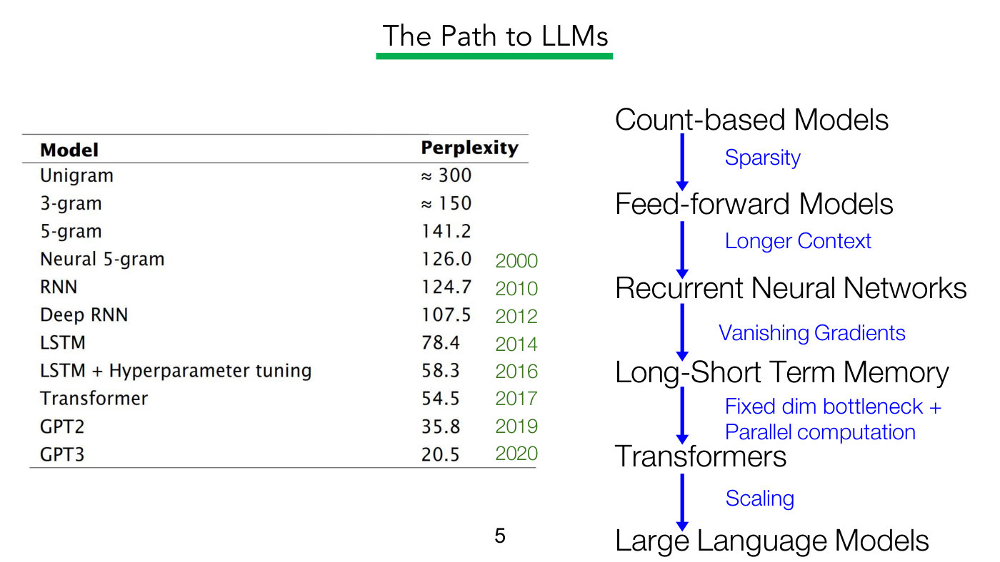

Same title and layout as slide 4, with additions. The table gains two rows after Transformer: "GPT2" 35.8 (2019) and "GPT3" 20.5 (2020), and a closing rule under the table. The chain on the right gains a final blue arrow labelled "Scaling" from "Transformers" to a new bottom label "Large Language Models". Printed slide number "5".

## Slide 6 — The Path to LLMs (Large Language Models in Machine Translation, 2007)

Title: "The Path to LLMs". Beneath it a pasted paper header: "Large Language Models in Machine Translation" (bold serif, with "in Machine Translation" highlighted in pale green) and "(2007)" at the right in sans-serif. Authors: "Thorsten Brants   Ashok C. Popat   Peng Xu   Franz J. Och   Jeffrey Dean".

Lower left, the paper's abstract: "This paper reports on the benefits of large-scale statistical language modeling in machine translation. A distributed infrastructure is proposed which we use to train on up to 2 trillion tokens, resulting in language models having up to 300 billion n-grams. It is capable of providing smoothed probabilities for fast, single-pass decoding. We introduce a new smoothing method, dubbed Stupid Backoff, that is inexpensive to train on large data sets and approaches the quality of Kneser-Ney Smoothing as the amount of training data increases." The phrases "2 trillion tokens," and "300 billion n-grams" are each boxed in red.

Lower right, a table (pasted from another paper) with columns "Model", "Size (# Parameters)", "Training Tokens":

| Model | Size (# Parameters) | Training Tokens |
| --- | --- | --- |
| LaMDA (Thoppilan et al., 2022) | 137 Billion | 168 Billion |
| GPT-3 (Brown et al., 2020) | 175 Billion | 300 Billion |
| Jurassic (Lieber et al., 2021) | 178 Billion | 300 Billion |
| *Gopher* (Rae et al., 2021) | 280 Billion | 300 Billion |
| MT-NLG 530B (Smith et al., 2022) | 530 Billion | 270 Billion |
| *Chinchilla* (below a rule) | 70 Billion | 1.4 Trillion |

"Gopher" and "Chinchilla" are italic; the citations are blue. A fourth raster is drawn on this page, the "Training FLOPS" chart that shows faded on slide 7, but the table and two white boxes cover it completely here. Printed slide number "6".

## Slide 7 — The Path to LLMs ("Number of parameters is a bad proxy for model flexibility")

Title: "The Path to LLMs". Slide 6's four rasters (the paper's title and authors, its abstract, the parameter table, and the chart slide 6 hides under its table) are drawn faded, at about 11% opacity and with no white boxes, so the chart shows below and through the faded table; slide 6's "(2007)", its green highlight and its red boxes are absent. The chart is a web-chart screenshot, "Training FLOPS (Sevilla 2021)" (its red title mostly under the overlay's first line), with a "LINEAR | LOG" toggle and a "Select systems" control at top left: petaFLOPs on a linear y axis ("500 million" to "2.5 billion") against "Publication date" ("Sep 26, 2010", "Jul 31, 2014", "Apr 26, 2017", "Jan 21, 2020"). Its coloured dots lie mostly along the bottom, labelled from "KN5 LM + RNN 400/10 (WSJ)" through "RNNsearch-50*", "GNMT", "PNASNet-5", "AlphaGo Master", "AlphaGo Zero", "AlphaStar", "ObjectNet", "SEER", "ALIGN", "Yuan 1.0" and "Gopher" to "Megatron-Turing NLG 530B" (about 1.4 billion) and, at the top right, "PaLM (540B)" (about 2.5 billion), circled in red. A red "GPT-3" label has a red arrow pointing down to GPT-3's dot, low on the chart (about 300 million) just after Jan 21, 2020. Over it, in large black text: "Number of parameters is a bad proxy for model flexibility" and, below, "How you use the parameters matters much more!" with the word "How" underlined. Printed slide number "7".

## Slide 8 — The Path to LLMs (pipelined NLP)

Title: "The Path to LLMs". First of a column build. A dashed vertical rule about a quarter of the way across separates the first column from the empty space to its right. First column:

- Heading (underlined): "Pipelined NLP"
- "1970–2014"
- "Language model as part of noisy-channel model."
- Equation: $\Pr(\boldsymbol{Y}=\boldsymbol{y} \mid \boldsymbol{X}=\boldsymbol{x}) \propto \Pr(\boldsymbol{X}=\boldsymbol{x} \mid \boldsymbol{Y}=\boldsymbol{y}) \thinspace \Pr(\boldsymbol{Y}=\boldsymbol{y})$, written on two lines; the last factor, $\Pr(\boldsymbol{Y}=\boldsymbol{y})$, is highlighted in pale blue, and to the right of the dashed rule, level with it, sits the blue label "Language model" (no arrow).
- "Applying existing architectures to LM:" with dashes "MLP", "RNN", "LSTM".

No slide number is printed at the bottom centre on this page (the slide file's numbering is by PDF page; nothing is printed here).

## Slide 9 — The Path to LLMs (seq2seq learning)

Build step adding a second column, headed (underlined) "seq2seq learning", after a dashed rule; the first column keeps its text and equation but loses its highlight and its blue "Language model" label, and a second dashed rule follows. Second column:

- "2014–2017"
- "(Conditional) language modeling for sequence prediction."
- Equation: $\Pr(\boldsymbol{Y}=\boldsymbol{y} \mid \boldsymbol{X}=\boldsymbol{x}) = \prod_{t=1}^{T} \Pr(Y_t = y_t \mid \boldsymbol{X}=\boldsymbol{x}, \boldsymbol{Y}_ {\lt t}=\boldsymbol{y}_ {\lt t})$, with the product line highlighted in pale blue.
- "New architectures for seq2seq:" with dashes "GRU", "Attention", "Transformer".

To the right of the second dashed rule, in blue: "Autoregressive conditional language model". No slide number printed.

## Slide 10 — The Path to LLMs (pretrain + transfer)

Build step adding a third column, "Pretrain + Transfer" (underlined), after a dashed rule. Columns 1 and 2 unchanged (no highlights now). Third column:

- "2017–2020"
- "Language model (like) objectives for representation learning."
- Two equations, highlighted in pale blue: $\Pr(X_t = x_t \mid \boldsymbol{X}_ {\lt t}=\boldsymbol{x}_ {\lt t}, \boldsymbol{X}_ {\gt t}=\boldsymbol{x}_ {\gt t})$ and $\arg\max_{\theta} \log \Pr(Y=y \mid \boldsymbol{X}=\boldsymbol{x})$.
- "Big Transformers "language models":" with dashes "Masked LMs", "Probing", "Finetuning".

To the right of the third dashed rule, in blue: "Pretrain as a "language model", then finetune". No slide number printed.

## Slide 11 — The Path to LLMs (pretrain + prompt)

Build step adding a fourth column, "Pretrain + Prompt" (underlined), "2020–", "A single language model for everything". Its equation is just $\Pr(\boldsymbol{X}=\boldsymbol{x})$, centred. Then "BIG Transformer language models:" with dashes "Prompting" and "Exploration of capabilities". The other three columns are unchanged and unhighlighted. No slide number printed.

## Slide 12 — BERT Review (pretrain and fine-tune)

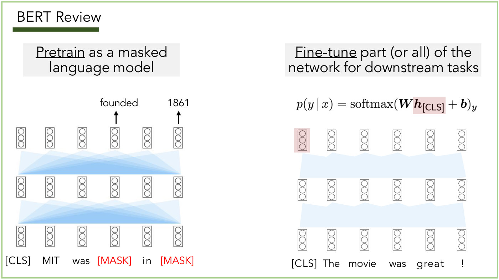

Title: "BERT Review" with a dark-green bar under it; the slide has a thin light-green border (the Review section's frame). Two panels, each with a grey label box.

Left panel, label "Pretrain as a masked language model" ("Pretrain" underlined). A two-layer Transformer diagram: three rows of six small token-embedding boxes (each a vertical stack of three circles), connected between rows by fans of translucent blue triangles (every position attends to every position). Bottom input tokens: "[CLS]", "MIT", "was", "[MASK]", "in", "[MASK]" (the two [MASK] in red). Above the top row, two black up-arrows from the fourth and sixth positions to the predictions "founded" and "1861".

Right panel, label "Fine-tune part (or all) of the network for downstream tasks" ("Fine-tune" underlined). Equation at the top: $p(y \mid x) = \mathrm{softmax}(\boldsymbol{W} \boldsymbol{h}_ {[\mathrm{CLS}]} + \boldsymbol{b})_ y$, with $\boldsymbol{h}_ {[\mathrm{CLS}]}$ highlighted in pink. The same three-row diagram below it with paler, flatter blue bands between rows; the top-left embedding box (the [CLS] position) is highlighted in pink. Input tokens: "[CLS]", "The", "movie", "was", "great", "!". No slide number printed.

## Slide 13 — BERT Review (results)

Title: "BERT Review" (green frame). Centred text: "Results were remarkably strong". Below, a results table (pasted from a paper). Columns: System, MNLI-(m/mm) with 392k, QQP 363k, QNLI 108k, SST-2 67k, CoLA 8.5k, STS-B 5.7k, MRPC 3.5k, RTE 2.5k (training-set sizes under each name), and "Average" (pale-green highlighted column, "-" under it).

| System | MNLI-(m/mm) | QQP | QNLI | SST-2 | CoLA | STS-B | MRPC | RTE | Average |
| --- | --- | --- | --- | --- | --- | --- | --- | --- | --- |
| Pre-OpenAI SOTA | 80.6/80.1 | 66.1 | 82.3 | 93.2 | 35.0 | 81.0 | 86.0 | 61.7 | 74.0 |
| BiLSTM+ELMo+Attn | 76.4/76.1 | 64.8 | 79.8 | 90.4 | 36.0 | 73.3 | 84.9 | 56.8 | 71.0 |
| OpenAI GPT | 82.1/81.4 | 70.3 | 87.4 | 91.3 | 45.4 | 80.0 | 82.3 | 56.0 | 75.1 |
| BERT_BASE | 84.6/83.4 | 71.2 | 90.5 | 93.5 | 52.1 | 85.8 | 88.9 | 66.4 | 79.6 |
| BERT_LARGE | **86.7/85.9** | **72.1** | **92.7** | **94.9** | **60.5** | **86.5** | **89.3** | **70.1** | **82.1** |

BERT_LARGE's values are bold (its row label is not), and so is the "Average" header. A rule separates the first three rows from the two BERT rows. No slide number printed.

## Slide 14 — BERT Review (why does this work?)

Title: "BERT Review" (green frame). Centred large text: "Why does this work?" No slide number printed.

## Slide 15 — BERT Review (why it works: knowledge in parameters)

Title: "BERT Review" (green frame). Left: the pretraining panel of slide 12 again (label "Pretrain as a masked language model"; tokens "[CLS] MIT was [MASK] in [MASK]", predictions "founded" and "1861"). Right, text: "Predicting words in context requires linguistic & world knowledge!" and "Such knowledge is implicitly captured within the Transformer's parameters. (Distributional hypothesis)". No slide number printed.

## Slide 16 — BERT Review (probability of a sequence)

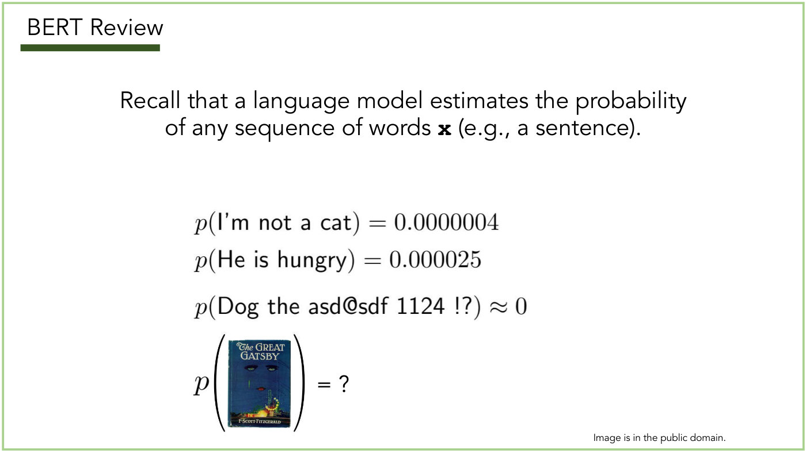

Title: "BERT Review" (green frame). Centred: "Recall that a language model estimates the probability of any sequence of words **x** (e.g., a sentence)." (the bold x in monospace). Then four displayed lines, with the sentences in sans-serif inside math:

- $p(\text{I'm not a cat}) = 0.0000004$
- $p(\text{He is hungry}) = 0.000025$
- $p(\text{Dog the asd@sdf 1124 !?}) \approx 0$
- $p(\ldots) = ?$, where the argument is a picture of a book cover that reads "The GREAT GATSBY" with the author line "F·SCOTT·FITZGERALD" (small caps, with middle dots) at its foot, a dark-blue cover with a face and a glowing amusement-park scene.

Bottom right, small print: "Image is in the public domain." No slide number printed.

## Slide 17 — BERT Review (BERT is not a language model)

Title: "BERT Review" (green frame). Centred text: "Thus, BERT is NOT a language model." and below: "Nowadays, "large language model" ≈ large Transformer pre-trained with a self-supervised objective (next-word prediction)". No slide number printed.

## Slide 18 — LLMs Review (pretrain-then-finetune needs labelled data)

Title: "LLMs Review" (green frame, green bar). Three centred paragraphs: "So far, we've used the masked language modelling objective to pre-train Transformers for **representation learning**" ("representation learning" in bold); "These learned representations were highly effective for downstream tasks." ("learned representations" in blue); "Yet, this pretrain-then-finetune paradigm still requires non-trivial amounts of labelled data (e.g., hundreds of samples)". No slide number printed.

## Slide 19 — LLMs Review (arms race chart)

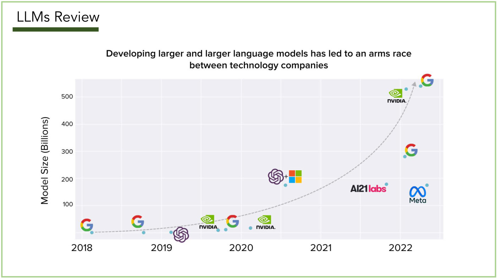

Title: "LLMs Review" (green frame). Bold centred caption: "Developing larger and larger language models has led to an arms race between technology companies". A pasted scatter chart on a pale grey grid. Y axis: "Model Size (Billions)", ticks 100, 200, 300, 400, 500. X axis: years 2018, 2019, 2020, 2021, 2022. Each point is a small teal dot with a company logo beside it; no model names are printed. A grey dashed arrow curves upward from the first Google dot, hugging the 2018–2020 points, passes well below the OpenAI + Microsoft dot and above the AI21labs, Meta and 280-billion Google dots, and rises steeply to an arrowhead by the top Google logo (2022, about 540). Logos and approximate positions (x year, y billions):

- Google logo, about 2018.1, near 0 (dot about 2018.1, 0).
- Google, about 2018.8, near 0.
- OpenAI logo, about 2019.2, near 0 (dot just left of the logo).
- NVIDIA, about 2019.6, about 8 (dot at about 2019.7).
- Google, about 2019.8, about 10.
- NVIDIA, about 2020.2, about 15.
- OpenAI logo + Microsoft logo (with a plus sign), about 2020.6, about 175 (dot just below).
- AI21labs (pink wordmark), about 2021.8, about 178 (dot to its right).
- Google, about 2022.1, about 280.
- Meta, about 2022.2, about 175.
- NVIDIA, about 2022.1, about 530.
- Google, about 2022.3, about 540, at the head of the dashed arrow.

No slide number printed.

## Slide 20 — Emergent Abilities of LLMs

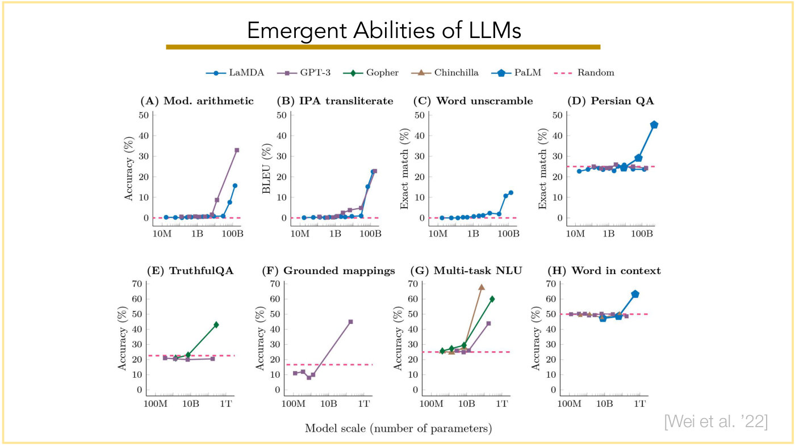

Title: "Emergent Abilities of LLMs", with a gold bar under it; the slide has a thin pale-yellow border. Citation at bottom right in grey: "[Wei et al. '22]". A pasted figure of eight small line charts in two rows of four, sharing one legend at the top: LaMDA (blue line, round marker), GPT-3 (purple line, square marker), Gopher (green line, diamond marker), Chinchilla (brown line, triangle marker), PaLM (the same blue as LaMDA, told apart by a thicker line and larger pentagon markers), Random (pink dashed line). Shared x-axis label at the bottom: "Model scale (number of parameters)", log scale. Panels:

- (A) "Mod. arithmetic": y "Accuracy (%)" 0 to 50; x ticks 10M, 1B, 100B. Random dashed at 0. LaMDA and GPT-3 sit at about 0 up to about 10B; GPT-3 then jumps to about 9 and about 33 at the largest sizes; LaMDA rises to about 1, 8 and 16 at the last three points.
- (B) "IPA transliterate": y "BLEU (%)" 0 to 50; x ticks 10M, 1B, 100B. Random at 0. GPT-3 creeps up to about 2.5, 4 and 5 between about 1B and a few tens of billions, then jumps to about 23; LaMDA stays at about 0 to 1 until about 40B, then rises to about 15 and 22.5; the two meet at about 22 to 23 at the right end.
- (C) "Word unscramble": y "Exact match (%)" 0 to 50; x ticks 10M, 1B, 100B. Random at 0. One series only, LaMDA: about 0 to 2 up to about 40B, then about 11 and 12 at the last two points.
- (D) "Persian QA": y "Exact match (%)" 0 to 50 (tick 0 at bottom); x ticks 10M, 1B, 100B. Random dashed at about 25. LaMDA, GPT-3 and PaLM hover at about 23 to 26 up to about 10B; the PaLM line then rises to about 29 and about 45 at the largest point; GPT-3 stays about 24.
- (E) "TruthfulQA": y "Accuracy (%)" 0 to 70; x ticks 100M, 10B, 1T. Random dashed at about 22. GPT-3 flat at about 20 to 21; Gopher rises from about 21 to 23 to about 43 at its largest size.
- (F) "Grounded mappings": y "Accuracy (%)" 0 to 70; x ticks 100M, 10B, 1T. Random dashed at about 17. GPT-3 at about 11, 12, 8, 10, then jumps to about 45 at the largest size.
- (G) "Multi-task NLU": y "Accuracy (%)" 0 to 70; x ticks 100M, 10B, 1T. Random dashed at about 25. Gopher about 26, 27.5, 29.5 then about 60; Chinchilla about 25, 24.5, 27.5 (each just under a Gopher diamond) then about 68; GPT-3 about 26, 25, 26 then about 44.
- (H) "Word in context": y "Accuracy (%)" 0 to 70; x ticks 100M, 10B, 1T. Random dashed at 50. Three series, GPT-3, Chinchilla and PaLM, all at about 47 to 50 up to about 100B (PaLM dips to about 47 and 48.5 at its first two sizes; GPT-3's last point is about 48.5); PaLM rises to about 63 at its largest size.

No slide number printed.

## Slide 21 — GPT-3 (Few-shot "In-Context Learning" with LLMs)

Top left, section label "GPT-3" with a violet bar under it; the slide has a thin lavender border (the Prompting section's frame). Top centre: Few-shot "In-Context Learning" with LLMs (printed as: Few-shot "In-Context Learning" with LLMs). At the left, in red: "The GPT-3 paper". Centre: a pasted paper title block, a thick rule, "Language Models are Few-Shot Learners", a thin rule, then the author list in bold serif: Tom B. Brown*, Benjamin Mann*, Nick Ryder*, Melanie Subbiah*; Jared Kaplan†, Prafulla Dhariwal, Arvind Neelakantan, Pranav Shyam, Girish Sastry; Amanda Askell, Sandhini Agarwal, Ariel Herbert-Voss, Gretchen Krueger, Tom Henighan; Rewon Child, Aditya Ramesh, Daniel M. Ziegler, Jeffrey Wu, Clemens Winter; Christopher Hesse, Mark Chen, Eric Sigler, Mateusz Litwin, Scott Gray; Benjamin Chess, Jack Clark, Christopher Berner; Sam McCandlish, Alec Radford, Ilya Sutskever, Dario Amodei; then "OpenAI". Bottom right in grey: "[Brown et al. '20]". No slide number printed at the bottom centre.

## Slide 22 — Outline (Review highlighted)

Same outline slide as slide 3: "Outline" with "Review", "Prompting", "In-Context", "Chain-of-Thought", "Instruction Tuning" and their colour bars; "Review" is highlighted in the pale-yellow box. A small "28" at bottom right, the source deck's numbering; no number at bottom centre.

## Slide 23 — Outline (In-Context highlighted)

Same outline slide, with the pale-yellow highlight now on "In-Context" (under "Prompting"). A small "29" at bottom right, the source deck's numbering; no number at bottom centre.

## Slide 24 — Prompting

Top left, label "Prompting" with a violet bar (lavender border). Centred large equation: $P(\cdot \mid x_1, \ldots, x_t)$ with the conditioning part $x_1, \ldots, x_t$ highlighted in pale blue. Below it: "How can we fiddle with the context that we give to language models to get them to do what we want?" with the word "context" in blue. No slide number printed.

## Slide 25 — "In-Context Learning" with LMs

Title: "In-Context Learning" with LMs (as printed: "In-Context Learning" with LMs), violet bar under it. Text: "Input "demonstration data" as history" and "⇒ LM learns to infer what the task is from exemplars". Then three aligned lines:

- "Training labels :" $\lbrace (\boldsymbol{x}^{(i)}, \boldsymbol{y}^{(i)}) \rbrace_{i=1}^{N}$
- "Test input :" $\boldsymbol{x}$
- "Prompted LM :" $P(\cdot \mid \boldsymbol{x}^{(1)}, \boldsymbol{y}^{(1)}, \ldots, \boldsymbol{x}^{(N)}, \boldsymbol{y}^{(N)}, \boldsymbol{x})$

Below, with the N in bold monospace: "N is typically 1-32". Bottom right: "[Brown et al. '20]". No slide number printed.

## Slide 26 — "In-Context Learning" with LMs (zero-shot)

Title as slide 25. Bold "Zero-shot", then "The model predicts the answer given only a natural language description of the task. No gradient updates are performed." Below, a pasted code-style box (pale blue, with a darker left gutter of line numbers, text in blue monospace):

1. `Translate English to French:` with a grey arrow pointing left from the italic label "task description"
2. `cheese =>` followed by a dotted line (the blank to be completed), with an arrow from the italic label "prompt"

*OCW notice: © Brown et al. All rights reserved. This content is excluded from our Creative Commons license. For more information, see https://ocw.mit.edu/help/faq-fair-use/ (bottom right, small print, URL blue and underlined; it covers the whole pasted figure: the "Zero-shot" heading, its description and the box are one image).*

Bottom right: "[Brown et al. '20]". No slide number printed.

## Slide 27 — "In-Context Learning" with LMs (one-shot)

Build on slide 26. Bold "One-shot", then "In addition to the task description, the model sees a single example of the task. No gradient updates are performed." At the right of this text, in dark red: "Task description optional if given exemplars". The code box now has three lines:

1. `Translate English to French:` (its label "task description" now sits on a pale pink highlight)
2. `sea otter => loutre de mer` (label "example")
3. `cheese =>` followed by a dotted line (label "prompt")

*OCW notice: © Brown et al. All rights reserved. This content is excluded from our Creative Commons license. For more information, see https://ocw.mit.edu/help/faq-fair-use/ (bottom right, small print; it covers the whole pasted figure: heading, description and box).*

Bottom right: "[Brown et al. '20]". No slide number printed.

## Slide 28 — "In-Context Learning" with LMs (few-shot)

Bold "Few-shot", then "In addition to the task description, the model sees a few examples of the task. No gradient updates are performed." The code box has five lines:

1. `Translate English to French:` (label "task description")
2. `sea otter => loutre de mer`
3. `peppermint => menthe poivrée`
4. `plush girafe => girafe peluche` (as printed: both halves print "girafe"; the slip is the English half's, for "giraffe", while "girafe" is the French spelling, which is outside the course material)
5. `cheese =>` followed by a dotted line (label "prompt")

A grey bracket joins lines 2 to 4 to the single label "examples".

*OCW notice: © Brown et al. All rights reserved. This content is excluded from our Creative Commons license. For more information, see https://ocw.mit.edu/help/faq-fair-use/ (bottom right, small print, beside the box's lower right; it covers the whole pasted figure: heading, description and box).*

Bottom right: "[Brown et al. '20]". No slide number printed.

## Slide 29 — "In-Context Learning" with LMs (sentiment example)

Title as slide 25. A dark-red horizontal rule runs across the slide under the title. Left, a rounded box holding a prompt in serif type, transcribed as printed:

"Review: the whole thing 's fairly lame , making it par for the course for disney sequels .
Answer: Negative
Review: this quiet , introspective and entertaining independent is worth seeking .
Answer: Positive
Review: this quiet , introspective and entertaining independent is worth seeking .
Answer:"

The two later reviews wrap with a hyphen ("indepen-" / "dent"), the figure's own line break. The pasted figure's header "Prompt (test input not shown)", its table rules and the test example's answer "Positive" are painted over in white; the page shows the answer blank.

Inside the box, along its right edge, bold math labels aligned with the three parts: $\boldsymbol{x}^{(1)}$ and $\boldsymbol{y}^{(1)}$ (first review and its answer), $\boldsymbol{x}^{(2)}$ and $\boldsymbol{y}^{(2)}$ (second), and $\boldsymbol{x}$ (the last review with a blank answer). Curly brackets at the far right: the first two examples are labelled "Training examples (two-shot)" and the last "Test example". Below the box, a thin arrow runs down from the box into a rectangle labelled "LM", and a second arrow from "LM" down to a rectangle labelled "“Positive”". To the right of "LM": $P(\cdot \mid \boldsymbol{x}^{(1)}, \boldsymbol{y}^{(1)}, \ldots, \boldsymbol{x}^{(N)}, \boldsymbol{y}^{(N)}, \boldsymbol{x})$.

*OCW notice: © Zhao et al. All rights reserved. This content is excluded from our Creative Commons license. For more information, see https://ocw.mit.edu/help/faq-fair-use/ (bottom centre, small print; it covers the pasted prompt box).*

Bottom right: "[Example from Zhao et al. '21]". No slide number printed.

## Slide 30 — (section break: possible issues with In-Context Learning)

The slide prints no title; it is a tan full-slide background with large text at upper left: "What are possible issues with In-Context Learning?" with "In-Context Learning" in purple. A small "38" at bottom right, the source deck's numbering; no number at bottom centre.

## Slide 31 — "In-Context Learning" with LMs (labels as natural language)

Build on slide 29 (same prompt box, math labels, LM boxes and formula), without the two braces and their labels "Training examples (two-shot)" and "Test example". Adds: the two answer words "Negative" and "Positive" in the training examples are highlighted in pink, and at the right, in dark red, the note "Need to turn labels into natural language".

*OCW notice: © Zhao et al. All rights reserved. This content is excluded from our Creative Commons license. For more information, see https://ocw.mit.edu/help/faq-fair-use/ (bottom centre, small print; it covers the pasted prompt box).*

Bottom right: "[Example from Zhao et al. '21]". No slide number printed.

## Slide 32 — "In-Context Learning" with LMs (extra text)

Build on slide 31. Adds pale-blue highlights over every "Review:" and every "Answer:" of the template (three of each), and, in blue at the right below the red note, "Extra text on top of input/outputs".

*OCW notice: © Zhao et al. All rights reserved. This content is excluded from our Creative Commons license. For more information, see https://ocw.mit.edu/help/faq-fair-use/ (bottom centre, small print; it covers the pasted prompt box).*

Bottom right: "[Example from Zhao et al. '21]". No slide number printed.

## Slide 33 — "In-Context Learning" with LMs (templates)

Build on slide 32. Adds, in green at the right just above the LM formula, "Templates for turning demonstration data into context", and the formula beside "LM" becomes $P(\cdot \mid \mathrm{template}(\boldsymbol{x}^{(1)}, \boldsymbol{y}^{(1)}, \ldots, \boldsymbol{x}^{(N)}, \boldsymbol{y}^{(N)}, \boldsymbol{x}))$, with the template part highlighted in pale green.

*OCW notice: © Zhao et al. All rights reserved. This content is excluded from our Creative Commons license. For more information, see https://ocw.mit.edu/help/faq-fair-use/ (bottom centre, small print; it covers the pasted prompt box).*

Bottom right: "[Example from Zhao et al. '21]". No slide number printed.

## Slide 34 — "In-Context Learning" vs Finetuning

Title: "In-Context Learning" vs Finetuning (as printed). Left, a pasted chart titled "In-Context Learning on SuperGLUE". Y axis: unlabelled, ticks 40, 50, 60, 70, 80, 90 (linear). X axis: "Number of Examples in Context (K)", ticks 0, 1, 2, 3, 4, 8, 16, 32 (placed at their numeric positions, so 0 to 4 are crowded at the left). Legend (top right): orange line with a dot, "Few-shot GPT-3 175B". Series: one orange line with round markers: K=0 about 58.2; K=1 about 68.8; K=2 about 69.0; K=3 about 68.9; K=4 about 70.2; K=8 about 71.5; K=16 about 72.3; K=32 about 73.2. Five grey dashed horizontal reference lines (annotations, not series), each labelled: "Human" about 89.8 and "Fine-tuned SOTA" about 89.3 (nearly overlapping, at the top, labels at the left); "Fine-tuned BERT++" about 71.6 (label at the left); "Fine-tuned BERT Large" about 69.0 (label at the right, under the line); "Random Guessing" about 45.7 (label at the right, above the line).

Right, text: "Performance increases as the number of demonstration examples increases, but it saturates." and "Still underperforms models finetuned on lots of training data."

*OCW notice: © Brown et al. All rights reserved. This content is excluded from our Creative Commons license. For more information, see https://ocw.mit.edu/help/faq-fair-use/ (bottom right, small print; it covers the chart).*

Bottom right: "[Brown et al. '20]". No slide number printed.

## Slide 35 — Performance as a function of LM size

Title: "Performance as a function of LM size". Left, a pasted chart titled "SuperGLUE Performance". Y axis "SuperGLUE Score", ticks 40 to 90 in steps of 10. X axis "Billions of Parameters in LM", ticks 0.1, 0.4, 0.8, 1.3, 2.6, 6.7, 13, 175, unevenly spaced in a way consistent with a log scale: 0.8 and 1.3 sit close together, and 175 is far to the right. Legend (top right): blue "Zero-shot", green "One-shot", orange "Few-shot (K=32)". Three series with round markers, values at the eight x positions in order:

- Zero-shot (blue): about 40.7, 47.4, 46.8, 49.6, 50.1, 52.3, 54.4, 58.2.
- One-shot (green): about 54.4, 55.1, 56.7, 57.8, 61.2, 59.8, 64.3, 68.9.
- Few-shot, K=32 (orange): about 50.3, 56.2, 56.8, 60.0, 64.3, 63.6, 66.9, 73.2.

Grey dashed reference lines (annotations): "Human" about 89.8 and "Fine-tuned SOTA" about 89.3 at the top (the legend box sits over their right part), "Fine-tuned BERT++" about 71.6, "Fine-tuned BERT Large" about 69.0 (labelled at the left, above its line, unlike slide 34), "Random Guessing" about 45.7 (label at the right).

Right, text: "In-context learning capabilities improve with model size."

*OCW notice: © Brown et al. All rights reserved. This content is excluded from our Creative Commons license. For more information, see https://ocw.mit.edu/help/faq-fair-use/ (bottom right, small print; it covers the chart).*

Bottom right: "[Brown et al. '20]". No slide number printed.

## Slide 36 — In-Context Learning Issues (sensitivity to ordering)

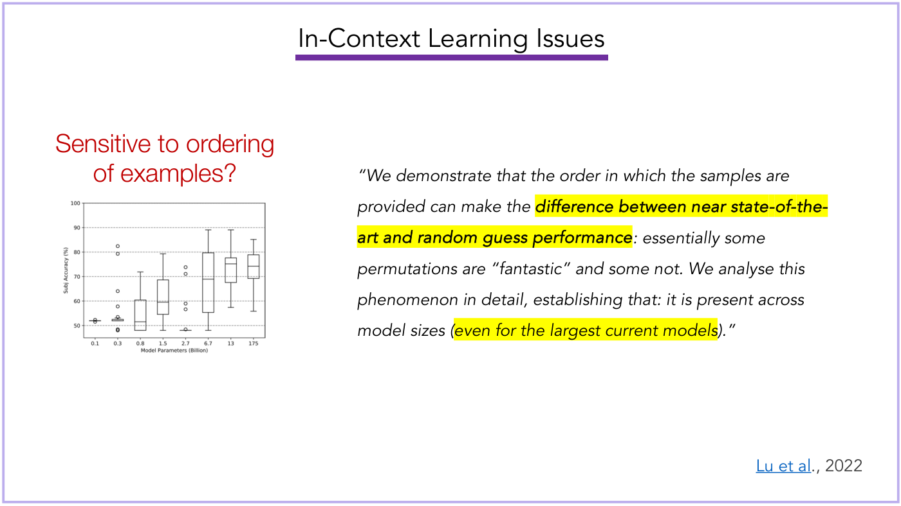

Title: "In-Context Learning Issues" with a violet bar. Left, in red: "Sensitive to ordering of examples?" Under it a small pasted box-plot chart. Y axis "Subj Accuracy (%)", ticks 50 to 100 in steps of 10. X axis "Model Parameters (Billion)", ticks 0.1, 0.3, 0.8, 1.5, 2.7, 6.7, 13, 175. One box (with whiskers and circles for outliers) per model size, approximate medians and spread: 0.1, a flat line at about 52 with two outliers on it; 0.3, a very thin box at about 52, outliers at about 82, 79, 64, 58 and 53.5 above it and two at about 48 below; 0.8, median about 52, box about 48 to 60, whisker to about 72; 1.5, median about 60, box about 55 to 68, whisker about 48 to 79; 2.7, a flat line at about 48, outliers at about 48.4, 57, 59, 71 and 74; 6.7, median about 69, box about 55 to 80, whisker about 48 to 89; 13, median about 75, box about 68 to 78, whisker about 57 to 89; 175, median about 74, box about 69 to 79, whisker about 56 to 85.

Right, an italic quotation, transcribed as printed: ""We demonstrate that the order in which the samples are provided can make the difference between near state-of-the-art and random guess performance: essentially some permutations are "fantastic" and some not. We analyse this phenomenon in detail, establishing that: it is present across model sizes (even for the largest current models)."" with "difference between near state-of-the-art and random guess performance" (also bold) and "even for the largest current models" highlighted in yellow. Bottom right: "Lu et al., 2022" ("Lu et al" blue and underlined, ", 2022" grey). The slide prints no OCW notice and no licence credit for the box plot, only this citation.

## Slide 37 — In-Context Learning Issues (label distribution and coverage)

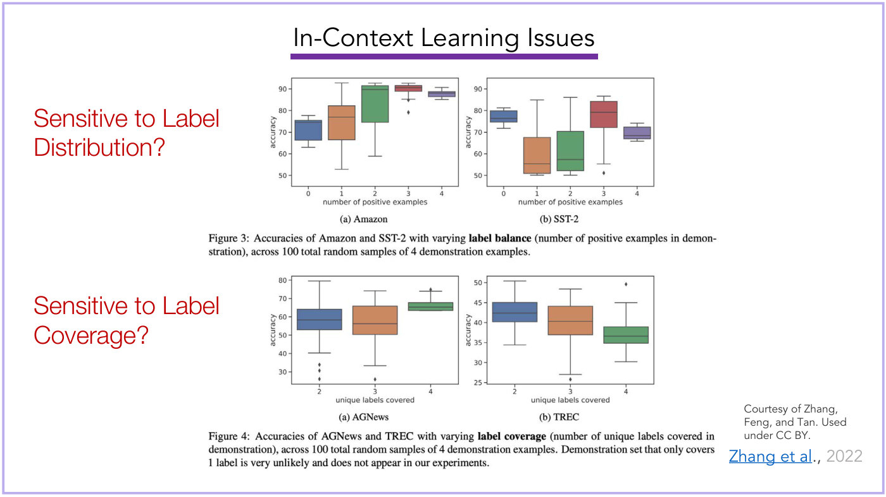

Title as slide 36. Two red questions at the left: "Sensitive to Label Distribution?" (upper) and "Sensitive to Label Coverage?" (lower). A pasted figure from a paper with four box-plot panels, y axis "accuracy" in each:

- Upper left, "(a) Amazon": x "number of positive examples", 0 to 4, y ticks 50 to 90. Box colours blue (0), orange (1), green (2), red (3), purple (4); medians about 74, 77, 90, 90, 88; the box for 1 spans about 66 to 82 and for 2 about 74 to 91.
- Upper right, "(b) SST-2": same x; medians about 77, 55, 57, 79, 69; the box for 1 spans about 51 to 67, for 3 about 72 to 84.
- Caption: "Figure 3: Accuracies of Amazon and SST-2 with varying **label balance** (number of positive examples in demonstration), across 100 total random samples of 4 demonstration examples."
- Lower left, "(a) AGNews": x "unique labels covered", 2, 3, 4 (blue, orange, green), y ticks 30 to 80; medians about 58, 56, 65.
- Lower right, "(b) TREC": same x, y ticks 25 to 50; medians about 42, 40, 36.5.
- Caption: "Figure 4: Accuracies of AGNews and TREC with varying **label coverage** (number of unique labels covered in demonstration), across 100 total random samples of 4 demonstration examples. Demonstration set that only covers 1 label is very unlikely and does not appear in our experiments."

Bottom right, small print: "Courtesy of Zhang, Feng, and Tan. Used under CC BY." and below it "Zhang et al., 2022" ("Zhang et al" blue and underlined).

## Slide 38 — In-Context Learning Issues (correctness of examples, bars)

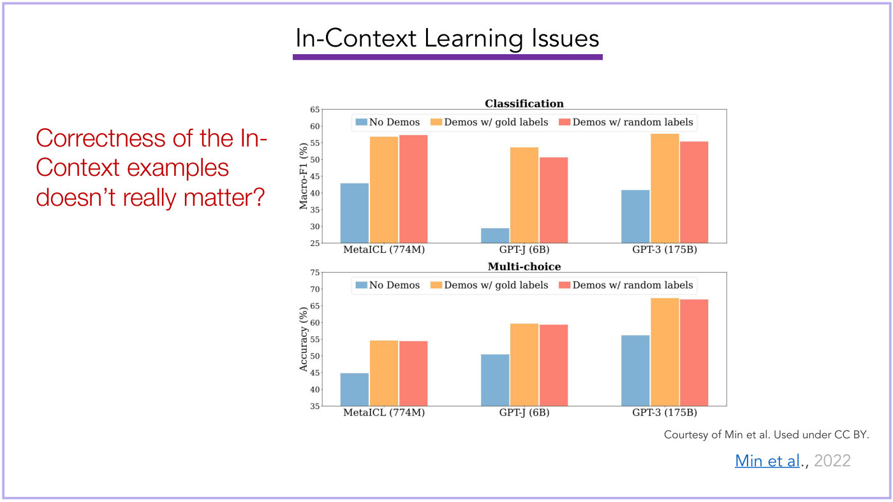

Title as slide 36. Left, in red: "Correctness of the In-Context examples doesn't really matter?" Right, a pasted figure of two bar charts, each with three groups (x labels "MetaICL (774M)", "GPT-J (6B)", "GPT-3 (175B)") of three bars: blue "No Demos", orange "Demos w/ gold labels", red-pink "Demos w/ random labels".

- Upper chart, title "Classification", y "Macro-F1 (%)", ticks 25 to 65. MetaICL: about 43, 57, 57.3; GPT-J: about 29.5, 53.7, 50.7; GPT-3: about 41, 57.8, 55.5 (order: No Demos, gold, random).
- Lower chart, title "Multi-choice", y "Accuracy (%)", ticks 35 to 75. MetaICL: about 45, 54.7, 54.5; GPT-J: about 50.5, 59.7, 59.4; GPT-3: about 56.2, 67.4, 67.

Bottom right: "Courtesy of Min et al. Used under CC BY." and "Min et al., 2022" ("Min et al" blue, underlined).

## Slide 39 — In-Context Learning Issues (correctness of examples, fraction correct)

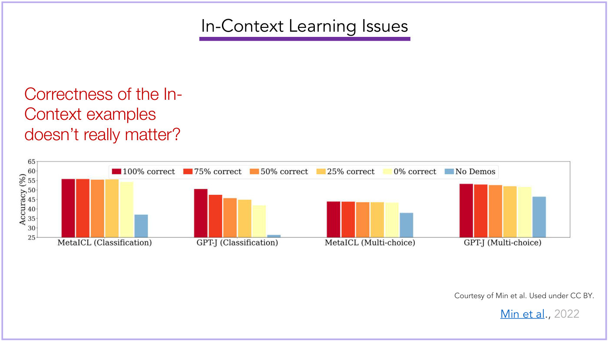

Title as slide 36. Same red text: "Correctness of the In-Context examples doesn't really matter?" A wide pasted bar chart: y axis "Accuracy (%)", ticks 25 to 65. Four groups on the x axis: "MetaICL (Classification)", "GPT-J (Classification)", "MetaICL (Multi-choice)", "GPT-J (Multi-choice)". Six bars per group, legend across the top: dark red "100% correct", red-orange "75% correct", orange "50% correct", yellow-orange "25% correct", pale yellow "0% correct", blue "No Demos". Approximate values in legend order:

- MetaICL (Classification): 55.8, 55.8, 55.4, 55.6, 54.3, and No Demos 37.
- GPT-J (Classification): 50.5, 47.4, 45.7, 44.8, 42.0, and No Demos 26.5.
- MetaICL (Multi-choice): 43.9, 43.8, 43.5, 43.5, 43.3, and No Demos 38.
- GPT-J (Multi-choice): 53.2, 52.9, 52.5, 52.0, 51.6, and No Demos 46.5.

Bottom right: "Courtesy of Min et al. Used under CC BY." and "Min et al., 2022".

## Slide 40 — In-Context Learning Issues (label tokens, "verbalizer")

Title as slide 36. Centred red question: "What do we use as label tokens ("verbalizer")?" Below, a pasted table (columns Task, Template, Label words; the template placeholder is written with $S_1$ in angle brackets and a monospace [MASK]):

| Task | Template | Label words |
| --- | --- | --- |
| SST-2 | <S1> It was [MASK] . | positive: great, negative: terrible |
| SST-5 | <S1> It was [MASK] . | v.positive: great, positive: good, neutral: okay, negative: bad, v.negative: terrible |
| MR | <S1> It was [MASK] . | positive: great, negative: terrible |
| CR | <S1> It was [MASK] . | positive: great, negative: terrible |
| Subj | <S1> This is [MASK] . | subjective: subjective, objective: objective |
| TREC | [MASK] : <S1> | abbreviation: Expression, entity: Entity, description: Description (line break, no punctuation) human: Human, location: Location, numeric: Number |
| COLA | <S1> This is [MASK] . | grammatical: correct, not_grammatical: incorrect |

The slide prints no source citation, OCW notice or licence credit for this pasted table. No slide number printed.

## Slide 41 — Few-shot Learning Impact (collect data, train a model per task)

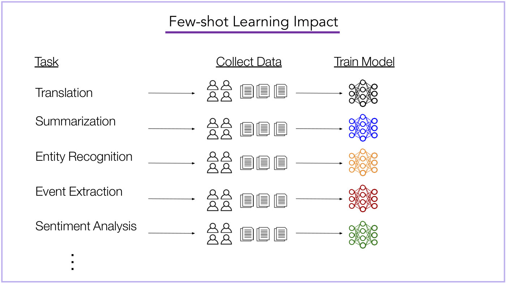

Title: "Few-shot Learning Impact" with a violet bar. Three underlined column headings: "Task" (left), "Collect Data" (centre), "Train Model" (right). Five task rows, each a left label, a long arrow to the centre, then a long arrow to the right: "Translation", "Summarization", "Entity Recognition", "Event Extraction", "Sentiment Analysis", and a vertical ellipsis below. In every row the centre column shows the same icon group: four small person outlines in a 2×2 block followed by three stacked-document icons. The right column shows a small neural-network icon (three layers of 3, 4 and 3 circles, fully connected), a different colour in each row: black, blue, orange, dark red, green. No slide number printed.

## Slide 42 — Few-shot Learning Impact (prompt one model)

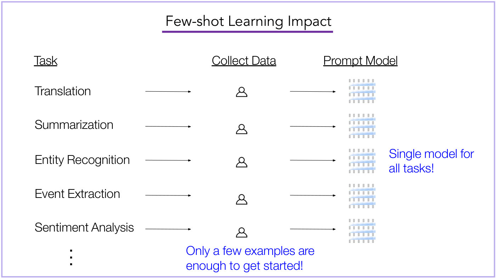

Build variant of slide 41 with the same title and the same five task rows and arrows. The headings are now "Task", "Collect Data" and "Prompt Model" (the third replaced "Train Model"). In the centre column each row has a single small person outline instead of the people-and-documents group. In the right column each row has the same small grey token-grid icon (four rows of six small grey boxes, each holding a column of three small circles, with pale-blue bands between the rows), identical in every row, instead of the coloured networks. Added blue text: "Single model for all tasks!" at the right beside the middle row, and "Only a few examples are enough to get started!" at the bottom centre. No slide number printed.

## Slide 43 — Reasoning Capabilities

Title: "Reasoning Capabilities" with a violet bar. Left, a pasted figure with two rounded boxes. Upper box, tab "Model Input" (blue): "Q: Roger has 5 tennis balls. He buys 2 more cans of tennis balls. Each can has 3 tennis balls. How many tennis balls does he have now?" then "A: The answer is 11." then "Q: The cafeteria had 23 apples. If they used 20 to make lunch and bought 6 more, how many apples do they have?" Lower box, tab "Model Output" (green): "A: The answer is 27." followed by a red cross mark. Right, text: "LLMs still have difficulty with questions that require "reasoning"." and "How do humans reason? With intermediate reasoning step!"

Bottom right: "Courtesy of Wei, et al. Used under CC BY." and "[Wei et al. '22]". No slide number printed.

## Slide 44 — Outline (In-Context highlighted)

Same outline slide as slides 3 and 23, with the pale-yellow highlight on "In-Context". A small "53" at bottom right, the source deck's numbering; no number at bottom centre.

## Slide 45 — Outline (Chain-of-Thought highlighted)

Same outline slide, with the pale-yellow highlight now on "Chain-of-Thought". A small "54" at bottom right, the source deck's numbering; no number at bottom centre.

## Slide 46 — "Chain-of-Thought" Prompting

Title: "Chain-of-Thought" Prompting (as printed: "Chain-of-Thought" Prompting), with a gold bar under it; the slide has a pale-yellow border. Left, a pasted paper title block: thick rule, "Chain-of-Thought Prompting Elicits Reasoning in Large Language Models", thin rule, authors "Jason Wei, Xuezhi Wang, Dale Schuurmans, Maarten Bosma, Brian Ichter, Fei Xia, Ed H. Chi, Quoc V. Le, Denny Zhou", then "Google Research, Brain Team" and "{jasonwei,dennyzhou}@google.com". Below it, text: "Idea: feed language representations of reasoning steps as additional input." (the phrase "language representations of reasoning steps" in blue); "These reasoning steps are manually written by humans."; "Given text example, LM predicts the reasoning steps and then outputs the answer."

Right, a pasted figure headed "Chain-of-Thought Prompting" with two rounded boxes. Upper box, tab "Model Input" (blue): "Q: Roger has 5 tennis balls. He buys 2 more cans of tennis balls. Each can has 3 tennis balls. How many tennis balls does he have now?" then "A: Roger started with 5 balls. 2 cans of 3 tennis balls each is 6 tennis balls. 5 + 6 = 11. The answer is 11." (the reasoning sentences "Roger started with 5 balls. … 5 + 6 = 11." highlighted in blue) then "Q: The cafeteria had 23 apples. If they used 20 to make lunch and bought 6 more, how many apples do they have?" Lower box, tab "Model Output" (green): "A: The cafeteria had 23 apples originally. They used 20 to make lunch. So they had 23 - 20 = 3. They bought 6 more apples, so they have 3 + 6 = 9. The answer is 9." with the reasoning sentences highlighted in green and a green check mark at the end.

Bottom right: "Courtesy of Wei et al. Used under CC BY." and "[Wei et al. '22]". No slide number printed.

## Slide 47 — "Chain-of-Thought" Prompting

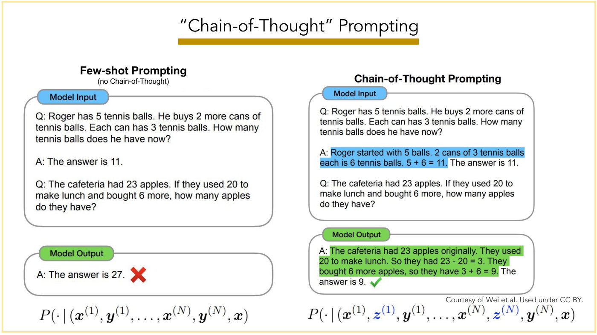

Title: "Chain-of-Thought" Prompting, with a gold underline. Pale-yellow slide border. Two side-by-side panels, each a pasted figure.

Left panel, heading "Few-shot Prompting" with the sub-label "(no Chain-of-Thought)" (typed slide text above a pasted image of the two boxes). A rounded box tagged by a blue pill "Model Input" holds: "Q: Roger has 5 tennis balls. He buys 2 more cans of tennis balls. Each can has 3 tennis balls. How many tennis balls does he have now?" then "A: The answer is 11." then "Q: The cafeteria had 23 apples. If they used 20 to make lunch and bought 6 more, how many apples do they have?". Below it a second box tagged by a green pill "Model Output" holds "A: The answer is 27." followed by a red cross. Under the panel the formula $P(\cdot \mid (\boldsymbol{x}^{(1)}, \boldsymbol{y}^{(1)}, \ldots, \boldsymbol{x}^{(N)}, \boldsymbol{y}^{(N)}, \boldsymbol{x})$ (as printed: two opening parentheses, one after $P$ and one after the bar, and a single closing parenthesis after the final $\boldsymbol{x}$).

Right panel, heading "Chain-of-Thought Prompting" (bold, part of the pasted figure, the same image as slide 46's). "Model Input" box with the same first question, then the answer written out with a blue highlight over "Roger started with 5 balls. 2 cans of 3 tennis balls each is 6 tennis balls. 5 + 6 = 11." followed by unhighlighted "The answer is 11."; then "Q: The cafeteria had 23 apples. If they used 20 to make lunch and bought 6 more, how many apples do they have?". "Model Output" box: "A:" then a green highlight over "The cafeteria had 23 apples originally. They used 20 to make lunch. So they had 23 - 20 = 3. They bought 6 more apples, so they have 3 + 6 = 9." then "The answer is 9." and a green check mark. Under the panel the formula $P(\cdot \mid (\boldsymbol{x}^{(1)}, \boldsymbol{z}^{(1)}, \boldsymbol{y}^{(1)}, \ldots, \boldsymbol{x}^{(N)}, \boldsymbol{z}^{(N)}, \boldsymbol{y}^{(N)}, \boldsymbol{x})$ with each $\boldsymbol{z}^{(i)}$ printed in blue (the written-out reasoning inserted between each $\boldsymbol{x}$ and $\boldsymbol{y}$).

Credit, bottom right above the right-hand formula: "Courtesy of Wei et al. Used under CC BY." There is no "[Wei et al. '22]" on this slide.

## Slide 48 — "Chain-of-Thought" Prompting

Same title and styling as slide 47. Three pasted example boxes side by side, each tagged by a coloured pill; the reasoning text in each answer is highlighted. Credit "Courtesy of Wei et al. Used under CC BY." and, bottom right in grey, "[Wei et al. '22]".

- Green pill "Math Word Problems (free response)": "Q: Roger has 5 tennis balls. He buys 2 more cans of tennis balls. Each can has 3 tennis balls. How many tennis balls does he have now?" "A:" then green highlight "Roger started with 5 balls. 2 cans of 3 tennis balls each is 6 tennis balls. 5 + 6 = 11." then "The answer is 11."
- Green pill "Math Word Problems (multiple choice)": "Q: How many keystrokes are needed to type the numbers from 1 to 500?" "Answer Choices: (a) 1156 (b) 1392 (c) 1480 (d) 1562 (e) 1788" "A:" then green highlight "There are 9 one-digit numbers from 1 to 9. There are 90 two-digit numbers from 10 to 99. There are 401 three-digit numbers from 100 to 500. 9 + 90(2) + 401(3) = 1392." then "The answer is (b)."
- Orange pill "CSQA (commonsense)": "Q: Sammy wanted to go to where the people were. Where might he go?" "Options: (a) race track (b) populated areas (c) desert (d) apartment (e) roadblock" "A:" then orange highlight "The answer must be a place with a lot of people. Race tracks, desert, apartments, and roadblocks don't have a lot of people, but populated areas do." then "So the answer is (b)."

## Slide 49 — "Chain-of-Thought" Prompting

Same layout as slide 48 with three more example boxes (orange pills, orange highlights on the reasoning). Credit "Courtesy of Wei et al. Used under CC BY." and "[Wei et al. '22]".

- "StrategyQA": "Q: Yes or no: Would a pear sink in water?" "A:" highlight "The density of a pear is about 0.6 g/cm^3, which is less than water. Thus, a pear would float." then "So the answer is no."
- "Date Understanding": "Q: The concert was scheduled to be on 06/01/1943, but was delayed by one day to today. What is the date 10 days ago in MM/DD/YYYY?" "A:" highlight "One day after 06/01/1943 is 06/02/1943, so today is 06/02/1943. 10 days before today is 05/23/1943." then "So the answer is 05/23/1943."
- "Sports Understanding": "Q: Is the following sentence plausible? "Joao Moutinho caught the screen pass in the NFC championship."" "A:" highlight "Joao Moutinho is a soccer player. The NFC championship is part of American football, not soccer." then "So the answer is no."

## Slide 50 — "Chain-of-Thought" Prompting

Same layout; three more example boxes. Credit "Courtesy of Wei et al. Used under CC BY." and "[Wei et al. '22]".

- Orange pill "SayCan (Instructing a robot)": "Human: How would you bring me something that isn't a fruit?" then, with orange highlight, "Explanation: the user wants something to eat that isn't a fruit. An energy bar is not a fruit, so I will bring the user an energy bar." then unhighlighted "Plan: 1. find(energy bar) 2. pick(energy bar) 3. find(user) 4. put(energy bar) 5. done()."
- Blue pill "Last Letter Concatenation": "Q: Take the last letters of the words in "Lady Gaga" and concatenate them." "A:" blue highlight "The last letter of "Lady" is "y". The last letter of "Gaga" is "a". Concatenating them is "ya"." then "So the answer is ya."
- Blue pill "Coin Flip (state tracking)": "Q: A coin is heads up. Maybelle flips the coin. Shalonda does not flip the coin. Is the coin still heads up?" "A:" blue highlight "The coin was flipped by Maybelle. So the coin was flipped 1 time, which is an odd number. The coin started heads up, so after an odd number of flips, it will be tails up." then "So the answer is no."

## Slide 51 — "Chain-of-Thought" Prompting

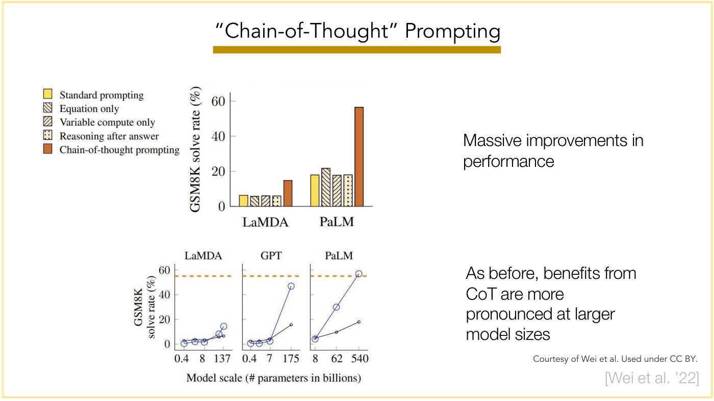

Same title. Two pasted charts from Wei et al. on the left, two text remarks on the right. Credit "Courtesy of Wei et al. Used under CC BY." and "[Wei et al. '22]".

Upper chart (bar chart). Y axis "GSM8K solve rate (%)", ticks 0, 20, 40, 60. X axis groups "LaMDA" and "PaLM". Legend at upper left, five entries: yellow solid square "Standard prompting", diagonal-hatched (backslash) "Equation only", forward-slash-hatched "Variable compute only", dotted "Reasoning after answer", solid brown "Chain-of-thought prompting". Five bars per group in legend order:

- LaMDA: standard about 6.3, equation only about 5.8, variable compute only about 6.1, reasoning after answer about 6.1, chain-of-thought about 14.8.
- PaLM: standard about 18.1, equation only about 21.8, variable compute only about 17.8, reasoning after answer about 18.1, chain-of-thought about 56.6.

The hatched and dotted bars have a pale peach fill; the legend is a separate pasted image to the left of the chart.

Lower chart: three small line panels titled "LaMDA", "GPT", "PaLM". Shared Y axis "GSM8K solve rate (%)", ticks 0, 20, 40, 60. X axis label "Model scale (# parameters in billions)", labelled ticks per panel: LaMDA 0.4, 8, 137; GPT 0.4, 7, 175; PaLM 8, 62, 540. Each panel has two lines, a blue line with large open circles and a thin black line with small open circles; the line panels print no legend, so the slide does not say which is which (the bar chart's legend uses other colours). By the bar chart's results the blue line is the higher-scoring chain-of-thought series, but that is an inference. An unlabelled orange dashed horizontal line at about 55% runs across each panel. LaMDA has five points per line (at 0.4, an unlabelled size, 8, another unlabelled size and 137), GPT four (0.4, an unlabelled size, 7, 175) and PaLM three. Approximate values: LaMDA blue 0, 1.5, 1, 8, 14, black 2.5, 3.5, 3, 5.5, 6.5; GPT blue 0.5, 0.5, 2, 47, black 2, 2, 4, 15.5; PaLM blue 4, 30, 57 (reaching the dashed line), black 5, 9.5, 18.

Right-hand text, upper: "Massive improvements in performance". Lower: "As before, benefits from CoT are more pronounced at larger model sizes".

## Slide 52 — Zero-shot "Chain-of-Thought" Prompting

Title: Zero-shot "Chain-of-Thought" Prompting, gold underline. A 2×2 grid of pasted panels from Kojima et al.; bottom-right grey "[Kojima et al. '22]".

*OCW notice: © Kojima et al. All rights reserved. This content is excluded from our Creative Commons license. For more information, see https://ocw.mit.edu/help/faq-fair-use/ (bottom centre, under the figure; it covers the pasted panels).*

- (a) Few-shot: green text "Q: Roger has 5 tennis balls. He buys 2 more cans of tennis balls. Each can has 3 tennis balls. How many tennis balls does he have now? A: The answer is 11." then black "Q: A juggler can juggle 16 balls. Half of the balls are golf balls, and half of the golf balls are blue. How many blue golf balls are there? A:" then a rule and "(Output) The answer is 8." with a red X.
- (b) Few-shot-CoT: same green exemplar but with "A: Roger started with 5 balls. 2 cans of 3 tennis balls each is 6 tennis balls. 5 + 6 = 11. The answer is 11."; same juggler question; output in blue italics "The juggler can juggle 16 balls. Half of the balls are golf balls. So there are 16 / 2 = 8 golf balls. Half of the golf balls are blue. So there are 8 / 2 = 4 blue golf balls." then black "The answer is 4." with a green check.
- (c) Zero-shot: juggler question, "A: The answer (arabic numerals) is", rule, "(Output) 8" with a red X.
- (d) Zero-shot-CoT (Ours): juggler question, "A:" followed by "Let's think step by step." in bold italics on a pink highlight; rule; output in blue italics "There are 16 balls in total. Half of the balls are golf balls. That means that there are 8 golf balls. Half of the golf balls are blue. That means that there are 4 blue golf balls." with a green check.

## Slide 53 — Zero-shot "Chain-of-Thought" Prompting

Same title; a pasted two-stage diagram from Kojima et al.; "[Kojima et al. '22]" bottom right.

*OCW notice: © Kojima et al. All rights reserved. This content is excluded from our Creative Commons license. For more information, see https://ocw.mit.edu/help/faq-fair-use/ (bottom centre; it covers the pasted diagram).*

Left column, header box "【1st prompt】 Reasoning Extraction" (peach box). Below it a rounded box: "Q: On average Joe throws 25 punches per minute. A fight lasts 5 rounds of 3 minutes. How many punches did he throw?" and in bold red "A: Let's think step by step." A pale-yellow down arrow leads to a blue box "LLM", another down arrow to a rounded box: "In one minute, Joe throws 25 punches. In three minutes, Joe throws 3 * 25 = 75 punches. In five rounds, Joe throws 5 * 75 = 375 punches."

Right column, header box "【2nd prompt】 Answer Extraction". Rounded box: "Q: On average Joe throws 25 punches per minute. A fight lasts 5 rounds of 3 ···" / "A: Let's think step by step." then a rule, then "In one minute, Joe throws 25 punches. ···In five rounds, Joe throws 5 * 75 = 375 punches. ." and in bold red "Therefore, the answer (arabic numerals) is". Down arrow to a blue box "LLM", down arrow to a box "375."

Two dashed black arrows connect the columns: one from the right edge of the first question box to the left of the second prompt's question part, and one from the right of the generated-reasoning box up to the second prompt's reasoning part (the first stage's output is pasted into the second stage's prompt).

## Slide 54 — Zero-shot "Chain-of-Thought" Prompting

Same title. A pasted results table (Kojima et al.) at left, two remarks at right; "[Kojima et al. '22]" bottom right.

*OCW notice: © Kojima et al. All rights reserved. This content is excluded from our Creative Commons license. For more information, see https://ocw.mit.edu/help/faq-fair-use/ (bottom centre; it covers the pasted table).*

Table, columns MultiArith and GSM8K (a "-" means no entry; the first column prints no header, and "Method" is supplied here):

| Method | MultiArith | GSM8K |
| --- | --- | --- |
| **Zero-Shot** | **17.7** | **10.4** |
| Few-Shot (2 samples) | 33.7 | 15.6 |
| Few-Shot (8 samples) | 33.8 | 15.6 |
| **Zero-Shot-CoT** | **78.7** | **40.7** |
| Few-Shot-CoT (2 samples) | 84.8 | 41.3 |
| Few-Shot-CoT (4 samples : First) (*1) | 89.2 | - |
| Few-Shot-CoT (4 samples : Second) (*1) | 90.5 | - |
| Few-Shot-CoT (8 samples) | 93.0 | 48.7 |
| **Zero-Plus-Few-Shot-CoT (8 samples)** (*2) | **92.8** | **51.5** |
| Finetuned GPT-3 175B [Wei et al., 2022] | - | 33 |
| Finetuned GPT-3 175B + verifier [Wei et al., 2022] | - | 55 |
| **PaLM 540B: Zero-Shot** | **25.5** | **12.5** |
| **PaLM 540B: Zero-Shot-CoT** | **66.1** | **43.0** |
| **PaLM 540B: Zero-Shot-CoT + self consistency** | **89.0** | **70.1** |
| PaLM 540B: Few-Shot [Wei et al., 2022] | - | 17.9 |
| PaLM 540B: Few-Shot-CoT [Wei et al., 2022] | - | 56.9 |
| PaLM 540B: Few-Shot-CoT + self consistency [Wang et al., 2022] | - | 74.4 |

Horizontal rules separate the four groups (zero/few-shot, CoT, finetuned GPT-3, PaLM 540B). Right-hand text: "Massive improvements in performance (again)." and below it "Sometimes even outperforms few-shot CoT!"

## Slide 55 — Zero-shot "Chain-of-Thought" Prompting

Same title. Three pasted line charts (Kojima et al.), no right-hand text; "[Kojima et al. '22]" bottom right.

*OCW notice: © Kojima et al. All rights reserved. This content is excluded from our Creative Commons license. For more information, see https://ocw.mit.edu/help/faq-fair-use/ (bottom centre; it covers the pasted charts).*

Each chart has a legend with a blue circle "Zero-shot" and a red square "Zero-shot-CoT", and two series (blue line with circles, red line with squares). No Y axis label is printed. The chart captions are printed below.

- "(a) MultiArith on Original GPT-3": Y ticks 0 to 80 in steps of 20; X categories 0.3B, 1.3B, 6.7B, 175B. Blue: about 2, 1, 1, 3. Red: about 2, 2, 2, 19.
- "(b) MultiArith on Instruct GPT-3": Y ticks 0 to 80; X categories S, M, L, XL. Blue: about 4, 4, 4, 18. Red: about 2, 3, 3, 79.
- "(c) GMS8K on PaLM" (printed "GMS8K" [sic], as in the source figure): Y ticks 0 to 50 in steps of 10; X categories 8B, 62B, 540B. Blue: about 2, 7, 13. Red: about 2, 11, 43.

## Slide 56 — Zero-shot "Chain-of-Thought" Prompting

Same title. A pasted table (Kojima et al.) of prompt templates; "[Kojima et al. '22]" bottom right.

*OCW notice: © Kojima et al. All rights reserved. This content is excluded from our Creative Commons license. For more information, see https://ocw.mit.edu/help/faq-fair-use/ (bottom centre; it covers the pasted table).*

| No. | Category | Template | Accuracy |
| --- | --- | --- | --- |
| 1 | instructive | Let's think step by step. | **78.7** |
| 2 | | First, (*1) | 77.3 |
| 3 | | Let's think about this logically. | 74.5 |
| 4 | | Let's solve this problem by splitting it into steps. (*2) | 72.2 |
| 5 | | Let's be realistic and think step by step. | 70.8 |
| 6 | | Let's think like a detective step by step. | 70.3 |
| 7 | | Let's think | 57.5 |
| 8 | | Before we dive into the answer, | 55.7 |
| 9 | | The answer is after the proof. | 45.7 |
| 10 | misleading | Don't think. Just feel. | 18.8 |
| 11 | | Let's think step by step but reach an incorrect answer. | 18.7 |
| 12 | | Let's count the number of "a" in the question. | 16.7 |
| 13 | | By using the fact that the earth is round, | 9.3 |
| 14 | irrelevant | By the way, I found a good restaurant nearby. | 17.5 |
| 15 | | Abrakadabra! | 15.5 |
| 16 | | It's a beautiful day. | 13.1 |
| - | | (Zero-shot) | 17.7 |

Rules separate the three categories and the last row.

## Slide 57 — Searching for ~~magic~~ optimal prompts

Title as printed: "Searching for" then "magic" struck through, then "optimal prompts". Gold underline. A pasted table, bottom-right grey "[Yang et al. '23]". Table caption as printed: "Table 1: Top instructions with the highest GSM8K zero-shot test accuracies from prompt optimization with different optimizer LLMs. All results use the pre-trained PaLM 2-L as the scorer." (the screenshot itself is cropped through the final "n" of "optimization", which reads as "optimizatior"; the Source entries and "PaLM 2-L" in the caption are set in a typewriter font).

| Source | Instruction | Acc |
| --- | --- | --- |
| *Baselines* | | |
| (Kojima et al., 2022) | Let's think step by step. | 71.8 |
| (Zhou et al., 2022b) | Let's work this out in a step by step way to be sure we have the right answer. | 58.8 |
| | (empty string) | 34.0 |
| *Ours* | | |
| PaLM 2-L-IT | Take a deep breath and work on this problem step-by-step. | **80.2** |
| PaLM 2-L | Break this down. | 79.9 |
| gpt-3.5-turbo | A little bit of arithmetic and a logical approach will help us quickly arrive at the solution to this problem. | 78.5 |
| gpt-4 | Let's combine our numerical command and clear thinking to quickly and accurately decipher the answer. | 74.5 |

Dashed rules separate the Baselines and Ours blocks from their headings.

## Slide 58 — NLP research in 2009 / NLP research in 2022 (meme, first build)

Prints no title; two headings in a comic-style font: left "NLP research in 2009" (typed slide text), right "NLP research in 2022" (part of a pasted image that also holds the crying dog and the quote below it).

*OCW notice: © source unknown. All rights reserved. This content is excluded from our Creative Commons license. For more information, see https://ocw.mit.edu/help/faq-fair-use/ (bottom right; it covers the pictures).*

Left, under "NLP research in 2009": a collage of overlapping paper excerpts: a table titled "Element / ⟨p, r⟩" with rows for products and sums of pairs, "Table 1: Expectation semiring: Each element in the semiring is a pair ⟨p, r⟩..."; under it a sign and log table with columns $s_a \thinspace s_b$, $a + b$ and $a \cdot b$ (rows "+ +" and "+ -"), cut off by the parse diagram; a lower table "Table 2: Second-order expectation semiring (variance semiring): Each element in the semiring is a 4-tuple ⟨p, r, s, t⟩..."; a parse-forest style diagram with a "goal item" node reached from two rules "S→⟨X0, X0⟩", items such as "X 0,4 the mat a cat", "X 0,4 a cat the mat", "X 0,2 the mat NA" and "X 3,4 a cat NA", rules such as "X→⟨X0 的 X1, X1 of X0⟩", and Chinese words with glosses at the bottom ("on the mat", "of", "a cat"); and at right a text block "3.3 Correctness of the Algorithms" about the first-order expectation semiring. In the gap between the Table 1 excerpt and the "3.3" text block stands a picture of a dog's head on a hugely muscular, upright, human-like body, arms hanging at its sides (the parse diagram and the "3.3" block overlap its forearms). Right, under "NLP research in 2022": a photograph of a small sitting dog looking down, with painted blue tears, and the quoted text "Let's think step by step" below it. Neither the slide nor the lecturer ("a meme", ≈48:19) names the meme. (This build shows the muscular dog with the 2009 papers and the crying dog with 2022.)

## Slide 59 — NLP research in 2009 / NLP research in 2022 (meme, second build)

Same text, collage and notice as slide 58 (the notice is again bottom right: "© source unknown. All rights reserved. This content is excluded from our Creative Commons license. For more information, see https://ocw.mit.edu/help/faq-fair-use/"), but the two dog pictures are swapped: now the crying sitting dog stands in the collage gap where the muscular dog stood (the "3.3" block covers its rear), and a larger muscular upright dog is pasted over the right-hand picture's crying dog, under "NLP research in 2022" and above the quoted "Let's think step by step".

*OCW notice: © source unknown. All rights reserved. This content is excluded from our Creative Commons license. For more information, see https://ocw.mit.edu/help/faq-fair-use/ (bottom right; it covers the pictures).*

## Slide 60 — Prompt Engineering

Title: "Prompt Engineering", gold underline. Three pasted screenshots of web search results and a headline, overlapping:

*OCW notice: © Google, Forbes, and Business Insider. All rights reserved. This content is excluded from our Creative Commons license. For more information, see https://ocw.mit.edu/help/faq-fair-use/ (left middle; it covers the three screenshots).*

- Top: a Google search box with the query "prompt engineering salary", filter chips "In us", "For freshers", "Per hour", "AI", "UK", "In Canada", "ChatGPT", "Images", "News"; "About 12,000,000 results (0.39 seconds)"; large text "\$175,000 to \$335,000 per annum"; "Bloomberg says the average prompt engineering salary ranges from \$175,000 to \$335,000 per annum." with the dollar range highlighted, "Apr 12, 2023".
- Middle right: a Forbes result, "Forbes https://www.forbes.com › Small Business › Entrepreneurs", headline in blue "AI Prompt Engineers Earn \$300k Salaries: Here's How To ...", "Jul 12, 2023 — AI prompt engineer roles are offering salaries over \$300k, including this one at Anthropic. Here are six free courses that can help you or a ...".
- Bottom: a Business Insider page header "HOME > TECH", headline "AI 'prompt engineer' jobs can pay up to \$375,000 a year and don't always require a background in tech", byline "Britney Nguyen May 1, 2023, 11:34 AM EDT", with small share icons at right.

## Slide 61 — Outline (Chain-of-Thought highlighted)

Prints "Outline" at top left; a small "73" at bottom right, the source deck's numbering. Coloured bars sit beside each item: "Review" (green), "Prompting" (purple), indented "In-Context" (red), indented "Chain-of-Thought" (gold, with a pale-yellow highlight box behind the text), "Instruction Tuning" (blue). The highlight marks the current section: Chain-of-Thought.

## Slide 62 — Outline (Instruction Tuning highlighted)

Same outline as slide 61 (small "74" at bottom right, the source deck's numbering), but the pale-yellow highlight now sits behind "Instruction Tuning" instead of "Chain-of-Thought".

## Slide 63 — Review: Few-shot Learning via Prompting

Title: "Review: Few-shot Learning via Prompting", with a blue underline (blue-bordered slide). A large rounded box holds a few-shot prompt in serif text:

"Review: the whole thing 's fairly lame , making it par for the course for disney sequels ." / "Answer: Negative" (labelled at right $\boldsymbol{x}^{(1)}$ for the review line and $\boldsymbol{y}^{(1)}$ for the answer); "Review: this quiet , introspective and entertaining independent is worth seeking ." / "Answer: Positive" (labelled $\boldsymbol{x}^{(2)}$ and $\boldsymbol{y}^{(2)}$); and "Review: this quiet , introspective and entertaining independent is worth seeking ." / "Answer:" (labelled $\boldsymbol{x}$); the two later reviews wrap with a hyphen ("indepen-" / "dent"). A brace spanning the labels of both training examples reads "Training examples (two-shot)"; a brace beside the single label $\boldsymbol{x}$ reads "Test example". An arrow runs down from the box to a box "LM", with the formula $P(\cdot \mid \boldsymbol{x}^{(1)}, \boldsymbol{y}^{(1)}, \ldots, \boldsymbol{x}^{(N)}, \boldsymbol{y}^{(N)}, \boldsymbol{x})$ beside it, and a further arrow down to a box "“Positive”".

*OCW notice: © Zhao et al. All rights reserved. This content is excluded from our Creative Commons license. For more information, see https://ocw.mit.edu/help/faq-fair-use/ (bottom centre; it covers the pasted prompt example).*

Bottom right in grey: "[Example from Zhao et al. '21]".

## Slide 64 — Motivation: Zero-shot Learning via Prompting

Title: "Motivation: Zero-shot Learning via Prompting", blue underline. A screenshot of a chat text box (with a green microphone icon at upper right). Typed text: "This quiet, introspective and entertaining independent is worth thinking." [sic: "thinking", as printed], then, highlighted in light green (the model's continuation): "This quiet, introspective, and entertaining independent film is worth watching. It follows the story of a young man who is struggling to find his place in the world. Through his journey, he discovers the importance of friendship, family, and love. Along the way, he learns valuable lessons about life and how to make the most of it. The film is filled with humor, heart, and insight, making it an enjoyable and thought-provoking experience." with a text cursor at the end. Caption bottom right: "Created with InstructGPT."

## Slide 65 — Motivation: Zero-shot Learning via Prompting

Same title and screenshot style. The box now holds only "Review: This quiet, introspective and entertaining independent is worth thinking." [sic: "thinking"] and below it "Answer:" with nothing after it (the area below is empty). Caption "Created with InstructGPT."

## Slide 66 — Motivation: Zero-shot Learning via Prompting

Build step on slide 65: after "Answer:" the model's output appears, highlighted in light green: "This thought-provoking independent film is worth a watch." with a text cursor at the end. Caption "Created with InstructGPT."

## Slide 67 — Need Instructions in the Zero-shot Case

Title: "Need Instructions in the Zero-shot Case", blue underline. Chat-box screenshot (green microphone icon at upper right). Text: "Please classify this review as "Positive" or "Negative"." then "Review: This quiet, introspective and entertaining independent is worth watching." then "Answer:" followed by "Positive" highlighted in light green (the model's output). Caption "Created with InstructGPT."

## Slide 68 — Conditioning on instructions doesn't always work!

Title: "Conditioning on instructions doesn't always work!" (no underline). Chat-box screenshot. Text: "Answer the following question." then "====" then "Why isn't the next-word prediction objective "enough" to enable generic instruction-following?" with nothing after it. Caption "Created with InstructGPT."

## Slide 69 — Conditioning on instructions doesn't always work!

Build step on slide 68: the model's continuation appears, highlighted green: "What is the "enough" amount of prediction that enables a machine to generate general instructions?" (it continues the question rather than answering it). Caption "Created with InstructGPT."

## Slide 70 — Conditioning on instructions doesn't always work!

Same prompt as slide 68 in smaller type, with the added label "From "InstructGPT"" in larger text at upper right. The green-highlighted answer reads: "The next-word prediction objective is not "enough" to enable generic instruction-following because it only predicts the most likely next word based on the context of the previous words. It does not take into account the overall goal or objective of the instructions, the context of the situation, or any potential errors or ambiguity in the instructions. This means that the predicted next word may not be the correct one to follow in order to successfully complete the instructions. Additionally, next-word prediction does not account for the understanding of the instructions as a whole, which is necessary for successful instruction-following." Caption "Created with InstructGPT." (the page shows only the prompt and this answer, in contrast with slide 69's continuation; slides 68 and 69 carry the same caption, and only the added label sets this answer apart).

## Slide 71 — Instruction Tuning

Title: "Instruction Tuning", blue underline, blue-bordered slide. Text:

Key idea:

- Finetune language models on "instruction following" data.
- ⇒ Hopefully, this will activate the "instruction-following mode" of the language model.
- ⇒ and it will generalize to new tasks/instructions!

Instruction-following data:

- Task-based (blue): transform existing NLP tasks
- Demonstration-based (blue): collect human demonstrations

## Slide 72 — Emergent Abilities of LLMs

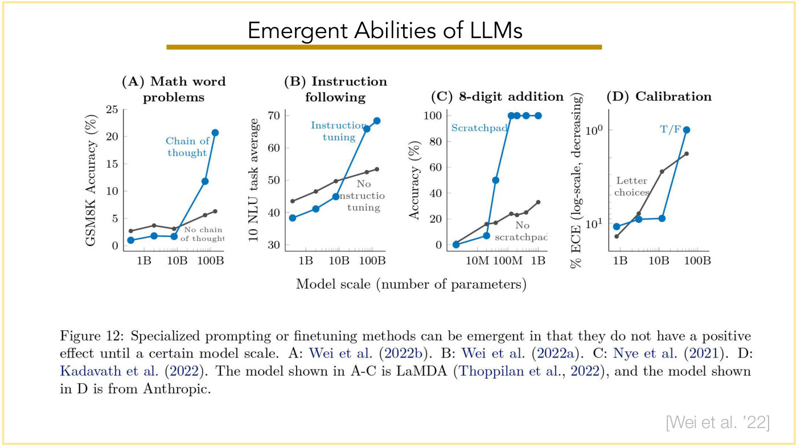

Title: "Emergent Abilities of LLMs", gold underline. A pasted figure with four small line charts side by side, then a caption; "[Wei et al. '22]" bottom right. Each chart has two series: a blue line with large filled circles (the specialized method) and a dark-grey line with small filled circles (the plain baseline). The shared X axis label below the four charts: "Model scale (number of parameters)".

- (A) "Math word problems": Y axis "GSM8K Accuracy (%)", ticks 0, 5, 10, 15, 20, 25; X ticks 1B, 10B, 100B (log). Blue, labelled "Chain of thought": about 1, 2, 2 (near 10B), then about 12 and about 21 at the two largest sizes. Grey, labelled "No chain of thought": about 3, 4, 3, 6, 6.
- (B) "Instruction following": Y axis "10 NLU task average", ticks 30, 40, 50, 60, 70; X ticks 1B, 10B, 100B. Blue, labelled "Instruction tuning": about 38, 41, 45, 66, 68. Grey, labelled "No instruction tuning": about 43, 46, 50, 52, 53.
- (C) "8-digit addition": Y axis "Accuracy (%)", ticks 0 to 100 in steps of 20; X ticks 10M, 100M, 1B. Blue, labelled "Scratchpad": about 0, 7, 50, then four points at 100 (seven points per line). Grey, labelled "No scratchpad": about 0, 16, 17, 24, 23, 25, 33.
- (D) "Calibration": Y axis "% ECE (log-scale, decreasing)", log ticks $10^1$ (lower) and $10^0$ (upper), so higher on the chart means lower ECE; X ticks 1B, 10B, 100B. Four points per line, at roughly 0.8B, 3B, 12B and 50B. Blue, labelled "T/F": about 11, 9 and 9% ECE, then about 1% (the $10^0$ tick) at the largest size. Grey, labelled "Letter choices": about 14, 8, 3 and 2% ECE. T/F has the lower ECE at the smallest and the largest size, Letter choices at the two middle sizes.

The in-chart labels are clipped in the figure as printed ("No chain of thought" ends "thoughi", "No instruction tuning" prints as "No / nstructio / tuning", "No scratchpad" ends "scratchpac"); they are given above in full.

Caption as printed: "Figure 12: Specialized prompting or finetuning methods can be emergent in that they do not have a positive effect until a certain model scale. A: Wei et al. (2022b). B: Wei et al. (2022a). C: Nye et al. (2021). D: Kadavath et al. (2022). The model shown in A-C is LaMDA (Thoppilan et al., 2022), and the model shown in D is from Anthropic."

## Slide 73 — Why isn't instruction-tuning enough?

Title: "Why isn't instruction-tuning enough?" (green-bordered slide, no underline). Heading "Instruction prompts" (underlined). Four rows, each a person icon at left and a quoted prompt in blue sans text: "Explain LLMs to a 5 year-old." / "Give me a list of good Korean restaurants in Boston." / "Help me write a PyTorch implementation of an RNN language model." / "When was MIT founded?"

## Slide 74 — Why isn't instruction-tuning enough?

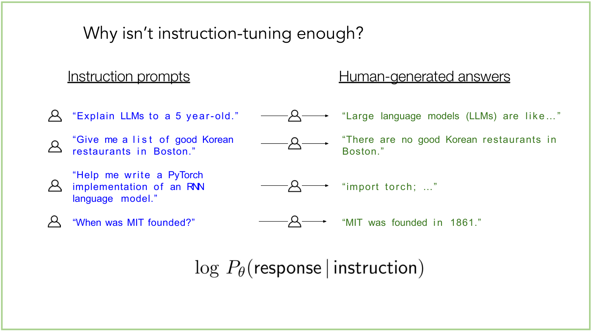

Build step on slide 73: a second column, heading "Human-generated answers" (underlined) at right. Each prompt has an arrow passing through a person icon to a green quoted answer: "Large language models (LLMs) are like..." / "There are no good Korean restaurants in Boston." / "import torch; ..." / "MIT was founded in 1861." Below, the displayed expression, printed as $\log P_{\theta}(\text{response} \mid \text{instruction})$ (the words "response" and "instruction" in sans-serif).

## Slide 75 — Why isn't instruction-tuning enough?

New content on the same title. Label "Test time" at upper left. Two rows, each a person icon, a blue quoted prompt, an arrow through a small graphic standing for the model (a 4 × 6 grid of small grey rounded capsules, each holding three stacked circles, with three pale-blue wedge-shaped streaks running between the rows), and a green quoted output: "Explain Transformers to me." → "A transformer is a passive component that transfers electrical energy ..." and "Where is MIT located?" → "MIT is located Cambridge, MA." [sic: no "in", as printed].

## Slide 76 — Why isn't instruction-tuning enough?

Build step: adds a third row, "Who won the 2028 World Cup?" → "Argentina won it."

## Slide 77 — Why isn't instruction-tuning enough?

Build step: the third output "Argentina won it." is struck through in green, and a new red quoted answer appears beside it: "I don't know, this is not in my internal knowledge."

## Slide 78 — Why isn't instruction-tuning enough?

Build step: adds a fourth row, "Can you give me ideas on how I could cheat in my midterm?" → green "Sure, you could...". (Row 3 keeps its struck "Argentina won it." and red replacement.)

## Slide 79 — Why isn't instruction-tuning enough?

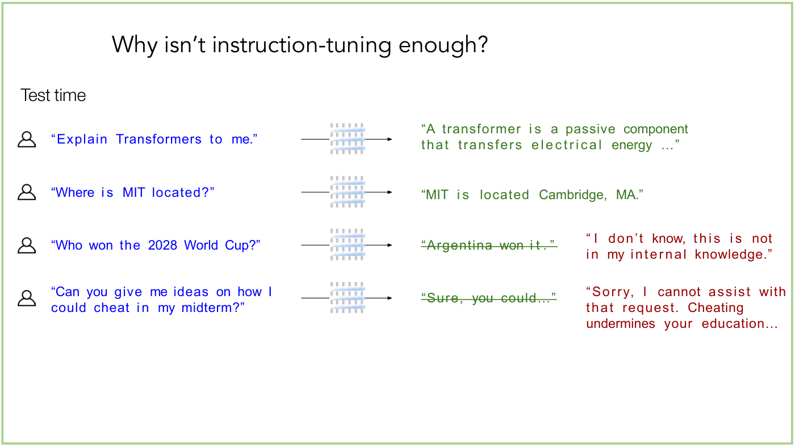

Build step: the fourth output "Sure, you could..." is struck through, and a red quoted answer appears beside it, printed with an opening quote mark and no closing one: "Sorry, I cannot assist with that request. Cheating undermines your education...

## Slide 80 — (ChatGPT screenshot, untitled)

Prints no title; green-bordered slide. A screenshot of a chat conversation, with "Created with ChatGPT.." (two periods, as printed) at the top right. The user message (a tan avatar square labelled "YO"): "Can you give me ideas on how I could cheat in my midterm?" The reply (purple logo avatar, grey background): "Sorry, I cannot assist with that request. Cheating undermines your education, compromises your integrity, and has serious consequences both academically and professionally." / "If you're struggling with your studies, I encourage you to seek help or resources that can assist you in understanding the material. There are legitimate ways to improve your knowledge and skills:" followed by a numbered list with bold lead-ins: "1. Study Groups: Collaborate with classmates to review and discuss the material." "2. Office Hours: Consult with your instructors or professors to clarify doubts." "3. Tutoring: Many schools offer tutoring services to help students grasp difficult concepts." "4. Online Resources: There are many educational platforms and websites that offer explanations, videos, and practice problems on various subjects." "5. Practice: Repeatedly go over challenging topics and practice problems." The screenshot is cut off after item 5.

## Slide 81 — Why isn't instruction-tuning enough?

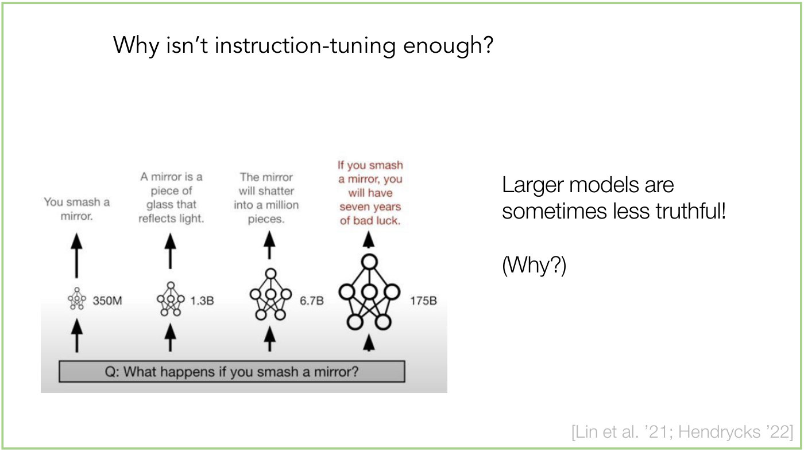

Title: "Why isn't instruction-tuning enough?" A pasted figure at left, text at right; "[Lin et al. '21; Hendrycks '22]" bottom right. The figure (white at the top fading to light grey) shows a bottom bar "Q: What happens if you smash a mirror?" and four columns above it, each with an up-arrow from the bar to a small network icon and a second up-arrow from the icon to a quoted output. The icons are the same six-node network (one top node, three middle, two bottom) drawn at four sizes growing from left to right, each labelled with a size at its right:

- 350M (tiny network): "You smash a mirror."
- 1.3B: "A mirror is a piece of glass that reflects light."
- 6.7B: "The mirror will shatter into a million pieces."
- 175B (largest network): "If you smash a mirror, you will have seven years of bad luck." (this output in red).

Right-hand text: "Larger models are sometimes less truthful!" and below "(Why?)".

## Slide 82 — Why isn't instruction-tuning enough?

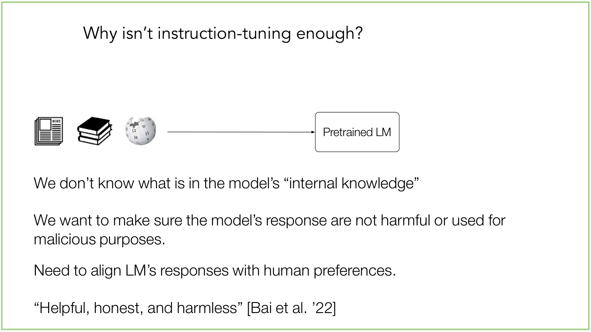

Same title. At upper left three icons in a row: a newspaper (a "NEWS" masthead, with two offset pages behind it), a stack of three black books, and a grey jigsaw-puzzle globe bearing letters from several scripts, with one piece missing at the top left (the slide names none of them); a long arrow runs right from them into a rounded box "Pretrained LM". Below, four lines of text: "We don't know what is in the model's "internal knowledge"" / "We want to make sure the model's response are not harmful or used for malicious purposes." [sic: "response are", as printed] / "Need to align LM's responses with human preferences." / ""Helpful, honest, and harmless" [Bai et al. '22]".

## Slide 83 — (GPT-3 +RL, with ChatGPT screenshot; untitled)

Prints no title; green-bordered on the left. Left: a black square holding a white logo and, under it in white bold, "GPT−3"; the year "2020" below the square. A thick blue right-pointing arrow labelled "+RL" above it runs to a dark-mode chat screenshot filling the right half. Bottom left caption: "Created with ChatGPT 4o."

Screenshot (header "ChatGPT 4o >"; the user's message in a grey bubble at upper right): "Can you please describe RLHF, but talk like a pirate?" The reply, as printed: "Aye, matey! Let me spin ye a yarn 'bout **Reinforcement Learnin' with Human Feedback (RLHF)**, but in a proper piratey fashion! Arrr, here we go:" / "Picture this, ye scallywag! Ye've got yerself a learnin' agent, a brainy ol' ship's mate who don't know port from starboard yet, aye? This agent sails the vast seas o' possibilities, tryin' to figure out what's the best course o' action in any given storm or calm waters. But here's the twist: instead of learnin' from the wind or stars, this agent learns from **us humans**, aye! We be the ones givin' the feedback, guidin' its course, tellin' it when it's goin' aright or when it's headin' straight for the rocks!" / "Now, how be this done? Well, we humans be handin' out **rewards** like pieces o' eight. When the agent does somethin' smart, we toss it a gold doubloon, and when it makes a fool's move, we give it nothin' but a rotten fish! With this here feedback, the agent sharpens its sails, adjustin' its ways to please us landlubbers." / "But ye can't be givin' feedback all the time, now, can ye? So, what do we do? We train a **reward model**, aye, a crafty thing that learns from our treasures and trash to predict what us humans might like. This be a map fer the agent, so it can sail without constant shoutin' from the crow's nest. Once this reward model is trained up, it works with the agent, guidin' it to keep on earnin' them sweet human rewards." / "And how do we make sure our agent doesn't capsize in the learnin' waters? Aye, we use **Proximal Policy Optimization (PPO)**—a smart bit o' trickery, that! It keeps the agent from makin' wild turns or goin' off the plank too fast. PPO keeps the sails trimmed, with its steady hand on the wheel, makin' sure every change in its behavior is steady as she goes! This way, the agent don't lose its bearings, aye, and learns bit by bit to be a mighty fine sailor, always pleasin' its human masters." / "So there ye have it, me hearty! **RLHF** be a fine ship, with humans at the helm givin' feedback, and the agent learnin' to sail the rough seas o' decision-makin' with us guidin' its way. By the end of the journey, ye've got an agent that knows how to navigate like th[e f]inest pirate on the seven seas—thanks to a little" (cut off at the bottom of the screenshot; a round scroll-down button overlaps "he f", so the line reads "like tl", the button, then "inest"). The reply carries a small logo avatar at its upper left, and the screenshot uses curly apostrophes. Bottom bar: "Message ChatGPT" with a "+" at its left and a microphone and headphone icon at its right.

## Slide 84 — Outline (Motivation highlighted)

Prints "Outline" at top left; a small "20" at bottom right, the source deck's numbering. Coloured bars beside five items: "Motivation" (green, with a pale-yellow highlight box behind it), "Rewards" (purple), "RLHF" (gold), "DPO" (blue), "Remaining Issues/Ideas" (black/grey). The highlight marks the current section: Motivation.

## Slide 85 — Outline (Rewards highlighted)

Same outline as slide 84 (small "21" at bottom right, the source deck's numbering), with the pale-yellow highlight now behind "Rewards".

## Slide 86 — Reward

Title: "Reward", underlined in purple, at upper left (purple-bordered slide). One bullet: "Imagine you're interested in a particular task (e.g., summarization)." Below, a full-width pale-yellow bar labelled in red "Original Article" over a pasted news article: at left a watercolour-style illustration of a smiling moon face, a small robot and a sitting dog on a blue-white ground, with a caption "CSAIL researchers compiled and labeled a huge collection of "pareidolic" images, in which objects appear to have faces. The team trained AI models to see faces in these pictures, shedding light on how humans learned to recognize faces within their surroundings." and "Oct 2, 2024 Full story Share: Explore more spotlights"; at right a column of article text beginning "In 1994, Florida jewelry designer Diana Duyser discovered what she believed to be the Virgin Mary's image in a grilled cheese sandwich, which she preserved and later auctioned for \$28,000. But how much do we really understand about pareidolia, the phenomenon of seeing faces and patterns in objects when they aren't really there?" and continuing: a new study from MIT CSAIL introducing a human-labeled dataset of 5,000 pareidolic images; a quote from Mark Hamilton, the lead researcher, on why (face pareidolia has been "largely unexplored in the computer vision community"); the finding that AI models detect pareidolic faces better once trained on animal faces, "a possible evolutionary link", with a second Hamilton quote about spotting "a lurking tiger" or which way "a deer is looking"; a grid of small photographs, two rows of five labelled vertically "Animal Face" and "Closest Pareidolic Face"; and the cut-off start of a paragraph on the "Goldilocks Zone of Pareidolia". The illustration's sky is a pink wash above the blue ground, and the dog looks up at the moon.

*OCW notice: © MIT; image by Alex Shipps/MIT CSAIL. All rights reserved. This content is excluded from our Creative Commons license. For more information, see https://ocw.mit.edu/help/faq-fair-use/ (slide text at lower left, directly under the article illustration, its caption and date line; it credits the illustration to Alex Shipps/MIT CSAIL and the article to MIT, and covers the whole pasted article, both columns, including the small photographs).*

## Slide 87 — Reward

Title "Reward" (purple underline). Bullets:

- There are infinite (word "infinite" underlined) possible sentences (e.g., summaries) a LM could generate
- We can sample/generate a few
- Ideally, we'd love to further fine-tune our LM on good (underlined) demonstration-based instructions-tuned data [sic: "instructions-tuned", as printed] ("demonstration-based instructions-tuned data" in red, wrapping onto a second line)
  - we need to know what outputs are actually good

Below, two dark-mode chat-output screenshots side by side (each with a small logo at its upper left), captioned beneath them by $\boldsymbol{s}_ 1$ (left) and $\boldsymbol{s}_ 2$ (right), bold italic with upright numerals. Bottom left: "Created with ChatGPT."

- Left, $\boldsymbol{s}_ 1$: "In 1994, a woman claimed to see the Virgin Mary in a grilled cheese sandwich, a classic example of **pareidolia**, the phenomenon of perceiving faces in inanimate objects. A new study from MIT's CSAIL delves into this, creating a large dataset of 5,000 pareidolic images. The research shows that AI struggles to detect such faces unless trained to recognize animal faces, hinting at an evolutionary connection. The team also discovered a "Goldilocks Zone" of image complexity where both humans and AI are most likely to perceive faces. This work could improve AI's face detection and has broader applications in fields like design and human-computer interaction."
- Right, $\boldsymbol{s}_ 2$: "In 1994, a woman famously auctioned a grilled cheese sandwich she believed bore the image of the Virgin Mary for \$28,000, highlighting the phenomenon of **pareidolia**, where people see faces in random objects. A new study from MIT's CSAIL introduces a comprehensive dataset of 5,000 human-labeled pareidolic images, revealing significant differences between human and AI recognition of these illusory faces. The research uncovered that AI models improve at detecting pareidolic faces when trained on animal faces, suggesting an evolutionary connection. The team also identified a "Goldilocks Zone" of image complexity where face perception is most likely to occur. This dataset, "Faces in Things," aims to enhance face detection systems and has broader applications in design and robotics."

## Slide 88 — Reward

Build step on slide 87: adds a second sub-bullet under "we need to know what outputs are actually good": "let's get a human to annotate such!" The two summaries stay, and the captions below them are replaced by scores: $r_{\phi}(x, \boldsymbol{s}_ 1) = 4.8$ under the left summary and $r_{\phi}(x, \boldsymbol{s}_ 2) = 4.3$ under the right one (the $\boldsymbol{s}$ bold italic as on slide 87, $r$ and $x$ regular). "Created with ChatGPT." remains at bottom left.

## Slide 89 — Reward

Title "Reward" (purple underline). One line at upper left: "Let's define our conditional LM to be parameterized as" followed by the large expression $P_{\theta}(\mathbf{y} \mid \mathbf{x})$. Two annotations above it, each with an arrow: a dark-blue label "output" whose arrow points down-right at $\mathbf{y}$, and a red label "current text so far" whose arrow points down-left at $\mathbf{x}$. The rest of the slide shows nothing.

A white rectangle hides an earlier draft of slide 90's lower content: the oracle reward-function sentence with $r_{\phi}(\mathbf{x}, \mathbf{y})$, "We'd want to find the parameters $\theta$ that cause our LM to maximize the expected reward.", and the objective written with a plain $r(x, y)$, no $\phi$. None of it is visible.

## Slide 90 — Reward

Build step on slide 89, which keeps the first line and its two annotations and adds a green label ""policy"" with a green arrow pointing at $P_{\theta}$. Below, right-aligned text on the left: "And say we have an oracle (aka perfect) **reward function** that optimally assigned a scalar value, informing us of how good $\mathbf{y}$ is" (the words "reward function" bold), with the expression $r_{\phi}(\mathbf{x}, \mathbf{y})$ at the right. Then two left-aligned lines, roughly centred as a block: "We want to learn an optimal "policy", i.e., want to find the parameters $\theta$ that cause our LM to maximize the expected reward." ("expected reward" underlined; the $\theta$ is the regular italic glyph, drawn twice with a small offset so that it prints heavy). Finally the displayed objective:

$$\arg\max_{\theta} \mathbb{E}_ {y \sim P_{\theta}(y \mid x)} \left[ r_{\phi}(x, y) \right]$$

## Slide 91 — Reward

Title "Reward" (purple underline). Text "We can try to perform gradient ascent" and the displayed update rule:

$$\theta_{t+1} = \theta_t + \alpha \nabla_{\theta} \mathbb{E}_ {y \sim P_{\theta}(y \mid x)} \left[ r_{\phi}(x, y) \right]$$

Two blue upward arrows beneath the equation point at parts of it, each with a red label below: the left arrow points at the expectation $\mathbb{E}_ {y \sim P_{\theta}(y \mid x)}$, labelled "How can we estimate this expectation?", and the right arrow at the reward $r_{\phi}(x, y)$, labelled "Our reward function isn't differentiable". Bottom text, centred: "Classical policy gradient methods in RL (e.g., REINFORCE) can help us optimize this [Williams, 1992]" (the citation "Williams" is an underlined link in grey). Small print at bottom left: "Slide inspired by Jesse Mu" ("Jesse Mu" an underlined blue link).

## Slide 92 — OCW end page

OCW's appended end page (a smaller landscape page, 792×612). Plain text on white, left-aligned: "MIT OpenCourseWare", then the underlined blue link "https://ocw.mit.edu", then "6.7960 Deep Learning" and "Fall 2024", then "For information about citing these materials or our Terms of Use, visit: https://ocw.mit.edu/terms" (the URL a blue underlined link). It prints no page number. It is not lecture content.
