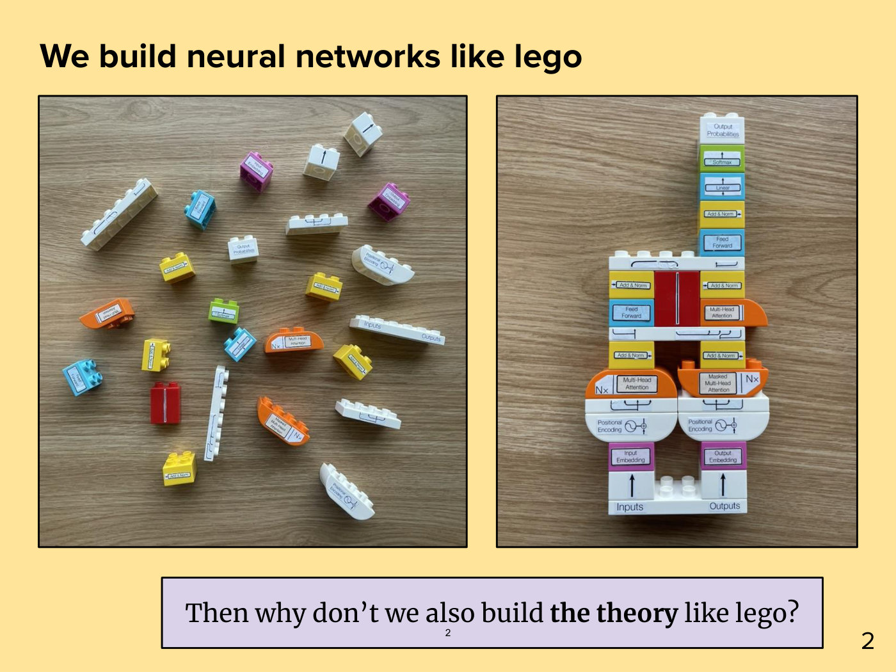
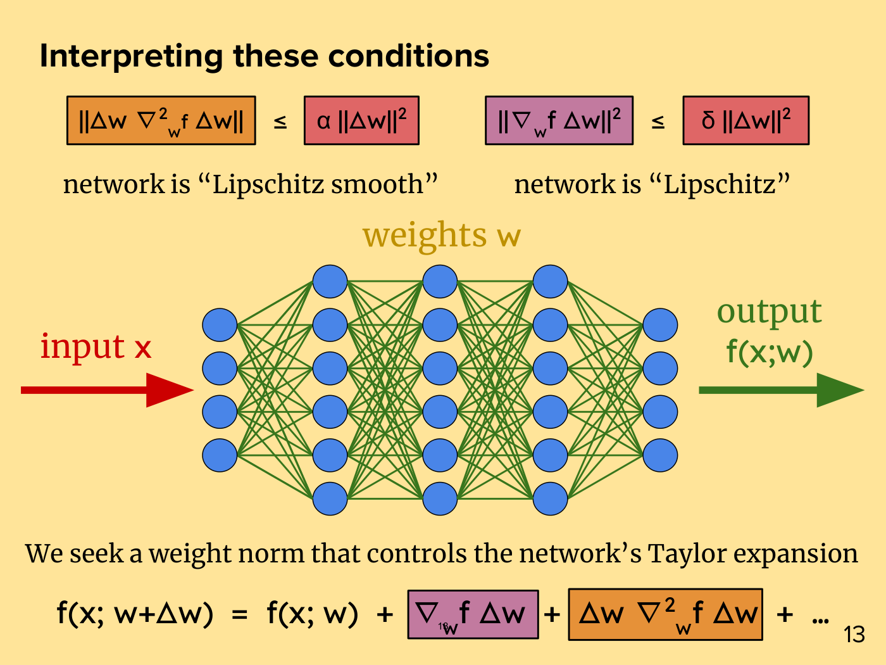
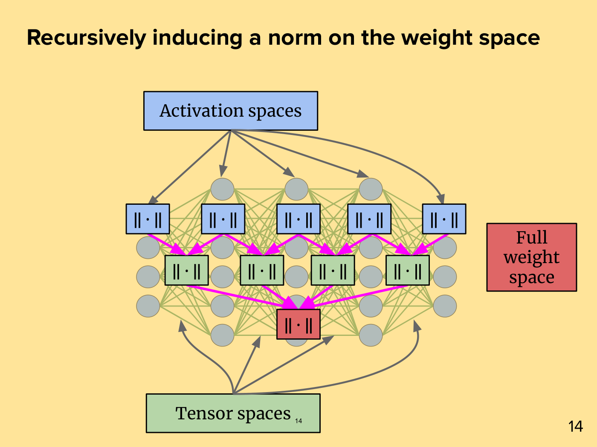
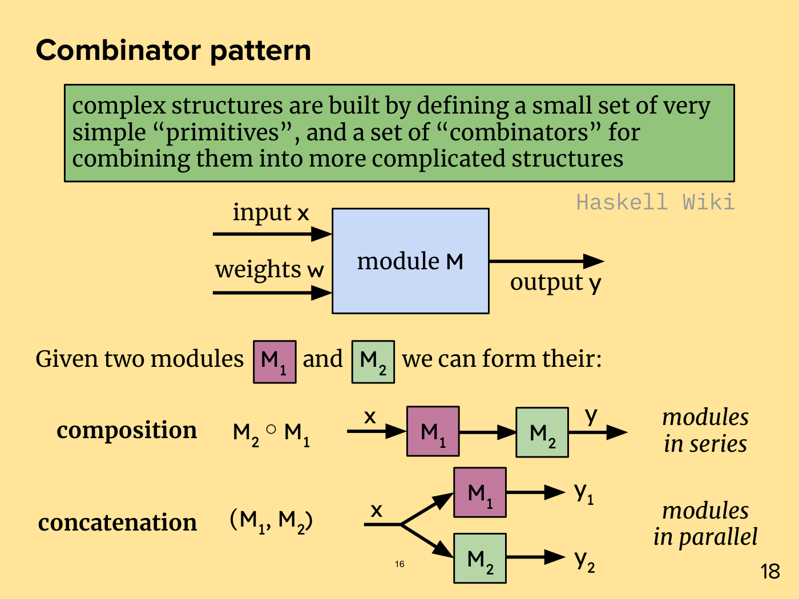
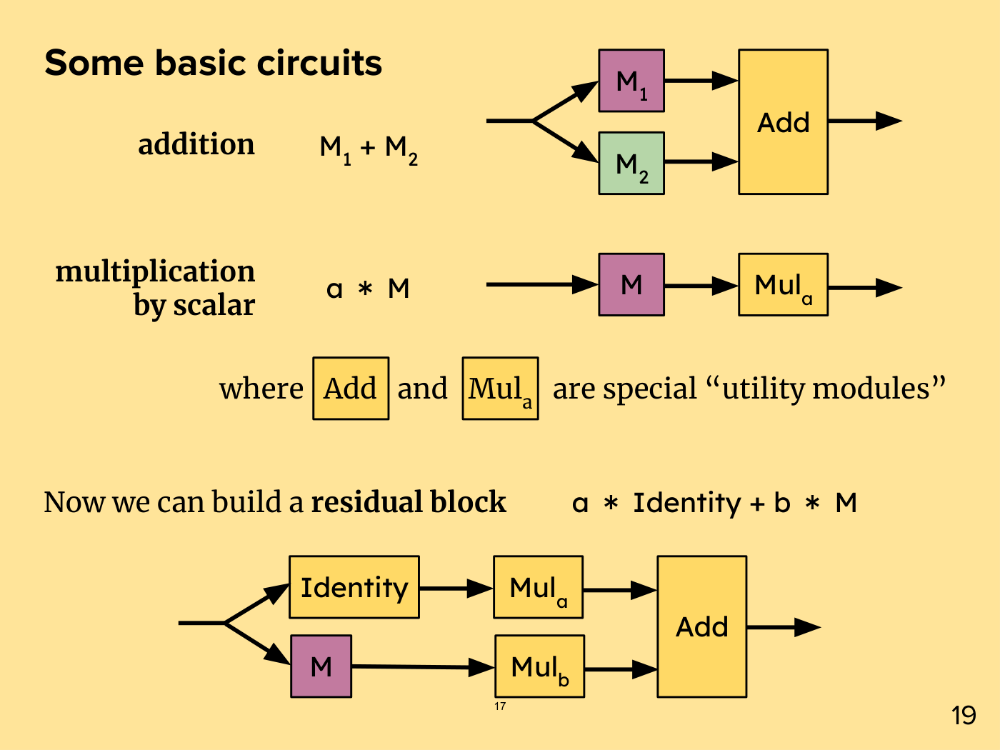
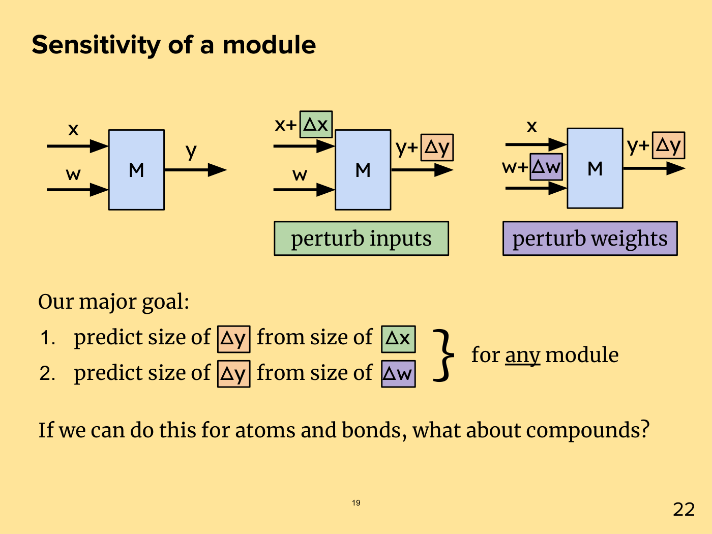
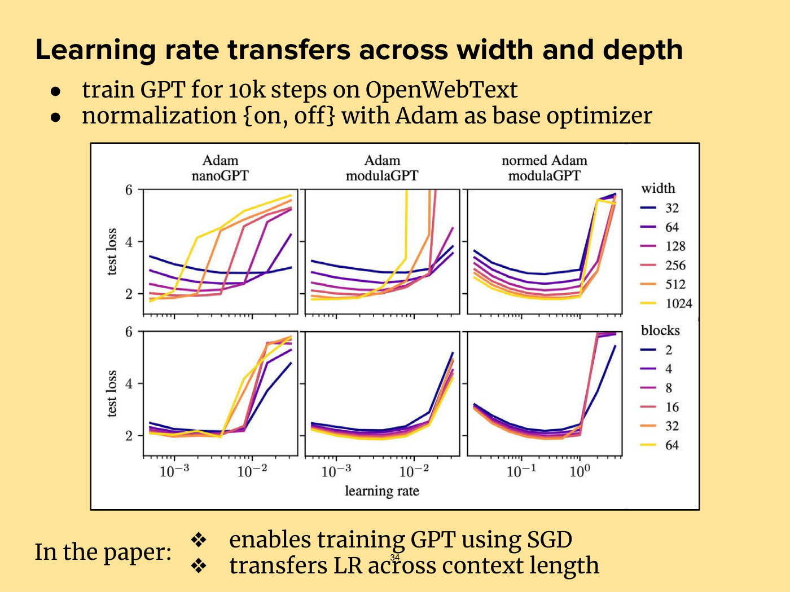
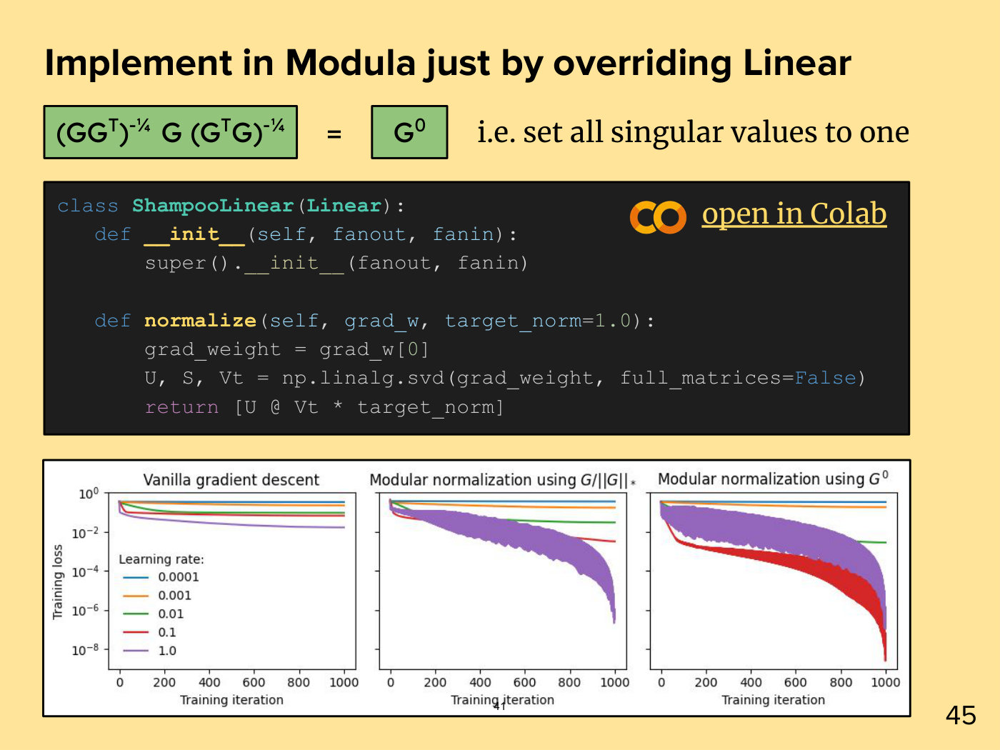

# Lecture 23 — Metrized Deep Learning: slide-by-slide

Text and figures of all 49 pages of
[`mit6_7960_f24_lec23.pdf`](https://ocw.mit.edu/courses/6-7960-deep-learning-fall-2024/mit6_7960_f24_lec23.pdf),
transcribed from the deck. The lecturer is Jeremy Bernstein, and the deck is typed (Google Slides), unlike his handwritten decks for
lectures 3, 7 and 13. **Cite these as "slide N", where N is the PDF page**, which is also the small number at bottom centre; the larger
numbers in the bottom-right corner of thirty pages belong to an earlier talk (see the front matter). Diagrams, plots and pictures are
described in prose since the KB is read as text. The equations are typed text whose text layer loses their structure, so all were read from
the page. The deck prints w, x, y and W plain, in an upright sans-serif, and so does this file; the [wiki page](../../wiki/23-metrized-deep-learning.md)
writes them bold, in the course notation. The deck's multiplication sign is a full-width asterisk "＊", given here as ∗ or $\ast$, and its
composition sign a small white circle "⚬", given as ∘.

The recording covers the whole deck and ends at ≈1:07:15 on slide 48; OCW's transcript PDF ends at the same words.

**Images.** Eight slides have a rendered image under their heading: 2, 13, 14, 16, 17, 19, 34 and 41. The fifteen slides with an OCW notice
(3–7, 24, 26–28, 31, 37, 42 and 45–47) are never rendered; no other slide of this deck reuses an excluded image, but lecture 13's slide 3
pastes the chart of slide 7 and was withdrawn when this deck was added. The others were not rendered because they are text, equations, code
or logos that this file reproduces (9–12, 18, 20–23, 29, 30, 32, 33, 36, 39, 40, 43 and 48), a repeat of a rendered slide (38, slide 14's
drawing), the title (1), section dividers (8, 15, 25, 35 and 44) or the end page (49).

Companion pages: [wiki page for this lecture](../../wiki/23-metrized-deep-learning.md) · [transcript](../transcripts/23-metrized-deep-learning.md)

| Section | Slides |
| --- | --- |
| Title | 1 |
| Motivation: build the theory like LEGO, and the payoff so far | 2–7 |
| Part I: Optimization theory | 8–14 |
| Part II: The theory of modules | 15–24 |
| Part III: Scaling | 25–34 |
| Part IV: Modular duality | 35–43 |
| Conclusion | 44–48 |
| OCW end page | 49 |

**Signposting slides you can skip.** Slide 1 is the title; slides 8, 15, 25, 35 and 44 are section dividers; slide 49 is the OCW end page.
Some slides repeat earlier ones, and are transcribed in full with a note of what changes: 10 to 12 (the three steps, each repeating the
bound to be proved), 13 (slide 12's conditions again), 23 (slide 20's definitions beside the combination rules), 31 (slide 30 with the
emphasis on its second question), 36 (slide 9's steepest descent, extended), 38 (slide 14's drawing under a new title), 43 (slide 32's code
with one line changed), 45 and 46 (slides 6 and 7 again, in the conclusion). Slides 42 and 48 have no printed title and are headed here
with a description.

**Printed slips and oddities**, kept as printed and flagged in each entry: slide 21's embedding-module box, whose second condition reads
"L.norm(W) ≤ 1" where the module is E (a copy of the linear module's line); slide 47's "We believe are questions", where a word seems to be
missing; and, in an OCW notice, slide 26's "unkown". Slides 10–13 write the Gauss-Newton products without transpose signs, slide 13's
expansion has no factor of one half on its second-order term, slide 23 prints the composition rule's $p$ without brackets, so its grouping is
not marked, and slide 36 prints the gradient's dual norm with no mark that it is a dual norm. Some pages hold things the page does not show:
slide 7's and slide 28's plot image carries hand-lettered titles ("optimal learning rate drifts", "deeper performs worse") under the panel
title bars, and slide 7 also clips away a whole depth plot; slide 28's network image has its own "width" and "depth" labels masked out; and
slide 45 hides a yellow "w₁" label under a brick. Each entry describes what the page shows.

**OCW licence notices** are on slides 3–7, 24, 26–28, 31, 37, 42 and 45–47, fifteen in all, all typed and in the text layer; the slide
file's set and the text layer's are the same, and a scan for notices drawn as glyph outlines found none. They cover the LEGO brick
renderings and photographs (3, 5, 6 and 45, "source unknown"), slide 4's loss surface and adversarial pig, Keller Jordan's charts and
photograph (7, 28, 42 and 46, "© @kellerjordan0 on X"), Li et al.'s loss-landscape renderings (24), the four animal photographs (26, the fly
"© Sanjay Acharya"), the supercomputer photographs (27, "© Carlos Jones / Oak Ridge National Laboratory"), the paper's author portraits (31),
the mirror picture (37, "© "ilbusca" at iStock") and slide 47's pictures. Slide 4's red brick and slide 45's bricks and pile are the same
images as slides 3 and 6's. Slides without a notice also reproduce figures: slide 2's photographs, slide 34's chart from the lecturer's paper
with his collaborators, slide 40's pseudocode screenshot of the Shampoo algorithm and slide 41's chart, with no credit printed;
[`LICENSE.md`](../../LICENSE.md) lists the rendered ones.

## Slide 1 — Metrized deep learning

Title page on a solid medium-blue background. Title "Metrized deep learning" in bold, with a thick black horizontal rule under it spanning the page width. Below the rule: "Jeremy Bernstein" and, in a grey monospace font, "https://jeremybernste.in/". At right, the black MIT logo (vertical bars), the only image on the page. Slide number 1 printed at bottom centre.

## Slide 2 — We build neural networks like lego



Title: "We build neural networks like lego" (on a pale-yellow page). Two photographs side by side, each with a thin black border, both on a wooden table. Left: a scatter of 25 small LEGO-style bricks and plates (5 yellow, 3 cyan, 3 orange, 2 magenta, 1 green, 1 red, 10 white), each carrying a small white sticker with a label or an arrow drawing; most stickers are small and turned at angles, but several can be read, among them "Inputs"/"Outputs", "Output Probabilities", "Multi-Head Attention", "Masked Multi-Head Attention" and "Positional Encoding". Right: the same 25 pieces assembled into one tall tower, whose stickers are legible. From the top down: a single column on the right of "Output Probabilities" (white), "Softmax" (green), "Linear" (cyan), "Add & Norm" (yellow) and "Feed Forward" (cyan), standing on a full-width white plate with residual-arrow drawings; then two columns with a tall red brick (its sticker a vertical line) between them, on the left "Add & Norm" over "Feed Forward", on the right "Add & Norm" over "Multi-Head Attention" (orange); then a second white plate with arrow drawings; then one "Add & Norm" brick in each column; then two orange bricks labelled "Multi-Head Attention" (left, "N×" at its left end) and "Masked Multi-Head Attention" (right, "N×" at its right end), each on a white plate with a branching-arrow drawing; then two white curved bricks labelled "Positional Encoding" (each sticker also showing a sine wave in a circle joined to a circled plus); then magenta bricks "Input Embedding" and "Output Embedding"; then two white bricks with up-arrows; and at the base a white plate labelled "Inputs" and "Outputs". The page never prints "transformer"; the stickers reproduce the labels of a transformer diagram, as the recording says ("we can build a transformer, for example", ≈0:46). No OCW notice and no credit is printed on the page.

A lavender box with a black border at the bottom right reads: "Then why don't we also build **the theory** like lego?" (bold on "the theory"). The small bottom-centre number 2 overlaps the box. (bottom-right corner: 2, the source deck's number)

## Slide 3 — What does that even mean?

Title: "What does that even mean?"

Text at upper left: "Suppose we can characterize the properties of an **individual layer**". At upper right, a single red LEGO brick drawn as a 3D rendering (two rows of four studs). Centre text: "Can we characterize the properties of **combinations of layers**?"

Below, two drawings. Left, a blue brick stacked on top of a red brick of the same footprint, labelled below in a pale-blue, black-bordered box "series combination". Right, a red and a blue brick placed side by side (the red in front on the left, the blue behind and to the right), labelled below "parallel combination". All the brick renderings on the page, the single red brick included, are two embedded images (one red brick, one blue) drawn five times; slides 4, 5 and 45 draw them again.

*OCW notice: "© source unknown. All rights reserved. This content is excluded from our Creative Commons license. For more information, see https://ocw.mit.edu/help/faq-fair-use/" (small print just above the "parallel combination" label, at lower right, overlapping the foot of the parallel bricks; it covers the brick renderings).*

(bottom-right corner: 3, the source deck's number)

## Slide 4 — What properties do we care about?

Title: "What properties do we care about?"

At left: "a layer has" followed by a large curly brace enclosing three lines: "an input **x**" (x in red), "weights **w**" (w in yellow), "an output **y**" (y in green). At right, a red LEGO brick with a yellow label "w+∆w" written along its side. A red up-arrow rises into the brick from below, labelled "x+∆x" in red; a green up-arrow leaves the top of the brick, labelled "y+∆y" in green.

A lavender box: "How **sensitive** is the output to the weights and inputs?"

At bottom left, a 3D rendering of a rainbow-coloured loss-surface mesh (blue in the valleys, red and orange at the peaks) above a contour map, with one black curved path, starting at a dot near the red peak and winding down the surface to an arrowhead in a blue valley. At bottom right, a bordered panel: a photograph of a pig captioned above "“pig”", then "+ 0.005 x" (a lower-case letter x), then a square of multicoloured noise, then "=", then the same photograph of a pig captioned above "“airliner”".

*OCW notice: "Images © source unknown. All rights reserved. This content is excluded from our Creative Commons license. For more information, see https://ocw.mit.edu/help/faq-fair-use/" (small print beneath the pig panel, at lower right; it covers the images, that is the loss surface and the pig panel, and the printed "Images" is plural; the red brick is the same embedded image as slide 3's excluded brick, drawn at the same position).* The small bottom-centre number 4 overprints the notice's second line.

(bottom-right corner: 4, the source deck's number)

## Slide 5 — If we understand the sensitivity of individual layers...

Title: "If we understand the sensitivity of individual layers..." (ending in three dots as printed).

Three LEGO drawings in a row, each with a red up-arrow labelled "x" entering from below and a green up-arrow leaving from above. Left: a single red brick with a yellow label "w" on its short end face; one green arrow labelled "y". Middle: a blue brick stacked on a red brick; the labels "w₁" on the red and "w₂" on the blue (yellow, written on the sides); a single x arrow in and a single green arrow "y" out through the top. Right: a red and a blue brick side by side, labelled "w₁" and "w₂"; one red x arrow in and two green arrows out, labelled "y₁" (above the red brick) and "y₂" (above the blue brick).

A lavender box: "...can we extend this understanding to **combinations**?"

*OCW notice: "Images © source unknown. All rights reserved. This content is excluded from our Creative Commons license. For more information, see https://ocw.mit.edu/help/faq-fair-use/" (small print above the lavender box, at lower right; it covers the brick renderings).*

(bottom-right corner: 5, the source deck's number)

## Slide 6 — A deep learning library should be like a lego set

Title: "A deep learning library should be like a lego set". Three bullets:

- a collection of layers each with its own theory
- a system of rules for combining layers
- build whatever you want!

At the bottom, a large photograph of a heap of loose LEGO bricks in many colours (red, blue, yellow, green, white, black), spanning the width of the slide.

*OCW notice: "Image © source unknown. All rights reserved. This content is excluded from our Creative Commons license. For more information, see https://ocw.mit.edu/help/faq-fair-use/" (small print over the right of the heap; it covers the photograph).*

The small bottom-centre number 6 is printed over the photograph, black on dark bricks and hard to see at normal size. Under the photograph is a black copy drawn through a soft mask, its drop shadow, not a second picture. (bottom-right corner: 6, the source deck's number)

## Slide 7 — The practical payoff... so far

Title: "The practical payoff... so far". Two panels, each with a coloured, black-bordered label box above (pink-mauve at left, light blue at right) and a bordered picture below.

Left, a pink label "fixing scaling issues". The picture is a hand-drawn-style plot with a wobbly black frame. Y-axis label: "training loss"; x-axis label: "learning rate"; no tick values. Legend "width" with six entries and line colours running from purple to yellow: 32 (dark purple), 64 (indigo), 128 (blue-teal), 256 (teal), 512 (green), 1024 (yellow). There are six U-shaped curves rising to the right. The minima of the curves move left and down as width grows: the width-32 curve bottoms out highest and furthest right, the width-1024 curve lowest and furthest left. A thick red arrow runs from the minimum of the narrowest curve (upper right) down and to the left toward the minimum of the widest curve.

Right, a blue label "nanoGPT speed records". The picture is a line chart titled "NanoGPT speedruns". X-axis: "Wallclock time (minutes on 8xH100)", ticks 0 to 40 in steps of 10. Y-axis: "Fineweb val loss", ticks 3.3 to 3.8 in steps of 0.1. A dashed horizontal line sits at about 3.28. Three series, listed in the legend with columns for ms per step and tokens:
- blue: "llm.c baseline", "140ms/step", "10.25B tokens". It enters at the top of the plot (3.8) at about 5.5 minutes and falls slowly, meeting the dashed line at about 42 minutes and ending on it at about 46 minutes.
- orange: "10/14/24 record", "179ms/step", "2.67B tokens". It falls much faster, with a kink near 3.41 at about 11 minutes after which it steepens, and reaches the dashed line at about 15 minutes.
- green: "+Distributed Muon", "154ms/step", "2.67B tokens". It is the fastest, tracking just left of the orange curve, with the same kink near 3.41 at about 9 minutes, and reaching the dashed line at about 13 minutes.

All three series carry small dot markers; the grey dashed line is at about 3.275, just below the lowest tick. The left picture is cropped from a wider embedded image, the one slide 28 shows in full; on this page it is clipped to the width plot, and a white strip hides that plot's hand-lettered title ("optimal learning rate drifts"). The hidden part also holds the depth plot of slide 28 ("deeper performs worse"); the recording speaks only of the width plot here (≈6:15–7:02).

Below the right picture, in a monospace font: "@kellerjordan0".

*OCW notice: "© @kellerjordan0 on X. All rights reserved. This content is excluded from our Creative Commons license. For more information, see https://ocw.mit.edu/help/faq-fair-use/" (small print at lower right, under the handle; it covers the right-hand chart; the left-hand hand-drawn plot has no separate credit).*

No larger corner number is printed on this page; only the small bottom-centre 7.

## Slide 8 — Part I: Optimization theory

Section divider on a solid medium-blue background. Title "Part I" in large bold, with a thick black rule beneath it spanning the page; below it, "Optimization theory". Small slide number 8 at bottom centre.

## Slide 9 — Recall: Steepest descent

Title: "Recall: Steepest descent". Text: "Consider a loss function $\mathcal{L}: \mathrm{R}^N \to \mathrm{R}$ and its Taylor expansion:" (the page prints the loss as a script L and the domain and codomain as plain sans-serif R's, not blackboard bold).

Two rows of coloured boxes joined by operators. Row 1: an orange box $\mathcal{L}(w+\Delta w)$, then "=", a yellow box $\mathcal{L}(w)$, "+", a green box $\nabla_ {w} \mathcal{L}^{\top} \Delta w$, "+", a blue box $\tfrac{1}{2} \Delta w^{\top} \nabla^2_ {w} \mathcal{L} \thinspace \Delta w$, "+", and a mauve box "...". Row 2, aligned under row 1: "≤", the same yellow box $\mathcal{L}(w)$, "+", the same green box, "+", a red box $\tfrac{1}{2} \lambda \Vert\Delta w\Vert^2$ in the place of the blue box, "+", and a mauve box "...".

A thick black arrow points up and to the left from the text to the "≤" sign. The text beside it reads: "can we find a **norm** $\Vert \cdot \Vert$ and a **sharpness** $\lambda$ to make this inequality hold tightly?" (bold on "norm ‖·‖" and "sharpness λ"). The arrow points up and to the left from the start of this text to the "≤".

Then: "If so, then we can select an optimization step by solving:" and below it "arg min" with subscript Δw, followed by the green box $\nabla_ {w} \mathcal{L}^{\top} \Delta w$, "+", and the red box $\tfrac{1}{2} \lambda \Vert\Delta w\Vert^2$.

(bottom-right corner: 9, the source deck's number)

## Slide 10 — How could we produce such a norm? (Step 1/3)

Title: "How could we produce such a norm?", with "Step 1/3" printed at the top right.

"We need to bound" followed by the blue box $\Delta w^{\top} \nabla^2_ {w} \mathcal{L} \thinspace \Delta w$, "≤", and the red box $\lambda \Vert\Delta w\Vert^2$.

"Recall that in deep learning, the loss function is a composite". Below, centred: a yellow box $\mathcal{L}(w)$, "=", a green box $\ell$, a small open circle "∘", and a purple box $f(w)$. A black arrow from the label "error measure" points up to the green box; a black arrow from the label "neural net" points up to the purple box.

"By the Gauss-Newton decomposition, the Hessian satisfies:" and then, in boxes: the blue box $\Delta w^{\top} \nabla^2_ {w} \mathcal{L} \thinspace \Delta w$, "=", an orange box $\Delta w \thinspace \nabla^2_ {w} f \thinspace \Delta w \thinspace \nabla_ f \ell$, "+", a mauve box $\Delta w \thinspace \nabla_ {w} f \thinspace \nabla^2_ f \ell \thinspace \nabla_ {w} f \thinspace \Delta w$. (Printed without transpose signs in the orange and mauve boxes, as shown here, and with spaces rather than operators between the factors.)

(bottom-right corner: 10, the source deck's number)

## Slide 11 — How could we produce such a norm? (Step 2/3)

Title: "How could we produce such a norm?", with "Step 2/3" at the top right.

"We need to bound" with the blue box $\Delta w^{\top} \nabla^2_ {w} \mathcal{L} \thinspace \Delta w$, "≤", the red box $\lambda \Vert\Delta w\Vert^2$ (as on slide 10).

"Now suppose we know a good norm $\Vert \cdot \Vert$ on the network output". Then: "Then we may bound the Gauss-Newton decomposition:".

Row 1: the blue box, "=", the orange box $\Delta w \thinspace \nabla^2_ {w} f \thinspace \Delta w \thinspace \nabla_ f \ell$, "+", the mauve box $\Delta w \thinspace \nabla_ {w} f \thinspace \nabla^2_ f \ell \thinspace \nabla_ {w} f \thinspace \Delta w$.

Row 2: "≤", two orange boxes side by side $\Vert\Delta w \thinspace \nabla^2_ {w} f \thinspace \Delta w\Vert$ and $\Vert\nabla_ f \ell\Vert$, "+", two mauve boxes side by side, $\Vert\nabla^2_ f \ell\Vert$ and $\Vert\nabla_ {w} f \thinspace \Delta w\Vert^2$ (the last with an exponent 2 outside the bars). A black arrow from the label "dual norm" points up to the box $\Vert\nabla_ f \ell\Vert$; a black arrow from the label "operator norm" points up to the box $\Vert\nabla^2_ f \ell\Vert$.

(bottom-right corner: 11, the source deck's number)

## Slide 12 — How could we produce such a norm? (Step 3/3)

Title: "How could we produce such a norm?", with "Step 3/3" at the top right.

"We need to bound" with the blue box and the red box, as on slide 10.

"By the Gauss-Newton decomposition and having an output norm:" Then the two rows of slide 11 again: the blue box "=" orange box $\Delta w \thinspace \nabla^2_ {w} f \thinspace \Delta w \thinspace \nabla_ f \ell$ "+" mauve box $\Delta w \thinspace \nabla_ {w} f \thinspace \nabla^2_ f \ell \thinspace \nabla_ {w} f \thinspace \Delta w$; and below, "≤" followed by four separated boxes, orange $\Vert\Delta w \thinspace \nabla^2_ {w} f \thinspace \Delta w\Vert$, orange $\Vert\nabla_ f \ell\Vert$, "+", mauve $\Vert\nabla^2_ f \ell\Vert$, mauve $\Vert\nabla_ {w} f \thinspace \Delta w\Vert^2$.

"Therefore, our problem reduces to the following:" then "Can we produce a norm $\Vert \cdot \Vert$ on the network weights such that:". Two inequalities side by side:

- an orange box $\Vert\Delta w \thinspace \nabla^2_ {w} f \thinspace \Delta w\Vert$, "≤", a red box $\alpha \Vert\Delta w\Vert^2$; captioned below: network is "Lipschitz smooth".
- a mauve box $\Vert\nabla_ {w} f \thinspace \Delta w\Vert^2$, "≤", a red box $\delta \Vert\Delta w\Vert^2$; captioned below: network is "Lipschitz".

The captions print curly quotation marks. No transposes and no ½ appear on this page.

(bottom-right corner: 12, the source deck's number)

## Slide 13 — Interpreting these conditions



Title: "Interpreting these conditions". At the top, the two inequalities of slide 12 again: the orange box $\Vert\Delta w \thinspace \nabla^2_ {w} f \thinspace \Delta w\Vert$ "≤" the red box $\alpha \Vert\Delta w\Vert^2$, captioned network is "Lipschitz smooth"; and the mauve box $\Vert\nabla_ {w} f \thinspace \Delta w\Vert^2$ "≤" the red box $\delta \Vert\Delta w\Vert^2$, captioned network is "Lipschitz".

Centre: a vector drawing of a fully connected network with five columns of blue circular nodes: 4, 6, 6, 6 and 4 nodes from left to right (the middle columns are taller than the outer ones; layers 2 to 4 each have six). Dark-green lines join every node to every node of the next column. Every node is joined to every node of the next column (120 edges). A thick red arrow labelled "input x" (red text) points right into the first column; a thick dark-green arrow labelled "output" above "f(x;w)" (dark-green text, no space after the semicolon) points right, away from the last column. Above the network's centre, in ochre: "weights w".

At the bottom: "We seek a weight norm that controls the network's Taylor expansion" and the equation $f(x; w+\Delta w) = f(x; w) + \nabla_ {w} f \thinspace \Delta w + \Delta w \thinspace \nabla^2_ {w} f \thinspace \Delta w + \ldots$, with the term $\nabla_ {w} f \thinspace \Delta w$ in a mauve box and $\Delta w \thinspace \nabla^2_ {w} f \thinspace \Delta w$ in an orange box. The small bottom-centre number 13 is printed over the mauve box, where it collides with the subscript w. (bottom-right corner: 13, the source deck's number)

## Slide 14 — Recursively inducing a norm on the weight space



Title: "Recursively inducing a norm on the weight space". The network of slide 13 (five columns of 4, 6, 6, 6 and 4 nodes, fully connected), seen through a semi-transparent pale-yellow rectangle, so that its nodes look grey and its lines pale olive-green. Over it are three tiers of small boxes, each containing the symbol $\Vert \cdot \Vert$:

- Five blue boxes in a row across the upper part of the network, one per column of nodes. Five dark-grey arrows fan down from a blue label box "Activation spaces" above the network: the outer two end on the leftmost and rightmost blue boxes, the middle three at the top nodes of the three middle columns, above their boxes. The first four arrows are straight, the fifth a long curve.
- Four green boxes in a second row, each placed between two adjacent blue boxes; magenta arrows run from each pair of neighbouring blue boxes down to the green box between them (two arrows into each green box).
- One red box in a third row at the centre; magenta arrows run from all four green boxes into it.

Four dark-grey arrows (the outer two curved) run up from a green label box "Tensor spaces" below the network; each ends at the network's lower edge in the gap between two adjacent columns of nodes, directly beneath one of the green boxes, not at the boxes. At right, a red label box "Full weight space", with no arrow to or from it. In all, twelve magenta arrows. The small bottom-centre number 14 is printed inside the "Tensor spaces" box, after the word "spaces". (bottom-right corner: 14, the source deck's number)

## Slide 15 — Part II: The theory of modules

Section divider on a solid medium-blue background. Title "Part II" in large bold with a thick black rule beneath; below it, "The theory of modules". Small number 15 at bottom centre. No larger corner number is printed.

## Slide 16 — Combinator pattern



Title: "Combinator pattern". A green box holds the quotation: "complex structures are built by defining a small set of very simple "primitives", and a set of "combinators" for combining them into more complicated structures". Below its right edge, in grey monospace: "Haskell Wiki".

Diagram: a light-blue box labelled "module M" (the M in a sans-serif font). Two black arrows enter it from the left, labelled "input x" (upper) and "weights w" (lower); one arrow leaves it to the right, labelled "output y".

"Given two modules" then a mauve box $\mathrm{M}_ 1$, "and", a green box $\mathrm{M}_ 2$, "we can form their:". Two rows follow:

- "composition" (bold), "M₂ ∘ M₁" (the composition sign is printed as a small white circle, ⚬, here and on slides 18 and 23), and a diagram: an arrow labelled "x" into the mauve box M₁, an arrow from M₁ to the green box M₂, an arrow labelled "y" out of M₂. Italic label at right: "modules in series".
- "concatenation" (bold), "(M₁, M₂)", and a diagram: a line labelled "x" (no arrowhead of its own) that forks into two arrows; the upper branch enters a mauve box M₁ and leaves as an arrow "y₁", and the lower branch enters a green box M₂ and leaves as an arrow "y₂". Italic label at right: "modules in parallel".

The small bottom-centre number printed is 16. (bottom-right corner: 18, the source deck's number)

## Slide 17 — Some basic circuits



Title: "Some basic circuits". Three circuit diagrams, built from small boxes and black arrows.

- "addition" (bold) with the expression "M₁ + M₂". Diagram: an input line forks into two arrows; the upper enters a mauve box $\mathrm{M}_ 1$, the lower a green box $\mathrm{M}_ 2$; an arrow from each enters a tall yellow box "Add", from which one arrow leaves to the right.
- "multiplication by scalar" (bold) with the expression "a ＊ M". Diagram: an input arrow into a mauve box M, then an arrow into a yellow box "Mul" with subscript a, then an output arrow.

Text: "where" a yellow box "Add" "and" a yellow box "Mul" (subscript a) "are special "utility modules"".

"Now we can build a **residual block**" with the expression "a ＊ Identity + b ＊ M" (in the sans-serif face of the box labels; the asterisks here and in "a ＊ M" are a large, vertically centred full-width asterisk, the deck's multiplication sign throughout). Diagram: the input forks into two arrows. The upper arrow goes to a yellow box "Identity", then a yellow box "Mul" (subscript a), then into a tall yellow box "Add". The lower arrow goes to a mauve box "M", then a yellow box "Mul" (subscript b), then into the same "Add" box; one arrow leaves "Add" to the right. The small bottom-centre number 17 sits just below the "Mul_b" box. (bottom-right corner: 19, the source deck's number)

## Slide 18 — Three kinds of modules

Title: "Three kinds of modules". Three rows, each a bold term, a dash and a definition, then "e.g." and coloured boxes:

- "**Atoms** — hand-declared attributes". e.g. a light-blue box "Linear", a purple box "Conv2d", a peach box "Embed".
- "**Bonds** — hand-declared attributes + no weights". e.g. a yellow box "ReLU", a pink box "FunctionalAttention".
- "**Compounds** — combinations of atoms and bonds". e.g. a green box "MLP", "=", a light-blue box "Linear", "∘", a yellow box "ReLU", "∘", a light-blue box "Linear".

(bottom-right corner: 20, the source deck's number)

## Slide 19 — Sensitivity of a module



Title: "Sensitivity of a module". Three small block diagrams in a row, each a light-blue box "M" with arrows in from the left and out to the right:

- Left (unperturbed): inputs "x" (upper) and "w" (lower), output "y".
- Middle: inputs "x+" followed by a green box "∆x" (upper) and "w" (lower); output "y+" followed by an orange box "∆y". A green label box below it: "perturb inputs".
- Right: input "x" (upper) and "w+" followed by a purple box "∆w" (lower); output "y+" followed by an orange box "∆y". A purple label box below it: "perturb weights".

"Our major goal:" and a numbered list, with the symbols in coloured boxes (∆y orange, ∆x green, ∆w purple):

1. predict size of ∆y from size of ∆x
2. predict size of ∆y from size of ∆w

A large right brace groups the two lines, followed by "for any module" (with "any" underlined).

Last line: "If we can do this for atoms and bonds, what about compounds?"

(bottom-right corner: 22, the source deck's number)

## Slide 20 — Formal definition of a module

Title: "Formal definition of a module". Two boxes side by side across the middle of the slide, with empty space above and below them. The numbered lists print "1)", "2)", "3)", and the attributes are set in three columns without commas (the commas below are added); the Cartesian product is printed as the sans-serif letter "x".

Left box, header (blue bar) "Definition: Module"; body on pale blue:

"A module M must have three vector spaces:"

1. input space $\mathcal{X}$ (calligraphic X)
2. weight space $\mathcal{W}$
3. output space $\mathcal{Y}$

At the right of this list is a small diagram: a blue box "M" with a thick arrow in from the left labelled $x \in \mathcal{X}$ (upper) and another labelled $w \in \mathcal{W}$ (lower), and an arrow out to the right labelled $y \in \mathcal{Y}$. (The page prints x, w and y without bold throughout, in the diagram and in the derivative lines, in the same upright sans-serif as M.)

"and four attributes:"

- I. a function, M.forward, $\mathcal{X} \times \mathcal{W} \to \mathcal{Y}$
- II. a number, M.sensitivity, $\in \mathbb{R}^{+}$
- III. a number, M.mass, $\in \mathbb{R}^{+}$
- IV. a norm, M.norm, $\mathcal{W} \to \mathbb{R}^{+}$

Right box, header (green bar) "Definition: Well-normed module"; body on pale green:

"A module M is well-normed if"

1. the input space $\mathcal{X}$ has norm $\Vert \cdot \Vert_ {\mathcal{X}}$
2. the output space $\mathcal{Y}$ has norm $\Vert \cdot \Vert_ {\mathcal{Y}}$

"and the first derivatives of the module satisfy:"

- I. $\Vert \nabla_ {w} \mathrm{M} \diamond \Delta w \Vert_ {\mathcal{Y}}$ ≤ M.norm(∆w)
- II. $\Vert \nabla_ {x} \mathrm{M} \diamond \Delta x \Vert_ {\mathcal{Y}}$ ≤ M.sensitivity ∗ $\Vert \Delta x \Vert_ {\mathcal{X}}$

(The page prints the diamond "◇" between the derivative and the perturbation; w and x after the nabla are subscripts; the multiplication sign is the full-width asterisk "＊".) The small bottom-centre number 20 is printed; no larger corner number is printed on this page.

## Slide 21 — Some atomic modules

Title: "Some atomic modules". Two definition boxes, each with a coloured header and a line of conditions below it.

Box 1, purple header "Definition: Linear module **L**", pale-pink body, in the deck's sans-serif face, set in two aligned columns:

- L.forward(W, x) = W x
- L.sensitivity = 1
- L.mass = 1
- L.norm = $\Vert \cdot \Vert_ {\text{spectral}}$ ∗ sqrt(fan-in/fan-out)

Below it: "L" and "well-normed" (underlined) "if", then a left brace over two lines: $\Vert \cdot \Vert_ {\mathcal{X}} = \Vert \cdot \Vert_ {\mathcal{Y}} = \Vert \cdot \Vert_ {\text{RMS}}$ and $\Vert x \Vert_ {\mathcal{X}} \le 1$ and L.norm(W) ≤ 1.

Box 2, blue header "Definition: Embedding module **E**", pale-blue body:

- E.forward(W, x) = W x
- E.sensitivity = 1
- E.mass = 1
- E.norm = $\max_ i \Vert \text{column}_ i(W) \Vert_ {\text{RMS}}$ (the page prints W and x without bold, with i as a subscript on max and on column)

Below it: "E" "well-normed" (underlined) "if", then a left brace over two lines: $\Vert \cdot \Vert_ {\mathcal{X}} = \Vert \cdot \Vert_ {1}$ and $\Vert \cdot \Vert_ {\mathcal{Y}} = \Vert \cdot \Vert_ {\text{RMS}}$ (the word "and" sits between them on the first line) and $\Vert x \Vert_ {\mathcal{X}} \le 1$ and L.norm(W) ≤ 1. Printed as "L.norm(W) ≤ 1" in the second condition of the embedding module, where the module is E; the page does not say "E.norm". The line is a character-for-character copy of L's second condition at the same positions, as if pasted from the box above. The small bottom-centre number 21 is printed over the word "and" in that line. (bottom-right corner: 24, the source deck's number)

## Slide 22 — Can we make compound modules automatically "good"?

Title: "Can we make compound modules automatically "good"?" (curly quotes around good). Text: "We want to be able to prove statements about module combinations". Two small diagrams: left, an arrow into a mauve box $\mathrm{M}_ 1$, an arrow to a green box $\mathrm{M}_ 2$, and an arrow out, labelled below "composition" (bold); right, an input line that forks to a mauve box $\mathrm{M}_ 1$ (upper) and a green box $\mathrm{M}_ 2$ (lower), each with its own output arrow, labelled below "concatenation" (bold).

Three rows, each a purple box and a statement:

- "Proposition 1": "Module combination is associative"
- "Proposition 2": "Module combination preserves well-normed-ness"
- "Proposition 3": "Feature learning is apportioned by mass"

(bottom-right corner: 25, the source deck's number)

## Slide 23 — Defining combination rules

Title: "Defining combination rules". Four boxes in a 2×2 grid.

Top left, blue header "Definition: Module", slide 20's box except that its first line stops at "A module M must have" (slide 20 continues "three vector spaces:"): 1) input space $\mathcal{X}$, 2) weight space $\mathcal{W}$, 3) output space $\mathcal{Y}$, a diagram of a blue box "M" with inputs $x \in \mathcal{X}$ and $w \in \mathcal{W}$ and output $y \in \mathcal{Y}$, and "and four attributes:" I. a function M.forward, $\mathcal{X} \times \mathcal{W} \to \mathcal{Y}$; II. a number M.sensitivity, $\in \mathbb{R}^{+}$; III. a number M.mass, $\in \mathbb{R}^{+}$; IV. a norm M.norm, $\mathcal{W} \to \mathbb{R}^{+}$.

Top right, green header "Definition: Well-normed module", the same box as slide 20: "A module M is well-normed if" 1) the input space $\mathcal{X}$ has norm $\Vert \cdot \Vert_ {\mathcal{X}}$, 2) the output space $\mathcal{Y}$ has norm $\Vert \cdot \Vert_ {\mathcal{Y}}$, "and the first derivatives of the module satisfy:" I. $\Vert \nabla_ {w} \mathrm{M} \diamond \Delta w \Vert_ {\mathcal{Y}}$ ≤ M.norm(∆w); II. $\Vert \nabla_ {x} \mathrm{M} \diamond \Delta x \Vert_ {\mathcal{Y}}$ ≤ M.sensitivity ∗ $\Vert \Delta x \Vert_ {\mathcal{X}}$.

Bottom left, orange header "Definition: Module composition", pale-orange body. "Given two modules M₁ and M₂ their composite", "M = M₂ ∘ M₁", with a diagram: an arrow into a mauve box M₁, an arrow to a green box M₂, an arrow out. "is the module with attributes:"

- I. M.forward = M₂.forward ∘ M₁.forward
- II. M.sensitivity = M₁.sensitivity ∗ M₂.sensitivity
- III. M.mass = M₁.mass + M₂.mass
- IV. M.norm = max(p ∗ M₁.norm, q ∗ M₂.norm)

"where" p = M.mass / M₁.mass ∗ M₂.sensitivity and q = M.mass / M₂.mass, on two lines, with no brackets printed, so the grouping of the denominator is not marked.

Bottom right, red header "Definition: Module concatenation", pale-pink body. "Given two modules M₁ and M₂ their tuple", "M = (M₁, M₂)", with a diagram: an input line forks to a mauve box M₁ (upper) and a green box M₂ (lower), each with an output arrow. "is the module with attributes:"

- I. M.forward = (M₁.forward, M₂.forward)
- II. M.sensitivity = M₁.sensitivity + M₂.sensitivity
- III. M.mass = M₁.mass + M₂.mass
- IV. M.norm = max(p ∗ M₁.norm, q ∗ M₂.norm)

"where" p = M.mass / M₁.mass and q = M.mass / M₂.mass.

The small bottom-centre number 23 sits in the gap between the two lower boxes. No larger corner number is printed on this page.

## Slide 24 — The theory works to second order

Title: "The theory works to second order". Top right, two 3D rendered loss-surface pictures on black backgrounds: a smooth bowl, blue at the bottom, shading to pale and then orange-red towards its raised corners, and, to its right, a very rugged surface with blue valleys, pale-orange walls and flat red cut-off planes along its top rim. Under them, in grey: "Visualizing the loss landscape of neural nets, Li et al (2018)". At left, in red bold italic: "Think:" and "“Generalized top eigenvalues”". A red line runs from below that phrase down to a red oval drawn around exactly the column of symbols α, β, γ (between the "≤" signs and the asterisks) in the box below; the oval runs a little past the box's bottom edge.

*OCW notice: "© Li, et al. All rights reserved. This content is excluded from our Creative Commons license. For more information, see https://ocw.mit.edu/help/faq-fair-use/" (small print at the very top right, above the title line; it covers the two loss-landscape renderings).*

A blue-headed box "Definition: Module sharpness" (crossed by the red line). Body: "A module M is "(α, β, γ)-sharp" if second derivatives obey:" followed by three lines, written as printed (the page puts a tilde over the w of the second Δw and the x of the second Δx):

- I. $\Vert \Delta w \thinspace \nabla_ {w} \nabla_ {w} \mathrm{M} \thinspace \Delta\tilde{w} \Vert_ {\mathcal{Y}} \le \alpha \ast \text{M.norm}(\Delta w) \ast \text{M.norm}(\Delta\tilde{w})$
- II. $\Vert \Delta x \thinspace \nabla_ {x} \nabla_ {w} \mathrm{M} \thinspace \Delta w \Vert_ {\mathcal{Y}} \le \beta \ast \text{M.norm}(\Delta w) \ast \Vert \Delta x \Vert_ {\mathcal{X}}$
- III. $\Vert \Delta x \thinspace \nabla_ {x} \nabla_ {x} \mathrm{M} \thinspace \Delta\tilde{x} \Vert_ {\mathcal{Y}} \le \gamma \ast \Vert \Delta x \Vert_ {\mathcal{X}} \ast \Vert \Delta\tilde{x} \Vert_ {\mathcal{X}}$

Below, bullets:

- Sharpness tuple (α, β, γ) obeys associative combination laws
- Neural net loss functions are:
  - Lipschitz smooth in the modular norm
  - with non-dimensional Lipschitz constants!
- So long as the error measure is smooth in the module output

The last bullet is a conditional clause with no main clause of its own: it states the condition under which the claim of the bullet above holds (loss functions are Lipschitz smooth in the modular norm so long as the error measure is smooth in the module output). It is printed as a third top-level bullet (filled ●, at the indent of the first two), not as a sub-bullet. The small bottom-centre number 24 is printed over the word "is" in it. No larger corner number is printed on this page.

## Slide 25 — Part III: Scaling

Section divider on a plain blue background. Large bold title "Part III", a thick black horizontal rule across the full width, and below it "Scaling" in regular type.

## Slide 26 — Scale is all you need?

Pale-yellow slide. Four square photographs in a row, each with a thin black border and a caption below in serif type: a pale, worm-like animal bent into a V (head at the top, a long thin tail running off to the right) on a brown background, "302 neurons"; a fly with red eyes seen from the side on an orange surface, "130 thousand neurons"; a baby sitting on a white background, "100 billion neurons"; an elephant facing the viewer in grass, "250 billion neurons".

*OCW notice: Fruit fly © Sanjay Acharya. Other images © source unkown. All rights reserved. This content is excluded from our Creative Commons license. For more information, see https://ocw.mit.edu/help/faq-fair-use/ (bottom right, small print; it covers all four photographs, the credit for the fly being named and the others unattributed). Printed as "unkown".*

Bottom-right corner: 29, the source deck's number.

## Slide 27 — Recipe for AGI?

Pale-yellow slide with a three-step numbered list.

1. "get the biggest supercomputer you can". Below it, three photographs in a row: a long aisle of black server cabinets with blue angular panels and yellow overhead trays, the end panel printed "IBM" (small, top) and "summit" (large, vertical); a close, angled view of rows of such cabinets with blue trim; a close-up of rack hardware (perforated drive bays) with two round green lights at the right. The credit at upper right, above the third photograph, is the notice below.
2. "scrape as much data as you can", with "(don't get caught!)" at the right. Below are two logos: the "The New York Times" wordmark at left and the "stackoverflow" logo (orange stacked-lines icon, "stack" in grey and "overflow" in bold black) at right.
3. "train the biggest transformer you can". Below is a row of five boxes joined by arrows pointing right: a green box "Embed", then three blue boxes each reading "GPT block" (the arrow between the second and third is dotted, standing for omitted blocks), then a pink box "Linear".

*OCW notice: © Carlos Jones / Oak Ridge National Laboratory. All rights reserved. This content is excluded from our Creative Commons license. For more information, see https://ocw.mit.edu/help/faq-fair-use/ (top right, small print; it sits above the supercomputer photographs and covers them).*

No corner number is printed.

## Slide 28 — Problem: Scaling can hurt

Pale-yellow slide. At upper right a hand-drawn-style neural network: an input column of 3 blue nodes, two hidden columns of 5 blue nodes each, and an output column of 2 nodes, all fully connected by dark red lines. Each hidden column has a dashed magenta vertical line with arrowheads at top and bottom (width scaling), and below the network a dashed green horizontal line with arrowheads at both ends (depth scaling).

Two panels below, each with a coloured title bar and a verdict bar.

- Left panel, pink title "Scale width", a hand-drawn-style plot. Axes: "training loss" (vertical) against "learning rate" (horizontal), no tick values. Six U-shaped curves, one per width, with legend "width": 32 (darkest purple), 64, 128, 256, 512, 1024 (yellow), moving from purple through teal and green to yellow. The minima shift steadily to the left and downward as width grows (the yellow 1024 curve has its minimum furthest left and lowest, the purple 32 curve furthest right and highest). A thick red arrow runs from the 32 minimum down and to the left to the 1024 minimum. Verdict bar (pink-grey) with a red cross: "optimal learning rate drifts".
- Right panel, green title "Scale depth", same axes and legend but "depth": 32, 64, 128, 256, 512, 1024 in the same colours. Six U-shaped curves stacked vertically with their minima at about the same learning rate; deeper curves lie higher (the yellow 1024 curve at the top, the purple 32 curve at the bottom). A thick red arrow points straight up from the 32 minimum to the 1024 minimum. Verdict bar (green) with a red cross: "performance gets worse".

*OCW notice: Graphs© @kellerjordan0 on X. All rights reserved. This content is excluded from our Creative Commons license. For more information, see https://ocw.mit.edu/help/faq-fair-use/ (left, above the width panel, small print; it covers the two graphs).*

(The two plots are one embedded image drawn twice; it also carries hand-lettered titles, "optimal learning rate drifts" and "deeper performs worse", above the plots, which the panel title bars hide on the page. The network is a separate image whose own "width" and "depth" labels are masked out; the visible dashed arrows are drawn over it.) The width plot's curves are lopsided, with a short left arm and a long, steep right arm; the depth plot's are broad, flat-bottomed U's.

No corner number is printed.

## Slide 29 — Our thesis for good scaling

Pale-yellow slide. A row of four boxes: a purple "non-dimensional", a blue "tight", a pink "Lipschitzness", then a right arrow "⇒" and a green "LR transfer".

Text: "If for generic module M we can achieve:" (the "M" in a sans-serif face). Numbered list: 1. "Lipschitz constants independent of width, depth, etc." 2. "Bounds stay tight across scale". Then "Then controlling M.norm(∆w) ⇒ control over" $\Vert \Delta y \Vert_ {\mathcal{Y}}$ (the output-space norm, with a script capital Y subscript, the same glyph as slide 20's output space). Then "Formally, we want" followed by a light-blue box containing $\Vert \Delta y \Vert_ {\mathcal{Y}}$ "≤ M.norm(∆w)", then "to hold tightly". In the box and in the line above, "∆y", "∆w" and "M.norm" are in the sans-serif face.

Bottom-right corner: 32, the source deck's number.

## Slide 30 — Breaking up the problem

Pale-yellow slide. Two stacked rounded boxes. The top, in full colour (light blue), reads "What are good properties for an individual layer?"; the lower, faded to pale beige with grey text, reads "How to keep under composition & concatenation?".

"Example: linear layer" and two small diagrams drawn left to right. First: "x" with an arrow into a pink box "W", with an arrow out labelled "Wx". Second: "x" with an arrow into an orange box "W+∆W", with an arrow out labelled "(W+∆W)x".

To the left of two rows, the words "impose spectral conditions" with a large black curly brace spanning both rows. Each row is a chain of boxes: a green box "sqrt(fan-in/fan-out)", "*", a coloured box, "=", a blue box.

- Row 1: green "sqrt(fan-in/fan-out)" * pink "‖ W ‖" with subscript "spectral" = blue "1".
- Row 2: green "sqrt(fan-in/fan-out)" * orange "‖ ∆W ‖" with subscript "spectral" = blue "LR".

References at the bottom, each with a coloured book icon (blue, then green):

- Blue book: "On the distance between two neural networks and the stability of learning", grey line "Bernstein, Vahdat, Yue, Liu   NeurIPS 2020".
- Green book: "A spectral condition for feature learning", grey line "Yang*, Simon*, Bernstein*   arXiv 2023".

Bottom-right corner: 34, the source deck's number.

## Slide 31 — Breaking up the problem

Same layout as slide 30 with the emphasis reversed: the top box "What are good properties for an individual layer?" is faded, and the lower box "How to keep under composition & concatenation?" is in full colour (lavender).

Below is a pasted screenshot of the title block of a paper: a thick black rule, the bold title "Scalable Optimization in the Modular Norm", a thin rule, then six square portrait photographs in two rows of three, each with a name and affiliation beneath:

- Row 1: "Tim Large*" "Columbia University"; "Yang Liu" "Lawrence Livermore National Lab"; "Minyoung Huh" "MIT CSAIL".
- Row 2: "Hyojin Bahng" "MIT CSAIL"; "Phillip Isola" "MIT CSAIL"; "Jeremy Bernstein*" "MIT CSAIL".

(The two author stars are printed as superscript stars after "Large" and "Bernstein".)

*OCW notice: Photos © source unknown. All rights reserved. This content is excluded from our Creative Commons license. For more information, see https://ocw.mit.edu/help/faq-fair-use/ (bottom left, small print; it covers the six portraits).*

Bottom-right corner: 35, the source deck's number.

## Slide 32 — mo(du,la)

Dark (near-black) slide. The title is the logo "mo(du,la)" in large rounded letters: "mo" in blue, "(" in grey, "du" in magenta, "," in grey, "la" in yellow, ")" in grey (the logo is one image, reused on slides 33, 43 and 48). Below it is a code listing in yellow monospace with line numbers 1–20, in a paler yellow, in the left margin (the numbers are not part of the code). The strings `mlp.initialize`, `mlp.forward` and `mlp.normalize` are highlighted with a dark-gold background. The listing, with the indentation the page shows:

```python
import torch

from modula.atom import Linear
from modula.bond import ReLU

mlp = Linear(10,10000) @ ReLU() @ Linear(10000, 1000)

weights = mlp.initialize(device="cpu")
data, target = torch.randn(1000), torch.randn(10)

for step in range(steps:=20):
    output = mlp.forward(data, weights)
    loss = (target - output).square().mean()
    loss.backward()

    with torch.no_grad():
        grad = weights.grad()
        mlp.normalize(grad)
        weights -= 0.1 * grad
        weights.zero_grad()
```

The code is transcribed as printed.

Bottom-right corner: 36, the source deck's number.

## Slide 33 — Compatible with any array programming package

Dark slide with a yellow bold title. At left the "mo(du,la)" logo as on slide 32. A large white curly brace opens to the right and points to three logos stacked vertically: the "PyTorch" logo (orange-red flame icon, white wordmark), the JAX logo (the letters J, A, X built from cubes, in blue, teal-green and purple-pink), and the "NumPy" logo (blue cube icon, blue wordmark).

At the bottom, three lines in yellow serif type with underlined grey links:

- "PyTorch:" github.com/jxbz/modula/
- "JAX:" github.com/GallagherCommaJack/modulax/
- "NumPy:" open in Colab, followed by "—best place to start"

Bottom-right corner: 37, the source deck's number.

## Slide 34 — Learning rate transfers across width and depth



Pale-yellow slide. Two bullets: "train GPT for 10k steps on OpenWebText" and "normalization {on, off} with Adam as base optimizer".

A white-background figure with six panels in two rows of three. Column titles: "Adam nanoGPT", "Adam modulaGPT", "normed Adam modulaGPT". Every panel plots "test loss" (vertical, ticks 2, 4, 6) against "learning rate" (horizontal, log scale, shared per column along the bottom: left and middle columns ticks 10^-3 and 10^-2; right column ticks 10^-1 and 10^0). Each panel has six curves, coloured from dark purple through magenta and orange to yellow. The top row varies width, with legend "width": 32, 64, 128, 256, 512, 1024. The bottom row varies depth, with legend "blocks": 2, 4, 8, 16, 32, 64.

- Top left (Adam nanoGPT, width): the minima move left as width grows (loss near 2 for wide models at the left). Widths 128 to 1024 each jump to about 4 to 5 at a different learning-rate threshold, the wider models jumping earlier (1024 at about $2 \times 10^{-3}$), and end at about 5.2 to 5.8; width 64 rises only at the last point, to about 4.3, and width 32 stays near 3 throughout (about 3.45 at the left, about 2.8 at its minimum, about 3.0 at the right).
- Top middle (Adam modulaGPT, width): the curves are separated vertically by width (wider lower), the widest lowest at the left edge (about 1.8) and the narrowest bottoming out near $4 \times 10^{-3}$ to $8 \times 10^{-3}$, so the minima do not line up. The yellow 1024 curve shoots off the top at about $8 \times 10^{-3}$, the 512 and 256 curves at about $2 \times 10^{-2}$; widths 32, 64 and 128 rise only to about 3.6 to 4.6 at the right edge.
- Top right (normed Adam modulaGPT, width): the curves are U-shaped with minima aligned at about 0.2 to 0.5; at $10^{0}$ all are still low (about 1.9 to 2.9), and they climb to about 5.4 to 5.9 between $10^{0}$ and the right edge (about 4), widths 32, 64 and 1024 first.
- Bottom left (Adam nanoGPT, blocks): flat near 2 then rising at slightly different thresholds near 10^-2, the deeper models rising to about 5 to 6.
- Bottom middle (Adam modulaGPT, blocks): curves nearly overlap, minima near 2 around 10^-3 to 10^-2, rising together after 10^-2.
- Bottom right (normed Adam modulaGPT, blocks): curves nearly overlap, minima near 2 around $10^{-1}$ to $10^{0}$, then a sharp rise to about 6; the 2-block curve (navy) rises more slowly, to about 3.7 at 2 and about 5.45 at the right edge.

Values are read from the embedded image at native resolution. "test loss" and the y ticks are printed on the left column only, "learning rate" once under the middle column, and the x tick labels on the bottom row only. Below the figure: "In the paper:" with two diamond-marked bullets: "enables training GPT using SGD" and "transfers LR across context length".

No corner number is printed.

## Slide 35 — Part IV: Modular duality

Section divider on a plain blue background. Large bold title "Part IV", a thick black horizontal rule across the full width, and below it "Modular duality" in regular type.

## Slide 36 — Recall: Steepest descent

Pale-yellow slide. "Consider a loss function $\mathcal{L}$: R^N → R that satisfies:" (printed with a script $\mathcal{L}$, and "R^N → R" in the sans-serif face). Below, a row of coloured boxes reading, left to right:

$$\mathcal{L}(w+\Delta w) \le \mathcal{L}(w) + \nabla_ w \mathcal{L}^{\top} \Delta w + \tfrac{1}{2} \lambda \Vert \Delta w \Vert^{2}$$

The boxes are: orange for $\mathcal{L}(w+\Delta w)$, yellow for $\mathcal{L}(w)$, green for $\nabla_ w \mathcal{L}^{\top} \Delta w$, red for $\tfrac{1}{2} \lambda \Vert \Delta w \Vert^{2}$, with "≤" and "+" signs between them as printed.

"We can select an optimization step by solving:" Then, centred, "arg min" with subscript "∆w" followed by a green box $\nabla_ w \mathcal{L}^{\top} \Delta w$, "+", and a red box $\tfrac{1}{2} \lambda \Vert \Delta w \Vert^{2}$. On the next line: "= -" then a purple box $\Vert \nabla_ w \mathcal{L} \Vert / \lambda$ (the gradient norm over λ), "∗", "arg max" with subscript "‖∆w‖=1", and a green box $\nabla_ w \mathcal{L}^{\top} \Delta w$. The same equation as one display:

$$\arg\min_{\Delta w} \thinspace \nabla_ w \mathcal{L}^{\top} \Delta w + \tfrac{1}{2} \lambda \Vert \Delta w \Vert^{2} = - \frac{\Vert \nabla_ w \mathcal{L} \Vert}{\lambda} \ast \arg\max_{\Vert \Delta w \Vert = 1} \nabla_ w \mathcal{L}^{\top} \Delta w$$

(Transcribed as printed: the norm on the gradient in the purple box carries no subscript.) Two black arrows point up from labels beneath: "step size" points to the purple box, and "“duality map”" (in quotation marks) points to the "arg max" term.

Bottom-right corner: 40, the source deck's number.

## Slide 37 — Gradient descent does not type check

Pale-yellow slide. At centre a black-and-white, grainy, framed picture of a short-haired man in a jacket and tie, seen from behind with his face in profile, at left, looking at his own reflection in a large, tilted, curved-looking mirror at right; the reflection is a distorted face looking back at him. At left of the picture, in bold purple: "weight space", with a purple arrow pointing right to the man's face. At right, in bold magenta: "gradient space", with a magenta arrow pointing left to the reflected face.

Below the picture, two lines of monospace code, with "weight" in bold purple, "gradient" in bold magenta, "dualize" in bold blue and the rest in black:

- `weight - LR * gradient` with a red cross at the right.
- `weight - LR * dualize(gradient)` with a green check mark at the right.

*OCW notice: Image © "ilbusca" at iStock. All rights reserved. This content is excluded from our Creative Commons license. For more information, see https://ocw.mit.edu/help/faq-fair-use/ (right of the picture, bottom, small print; it covers the mirror picture).*

No corner number is printed.

## Slide 38 — Recall: Inducing a norm on the full weight space

Pale-yellow slide. At the centre a drawing of a fully connected network: five columns of grey circular nodes, 4, 6, 6, 6 and 4 (the outer columns' four nodes level with the middle four of the inner columns' six), joined by thin olive-green lines. The whole drawing is slide 14's, item for item; only the title and the corner number differ. Three layers of small boxes labelled "‖·‖" are drawn over it:

- A top row of five blue "‖·‖" boxes, one per node column. A blue box "Activation spaces" above the network has five dark grey arrows fanning out to these five boxes.
- A middle row of four green "‖·‖" boxes, one between each pair of adjacent columns. Each green box receives two magenta arrows from the two blue boxes on either side of it.
- A single red "‖·‖" box at the bottom centre, receiving four magenta arrows, one from each green box.

At the right, a red box "Full weight space". At the bottom, a green box "Tensor spaces" with four dark grey arrows pointing up at the network (the outer two curve), ending at its lower edge between adjacent node columns. As on slide 14, only the outer two "Activation spaces" arrows end at blue boxes; the middle three end at the top nodes of the middle columns. The small bottom-centre number 38 sits inside the "Tensor spaces" box.

Bottom-right corner: 42, the source deck's number.

## Slide 39 — We propose modular dualization

Pale-yellow slide. Item 1: "solve duality map for each layer", with at right a small diagram: an arrow pointing right into a yellow square, and an arrow pointing right out of it. Below, in bold monospace:

`dualize(G) = arg max‖A‖=1<A,G>`

with "‖A‖=1" as a subscript under "max" and the "<A,G>" at the right, as printed.

Item 2: "recursively solve duality map for full network". Two diagrams: at left, an arrow into a yellow square, an arrow to a second yellow square, an arrow out, labelled in italics "modules in series"; at right, a plain line splitting into two arrows, one going to an upper yellow square and one to a lower yellow square, each with its own arrow out to the right, labelled in italics "modules in parallel".

No corner number is printed.

## Slide 40 — Faster training with Shampoo

Pale-yellow slide. A white-background boxed screenshot of a pseudocode listing, with caption "Algorithm 1: Shampoo, matrix case." Its lines:

- Initialize $W_ 1 = \mathbf{0}_ {m \times n}$ ; $L_ 0 = \epsilon I_ m$ ; $R_ 0 = \epsilon I_ n$
- **for** $t = 1, \ldots, T$ **do**
- Receive loss function $f_ t : \mathbb{R}^{m \times n} \mapsto \mathbb{R}$
- Compute gradient $G_ t = \nabla f_ t(W_ t)$ $\lbrace G_ t \in \mathbb{R}^{m \times n} \rbrace$
- Update preconditioners:
- $L_ t = L_ {t-1} + G_ t G_ t^{\top}$
- $R_ t = R_ {t-1} + G_ t^{\top} G_ t$
- Update parameters:
- $W_ {t+1} = W_ t - \eta L_ t^{-1/4} G_ t R_ t^{-1/4}$

Below the screenshot, "Core primitive:" and two rows of boxes:

- A mauve box "∆W", "=", a peach box "-η", "*", a green box "(GG^T)^-¼ G (G^T G)^-¼" (with "T" and "-¼" as superscripts).
- "=", a peach box "-η", "*", a green box "arg max" with subscript "‖A‖≤1" followed by "<G, A>".

The same two rows as displays:

$$\Delta W = -\eta \ast (G G^{\top})^{-1/4} \thinspace G \thinspace (G^{\top} G)^{-1/4}$$

$$= -\eta \ast \arg\max_{\Vert A \Vert \le 1} \langle G, A \rangle$$

Underneath: i.e. "steepest descent under the spectral norm" (quoted in the slide).

Bottom-right corner: 44, the source deck's number.

## Slide 41 — Implement in Modula just by overriding Linear



Pale-yellow slide. A green box "(GG^T)^-¼ G (G^T G)^-¼" (superscripts as on slide 40), "=", a green box "G^0" (zero as a superscript), then "i.e. set all singular values to one".

A dark code panel, syntax-coloured on near-black ("class", "def" and "False" blue; "ShampooLinear" and "Linear" bold teal; "__init__" and "normalize" bold yellow; parameters light blue; numbers pale green; "return" purple-pink; the rest light grey), at the right a Colab logo (an orange "CO") and the underlined yellow link "open in Colab". The code (copied from the text layer and checked against the page, indentation as shown):

```python
class ShampooLinear(Linear):
   def __init__(self, fanout, fanin):
       super().__init__(fanout, fanin)

   def normalize(self, grad_w, target_norm=1.0):
       grad_weight = grad_w[0]
       U, S, Vt = np.linalg.svd(grad_weight, full_matrices=False)
       return [U @ Vt * target_norm]
```

Below, a figure of three side-by-side line charts with the shared y-axis "Training loss" (log scale, ticks 10^0, 10^-2, 10^-4, 10^-6, 10^-8, shown on the left chart only) and x-axis "Training iteration" (0 to 1000, ticks 0, 200, 400, 600, 800, 1000). Panel titles: "Vanilla gradient descent", "Modular normalization using $G / \Vert G \Vert_ \ast$" (the "*" is printed as a subscript), and "Modular normalization using $G^{0}$". Each has five series; the legend "Learning rate:" appears in the first panel: 0.0001 (blue), 0.001 (orange), 0.01 (green), 0.1 (red), 1.0 (purple).

- Vanilla gradient descent: the blue and orange curves are nearly flat between $10^{-1}$ and $10^{0}$ (ending at about 0.35 and 0.25). The red curve drops at once and the green one over the first few hundred iterations, both flattening near $10^{-1}$. The purple curve drops at once to about $10^{-1}$ and then declines slowly to about $2 \times 10^{-2}$. No curve goes below about $10^{-2}$.
- Modular normalization using G/‖G‖_*: blue and orange are flat between $10^{-1}$ and $10^{0}$; green declines slowly to about $3 \times 10^{-2}$; red drops at once to about $10^{-1}$ and declines to about $3 \times 10^{-3}$ by the end; purple is a thick, noisy band whose tip reaches about $10^{-6.6}$ by iteration 1000.
- Modular normalization using G^0: blue and orange flat between $10^{-1}$ and $10^{0}$; green, hidden under the purple band until about iteration 850, ends flat at about $3 \times 10^{-3}$; red falls as a thin line to about $3 \times 10^{-3}$ by about iteration 80, then becomes a thick noisy band whose tip reaches about $10^{-8.5}$ at iteration 1000, the lowest point of the figure; purple, a thick noisy band from near $10^{-1}$, reaches about $10^{-7}$ at the end.

Values are read from the embedded image at native resolution; the y axis runs down to about $10^{-9}$, below its $10^{-8}$ tick. The middle and right panels show no y-axis tick labels; "Training iteration" is printed under each panel.

Bottom-right corner: 45, the source deck's number.

## Slide 42 — (no title; "News flash" banner: new NanoGPT speed record)

Pale-yellow slide. At upper left a banner graphic: "NEWS" in white on a dark blue tilted label above "FLASH" in white on a pink-red tilted label. At the right of it, in bold italics: "¡New NanoGPT speed record!"

At left, a white-background line chart titled "Optimizer comparison by time (NanoGPT speedrun)". Axes: "Validation loss" (vertical, 3.3 to 4.1 in steps of 0.1) and "Wallclock time on 8xH100" (horizontal, 0 to 25, ticks every 5). Five series, labelled in the legend with their time per step:

- Adam (blue): 139ms/step; it merges with the green curve from about 9.5 and is last visible near time 12 at about 3.34.
- DistributedShampoo (UpdateFreq=10) (orange): 179ms/step; ends near time 15 at about 3.28.
- DistributedShampoo (UpdateFreq=32) (green): 154ms/step; ends near time 13 at about 3.29.
- SOAP* (red): 301ms/step; the slowest curve, ending near time 25.5 at about 3.28.
- Muon (purple): 142ms/step; the lowest curve over the whole visible run, ending near time 12.1 at about 3.27.

A footnote under the chart: "*SOAP is under active development. Future versions will significantly improve the wallclock overhead."

At right, a photograph of a smiling young man with dark, tousled hair and a dark grey t-shirt against green-and-brown hills and a pale sky, with the caption "@kellerjordan0" in monospace. 

*OCW notice: © @kellerjordan0 on X. All rights reserved. This content is excluded from our Creative Commons license. For more information, see https://ocw.mit.edu/help/faq-fair-use/ (right, under the caption, small print; it covers the chart and the photograph).*

Below: "Uses “Newton-Schulz” to do `Linear.dualize` fast" (with `Linear.dualize` in bold monospace). Then the recurrence, printed in a sans-serif face with the subscripts as shown:

$$X_ {t+1} = a X_ t - b X_ t X_ t^{\top} X_ t + c X_ t X_ t^{\top} X_ t X_ t^{\top} X_ t$$

No corner number is printed.

## Slide 43 — mo(du,la)

Same slide as slide 32 (the "mo(du,la)" logo and the 20-line code listing, with the same highlights on `mlp.initialize` and `mlp.forward`), with one change on line 18, as printed. `mlp.normalize(grad)` (with `mlp.normalize` highlighted in gold) is struck through, "(grad)" included, by a red horizontal line that overhangs it slightly at both ends; at its right on the same line, after a gap of about two characters, a new `mlp.dualize(grad)` is printed, with `mlp.dualize` highlighted in gold. All other lines are as on slide 32:

```python
import torch

from modula.atom import Linear
from modula.bond import ReLU

mlp = Linear(10,10000) @ ReLU() @ Linear(10000, 1000)

weights = mlp.initialize(device="cpu")
data, target = torch.randn(1000), torch.randn(10)

for step in range(steps:=20):
    output = mlp.forward(data, weights)
    loss = (target - output).square().mean()
    loss.backward()

    with torch.no_grad():
        grad = weights.grad()
        mlp.normalize(grad)  mlp.dualize(grad)  # line 18: the first call struck through in red
        weights -= 0.1 * grad
        weights.zero_grad()
```

The line numbers 1–20 are printed in the margin and are not part of the code. The `#` comment on line 18 is not printed; it describes the strike-through.

Bottom-right corner: 48, the source deck's number.

## Slide 44 — Conclusion

Section divider on a plain blue background: large bold "Conclusion" at upper left with a thick black rule beneath it across the full width. Nothing else.

## Slide 45 — A deep learning library should be like a lego set

Pale-yellow slide. Top row, three computer-rendered toy bricks: at left a single dark red 2×4 brick with eight studs; in the middle a blue 2×4 brick stacked directly on top of the red one (blue above, red below, studs aligned); at right the same red and blue bricks placed side by side at the same level, joined along their long sides (red in front, blue behind), making a slab of sixteen studs. (The text layer also holds a yellow label "w₁" drawn under the right-hand red brick and wholly hidden by it.) The brick renderings are the images of slides 3–5, and the pile is slide 6's photograph. Below them a large photographed pile of loose, multi-coloured bricks (red, blue, yellow, green, white, black, in many shapes and sizes).

*OCW notice: © source unknown. All rights reserved. This content is excluded from our Creative Commons license. For more information, see https://ocw.mit.edu/help/faq-fair-use/ (bottom right, small print; it sits by the pile of bricks and the notice is printed once for the slide, so I treat it as covering the pile and the rendered bricks).*

Bottom-right corner: 50, the source deck's number.

## Slide 46 — The practical payoff... so far

Pale-yellow slide with two labelled panels. Left, a pink title box "fixing scaling issues" over a hand-drawn-style plot with axes "training loss" (vertical) and "learning rate" (horizontal), and legend "width": 32, 64, 128, 256, 512, 1024 (dark purple through teal and green to yellow). Six U-shaped curves whose minima move down and to the left as width grows, with a thick red arrow from the 32 minimum to the 1024 minimum. It is the left panel of slide 28 without the verdict bar.

Right, a blue title box "nanoGPT speed records" over a white-background line chart titled "NanoGPT speedruns". Axes: "Fineweb val loss" (vertical, ticks 3.3 to 3.8 by 0.1) and "Wallclock time (minutes on 8xH100)" (horizontal, ticks 0, 10, 20, 30, 40). Three series with legend text:

- "llm.c baseline" (blue): 140ms/step, 10.25B tokens; a slowly declining curve from above 3.8 down to about 3.27 at about 46 minutes.
- "10/14/24 record" (orange): 179ms/step, 2.67B tokens; falls far faster than the baseline, with a kink near 3.4 at about 11 minutes, and reaches about 3.27 at about 15 minutes.
- "+Distributed Muon" (green): 154ms/step, 2.67B tokens; the fastest, just left of the orange curve throughout, reaching about 3.27 at about 13 minutes.

A dashed horizontal grey line marks the level of about 3.275 (the final loss of the baseline). The slide repeats slide 7 (the same two pictures in the same places) without the "@kellerjordan0" handle.

*OCW notice: © @kellerjordan0 on X. All rights reserved. This content is excluded from our Creative Commons license. For more information, see https://ocw.mit.edu/help/faq-fair-use/ (bottom right, under the right panel, small print; it covers the right chart and, since the left plot is the same graph as on slide 28, which carries the same credit, the left one too).*

No corner number is printed.

## Slide 47 — The future: Robust, low-precision models

Pale-yellow slide. A 3×2 grid of pictures in two rows. Top row, three pictures: a flat illustration of two cooling towers with steam, atom symbols at left and a sun at right, on a pale green background; a pile of three banded stacks of banknotes (each printed "100") on a pink background; a toy figure in a blue top and yellow legs sitting at a desk with a laptop, a plant and a monitor, built from toy bricks on a blue wall background. Bottom row: a photograph of a panda holding a bamboo stalk in its mouth, a "+" sign, a square of beige noise texture, an "=" sign, and the same panda photograph visibly overlaid with noise (grainier and duller); the page does not print the word "panda".

At the bottom left a large light-blue "?" ; next to it, in bold serif type, "We believe are questions" (printed so: a word appears to be missing after "believe"; the lecturer says "you want to cast these as questions of module sensitivity", ≈1:07:15) and, in italics on the next line, "of module sensitivity". At bottom right a small diagram: a light-blue box "M" with three arrows. Top-left input arrow labelled "x+" followed by a green box "∆x"; bottom-left input arrow labelled "w+" followed by a purple box "∆w"; an output arrow to the right labelled "y+" followed by an orange box "∆y".

*OCW notice: Images © sources unknown. All rights reserved. This content is excluded from our Creative Commons license. For more information, see https://ocw.mit.edu/help/faq-fair-use/ (bottom, a single long line across the page, small print; it covers the pictures).*

Bottom-right corner: 53, the source deck's number.

## Slide 48 — (no title; mo(du,la) logo and project URL)

Dark purple slide. Centred, the logo "mo(du,la)" in large rounded letters as on slide 32 ("mo" blue, "(" grey, "du" magenta, "," grey, "la" yellow, ")" grey). Beneath it, in yellow monospace, "https://modula.systems/" (with "modula.systems/" in a heavier weight than "https://").

No corner number is printed.

## Slide 49 — (OCW end page)

OCW's smaller end page (792×612 pt), not lecture content: "MIT OpenCourseWare", link "https://ocw.mit.edu", "6.7960 Deep Learning", "Fall 2024", and "For information about citing these materials or our Terms of Use, visit: https://ocw.mit.edu/terms". The small number at bottom centre prints "49", although `slide_number_map.py` reports this page as printing none: the page is stored rotated 90°, so the script does not find the number at the bottom of the page.

