# Lecture 24 — Inference Methods for Deep Learning: slide-by-slide

Text and figures of all 56 pages of
[`mit6_7960_f24_lec24.pdf`](https://ocw.mit.edu/courses/6-7960-deep-learning-fall-2024/mit6_7960_f24_lec24.pdf),
transcribed from the deck. The lecturer is Phillip Isola, and the deck is typed (Keynote). **Cite these as "slide N", where N is the PDF
page**, which is also the small number at bottom centre. Diagrams, plots and pictures are described in prose since the KB is read as text.
The deck's equations are LaTeXiT objects: their glyphs are Computer Modern text (slides 12–17, 26, 27, 29, 30, 46, 51, 52 and 55), whose
fonts settle bold and italic, and four of them (on slides 13, 17, 30 and 51) also carry LaTeXiT's base64-encoded source in the text layer.
Their structure was read from the page, never from the text layer.

The recording covers the whole deck and ends at ≈1:22:19 on slide 55 ("So I will end there."); OCW's transcript PDF ends at the same words.

**Images.** Nineteen slides have a rendered image under their heading: 3, 5, 9, 12, 14, 15, 17–20, 22, 26, 33–38 and 51. The fourteen
slides with an OCW notice (7, 8, 27–31, 39, 40, 46, 47 and 52–54) are never rendered, and three more are withheld because they reuse an
excluded image without a notice: slide 4 pastes the same raster of Sutton's essay that lecture 20's slide 3 excludes, cropped to another
paragraph; slide 42 is a screenshot of lecture 21's slide 32, excluded there under "© Zhao et al."; and slide 55's two text images are
crops of the STaR example that slide 54 excludes. The others were not rendered because they are text, equations or bullets that this file
reproduces (2, 6, 16, 23–25, 32, 43–45 and 48), build steps of a rendered slide (10, 41 and 49, slide 3's map with other words in bold; 11
and 13, slide 12's network; 21, slide 20's scorer with other scores; 50, slide 22's verifier under a new header), the title (1) or the end
page (56).

**Signposting slides you can skip.** Slide 1 is the title, slides 6 and 23 are one-line dividers, and slide 56 is the OCW end page. Some
slides repeat earlier ones and are transcribed in full with a note of what changes: 10, 41 and 49 (slide 3's map, with different methods in
bold), 11 to 15 (one captioning network, built up), 21 (slide 20 with another scorer), 29 (slide 27 with the paper's title and authors), 34
to 38 (slide 33's interface with longer prompts), 46 (slide 45's heading), 48 (slide 47's title), 50 and 51 (slide 22's verifier, then its
answer as training data) and 53 to 55 (slide 52's header).

**Printed slips and oddities**, kept as printed and flagged in each entry: slide 16's last factor, whose subscript 1 is bold, unlike every
other; slide 29's author line "Goetschalkx" against its photograph caption "Goetschalckx"; slide 30's "BigGΛN", its A without a crossbar;
slide 43's update $\theta' = \theta + \lambda \nabla_\theta \mathcal{L}$, printed with a plus sign under a bullet that calls it gradient
descent; slide 45's "just a $x$"; and slide 47's author "Gut", "Guo" on slide 48. In screenshots: the prompts "An very" (slides 35–38),
"of ,amountain … waterfalll" (34), "be·autiful" (36) and the garbled "v,ery v1ery" run of slide 38, all in an OCR text layer laid over the
screenshots except slide 35's; and Jon Barron's "trying to to suggest" (slide 40). OCW's credit on slide 7 prints "Jim Garnder" as given.

**Hidden content**, which the entries describe as hidden, never as shown: slide 1's logo raster also holds the words "PROFESSIONAL
EDUCATION", clipped off the page; slide 14's text layer holds a green copy of the target words under the black ones; the code image of
slides 22, 50 and 51 continues "# Correct recursive" past its frame; slide 29's right portrait is clipped by its frame; slide 30's red cells
are drawn over the pasted figure's blue ones; and slides 34 and 36–38 keep a faint residue of the screenshots' wiped prompts.

**OCW licence notices** are on slides 7, 8, 27–31, 39, 40, 46, 47 and 52–54, fourteen in all (two on slide 29), all typed and in the text
layer; the slide file's set and the text layer's are the same, and a scan for notices drawn as glyph outlines found none. They cover the
photograph of Kasparov's audience (7), Nature's AlphaGo cover and tree diagram (8), the lecturer's memorability photographs and figures (27–29,
"© Isola, et al."), the GANalyze authors' portraits and figures (29–31, "© source unknown"), Jon Barron's posts (39, 40), the bird photographs
of slide 46, the ARC figure (47), the game screenshot (52, "© Nintendo"), AlphaGo's search figure (53) and the STaR figure (54). Slide 7 also
credits its photograph of the machine "Courtesy of Jim Garnder (jamesthephotographer) on Flickr. Used under CC BY."

Companion pages: [wiki page for this lecture](../../wiki/24-inference-methods-for-deep-learning.md) · [transcript](../transcripts/24-inference-methods-for-deep-learning.md)

| Section | Slides |
| --- | --- |
| Title | 1 |
| What "inference" means; training against inference | 2–3 |
| Search and learning: the bitter lesson, o1's two curves, chess, Go, board-game scaling | 4–10 |
| Search through an autoregressive model: training, teacher forcing, sampling, greedy decoding | 11–16 |
| Search methods: Best-of-N, beam search, chain of thought, other scorers, verification | 17–22 |
| Steering model outputs toward human preferences: CLIP + VQGAN, memorability, GANalyze | 23–31 |
| "Just ask": prompting for reward (DALL-E paintings, "Make it more") | 32–40 |
| Changing the model at deployment: in-context learning, test-time training, ARC | 41–48 |
| Search and learning together: verifier-filtered finetuning, the game loop, AlphaGo, STaR, o1 | 49–55 |
| OCW end page | 56 |

## Slide 1 — Lecture 24: Inference methods for deep learning

Title (large, left): "Lecture 24:" / "Inference methods for deep learning". Below it: "Speaker: Phillip Isola". Near the bottom right, above the footer: "See also this nice tutorial by Sasha Rush: https://srush.github.io/awesome-o1/o1-tutorial.pdf". The footer band (light grey, across the bottom) carries the MIT logo at the left (hidden: the logo raster also holds the words "PROFESSIONAL EDUCATION", clipped off the page), "6.7960 Deep Learning" in red, the underlined URL "https://phillipi.github.io/6.7960" and, at the right, "Fall 2024". The printed slide number "1" is a tiny digit just under the end of the URL.

Right side: a diagram of a tree drawn left to right. One dark-grey circle (root) at the left has two arrows leaving it, one up-right and one down-right, each to a second-level circle (so two circles in the second column, one upper and one lower). Each second-level circle has arrows to two third-level circles: the upper one has an up-right arrow and a horizontal arrow to two circles; the lower one has a horizontal arrow and a down-right arrow to two circles. So there are four circles in the third column. Each third-level circle in turn has two short arrows leaving it to the right that end at no circle (top: up-right and horizontal; second: slightly up-right and down-right; third: up-right and horizontal; bottom: horizontal and down-right), suggesting the tree continues. In all, 7 circles and 14 arrows. Printed slide number "1".

## Slide 2 — Inference

Title "Inference". Two bullets:

- **Statistics definition:** figuring out properties of a data generating process from samples from that process (in ML we call this "learning" or "training")
- **ML definition:** making predictions about new datapoints using a trained model (in statistics we call this "prediction")

The second bullet (ML definition) is outlined by a hand-drawn-looking yellow rectangle. Printed slide number "2".

## Slide 3 — (no title; diagram dividing "Training" from "Inference")

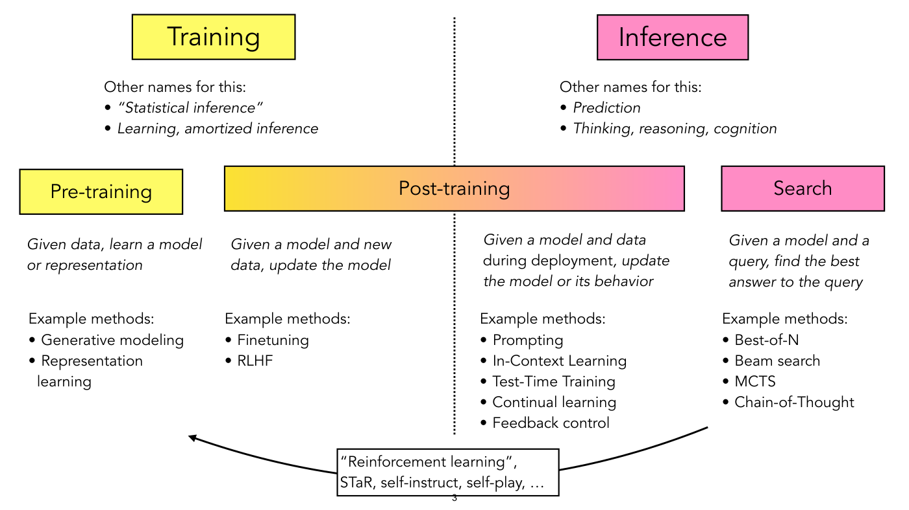

A diagram split by a vertical dotted line down the centre. Top left, a yellow box "Training"; top right, a pink box "Inference".

Under "Training": "Other names for this:" with bullets (italic) "“Statistical inference”" and "Learning, amortized inference". Under "Inference": "Other names for this:" with italic bullets "Prediction" and "Thinking, reasoning, cognition".

A second row of four boxes: a yellow box "Pre-training" at the far left; a wide box "Post-training" in the middle, filled with a gradient from yellow at its left end to pink at its right end, straddling the dotted line; and a pink box "Search" at the far right. Under each, an italic description and a list of example methods:

- Pre-training: "Given data, learn a model or representation". Example methods: Generative modeling; Representation learning.
- Post-training, left half (yellow side of the gradient): "Given a model and new data, update the model". Example methods: Finetuning; RLHF.
- Post-training, right half (pink side, right of the dotted line): "Given a model and data during deployment, update the model or its behavior" (italic except "during deployment", which is set upright for emphasis). Example methods: Prompting; In-Context Learning; Test-Time Training; Continual learning; Feedback control.
- Search: "Given a model and a query, find the best answer to the query". Example methods: Best-of-N; Beam search; MCTS; Chain-of-Thought.

At the bottom, a curved black arrow runs from under the Search column, down and left through a boxed label "“Reinforcement learning”, STaR, self-instruct, self-play, …", and ends with its arrowhead pointing up-left towards the Pre-training column. Printed slide number "3" (partly overlapped by the boxed label).

## Slide 4 — The Bitter Lesson

Heading "The Bitter Lesson", then "Rich Sutton", then "March 13, 2019", all in bold serif. Then the text (serif, large):

"One thing that should be learned from the bitter lesson is the great power of general purpose methods, of methods that continue to scale with increased computation even as the available computation becomes very great. The two methods that seem to scale arbitrarily in this way are search and learning."

The word "search" is italic on a pink highlight and "learning" is italic on a yellow highlight. No OCW notice is printed on this page. Printed slide number "4".

## Slide 5 — (no title; two charts of o1 AIME accuracy, "Training" and "Search")

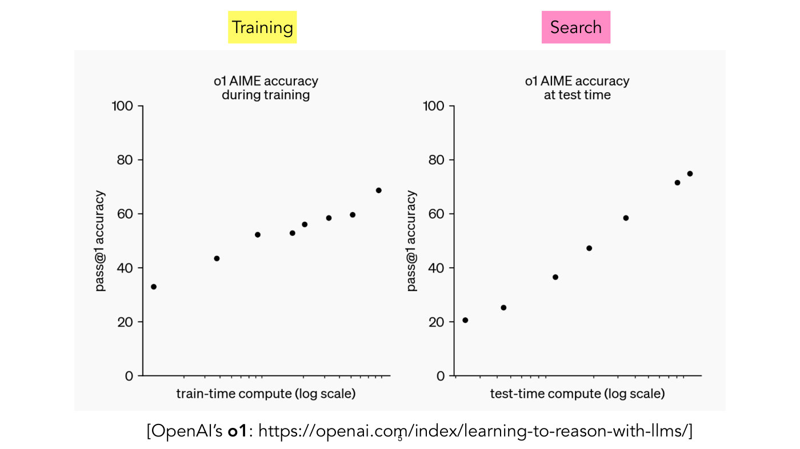

Two pasted charts side by side on a very light grey background, each headed by a coloured label: a yellow box "Training" above the left chart and a pink box "Search" above the right chart. Caption under the charts: "[OpenAI's **o1**: https://openai.com/index/learning-to-reason-with-llms/]" ("o1" is bold).

Left chart, title "o1 AIME accuracy during training". Y axis "pass@1 accuracy", linear, ticks 0, 20, 40, 60, 80, 100. X axis "train-time compute (log scale)", no numeric tick labels, only unlabelled log tick marks. One series of 8 black dots rising left to right, roughly 33, 43.5, 52.3, 52.8, 56, 58.5, 59.6 and 68.7 (the dots at 52.3 and 52.8 are nearly level but a wide gap apart horizontally; the dots at 52.8 and 56 are close together; the dots at 56, 58.5, 59.6 and 68.7 are evenly spaced).

Right chart, title "o1 AIME accuracy at test time". Y axis "pass@1 accuracy", ticks 0, 20, 40, 60, 80, 100. X axis "test-time compute (log scale)", no numeric tick labels. One series of 7 black dots rising left to right, roughly 20.5, 25, 36.5, 47, 58.5, 71.5 and 75 (the last two close together). The right-hand series rises more steeply than the left one. Printed slide number "5" (overlapping the caption's URL).

## Slide 6 — (no title; question "What is search?")

Centred text: "What is search?" with the word "search" on a pink highlight. Printed slide number "6".

## Slide 7 — Kasparov vs. IBM Deep Blue

*OCW notice: Above © Stan Honda/AFP/Getty Images. All rights reserved. This content is excluded from our Creative Commons license. For more information, see https://ocw.mit.edu/help/faq-fair-use/ (small serif print under the large left photograph; covers the photograph on the left).*

*Credit: Right: Courtesy of Jim Garnder (jamesthephotographer) on Flickr. Used under CC BY. (second line of the same small print; covers the photograph of the machine on the right of the slide; "Garnder" as printed).*

Left, a wide colour photograph: a crowd of spectators in an auditorium looking up and ahead (several with hands at their chins), seated behind two monitors in the foreground. The left monitor shows a chessboard with pieces and, at its bottom edge, the partial move text "e4 c6 2. d4 d5 3. Nc3 dxe4". The right monitor shows a man in a blue jacket with both hands on his head, face hidden. Right, a tall photograph of a black two-door cabinet-style machine with "IBM" at its upper left and a small white label at its upper right that is too blurred to read (it may say "RS6000 SP"), standing in a room; the edge of another white device is cut off at the photograph's right edge. Printed slide number "7".

## Slide 8 — (no title; Nature cover and AlphaGo search diagram)

*OCW notice: © Springer Nature Limited. All rights reserved. This content is excluded from our Creative Commons license. For more information, see https://ocw.mit.edu/help/faq-fair-use/ (bottom right of the slide, small serif print under the caption, below the AlphaGo tree diagram; the page's only notice or credit. Springer Nature is Nature's publisher, so it covers both the diagram from the Nature paper and the Nature cover on the left).*

Left: the cover of a journal issue, "nature" in large blue letters, the strapline "THE INTERNATIONAL WEEKLY JOURNAL OF SCIENCE", an image of a Go board with black and white stones laid out in an intricate pattern on top of a computer chip on a circuit board, the text "At last — a computer program that can beat a champion Go player PAGE 484" ("At last" italic, "PAGE 484" in orange) and, in large white letters, "ALL SYSTEMS GO".

Right: a tree diagram of Go positions, drawn top to bottom. At the top, a small Go board (3 by 3 grid shown) with one white stone above one black stone. Two arrows of the same thickness go down from it: a black one to the lower right and a light-grey one to the lower left, the pair labelled "max" between them, with "Q + u(P)" in light grey to the left and "Q + u(P)" in black to the right (at the right end of the dashed horizontal band). Below are two small boards: the left one (at the end of the light-grey arrow) is drawn in black, with a white stone on the top row and two black stones side by side on the middle row; the right one (at the end of the black arrow) is drawn in grey, with a white stone on the top row, a grey stone to its right, and a grey stone below the white one. From the right board, a black arrow goes down-left and a light-grey arrow of the same thickness down-right, labelled "max" between them, with "Q + u(P)" in black at the left and in light grey at the right. Below, to the lower right under the end of the light-grey arrow (not the black one), is a final small board, drawn in black, with two white and two black stones in a square: white then black on the top row, black then white on the row below. Faint dashed horizontal lines separate the levels.

Caption below the diagram: "[AlphaGo: Silver*, Huang* et al, Nature 2016]". Printed slide number "8".

## Slide 9 — Scaling Scaling Laws with Board Games

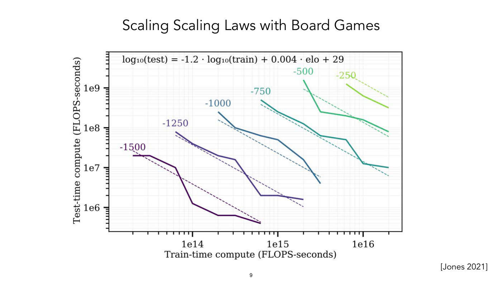

A pasted log-log chart. Equation printed at the top of the plot area: "log₁₀(test) = -1.2 · log₁₀(train) + 0.004 · elo + 29" (as printed, plain text with subscript 10). Y axis: "Test-time compute (FLOPS-seconds)", log scale, labelled ticks 1e6, 1e7, 1e8, 1e9 (range about 2.5e5 to 8e9). X axis: "Train-time compute (FLOPS-seconds)", log scale, labelled ticks 1e14, 1e15, 1e16 (range about 1e13 to 3e16). Six solid curves, each in a different colour from dark purple (lower left) through blue and teal to light green (upper right), each labelled above its start with a number, and each with a thin dashed straight line of the same colour spanning the same x range. The slide does not say what the dashed lines are; all have slope about -1.2 and they sit one decade apart for each 250 step of the labels, matching the equation's coefficients (each sits about 0.35 decade above what the printed equation gives for its label). All curves slope downward from left to right (more train-time compute allows less test-time compute), piecewise linear with sharp kinks and some flat stretches rather than smooth:

- "-1500" (dark purple): from about (2e13, 2e7) to about (6e14, 4e5); dashed line from about (2e13, 2.7e7) to about (6e14, 4.5e5).
- "-1250" (purple-blue): from about (6e13, 8e7) to about (2e15, 1.6e6).
- "-1000" (steel blue): from about (2e14, 2.5e8) to about (3e15, 4e6).
- "-750" (teal): from about (6e14, 5e8) to about (2e16, 1e7).
- "-500" (green): from about (2e15, 1.6e9) to about (2e16, 8e7).
- "-250" (light green): from about (6e15, 1.3e9) to about (2e16, 3.2e8).

The labels are the numbers that sit at each curve's start (elo-like levels, as the equation's "elo" term suggests; the slide does not define them). Citation bottom right: "[Jones 2021]". Printed slide number "9".

## Slide 10 — (no title; same Training / Inference diagram, search methods emphasised)

Repeats slide 3's diagram in full (Training and Inference boxes, "Other names for this" lists, Pre-training, Post-training and Search boxes, the descriptions, the example methods, and the bottom curved arrow with the boxed label "“Reinforcement learning”, STaR, self-instruct, self-play, …"). Changed from slide 3: under Search, the methods "Best-of-N", "Beam search" and "Chain-of-Thought" are now in bold; "MCTS" stays regular weight. Printed slide number "10" (overlapped by the boxed label).

## Slide 11 — Search through an autoregressive model

A diagram of a recurrent network that writes a sentence about a molecule, labelled on the left with row names "Outputs" (top), "Hidden" (middle) and "Input" (bottom). Bottom: a boxed drawing of a chemical structure diagram (a two-ring molecule with atoms labelled O, N, N, N, N, O and methyl groups "H₃C", "CH₃", "CH₃"). An arrow goes up from it into a green box "GNN", and an arrow from the GNN goes up into the first of a row of 8 blue boxes each labelled "LSTM". The LSTM boxes are joined left to right by horizontal arrows (each box feeds the next). From the top of each LSTM an arrow goes up to a monospaced word written at a slant, in order: "A", "mild", "stimulant", "that", "enhances", "cognitive", "ability", "END". Only the first LSTM receives the GNN's output; the other LSTMs have no input from below. Printed slide number "11".

## Slide 12 — (no title; Training, max-likelihood objective with output distributions)

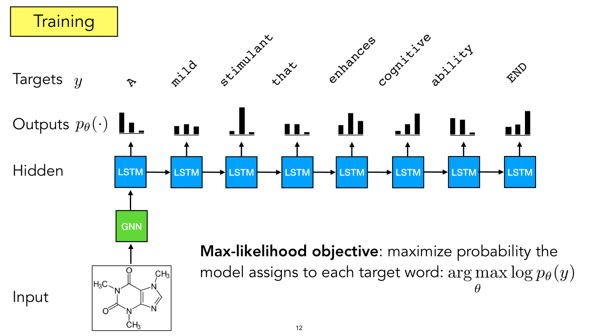

Top left, a yellow box "Training". Same network as slide 11, now with four row labels at the left: "Targets $y$" (the target words, slanted monospaced: "A", "mild", "stimulant", "that", "enhances", "cognitive", "ability", "END"), "Outputs $p_\theta(\cdot)$", "Hidden" and "Input". Under each target word, in the Outputs row, a small black bar chart of three bars (a predicted distribution over words) sits above each LSTM, with an arrow from the LSTM up to the bars. Bar heights (tall to short, left to right in each chart of three): 1st chart tall, medium, tiny; 2nd chart three small, about equal; 3rd chart tiny, very tall, tiny; 4th chart medium, medium, tiny; 5th chart small, tall, medium; 6th chart tiny, small, tall; 7th chart tall, tall (slightly shorter), tiny; 8th chart small, small, tall. (Measured heights in points, left to right: 64, 32, 7 / 26, 32, 25 / 10, 86, 7 / 33, 32, 7 / 29, 68, 43 / 11, 32, 66 / 53, 48, 7 / 25, 32, 75.) The Input row has the molecule drawing feeding a green "GNN" box that feeds the first LSTM (as on slide 11).

Text at the bottom right: "**Max-likelihood objective**: maximize probability the model assigns to each target word: $\arg\max_\theta \log p_\theta(y)$" (the "Max-likelihood objective" part is bold; the formula is displayed inline in larger type, with $\theta$ under "max"). Printed slide number "12".

## Slide 13 — (no title; Training, cross-entropy form of the objective)

Top left, a yellow box "Training". Same network as slide 12, with row labels "Targets $\mathbf{y}$" (bold y), "Outputs $\hat{\mathbf{y}}$" (bold y with a hat), "Hidden" and "Input". Changed from slide 12: the slanted target words are replaced by a row of 8 one-hot bar charts, each a single tall black bar (the bar's position in each chart, charts 1 to 8: left, centre, centre, left, centre, right, left, right), above the row of 8 predicted-distribution bar charts of slide 12 (the Outputs row, unchanged). The molecule, GNN, LSTMs and arrows are as on slide 12.

Text at the bottom: "**Max-likelihood objective**: minimize cross-entropy between model outputs and one-hot encoded targets." ("Max-likelihood objective" bold). To the right of this text, the formula

$$f^\ast = \arg\min_{f \in \mathcal{F}} \sum_{i=1}^{N} H(\mathbf{y}_ i, \hat{\mathbf{y}}_ i)$$

Printed slide number "13".

## Slide 14 — (no title; "Teacher forcing")

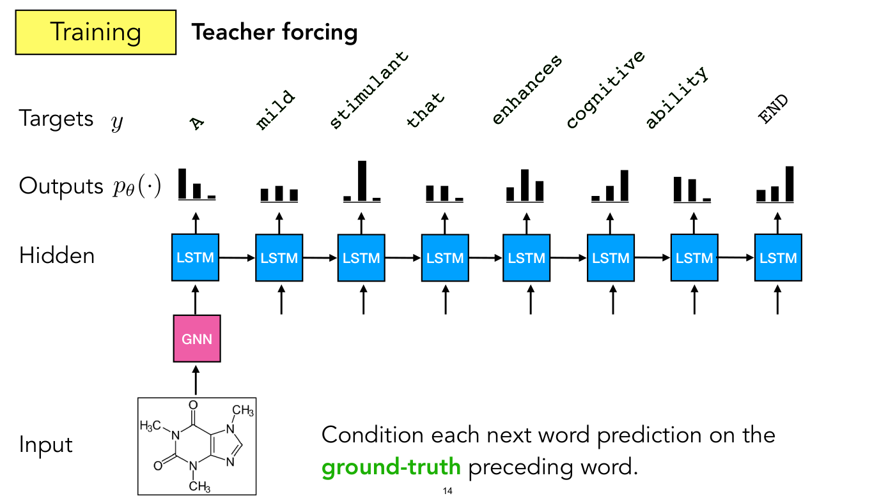

Top left, a yellow box "Training", with the bold heading "Teacher forcing" beside it. Same as slide 12 (row labels "Targets $y$", "Outputs $p_\theta(\cdot)$", "Hidden", "Input"; slanted target words; the three-bar output charts), with these changes: the "GNN" box is now pink instead of green; and arrows from below now point up into each of the 7 LSTMs after the first (short vertical arrows ending just under each box, starting from nothing; no words are drawn at their tails), in addition to the first LSTM's arrow from the GNN. No objective text. Text at the bottom right: "Condition each next word prediction on the **ground-truth** preceding word." ("ground-truth" in bold green). Hidden (not shown on the page): the text layer holds a second copy of the seven target words "A" to "ability", in the same green, at exactly the positions of the black words and drawn under them, so only the black words are visible. Hidden (not shown on the page): the text layer holds a second copy of the seven target words "A" to "ability", in the same green, at exactly the positions of the black words and drawn under them, so only the black words are visible. Printed slide number "14".

## Slide 15 — (no title; Inference, sampling word by word)

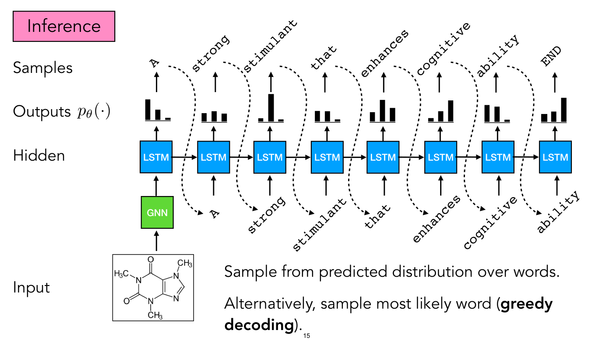

Top left, a pink box "Inference". Row labels at the left: "Samples" (top), "Outputs $p_\theta(\cdot)$", "Hidden", "Input". The same row of 8 LSTMs, GNN (green) and molecule as before, with the three-bar output chart above each LSTM and, above each chart, an arrow up to a sampled word written slanted in monospace: "A", "strong", "stimulant", "that", "enhances", "cognitive", "ability", "END". A dashed black curved arrow leaves each sampled word (except the last, "END") and loops down and to the right, ending at a slanted word under the next LSTM, which points up into that LSTM: the words fed back in are "A" (under LSTM 2), "strong" (under 3), "stimulant" (under 4), "that" (under 5), "enhances" (under 6), "cognitive" (under 7) and "ability" (under 8). So each sampled word becomes the input to the next step. The first LSTM takes its input from the GNN, as before.

Text at the bottom right: "Sample from predicted distribution over words." and "Alternatively, sample most likely word (**greedy decoding**)." ("greedy decoding" bold). Printed slide number "15".

## Slide 16 — Greedy sampling does not maximize likelihood!

Title: "Greedy sampling does not maximize likelihood!". Centre, a large equation with braces and annotations:

$$p(\mathbf{X}) = p(\mathbf{x}_ n | \mathbf{x}_ 1, \ldots, \mathbf{x}_ {n-1}) \cdots p(\mathbf{x}_ 2 | \mathbf{x}_ 1) p(\mathbf{x}_ {\mathbf{1}})$$

(sic: in the last factor the subscript 1 on $\mathbf{x}$ is printed in bold, "x" with a bold "1", unlike the other subscripts). Above and below it, with curly braces drawn over the equation:

- Over the whole left-hand side $p(\mathbf{X})$, a brace with a line up to $\lbrace \mathbf{x}_ 1^\ast, \ldots, \mathbf{x}_ n^\ast \rbrace = \arg\max_{\mathbf{X}} p(\mathbf{X})$.
- Over the factor $p(\mathbf{x}_ n | \mathbf{x}_ 1, \ldots, \mathbf{x}_ {n-1})$, a brace with a line up to $\mathbf{x}_ n^\ast = \arg\max_{\mathbf{x}_ n}$.
- Over the factor $p(\mathbf{x}_ 2 | \mathbf{x}_ 1)$, a brace with $\mathbf{x}_ 2^\ast = \arg\max_{\mathbf{x}_ 2}$ above it.
- Over the factor $p(\mathbf{x}_ {\mathbf{1}})$, a brace with $\mathbf{x}_ 1^\ast = \arg\max_{\mathbf{x}_ 1}$ above it.

Bottom: "(What about for VAEs? What about for diffusion models?)". Printed slide number "16".

## Slide 17 — (no title; Inference, "Best-of-N")

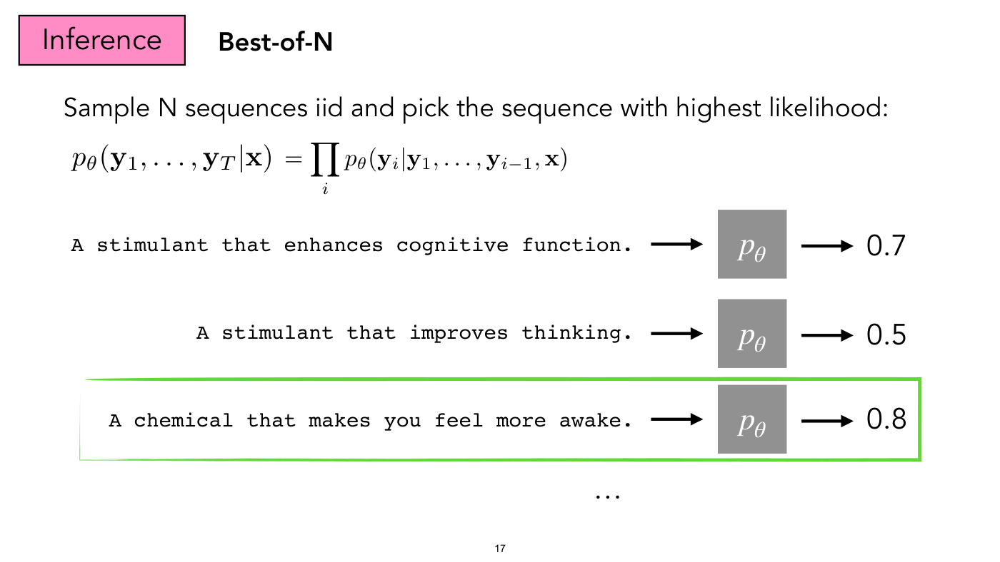

Top left, a pink box "Inference", beside it the bold heading "Best-of-N". Text: "Sample N sequences iid and pick the sequence with highest likelihood:" and the equation

$$p_\theta(\mathbf{y}_ 1, \ldots, \mathbf{y}_ T | \mathbf{x}) = \prod_i p_\theta(\mathbf{y}_ i | \mathbf{y}_ 1, \ldots, \mathbf{y}_ {i-1}, \mathbf{x})$$

Below, three rows, each a monospaced sentence (right-aligned) with an arrow to a grey square labelled $p_\theta$ and an arrow from it to a number:

- "A stimulant that enhances cognitive function." → $p_\theta$ → 0.7
- "A stimulant that improves thinking." → $p_\theta$ → 0.5
- "A chemical that makes you feel more awake." → $p_\theta$ → 0.8, this row enclosed in a hand-drawn green rectangle (the winner).

Below the rows, an ellipsis "…". Printed slide number "17".

## Slide 18 — (no title; Inference, "Beam search (a form of tree search)")

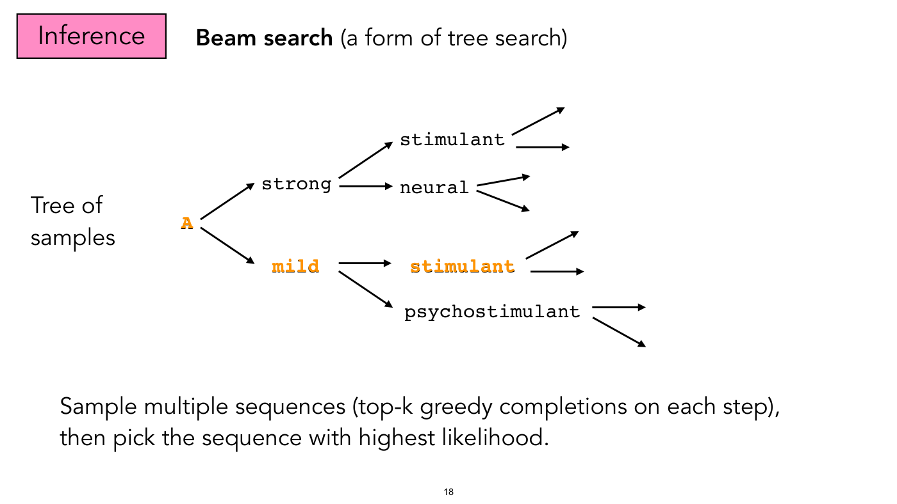

Top left, a pink box "Inference", beside it "**Beam search** (a form of tree search)" (the first part bold). A tree of word samples drawn left to right, with the left-hand label "Tree of samples". Root word "A" (orange, bold monospace) with two arrows to "strong" (black, upper) and "mild" (orange, lower). All three orange words are bold Courier laid over black plain copies of the same words (an overlay; nothing differs underneath). "strong" has two arrows, to "stimulant" (upper) and "neural" (lower), each of which has two arrows leaving it to nothing (fanning out to the right). "mild" (orange, bold) has two arrows, to "stimulant" (orange, bold, upper) and "psychostimulant" (black, lower); "stimulant" (orange) has two arrows leaving it (to the right), and "psychostimulant" has two arrows leaving it. The orange words "A", "mild", "stimulant" mark one path through the tree (the highlighted branch).

Text at the bottom: "Sample multiple sequences (top-k greedy completions on each step), then pick the sequence with highest likelihood." Printed slide number "18".

## Slide 19 — (no title; Inference, "Chain-of-thought (emergent/learned search)")

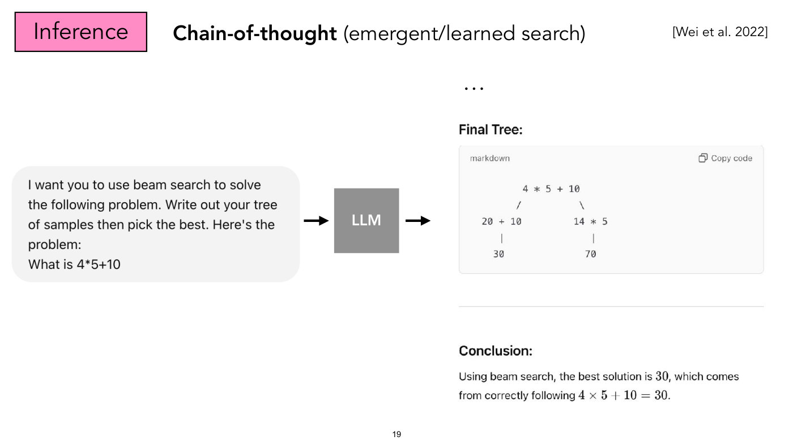

Top left, a pink box "Inference", beside it "**Chain-of-thought** (emergent/learned search)" (first part bold) and, at the top right, the citation "[Wei et al. 2022]". Left: a pasted screenshot of a light grey rounded chat bubble with the text "I want you to use beam search to solve the following problem. Write out your tree of samples then pick the best. Here's the problem: What is 4*5+10". An arrow goes right into a grey square labelled "LLM", and an arrow from it points right to a pasted screenshot of a chat response, partly cropped at the top (a row of dots "…" above it). The screenshot reads: heading "Final Tree:"; a code block labelled "markdown" with a "Copy code" button at its upper right, containing the text tree

```
         4 * 5 + 10
        /          \
  20 + 10         14 * 5
     |               |
    30              70
```

then a horizontal rule; then heading "Conclusion:" and the text "Using beam search, the best solution is 30, which comes from correctly following 4 × 5 + 10 = 30." (the numbers typeset in math font). Printed slide number "19".

## Slide 20 — (no title; Inference, scoring beyond likelihood)

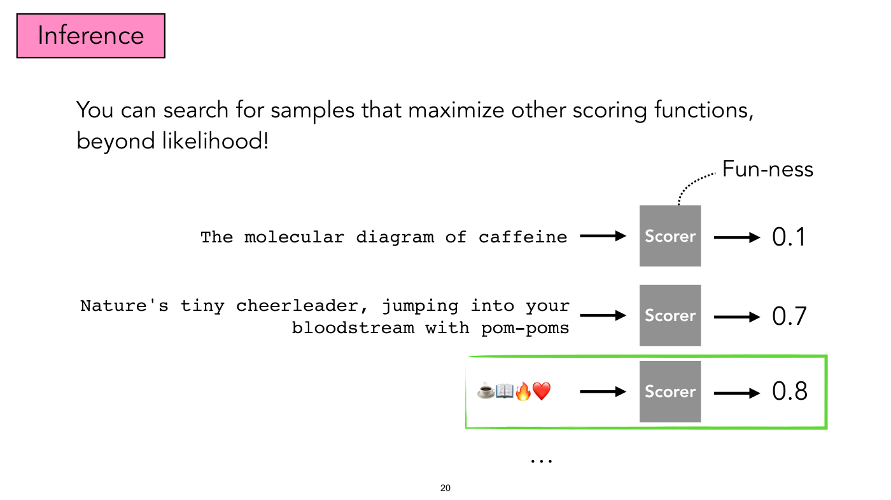

Top left, a pink box "Inference". Text: "You can search for samples that maximize other scoring functions, beyond likelihood!" Three rows, each a text (the first two monospaced and right-aligned, the emoji row further right and left-aligned in its box) with an arrow to a grey square labelled "Scorer" (bold white) and an arrow to a number; a dotted curved line (no arrowhead) runs from the top of the first Scorer up to the label "Fun-ness":

- "The molecular diagram of caffeine" → Scorer → 0.1
- "Nature's tiny cheerleader, jumping into your bloodstream with pom-poms" → Scorer → 0.7
- four emoji (a cup of coffee, an open book, a flame, a red heart) → Scorer → 0.8, this row enclosed in a hand-drawn green rectangle.

Below, an ellipsis "…". Printed slide number "20".

## Slide 21 — (no title; Inference, scoring beyond likelihood, "Scientific accuracy")

Top left, a pink box "Inference". Text: "You can search for samples that maximize other scoring functions, beyond likelihood!" Same three rows as slide 20, with a different scorer and different numbers; the dotted curved line (no arrowhead) from the top of the first Scorer now leads to the label "Scientific accuracy" (two lines) instead of "Fun-ness":

- "The molecular diagram of caffeine" → Scorer → 1.0, this row enclosed in a hand-drawn green rectangle (the winner; on slide 20 it scored 0.1 and the emoji row was boxed).
- "Nature's tiny cheerleader, jumping into your bloodstream with pom-poms" → Scorer → 0.3
- four emoji (a cup of coffee, an open book, a flame, a red heart) → Scorer → 0.1

Below, an ellipsis "…". Printed slide number "21".

## Slide 22 — (no title; Inference, "Verification")

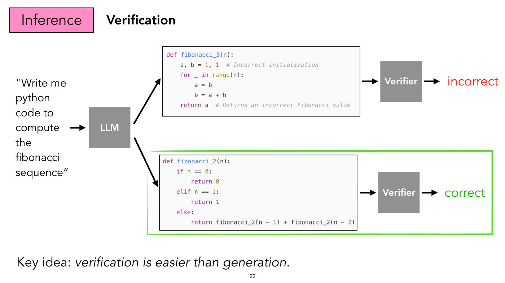

Top left, a pink box "Inference", beside it the bold heading "Verification". Left: the quoted prompt "Write me python code to compute the fibonacci sequence" (printed with a straight opening quote mark and curly closing quote), an arrow to a grey square "LLM". Two arrows leave the LLM, one up-right and one down-right, to two pasted code boxes (light grey background, syntax-coloured, each in a thin black frame):

Upper box (the incorrect program):

```python
def fibonacci_3(n):
    a, b = 1, 1  # Incorrect initialization
    for _ in range(n):
        a = b
        b = a + b
    return a  # Returns an incorrect Fibonacci value
```

(The comments "Incorrect initialization" and "Returns an incorrect Fibonacci value" are part of the pasted code.) An arrow leads from it to a grey square "Verifier" and then to the word "incorrect" in red.

Lower box (the correct program), enclosed in a hand-drawn green rectangle together with its verifier and verdict:

```python
def fibonacci_2(n):
    if n == 0:
        return 0
    elif n == 1:
        return 1
    else:
        return fibonacci_2(n - 1) + fibonacci_2(n - 2)
```

(Hidden: the pasted image runs on past the box's right edge, under the arrow and Verifier, and its last line there continues "  # Correct recursive", cut off at the image's edge; the page clips it at the frame, so the comment is not shown.) An arrow leads from it to a grey square "Verifier" and then to the word "correct" in green.

Text at the bottom: "Key idea: *verification is easier than generation.*" (the part after the colon in italics). Printed slide number "22".

## Slide 23 — (no title; section divider "Steering model outputs toward human preferences")

Centred text only: "Steering model outputs toward human preferences". Printed slide number "23".

## Slide 24 — Great objectives for AI systems

Title: "Great objectives for AI systems". A numbered list:

1. Given lots of wonderful data, imitate it (supervised learning, SSL, generative models, etc)
2. …

Printed slide number "24".

## Slide 25 — (no title; "Other than “imitate wonderful data”…")

Top text: "Other than “imitate wonderful data”, what might be other good, general-purpose objectives". Centre, large: "Make imagery that people find meaningful", with the word "meaningful" underlined by a thin line. A dotted curved arrow from the label "memorable/aesthetic/evocative/…" points up to the underline. Printed slide number "25".

## Slide 26 — Generating data that optimizes a scoring function

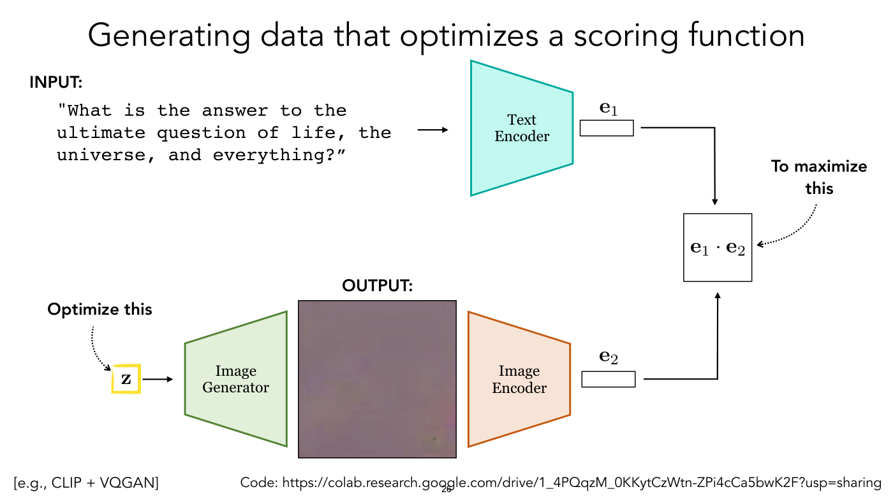

A block diagram with two encoder branches meeting in a dot product.

Top branch: bold label "INPUT:" and the monospaced text ""What is the answer to the ultimate question of life, the universe, and everything?”" (a straight opening quote mark and a curly closing one); an arrow right into a teal trapezoid labelled "Text Encoder" (wide on the left, narrower on the right); a small empty rectangle (a vector) labelled $\mathbf{e}_ 1$ to its right; a line from it runs right then down with an arrowhead into a box.

Bottom branch (left to right): a small box $\mathbf{z}$ (bold) outlined in a hand-drawn yellow square, with the bold label "Optimize this" and a dotted arrow pointing to it; an arrow to a green trapezoid "Image Generator" (narrow on the left, wide on the right); then, under the bold label "OUTPUT:", a square image that is an almost uniform muddy purple-grey texture, with one small dark speck near its lower right corner and no recognisable object; then an orange trapezoid "Image Encoder" (wide on the left, narrow on the right); a small empty rectangle labelled $\mathbf{e}_ 2$; a line from it runs right then up with an arrowhead into the same box.

The box on the right, between the two branches, contains $\mathbf{e}_ 1 \cdot \mathbf{e}_ 2$, with the bold label "To maximize this" and a dotted arrow pointing to it.

Bottom left: "[e.g., CLIP + VQGAN]". Bottom right: "Code: https://colab.research.google.com/drive/1_4PQqzM_0KKytCzWtn-ZPi4cCa5bwK2F?usp=sharing". Printed slide number "26" (overlapped by the URL). No OCW notice is printed on this page.

## Slide 27 — Generating data that optimizes human perception

*OCW notice: © Isola, et al. All rights reserved. This content is excluded from our Creative Commons license. For more information, see https://ocw.mit.edu/help/faq-fair-use/ (small serif print at the left of the photograph, in the middle of the slide; covers the colour photograph of a man's face among coloured balls).*

Top: a square colour photograph of a man's face (glasses, short hair) surrounded by many multicoloured balls (red, green, blue, yellow). An arrow from it goes right to a black brain icon labelled above "Human perception", and an arrow from the brain goes right to a small empty square; a dotted arrow from the label "Score from human judgment" points at that square. A red dotted double-headed vertical arrow connects the brain icon (above) with the orange trapezoid below ("Model of human").

Bottom branch, as on slide 26: a box $\mathbf{z}$ (bold) outlined in yellow, with "Optimize this" and a dotted arrow; an arrow to the green trapezoid "Image Generator"; under the bold label "OUTPUT:", an empty white square containing a large "?"; the orange trapezoid, here labelled "Model of human"; an arrow to a small empty square, with a dotted arrow from the bold label "To maximize this" pointing at the square. Printed slide number "27".

## Slide 28 — (no title; memorability experiment and memorable / forgettable images)

*OCW notice: © Isola, et al. All rights reserved. This content is excluded from our Creative Commons license. For more information, see https://ocw.mit.edu/help/faq-fair-use/ (small serif print at the bottom left; covers the photographs on the slide, the experiment strip and the two rows of example images).*

Top: a timeline strip of an experiment, drawn left to right over a long black arrow labelled "time" at the right end. A sequence of photographs alternates with white squares each holding a plus sign: a photograph of a group of people in white martial-arts uniforms in a hall, a square with a black plus, the colour photograph of a man's face among coloured balls, a square with a black plus, the martial-arts photograph again, a square with a green plus, then "…" over "100", a photograph of a sunlit glass-walled room with a mountain view, a square with a black plus, the face-among-balls photograph again, a square with a green plus, a photograph of an indoor space with trees and tables, and a square with a black plus. Under the first photograph "1 sec", under the first plus square "1.4 sec". (The strip, with its labels and brackets, is one pasted image.) A blue bracket above the strip, labelled "Vigilance repeat" in blue under its right end, spans from the first martial-arts photograph to its second appearance (the one before the green plus). A red bracket below the strip, labelled "Memory repeat" in red above its right end, spans from the first face-among-balls photograph to its second appearance, far along the strip.

Below, two groups of three photographs with large labels: "Forgettable" (left) over a seashore with sky, a glacier-like landscape with mountains, and a wooded scene with tall trees; "Memorable" (right) over a young man in a dark shirt crouching with a tray of bread, a group of people in medical scrubs working around a person on a table, and again the face-among-balls photograph.

Bottom right: "[Isola et al. 2011, Khosla et al. 2015]". Printed slide number "28".

## Slide 29 — GANalyze: Toward Visual Definitions of Cognitive Image Properties

Title (two lines): "GANalyze: Toward Visual Definitions of Cognitive Image Properties". Below it: "Lore Goetschalkx*, Alex Andonian*, Aude Oliva, Phillip Isola" and "ICCV 2019". At the top right, two portrait photographs side by side (a woman with long hair against a woodland background; a young man smiling against foliage), captioned "Lore Goetschalckx" (sic: the author line prints "Goetschalkx", the caption "Goetschalckx") and "Alex Andonian". (Hidden: the right portrait's pasted image runs past its frame above and below; the clipped parts hold only more foliage and more of his checked shirt.)

*OCW notice: © source unknown. All rights reserved. This content is excluded from our Creative Commons license. For more information, see https://ocw.mit.edu/help/faq-fair-use/ (small print under the two portrait captions at the top right; it covers the two portrait photographs).*

The rest of the page is slide 27's diagram again, shifted down, with the changes noted at the end of this section. Top row: a square image of a person's face in a ball pit of coloured balls (red, yellow, green, blue) — an arrow right to a black brain icon labelled above "Human perception" — an arrow right to an empty square. A red dotted double-headed vertical arrow runs from the brain down to the "Model of human" trapezoid in the bottom row.

*OCW notice: © Isola, et al. All rights reserved. This content is excluded from our Creative Commons license. For more information, see https://ocw.mit.edu/help/faq-fair-use/ (small print at the left of the ball-pit photograph; it covers that photograph).*

Bottom row, left to right: a small square "z" in a yellow outline (with a bold label "Optimize this" at the upper left and a dotted curved arrow from the label to the square); an arrow right to a green trapezoid labelled "Image Generator" (wide on the right, narrow on the left); an arrow-less gap, then a large empty square with a large "?" inside, labelled above "OUTPUT:"; then an orange-outlined peach trapezoid labelled "Model of human" (wide on the left, narrow on the right); an arrow right to an empty small square, with a bold label "To maximize this" at the upper right and a dotted curved arrow from that label pointing toward the square but ending about 100 pt short of it, in empty space (on slide 27 it reaches the square; the arrow was not moved with the diagram). Compared with slide 27, the title (which replaces "Generating data that optimizes human perception"), author line, ICCV year, the two portraits and their notice are new, the diagram sits about 71 pt lower, and the "Score from human judgment" label and its dotted arrow to the small square at the top right are gone (the arrow from the brain to that square remains). Printed slide number "29" (partly overlapped by the bottom edge of the "?" square).

## Slide 30 — (no title; GANalyze architecture and the "Probe into human perception" example)

Top half: a pipeline diagram, left to right, pasted as one image with the z cell rows, the left "…" and the left "z" drawn over it on the slide (hidden: the pasted image's z cells, under the red overlays, are blue). At the far left a row of seven coloured cells (pink, coral, red, black, an ellipsis "…", dark red, pink, coral) labelled $\mathbf{z}$ (bold) below it, and under it a dial icon (black knob with a dotted ring, "-" at the left end and "+" at the right end) labelled "α". Two arrows run from z and from the dial into a purple-headed box titled "Transformer", whose body shows the row z, then "+ α" then a second grey cell row labelled "θ". An arrow leads from the Transformer to a row of purple cells (with "..." ) labelled $\mathrm{T}_ \theta(\mathbf{z},\alpha)$ (upright T, italic θ and α, bold z). An arrow leads to a green-headed box titled "Generator" showing stacked feature-map layers, with the caption "e.g., BigGΛN" (sic: the A of BigGAN is printed without its crossbar, like a Λ). An arrow leads to a photograph of a brown-and-white dog, labelled $\mathrm{G}(\mathrm{T}_ \theta(\mathbf{z},\alpha),\mathbf{y})$ (z and y bold; the photograph is the same image as the α = 0.0 photograph below). An arrow leads to an orange-headed box titled "Assessor" showing stacked layers ending in a single node, with the caption "e.g., MemNet". An arrow at the right leads to the label $\mathrm{A}(\mathrm{G}(\mathrm{T}_ \theta(\mathbf{z},\alpha),\mathbf{y}))$ (z and y bold). A dotted horizontal line separates this half from the lower half.

Lower half: five teal dial icons in a row, each with "-" at its left and "+" at its right, the knob pointer turning clockwise from left to right, labelled "α = -0.2", "α = -0.1", "α = 0.0", "α = 0.1", "α = 0.2". Under each is a photograph of the same kind of brown-and-white dog with a score in a peach box at its upper left: 0.58, 0.73, 0.73, 0.75, 0.77. The dog is small, low-resolution and in a cluttered setting at α = -0.2 and becomes larger, sharper and closer to the camera as α increases. Caption at the bottom centre in large type: "Probe into human perception".

*OCW notice: © source unknown. All rights reserved. This content is excluded from our Creative Commons license. For more information, see https://ocw.mit.edu/help/faq-fair-use/ (small print at the lower right, under the last dog photograph; it covers the dog photographs and the architecture figure).*

Printed slide number "30".

## Slide 31 — (no title; GANalyze results grid for memorability, aesthetics and emotional valence)

*OCW notice: © source unknown. All rights reserved. This content is excluded from our Creative Commons license. For more information, see https://ocw.mit.edu/help/faq-fair-use/ (top left, white text with a cyan underlined URL on the dark grey page; it covers the photographs on the slide).*

Dark grey background. Three source photographs along the top: a brown-and-white dog (left), a coiled red-black-and-white banded snake on leaf litter (centre), a beach and sea with a wooded headland (right). From each, two white arrows fan down to the labels "α = -0.2" (left arrow) and "α = 0.2" (right arrow). Under them is a 3×6 grid of generated images, two columns per source photograph, one row per assessed property, with the row names at the left in white: "Memorability", "Aesthetics", "Emotional Valence" (the last on two lines). Each image carries a score in a white box at its upper left. Scores (α = -0.2, then α = 0.2):

| Row | Dog | Snake | Beach |
| --- | --- | --- | --- |
| Memorability | 0.58, 0.77 | 0.65, 0.82 | 0.19, 0.35 |
| Aesthetics | 0.25, 0.66 | 0.36, 0.65 | 0.22, 0.58 |
| Emotional Valence | 0.39, 0.66 | 0.37, 0.38 | 0.75, 0.94 |

The image at α = -0.2 is blurrier, duller or darker than its α = 0.2 partner in most cells (the dog's memorability row repeats slide 30's first and last photographs; the beach's memorability image at 0.19 is dark, the one at 0.35 is bright with turquoise water). The snake's pairs are the exception: they differ mainly in the snake's pose (at memorability 0.65 it is stretched across the frame, at 0.82 tightly coiled and filling it). Printed slide number "31" (small, near the bottom centre, drawn in black on top of the bottom edge of the Emotional Valence α = -0.2 snake image).

## Slide 32 — New paradigm: "Just ask"

Title: "New paradigm: “Just ask”". Body, two lines: "Chain-of-thought is “just ask for symbolic search”" and "Can we do “just ask for continuous reward optimization”?" At the bottom right: the URL "https://evjang.com/2021/10/23/generalization.html". Printed slide number "32" (just below the URL).

## Slide 33 — (no title; text-to-image screenshot, prompt "A painting of a mountain next to a waterfall.")

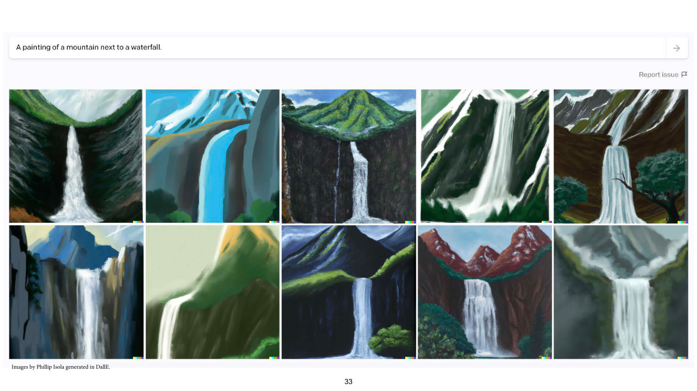

A screenshot of a text-to-image interface. A prompt box at the top reads "A painting of a mountain next to a waterfall." with a right-pointing arrow button at its right end; below it, at the right, "Report issue" with a flag icon. Below is a 2×5 grid of ten generated paintings, each of a waterfall falling from a mountain or cliff: all are fairly plain, painterly, mostly dark green, grey and white, with a few in blue or red-brown tones (the second in the top row is bright blue; the eighth, ninth and tenth in the bottom row are navy, red-brown mountains and grey fog). A small multicoloured square sits at the lower right corner of each image. Caption at the bottom left: "Images by Phillip Isola generated in DallE." Printed slide number "33".

## Slide 34 — (no title; same screenshot, prompt "A beautiful painting of a mountain next to a waterfall.")

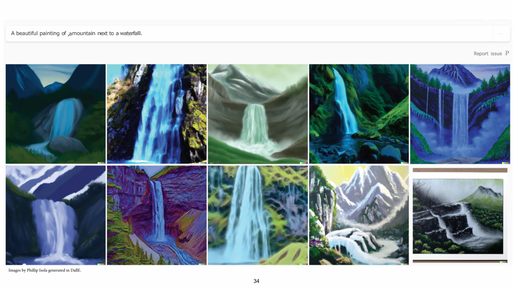

Same layout as slide 33 (prompt box, "Report issue", 2×5 grid of ten waterfall paintings, the multicoloured corner squares, the caption "Images by Phillip Isola generated in DallE."). The prompt now reads "A beautiful painting of ,amountain next to a waterfalll." as printed (sic: ",amountain" and "waterfalll"). The garbling is in a live text layer, not in the screenshot: the page draws the prompt (in Verdana) and "Report issue" (in Geneva) as visible text over a background raster of the interface from which the original text was erased, leaving only a faint, illegible residue, as an OCR text conversion of a screenshot does; the text layer has a space after ",a", but the printed "a" and "m" touch. Where the flag icon was, the page prints a grey serif letter "P" (sic), and the arrow button is only a faint ghost. The ten images are more saturated and stylised than on slide 33: mostly blue-teal and green waterfalls with some purple, magenta and violet tones; the last image (bottom right) is a photograph-like framed painting in black, white and green with a paper border. What changed: the prompt gained the word "beautiful", and the images changed accordingly. Printed slide number "34".

## Slide 35 — (no title; same screenshot, prompt "An very beautiful painting of a mountain next to a waterfall.")

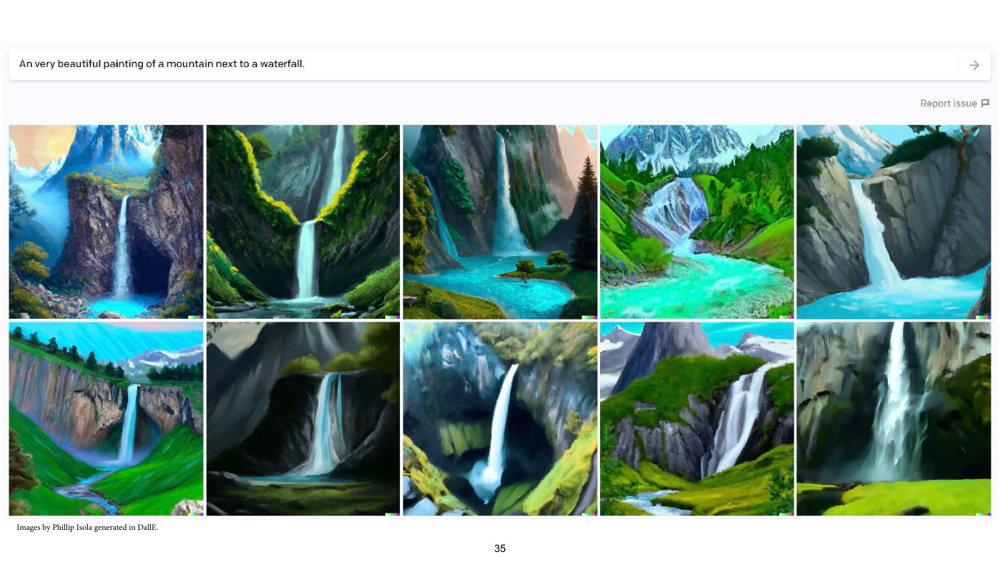

Same layout. The prompt reads "An very beautiful painting of a mountain next to a waterfall." (sic: "An very"). The ten images are more detailed and vivid than on slide 34: waterfalls with snowy peaks, pine forests, turquoise pools and green meadows, with sharper lighting and more realistic rock texture. What changed: "very" was added to the prompt. Printed slide number "35".

## Slide 36 — (no title; same screenshot, prompt "An very very beautiful painting of a mountain next to a waterfall.")

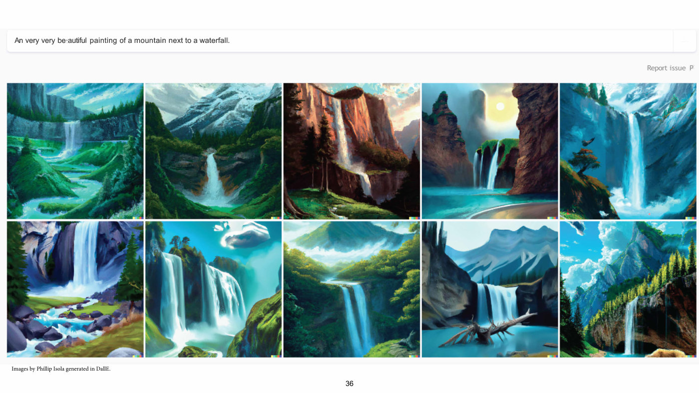

Same layout. The prompt reads "An very very be·autiful painting of a mountain next to a waterfall." as printed (sic: "An very very"; and "be·autiful", with a raised dot inside the word). The dot is a "·" character in a live text layer, not in the screenshot: as on slide 34, the prompt and "Report issue" are drawn as text (in Arial and Trebuchet MS) over a background raster from which the screenshot's own text was erased, and a grey "P" stands where the flag icon was (sic). The ten images are more dramatic and polished: sunlit cliffs, a sun disc in the sky, wide turquoise pools, clouds, fir forests, a fallen branch in a pool. What changed: another "very" was added. Printed slide number "36".

## Slide 37 — (no title; same screenshot, prompt with six "very"s)

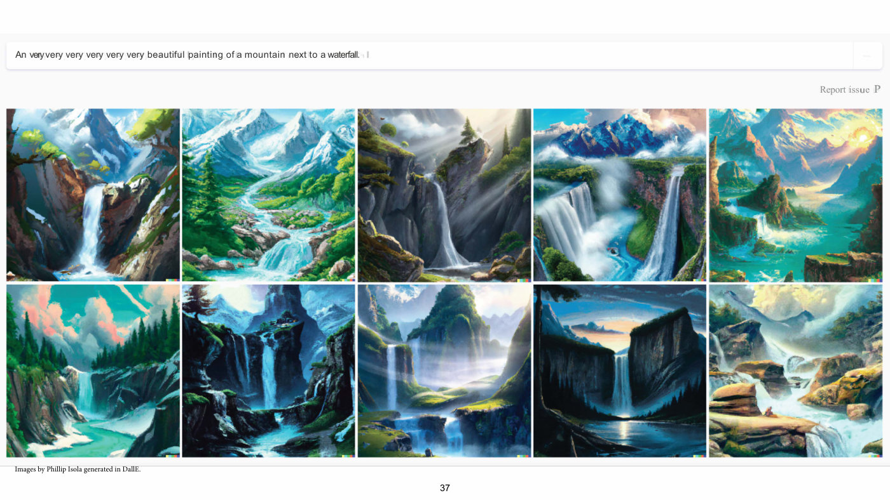

Same layout. The prompt reads "An very very very very very very beautiful painting of a mountain next to a waterfall." (six "very"s; on the page the first "very" is squeezed against the second with no visible gap, though the text layer has a space). As on slide 34, the prompt and "Report issue" are a live text layer (in Arial and a serif face) drawn over a background raster from which the screenshot's own text was erased; the faint grey marks behind the prompt and just past its full stop are the residue of that erased text, which was set wider, not another line. "Report issue" is followed by a serif "P" where the flag icon was (sic). The ten images are grander still: sweeping vistas, sun rays through mist, rock pinnacles, a low sun and a dusk sky, large waterfalls with spray. What changed: the prompt has more "very"s. Printed slide number "37".

## Slide 38 — (no title; same screenshot, prompt with twenty-two "very"s)


Same layout. The prompt reads "An very very very very very v,ery v1eryvery ve,ry very very v,ery v,ery very very very v,ery very very very very very b1eaiutiful painting of a mountain next to a waterfall!." as printed (sic: the text is garbled by stray commas and digits, and ends "waterfall!." with an exclamation mark; the text layer has a space between "v1ery" and "very", which the printed glyphs close up). As on slide 34, the garbling is in a live text layer (Lucida Grande) drawn over a background raster from which the screenshot's own text was erased, not in the screenshot; "Report issue" is drawn the same way, as "Report ·ssue" with a raised dot for the "i", followed by a grey "P" where the flag icon was (sic). The ten images are the most elaborate and stylised yet: glowing sunlit cliffs, mountains with sun and bird, red autumn trees, a small indistinct shape on a clifftop, a hut by a blue lake, dramatic purple and orange lighting, an indistinct dark figure in a pool. What changed: the prompt is still longer, with 22 "very"s counting the garbled ones (sixteen more than slide 37). Printed slide number "38".

## Slide 39 — "Make it more"

Title: "“Make it more”". Two pasted social-media posts side by side, both dark-themed, both by the account "Jon Barron" (verified badge, "@jon_barron · Nov 29, 2023"), each with a small round profile photo of a bearded man with glasses.

*OCW notice: © Jon Barron. All rights reserved. This content is excluded from our Creative Commons license. For more information, see https://ocw.mit.edu/help/faq-fair-use/ (single line along the bottom left of the slide, the URL blue and underlined, overlapped by the printed slide number; it covers both posts).*

Left post, text "Level 2 Reuben": a generated photograph of a Reuben sandwich on a white plate on a pale table against a beige wall: toasted dark bread on top, a slice of cheese, folded pink meat slices, shredded sauerkraut, a bread slice below. Right post, text "Level 1e15 Reuben": a generated picture of a gigantic, many-layered Reuben sandwich (several stacked tiers of bread, meat, cheese and lettuce) standing in a city street among skyscrapers, with tiny cars (yellow taxis, a bus) and crowds of tiny people around its base. Printed slide number "39".

## Slide 40 — "Make it more"

Title: "“Make it more”" (a continuation of slide 39, not a build step: the same title and layout, with both posts replaced by two further posts by the same account, same date).

*OCW notice: © Jon Barron. All rights reserved. This content is excluded from our Creative Commons license. For more information, see https://ocw.mit.edu/help/faq-fair-use/ (single line along the bottom left, overlapped by the printed slide number; it covers both posts).*

Left post, text "Level 1e40 Reuben": a generated image of a Reuben sandwich floating in outer space among galaxies, stars and nebulae; the top bread slice has a glowing spiral-galaxy swirl on it, a band of multicoloured cosmic lightning lies between layers, and a spiral galaxy wraps around the base. Right post, text "A Level 1e-40 Reuben. I'm guessing it's trying to to suggest that the sandwich is microscopically small." (sic: "to to"): a generated image of a Reuben sandwich on the stage of a cream-coloured microscope, the objective lens above its top slice (a small round disc sits on the bread under it), a small black display on the base showing a white label that reads like "LI-E-40", a green check mark and a few more green characters too blurred to read, a small glass of white sauce and two tools beside it, a window behind. Printed slide number "40".

## Slide 41 — (no title; diagram "Training" versus "Inference", with the methods of each)

Slide 3's diagram again, identical except that two of the Post-training methods, "In-Context Learning" and "Test-Time Training", are now set in bold. A taxonomy diagram split by a vertical dotted line down the centre. At the top left a yellow box "Training"; at the top right a pink box "Inference".

Under "Training": "Other names for this:" with bullets "“Statistical inference”" (italic, in quotation marks) and "Learning, amortized inference" (italic). Under "Inference": "Other names for this:" with bullets "Prediction" and "Thinking, reasoning, cognition" (italic).

A middle row of three boxes: a yellow box "Pre-training" at the far left (left of the dotted line); a wide box "Post-training" in the middle, shaded with a gradient from yellow at its left end to pink at its right end, straddling the dotted line; a pink box "Search" at the far right. Below each box, in italics, its definition (except the words "during deployment", which are printed upright), and then "Example methods:" with bullets:

| Box | Definition | Example methods |
| --- | --- | --- |
| Pre-training | Given data, learn a model or representation | Generative modeling; Representation learning |
| Post-training (left half) | Given a model and new data, update the model | Finetuning; RLHF |
| Post-training (right half, right of the dotted line) | Given a model and data during deployment, update the model or its behavior | Prompting; **In-Context Learning** (bold); **Test-Time Training** (bold); Continual learning; Feedback control |
| Search | Given a model and a query, find the best answer to the query | Best-of-N; Beam search; MCTS; Chain-of-Thought |

At the bottom, a boxed label "“Reinforcement learning”, STaR, self-instruct, self-play, …" at the bottom centre, with a long curved black arrow from it at the right (starting under the Search column) sweeping left and ending with an arrowhead at the lower left under the "Pre-training" column. The dotted line runs through the middle of the Post-training box, so its left half sits on the Training side and its right half on the Inference side. Printed slide number "41" (overlapped by the bottom of the boxed label).

## Slide 42 — In-Context Learning

At the top left a small gradient box "Post-training" (yellow to pink), then the bold title "In-Context Learning". A large rounded rectangle at the left holds a prompt of three review blocks, each line with a light-blue highlight on the word "Review:" or "Answer:" and a light-pink highlight on the given answer:

- "Review: the whole thing ’s fairly lame , making it par for the course for disney sequels ." then "Answer: Negative". Labelled at the right (bold italic) $\boldsymbol{x}^{(1)}$ for the review and $\boldsymbol{y}^{(1)}$ for the answer.
- "Review: this quiet , introspective and entertaining indepen-dent is worth seeking ." then "Answer: Positive". Labelled $\boldsymbol{x}^{(2)}$ and $\boldsymbol{y}^{(2)}$.
- "Review: this quiet , introspective and entertaining indepen-dent is worth seeking ." then "Answer:" (empty). Labelled $\boldsymbol{x}$.

(The page prints the labels in bold italic type; the hyphenation "indepen- dent" is printed.) At the right, red text "Need to turn labels into natural language" and blue text "Extra text on top of input/outputs". An arrow runs from the bottom of the large rectangle down to a box "LM", and from it down to a box "“Positive”". Beside the "LM" box the formula $P(\cdot \mid \boldsymbol{x}^{(1)}, \boldsymbol{y}^{(1)}, \ldots, \boldsymbol{x}^{(N)}, \boldsymbol{y}^{(N)}, \boldsymbol{x})$. Bottom right, grey: "[Example from Zhao et al. ’21]". The bottom of the "“Positive”" box is cut by the slide's lower image edge. Printed slide number "42".

## Slide 43 — “Transformers learn in-context by gradient descent”

Title: "“Transformers learn in-context by gradient descent”". Bullets:

- "Let $f_\theta$ be a transformer, $x$ a query and $\mathbf{c}$ the context."
- $f_\theta(x, \mathbf{c}) = f_{\theta'}(x)$
- "What’s the relationship between $\theta$ and $\theta'$ ?"
- "This paper shows a case where $\theta' = \theta + \lambda \nabla_\theta \mathcal{L}(f_\theta(x), \mathbf{c})$" (sic: the update is printed with a plus sign, although the next bullet calls it gradient descent, which subtracts the gradient; either $\lambda$ is meant to be negative or the sign is a slip, and the slide does not say which)
- "That is, in-context learning, in certain cases, can be expressed as gradient descent over the context examples, to update the final mapping from query to answer."

Bottom right: "[von Oswald et al. ICML 2023]". Printed slide number "43".

## Slide 44 — (no title; advantages and disadvantages of gradient descent over the context)

Bullets, as printed (ICL = in-context learning; $\mathbf{c}$ is the context, bold as printed):

- "This result raises a tantalizing possibility: instead of doing ICL over $\mathbf{c}$, why not do gradient descent over $\mathbf{c}$?"
- "This has several possible advantages:"
  - "ICL is learned learning. It isn’t guaranteed to work. And it often doesn’t work. Gradient descent is not learned. It is guaranteed to improve performance on the in-context examples."
  - "Gradient descent can leverage more test-time compute than ICL. You can run it forever."
- "And some possible disadvantages:"
  - "ICL could be a smarter learning algorithm than gradient descent."

Printed slide number "44".

## Slide 45 — Test-Time Training

At the top left the gradient box "Post-training", then the bold title "Test-Time Training"; at the top right "[Sun et al. ICML 2020]". Bullets:

- "Update the weights of your model *as a function of the test query (/queries)*." (the italic part is as printed, and the closing period is plain; the line breaks after "(/")
- "If the test query includes few-shot examples, $\lbrace x_1, y_1, x_2, y_2, \ldots, x_q, ? \rbrace$, then this should clearly improve performance on those examples."
- "What if the test query is just a $x$, or a set of unlabeled examples $\lbrace x_1, x_2, \ldots, x_q, ? \rbrace$" (sic: "a $x$")

Printed slide number "45".

## Slide 46 — Test-Time Training

Same header as slide 45 (gradient "Post-training" box, title "Test-Time Training", "[Sun et al. ICML 2020]" at the top right). At the left, large text: "Then we can update the weights using test-time self-supervised learning!"

*OCW notice: Bird © source unknown. All rights reserved. This content is excluded from our Creative Commons license. For more information, see https://ocw.mit.edu/help/faq-fair-use/ (small print at the lower left; it covers the bird photographs).*

At the right, a two-branch diagram, each branch an hourglass-like pair of trapezoids with a small rectangle between them labelled $\mathbf{z}$ (bold z). Left branch (bottom to top): an image labelled $\mathbf{x}_ {\text{masked}}$ (a bold serif x with the subscript in typewriter type), a photograph of an orange bird on a branch, divided into a 4×4 grid of square cells of which eight are blacked out; a trapezoid narrowing upward labelled $f$; the rectangle $\mathbf{z}$; a trapezoid widening upward labelled $g_{\text{self-sup}}$ (typewriter-style subscript); above it the same photograph with the other eight cells blacked out, so that it shows exactly the cells the input hides (the patches to be predicted). Right branch (bottom to top): the unmasked bird photograph labelled $\mathbf{x}$; a trapezoid narrowing upward labelled $f$; the rectangle $\mathbf{z}$; a trapezoid widening upward labelled $g_{\text{task}}$; above it the word "Bird" (typewriter-style). A black dotted horizontal arrow runs from the left $f$ to the right $f$, its arrowhead at the right one (the lecturer: $f$ is fine-tuned on the test image with the self-supervised loss and then gives a better representation for the task, ≈1:07:35). Printed slide number "46" (overlapped by the "x" of the masked label).

## Slide 47 — “The Surprising Effectiveness of Test-Time Training for Abstract Reasoning”

Title (two lines): "“The Surprising Effectiveness of Test-Time Training for Abstract Reasoning”". A pasted figure with three column headings "In-Context Examples", "Test", "Model Predictions".

*OCW notice: © Akyürek, et al. All rights reserved. This content is excluded from our Creative Commons license. For more information, see https://ocw.mit.edu/help/faq-fair-use/ (single line under the figure at the left; it covers the pasted figure).*

Under "In-Context Examples" (a pale grey panel): a 2×2 arrangement of black grids with grey grid lines. Top-left grid (15 columns × 12 rows): three closed one-cell-wide outlines in light blue (a large irregular loop at the upper left, a smaller irregular loop at the right and a 3×3 ring at the lower left). Top-right grid (16 × 14): two different closed outlines in darker blue (one at the upper left, one wider at the lower right). Bottom-left grid: the top-left grid's light-blue shapes with yellow and red cells added at their corners. Bottom-right grid: the top-right grid's dark-blue shapes with yellow and red cells added at their corners. So each column is an input (top) and output (bottom) pair, for two examples (the left pair in light blue, the right pair in dark blue). Under "Test" (a pale peach panel): a 16 × 15 grid with three green closed outlines of the same kind, above a grey box with a large "?". Under "Model Predictions" (a pale blue panel): two grids of the test's green shapes with yellow and red cells added, the upper labelled "FT" (rotated text at its left) with a red X mark at its right, the lower labelled "TTT" (likewise rotated) with an olive-green check mark at its right. The FT grid has fewer coloured cells added than the TTT one (FT: 8 yellow cells and 2 red, one red in the right-hand loop and one in the large upper-left loop; TTT: 22 yellow and 10 red at the corners of all three shapes, as in the examples). Bottom right: "[Akyürek, Damani, Qiu, Gut, Kim, Andreas, 2024]" (sic: "Gut"; slide 48 prints "Guo" in the same list, so one of the two is a slip; outside the course material, the paper's author is Guo). Printed slide number "47".

## Slide 48 — “The Surprising Effectiveness of Test-Time Training for Abstract Reasoning”

Same title as slide 47. Bullets at the left:

- "61.9% performance on ARC, which is current SOTA"
- "Mostly with an “old” method (GD on supervised examples; but examples that are highly relevant to each test query)"
- "Raises question: do we need fancy new search methods? Or is GD still enough?"

At the right, a pasted black banner divided by a thin grey vertical line: at its left the white pixel-style text "ARC" over "PRIZE", with a small pink square and a small yellow square after "ARC"; at its right, grey pixel-style text on two lines, "AGI PROGRESS HAS STALLED." and "NEW IDEAS ARE NEEDED.", and below it, in plain type, "Presented by" followed by two logos (a stylised "m" mark and "LAB" with a circled 42). No OCW notice is printed on this page. Bottom right: "[Akyürek, Damani, Qiu, Guo, Kim, Andreas, 2024]". Printed slide number "48".

## Slide 49 — (no title; the "Training" versus "Inference" diagram again)

Repeats slide 41's diagram exactly (yellow "Training" and pink "Inference" boxes; "Other names for this:" lists; "Pre-training", gradient "Post-training" and "Search" boxes with the same definitions and example methods; the dotted vertical line; the curved arrow from the bottom box to the lower left). What changed: the example methods "In-Context Learning" and "Test-Time Training" are no longer bold (all five post-training methods are plain), and in the boxed label at the bottom centre the words "“Reinforcement learning”" and "STaR" are now bold ("**“Reinforcement learning”**, **STaR**, self-instruct, self-play, …"). Printed slide number "49" (overlapped by the bottom of the boxed label).

## Slide 50 — Using Search to Improve Learning

Header strip: a yellow box "Training" at the top left and a pink box "Search" at the top right, joined by a long black arrow pointing left (from Search toward Training). Subtitle: "Using Search to Improve Learning". Diagram, left to right: the quoted prompt "Write me python code to compute the fibonacci sequence" (stacked on seven lines, printed with a straight opening quote mark and curly closing quote, as on slide 22) with an arrow into a grey box "LLM". Two arrows leave the LLM, one up-right and one down-right, to two code boxes.

Upper code box:

```python
def fibonacci_3(n):
    a, b = 1, 1  # Incorrect initialization
    for _ in range(n):
        a = b
        b = a + b
    return a  # Returns an incorrect Fibonacci value
```

An arrow leads from it into a grey box "Verifier", then an arrow to the red word "incorrect".

Lower code box (enclosed, with its verifier and result, in a thick green rectangle):

```python
def fibonacci_2(n):
    if n == 0:
        return 0
    elif n == 1:
        return 1
    else:
        return fibonacci_2(n - 1) + fibonacci_2(n - 2)
```

An arrow leads from it into a grey box "Verifier", then an arrow to the green word "correct". (Hidden: the pasted code image continues the last line with the comment "# Correct recursive", which the code box's right edge crops off; the page does not show it.) Printed slide number "50".

## Slide 51 — Using Search to Improve Learning

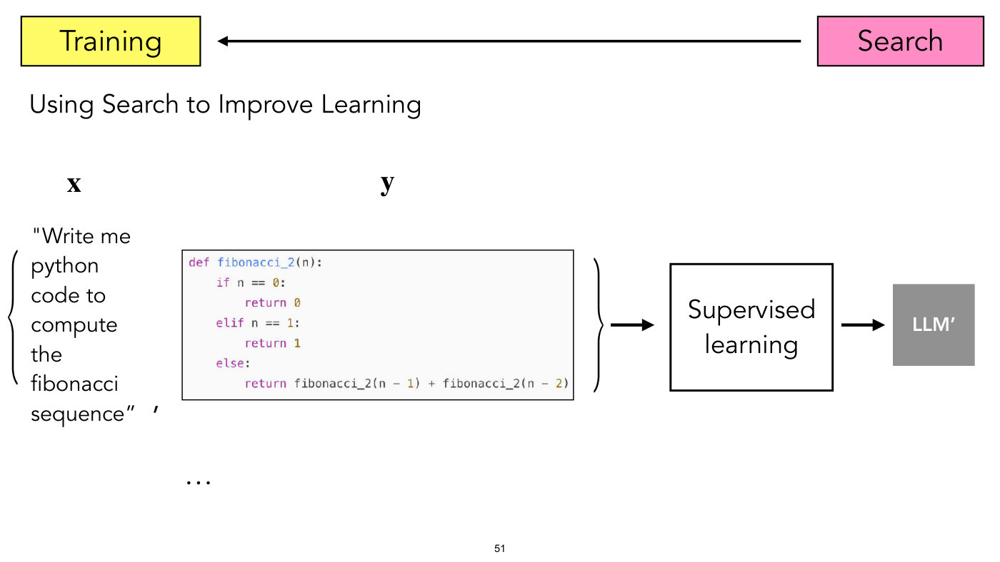

Same header strip (Training, Search, arrow pointing left) and subtitle as slide 50. Diagram, left to right: above the left column the bold label $\mathbf{x}$ and above the middle the bold label $\mathbf{y}$ (bold as printed). A large left curly brace spans the quoted prompt "Write me python code to compute the fibonacci sequence" (as on slide 50: seven lines, straight opening and curly closing quote), followed by a comma (printed as a large slanted tick); next to it the code box for `fibonacci_2` (the correct one, same code as on slide 50's lower box), followed by a right curly brace that closes the pair $(\mathbf{x}, \mathbf{y})$; below the pair a row of three dots "…" (more such pairs). An arrow leads from the brace to a white box "Supervised learning", then an arrow to a grey box "LLM’". What changed from slide 50: only the verified-correct program is kept, as a (prompt, program) training pair for supervised learning that produces an updated model "LLM’" (the prime is as printed). (Hidden, as on slide 50: the code image's trailing comment "# Correct recursive" is cropped off by the box.) Printed slide number "51".

## Slide 52 — Using Search to Improve Learning and Using Learning to Improve Search

Header strip: yellow "Training" box at the left and pink "Search" box at the right joined by a double-headed black arrow (arrowheads at both ends; on slides 50 and 51 it pointed left only). Subtitle: "Using Search to Improve Learning and Using Learning to Improve Search". Three numbered steps:

1. "1. Search for random action sequences that lead to high rewards (winning)." (upper left)
2. "2. Train a network (policy) that will tend to do those winning moves." (upper right)
3. "3. Repeat, guiding search using the policy to explore intelligently." (bottom centre)

Pictures: at the left a large video-game screenshot (blue sky, a green hill, a green pipe at the right, a brick floor, a small running character at the lower middle) with three black, white-outlined arrow icons below it, an up arrow above and a left and a right arrow below on either side (the available actions). At the centre a pair of curved black arrows forming a cycle (one arrowhead at the upper right pointing clockwise, one at the lower left). At the right a smaller copy of the game screenshot followed by a white block arrow labelled $\pi$, pointing to a bar chart with a vertical axis from 0 to 1 and three black bars, one above each of three arrow icons below the axis: left arrow (short bar, about 0.1), up arrow (tall bar, about 0.75), right arrow (medium bar, about 0.25).

*OCW notice: © Nintendo. All rights reserved. This content is excluded from our Creative Commons license. For more information, see https://ocw.mit.edu/help/faq-fair-use/ (small print directly under the left game screenshot; it covers the game screenshot, which also appears at smaller size at the right).*

Printed slide number "52".

## Slide 53 — Using Search to Improve Learning and Using Learning to Improve Search

Same header strip (Training and Search with a double-headed arrow) and subtitle as slide 52. A pasted four-panel figure of a game-tree search on Go boards, panels lettered "a" Selection, "b" Expansion, "c" Evaluation, "d" Backup, each showing a small tree of Go board diagrams (black and white stones on a grid), with the tree's rows separated by faint dotted horizontal lines.

- a, "Selection": a root board with two child boards below it, reached by a grey arrow to the left child labelled "Q + u(P)" (grey) and a black arrow to the right child labelled "Q + u(P)" (black), with a black "max" between the two arrows beside the black one. From the right child two more arrows leave: a black one down-left labelled "Q + u(P)" (black), again with "max" beside it, which ends with no board drawn, and a grey one down-right labelled "Q + u(P)" (grey) to the panel's only grandchild board. The selected path is black, the others grey.
- b, "Expansion": a root board with two grey arrows labelled "P" (grey) to two children; from the right child two more grey "P" arrows lead to two grandchildren, the left one shown as $p_\sigma(\ldots)$ (the board in large black parentheses, preceded by $p_\sigma$) with two black arrows labelled "P" (black) leaving it downward to no boards, the right one a plain board.
- c, "Evaluation": the same tree with unlabelled grey arrows (the root, its two children and the right child's two children); the right child's left child is itself shown as $v_\theta(\ldots)$ (the board in large black parentheses), and from it a black downward arrow, a solid stroke that turns into dots before its arrowhead, labelled "∼ $p_\pi$", leads to a board in black parentheses preceded by $r$; the right child's right child is a plain board.
- d, "Backup": each board of the tree (the root, its two children and the right child's two children) is shown in light grey parentheses preceded by a grey $v_\theta$, and along the bottom row three boards in grey parentheses preceded by a grey $r$ each send an upward arrow of the same solid-then-dotted kind to the board above (black under the right child's left child; grey under the right child's right child, and under the left child, where it runs up two rows). Arrows labelled "Q" carry values up the tree: a grey arrow with a grey "Q" from the left child to the root, a black arrow with a pink "Q" from the right child to the root, and from the right child's two children a black arrow with a blue "Q" and a grey arrow with a grey "Q". A blue rounded rectangle encloses the column of the right child's left child (its $v_\theta$ and $r$ boards), and a larger pink rounded rectangle encloses the right child's whole sub-tree.

The panel text and symbols are as printed in the paper's figure; the board positions are not transcribed move by move. Bottom right: "[AlphaGo: Silver*, Huang* et al, Nature 2016]".

*OCW notice: © Springer Nature Limited. All rights reserved. This content is excluded from our Creative Commons license. For more information, see https://ocw.mit.edu/help/faq-fair-use/ (small print at the lower left under the figure; it covers the four-panel figure).*

Printed slide number "53".

## Slide 54 — STaR

Same header strip (Training, Search, double-headed arrow). Bold title "STaR". At the left a pasted flow diagram in a rounded grey panel; at the right a pasted example in typewriter-style type.

*OCW notice: © Zelikman, et al. All rights reserved. This content is excluded from our Creative Commons license. For more information, see https://ocw.mit.edu/help/faq-fair-use/ (small print under the panel at the lower left; it covers the diagram and the example text).*

Diagram boxes (coloured text in the paper's figure): "Question, Rationale, Answer" (a box at the upper left, with "Question" in blue, "Rationale" in red, "Answer" in blue); "Question" (blue, a box at the left middle); "Language Model" (a box at the centre); "Rationale, Answer" (a green box at the right middle, "Rationale" red, "Answer" blue); "Hint" (a yellow box at the bottom, right of centre, green text); "Rationale, Answer" (a second green box at the bottom, left of centre). Arrows: "Question" → "Language Model"; "Language Model" → green "Rationale, Answer" at the right, labelled "Rationale Generation"; from that box a path goes up with a green check mark and the label "Correct Answer" (green), continuing around the top of the panel with a long arrow back to the "Question, Rationale, Answer" box; from the same box a path goes down with a red cross and the label "Wrong Answer" (red) to the "Hint" box; "Hint" → the bottom-left green "Rationale, Answer" box through an arc that rises from the top of "Hint", touches the bottom edge of the "Language Model" box, and comes down with its arrowhead into the green box, labelled "Rationalize" just under the Language Model; that bottom-left box has a green check mark and an arrow going left and up the left side into the "Question, Rationale, Answer" box; a dashed arrow labelled "Finetune" leads from the "Question, Rationale, Answer" box to the "Language Model". So the language model is finetuned on question–rationale–answer triples that reached the correct answer, with wrong answers rerun with a hint.

Example text at the right, in typewriter type: the question block in bold blue, the answer in plain dark red except for its bold blue "A:" and closing "(b)": "Q: What can be used to carry a small dog? Answer Choices: (a) swimming pool (b) basket (c) dog show (d) backyard (e) own home" and "A: The answer must be something that can be used to carry a small dog. Baskets are designed to hold things. Therefore, the answer is basket (b)."

Bottom right: "[Zelikman*, Wu*, Mu, Goodman, 2022]". Printed slide number "54".

## Slide 55 — o1?

Same header strip (Training, Search, double-headed arrow). Bold title "o1?" (the "o1" bold, "?" regular). Numbered text and pictures:

1. "1. Search for CoTs that solve the problem (randomly sample different chains)" (upper left), with beneath it a sample answer text in small typewriter-style type ("A: The answer must be something that can be used to carry a small dog. Baskets are designed to hold things. Therefore, the answer is basket (b).") and a row of three dots "…" to its right (more sampled chains).
2. "2. Finetune the LLM to preferentially output CoTs that led to high reward" (upper right), with beneath it a pair of curly braces enclosing the bold label $\mathbf{x}$ over a question text ("Q: What can be used to carry a small dog? Answer Choices: (a) swimming pool (b) basket (c) dog show (d) backyard (e) own home"), a comma, and the bold label $\mathbf{y}$ over the answer text above.
3. "3. Repeat, now the LLM outputs better CoTs" (centre), directly below a pair of curved black arrows that form a clockwise cycle between steps 1 and 2 (upper arrowhead at the right, lower one at the left).
4. "4. At deployment time, you can choose how much search to do on top of your fine-tuned LLM" (bottom).

Bottom line: "Speculation from Sasha Rush: https://www.youtube.com/watch?v=6PEJ96k1kiw&ab_channel=SashaRush%F0%9F%A4%97" (the URL printed with its percent-encoded emoji). No OCW notice is printed on this page, but both pasted text images (the answer, used twice, and the question) are the example text of slide 54's STaR figure, which slide 54's notice (© Zelikman, et al.) excludes: the same words, type, colours and line breaks. Printed slide number "55".

## Slide 56 — (OCW end page)

OCW's appended end page (792×612, a smaller page than the lecture slides; no lecture content). Text: "MIT OpenCourseWare", "https://ocw.mit.edu", "6.7960 Deep Learning", "Fall 2024", "For information about citing these materials or our Terms of Use, visit: https://ocw.mit.edu/terms". Printed slide number "56" at bottom centre.
