# Lecture 15 — Generative Models: Representation Learning Meets Generative Modeling

**Lecturer:** Phillip Isola ·
**Video:** [youtube.com/watch?v=8zzfcYIELdo](https://www.youtube.com/watch?v=8zzfcYIELdo) (81 min) ·
**Slides:** [`mit6_7960_f24_lec15.pdf`](https://ocw.mit.edu/courses/6-7960-deep-learning-fall-2024/mit6_7960_f24_lec15.pdf)
(42 pages; the deck is titled "Lecture 15: Deep Generative Models II"; transcribed slide by slide in [`raw/slides/15-generative-models-representation-learning-meets-generative-modeling.md`](../raw/slides/15-generative-models-representation-learning-meets-generative-modeling.md)) ·
**Transcript:** [`raw/transcripts/15-generative-models-representation-learning-meets-generative-modeling.md`](../raw/transcripts/15-generative-models-representation-learning-meets-generative-modeling.md)

## What this lecture establishes

The second of the course's three lectures on generative models goes deep on one model, the **variational autoencoder**
(VAE): "one model that really puts the two ideas together and solves them both at the same time", the ideas being
generative modeling and representation learning (≈0:00). "Rather than covering a lot of different topics in some
superficial level of detail, we're going to just go deep on VAEs" (≈0:47).

The lecture builds the model in layers and invites the listener to "pop back out" whenever the math gets heavy (≈7:04).
The first layer: a VAE is an autoencoder whose encoder maps the data to a Gaussian, so that new data can be made by
sampling from a Gaussian and decoding. The second: a VAE fits an **infinite mixture of Gaussians** to the data by maximum
likelihood, with a network $g_{\theta}$ turning every point of a unit-Gaussian latent space into one mixture component. The
likelihood of a data point is then an integral over the latent space that cannot be computed, and the rest of the
derivation is **three tricks** for approximating it: estimate the integral by Monte Carlo sampling; sample only where it
matters, by importance sampling; and train a second network, an encoder $f_{\psi}$, to predict the best sampling
distribution for each data point. With Jensen's inequality these give a single objective for both networks, the
**evidence lower bound** (ELBO), whose two terms are a reconstruction error and a KL penalty that squashes the encodings
toward the origin. "A lot of math, but at the end of the day, the VAE is a very simple model that looks just like an
autoencoder" (≈56:16). The lecture ends on what generative models' latent spaces learn: **disentangled** factors of
variation, which need not be the true causes of the data, and seams where a complicated shape has been squeezed onto a
sphere.

**Notation on this page** follows the slides. A data point is $\mathbf{x}$, in a data space $\mathcal{X}$; a latent
vector is $\mathbf{z}$, in a latent space $\mathcal{Z}$, with prior $p_{\mathbf{z}}$, the unit Gaussian
$\mathcal{N}(\mathbf{0}, \mathbf{I})$. $\mathcal{N}(\mathbf{x}; \mu, \mathbf{\Sigma})$ is the Gaussian density with mean
$\mu$ and covariance $\mathbf{\Sigma}$, evaluated at $\mathbf{x}$. The generator, or decoder, $g_{\theta}$ has parameters
$\theta$ and outputs a mean $g^{\mu}_ {\theta}(\mathbf{z})$ and a covariance $g^{\Sigma}_ {\theta}(\mathbf{z})$; the
encoder $f_{\psi}$ has parameters $\psi$ and outputs $f^{\mu}_ {\psi}(\mathbf{x})$ and $f^{\Sigma}_ {\psi}(\mathbf{x})$.
$p_{\theta}(\mathbf{x})$ is the model's density, $p_{\theta}(\mathbf{x} \vert \mathbf{z})$ the density of one mixture
component, and $p_{\theta}(Z \vert \mathbf{x})$ the distribution over latents given a data point, with a capital $Z$ for
the random variable, as the slides write it; $q_{\psi}(Z \vert \mathbf{x})$ is the encoder's model of it. The training set
is $\lbrace \mathbf{x}^{(i)} \rbrace_ {i=1}^{N}$, $\mathbf{z}^{(j)}$ is the $j$-th of $M$ latent samples, and
$\mathtt{KL}(q \parallel p)$ is the KL divergence. See also the course's [notation](notation.md).

## Where this lecture sits

The outline has three items: generative modeling as inverse representation learning, variational autoencoders, and
disentanglement (slide 2). Slide 3 repeats the picture the lecturer has "shown a few different times throughout all of the
representation learning and generative modeling lectures" (≈0:47): a box with "Data" at the bottom and "Embedding" at the
top, representation learning running up it as "mapping data to abstract representations (analysis)" and generative modeling
running down it as "mapping abstract representations to data (synthesis)". The two are "inverses to some degree, not
necessarily inverses in the sense of a mathematical function inverse because the direction from data to embeddings is many
to one, and the direction from embeddings to data might be one to many. It might be stochastic, so it's more like a
stochastic inverse"; and "in this lecture, we're going to see a model that explicitly models both directions
simultaneously" (≈0:47–1:33).

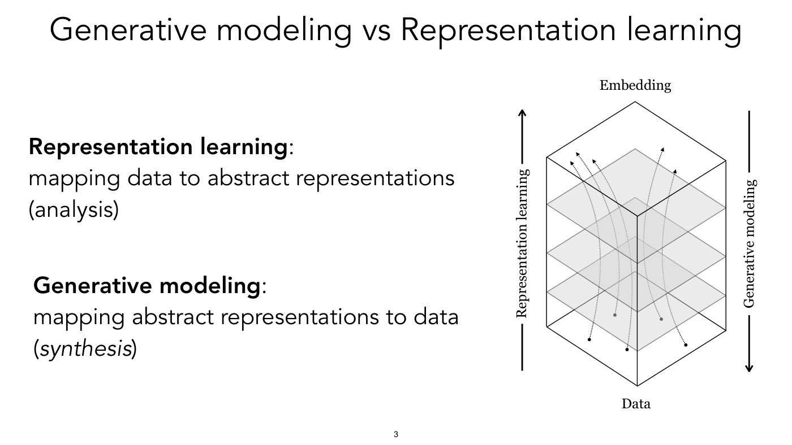

*Slide 3 — Representation learning maps data to abstract representations (analysis); generative modeling maps them back to data (synthesis). [Deck](https://ocw.mit.edu/courses/6-7960-deep-learning-fall-2024/mit6_7960_f24_lec15.pdf)*

The VAE gets its own lecture, after both representation learning and generative modeling, "because the VAE puts both of
them together. And it encompasses all the models we've seen. And many of the models we've seen, like diffusion models, can
be cast as a certain kind of VAE or autoencoders or a degenerate VAE" (≈8:37). "They're the pinnacle of generative
modeling and representation learning. But in practice, they're not as popular these days as diffusion models and other
things. But mathematically, they're a framework that encompasses almost everything that we've seen" (≈9:22).

## Generative models transform distributions

"Deep generative models are distribution transformers" (slide 4): a generator $g$ maps a simple **prior distribution**
$p(z)$, drawn as a circle, to a complicated **target distribution** $p(x)$, drawn as a lumpy Y-shaped blob. The prior "will be
the noise that we talked about last class", usually Gaussian. "If it's actually a normal distribution, then in high
dimensions, that will be roughly a soap bubble … Most of the probability density of a Gaussian in high dimensions is right
near the surface of the hypersphere" (≈2:19). The network's layers "geometrically push and pull it around" until it has the
data's shape, a cartoon of the layer-by-layer diagrams of [lecture 11](11-representation-learning-reconstruction-based.md)
(≈3:06).

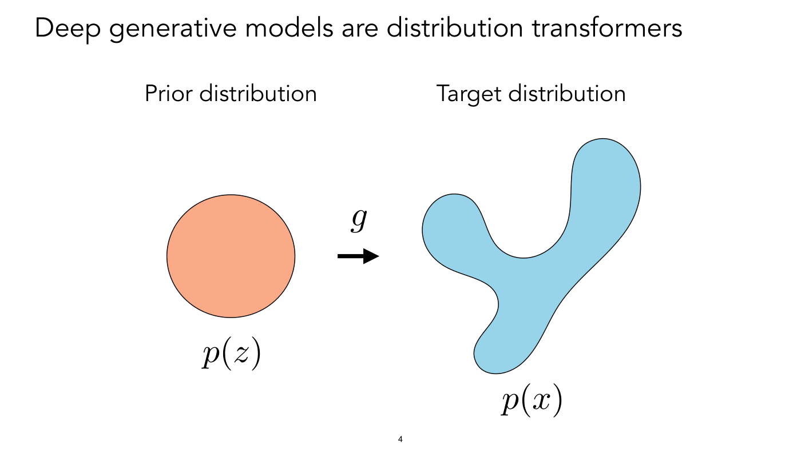

*Slide 4 — A deep generative model transforms a simple prior distribution into the complicated distribution of the data. [Deck](https://ocw.mit.edu/courses/6-7960-deep-learning-fall-2024/mit6_7960_f24_lec15.pdf)*

Slide 5 sets the two directions side by side. Representation learning is an **encoder** $f$ from a point $\mathbf{x}$ of
the data space, where $p_{\texttt{data}}$ lives, to a point $\mathbf{z}$ of the representation space; generative modeling is a
**generator** $g$ from a point $\mathbf{z}$ of the representation space, where $p_{\mathbf{z}}$ lives, to a point
$\mathbf{x}$ of the data space. "These are sometimes called generators. Other times, they're called decoders" (≈3:55).

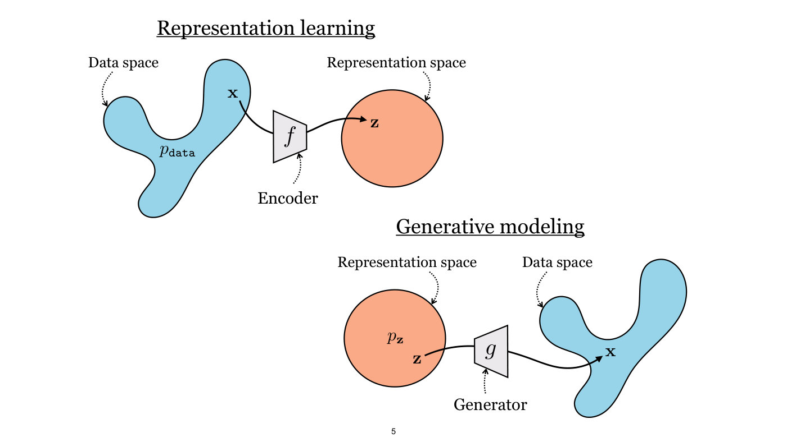

*Slide 5 — The encoder and the generator run between the same two spaces in opposite directions. [Deck](https://ocw.mit.edu/courses/6-7960-deep-learning-fall-2024/mit6_7960_f24_lec15.pdf)*

## Why an autoencoder's decoder is not yet a generative model

An [autoencoder](autoencoders.md) has both halves already: it maps data to a low-dimensional vector $\mathbf{z}$ and decodes
that vector back into the data. Its decoder is "doing functionally basically what we've described a generator … as doing",
so "can we use that decoder as a generative model, as a generator, to sample new random photos?" (slide 6, ≈4:43). To do
so you would first sample a $\mathbf{z}$, and a student puts the difficulty in two words: "What distribution?" The lecturer:
"I never told you what z is … there's no guarantee that set of embeddings is going to form a simpler shape or easier to
sample from distribution than the original data itself" (≈5:30). Slide 6's photographs are excluded from OCW's licence, so
it has no image here; it draws an autoencoder from a photograph through a bottleneck $\mathbf{z}$ to a reconstruction
$\hat{\mathbf{x}}$, and below it the decoder reused as a generative model, $\mathbf{z} \sim p_{\mathbf{z}}$, producing
new bird photographs.

"I can decode z vectors that are corresponding to the data that I trained on … But I don't know how to sample new valid f's
of x. It might be some weird distribution full of holes. And if I go to a point that has never been … observed via f of x,
then I won't know how to decode that. So the whole point of a variational autoencoder is to fix this problem … to make it so
that the latent space, the encodings of an autoencoder, form a simple distribution that you can sample from. That's all of
the math and algorithms that we'll develop in this lecture" (≈6:18). Slide 7 draws the problem: $f$ maps the data blob to a
lumpy shape, and $g$ maps that shape back to the data.

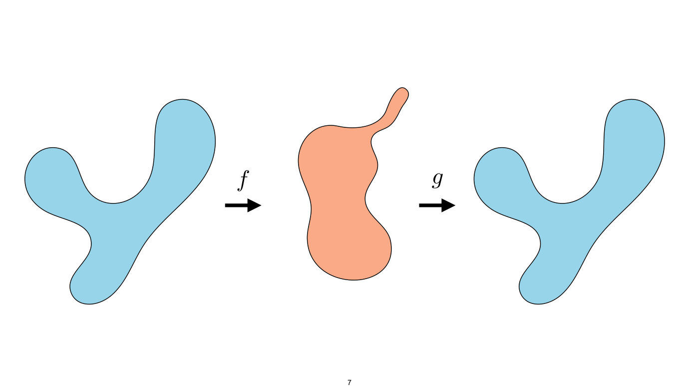

*Slide 7 — An autoencoder's codes can take any shape, so there is nothing simple to sample new codes from. [Deck](https://ocw.mit.edu/courses/6-7960-deep-learning-fall-2024/mit6_7960_f24_lec15.pdf)*

So "the first perspective I want you to understand is that a VAE is an autoencoder with one change, which is that rather
than the encoder mapping to a complicated shape, it will map to a simple shape. It will map to a Gaussian … that means that I
can sample new images by sampling from a Gaussian and running the Gaussian random vectors through decoder. That's the first
level of understanding of a VAE" (≈7:04–7:49). Asked whether the Gaussian is there for generation or because it makes a
better representation, the lecturer says both, but the second "is a little bit more subtle. So we'll get to that toward the
end" (≈7:49–8:37); see [Why squash toward the origin](#why-squash-toward-the-origin).

## Mixtures of Gaussians

The probabilistic view starts from a classical model, because "variational autoencoders are fitting a mixture of Gaussians
to a data distribution" (≈9:22). One Gaussian fitted by maximum likelihood, as in [lecture 14](14-generative-models-basics.md)
("last Thursday", ≈10:08), shifts its mean and variance until the density it places on the data points is as high as it can
be. A **mixture** sums several Gaussians, so as to model a distribution that is not Gaussian-shaped (slide 8):

$$p_{\theta}(\mathbf{x}) = \sum_{i=1}^{k} w_i \mathcal{N}(\mathbf{x}; \mu_i, \mathbf{\Sigma}_ i)$$

with parameters $\lbrace w_i, \mu_i, \mathbf{\Sigma}_ i \rbrace_ {i=1}^{k}$: the mixing weights, means and covariances of $k$
components. "If the circles are small enough and I have enough of them, then I can approximate any shape. So probably, you
could prove — I haven't thought through this, but probably a mixture of Gaussians can, to arbitrary precision, approximate any
density, something like that" (≈10:55). The weights would be positive in traditional models, "but you can imagine these being
negative or positive more generally" (≈10:55). Most of the lecture assumes **isotropic** Gaussians, whose covariance is a
multiple of the identity, so that every component is drawn as a circle whose radius is set by one number (≈10:08–11:41). In
$d$ dimensions a mean is a $d$-dimensional vector and a covariance a $d \times d$ matrix (≈11:41–12:27); the lecturer then
counts the parameters of $k$ components (one weight, $d$ for the mean, $d^2$ for the covariance, each), but the captions of
the total are garbled (≈12:27).

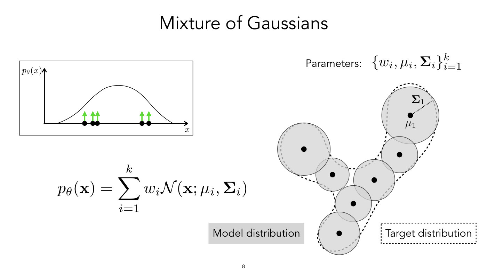

*Slide 8 — A mixture of Gaussians: seven circles, each one component with its own mean and covariance, together approximate the dashed target shape. [Deck](https://ocw.mit.edu/courses/6-7960-deep-learning-fall-2024/mit6_7960_f24_lec15.pdf)*

## An infinite mixture, parameterized by a network

"VAEs are a mixture of Gaussians. But they're not just any mixture. They're actually an infinite mixture of Gaussians"
(≈12:27). An explicit infinite mixture would need infinitely many parameters. The "really cool trick" is to parameterize it
"as a mapping from some underlying base continuous distribution to mixture components via function g that has a finite set
of parameters" (≈13:12). In this course $g$ is a neural network, "but in fact, a VAE doesn't have to have anything to do with
neural networks. g could be any type of mapping" (≈13:12).

Slide 9 draws it: points $\mathbf{z}$ sampled from the prior $p_{\mathbf{z}}$, a unit Gaussian, pass through $g_{\theta}$,
which outputs the mean $g^{\mu}_ {\theta}(\mathbf{z})$ and covariance $g^{\Sigma}_ {\theta}(\mathbf{z})$ of one mixture
component (≈14:00). "Because z is continuous, I can sample any point on a continuum, and I can thereby get an infinite
number of possible … Gaussian mixture components. And g just has weights and biases … So that's a finite number of
parameters to model an infinite mixture" (≈14:47). The sum becomes an integral over the latent space:

$$p_{\theta}(\mathbf{x}) = \int_{\mathbf{z}} p_{\mathbf{z}}(\mathbf{z}) \mathcal{N}(\mathbf{x}; g^{\mu}_ {\theta}(\mathbf{z}), g^{\Sigma}_ {\theta}(\mathbf{z})) d\mathbf{z}$$

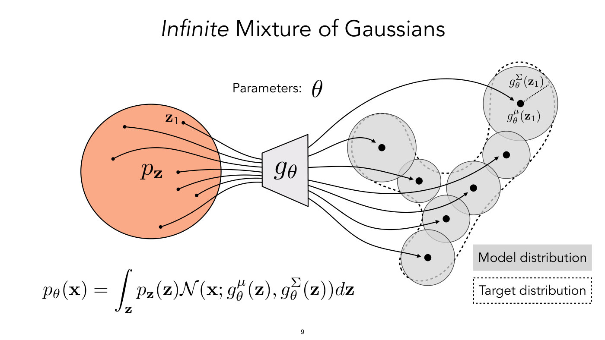

*Slide 9 — The infinite mixture: every latent point the generator network is given becomes the mean and covariance of one mixture component, so a continuum of latents gives infinitely many components from finitely many weights. [Deck](https://ocw.mit.edu/courses/6-7960-deep-learning-fall-2024/mit6_7960_f24_lec15.pdf)*

The prior plays the part of the mixing weights: "pz is my prior distribution. It's usually just a unit Gaussian. And think of
that the weights of the mixture components" (≈16:24). The components need not be Gaussian: "It could be a mixture of Laplace
distributions or Poisson distributions, whatever you want" (≈16:24–17:10). Asked whether this is a convolution, the lecturer
allows that "you could probably cast it as convolution in some sense", but prefers to read it as a marginal likelihood
(≈17:10).

## Latent variable models and the marginal likelihood

Slide 10 reads the latent space as **latent variables** "that describe all the attributes of the generated data, but in an
abstract fashion" (≈17:10), and brings back lecture 14's hand-written program that turns simple random variables into
pictures of rivers: $\mathbf{z}_ 1 \sim \texttt{Bernoulli}(0.5)$ for the river's turns,
$\mathbf{z}_ 2 \sim \texttt{Normal}(\mu_1, \mathbf{\Sigma}_ 1)$ for the grass colour and $\mathbf{z}_ 3 \sim \texttt{Unif}(0, 10)$ for the
number of trees feed a generator that draws map tiles (≈18:01). As a graphical model, $z$ points to $x$ and only $x$ is
observed: "We sample a z, and then condition on the z. We sample an x, we only observe the x … We have to maybe infer z from
x" (≈18:01). The generator is a conditional distribution $p_{\theta}(\mathbf{x} \vert \mathbf{z})$, and the density of a data
point marginalizes out the latents:

$$p_{\theta}(\mathbf{x}) = \int_{\mathbf{z}} p_{\theta}(\mathbf{x} \vert \mathbf{z}) p_{\mathbf{z}}(\mathbf{z}) d\mathbf{z}$$

"This is just marginalization from probability" (≈18:46). The probability the model places on the data is its
**likelihood**, and since computing it means marginalizing over the unobserved latents, "sometimes we call this marginal
likelihood. So a latent variable model, I'm going to fit it to data by maximizing the marginal likelihood" (≈19:34). See
[generative models](generative-models.md) for latent variables as control knobs.

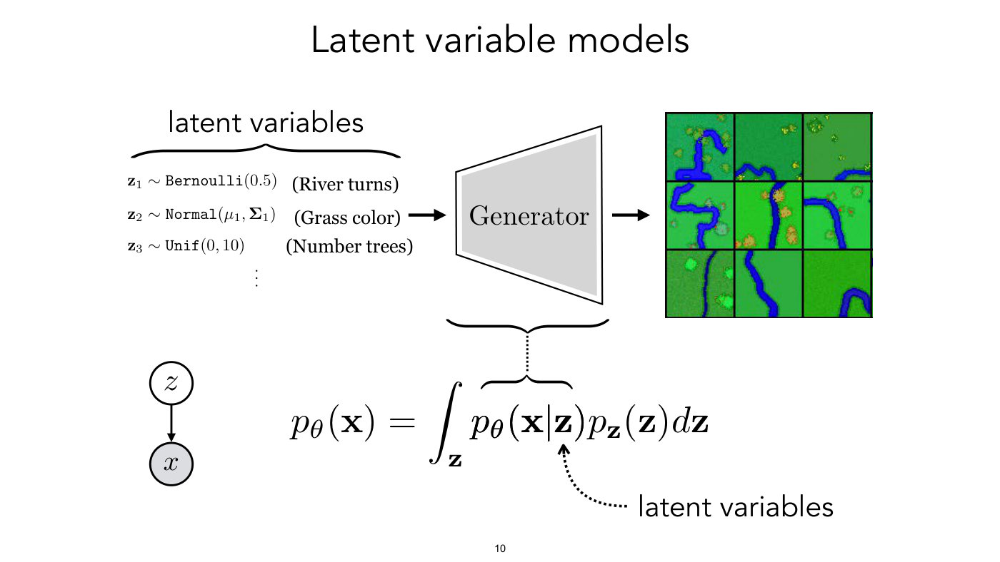

*Slide 10 — Latent variables: lecture 14's river program read as a latent variable model, where only the picture is observed and its probability integrates over all the latent settings that could have produced it. [Deck](https://ocw.mit.edu/courses/6-7960-deep-learning-fall-2024/mit6_7960_f24_lec15.pdf)*

## The whole model on one slide

Slide 11, "Infinite GMM / VAE", puts the model in the course's learner diagram. The **objective** is maximum likelihood,
$\max_{\theta} \mathbb{E}_ {\mathbf{x} \sim p_{\texttt{data}}} \left[ \log p_{\theta}(\mathbf{x}) \right]$; the
**hypothesis space** is the infinite mixture,

$$p_{\theta}(\mathbf{x}) = \int_{\mathbf{z}} \underbrace{\mathcal{N}(\mathbf{x}; g^{\mu}_ {\theta}(\mathbf{z}), g^{\Sigma}_ {\theta}(\mathbf{z}))}_ {p_{\theta}(\mathbf{x} \vert \mathbf{z})} \underbrace{\mathcal{N}(\mathbf{z}; \mathbf{0}, \mathbf{I})}_ {p_{\mathbf{z}}(\mathbf{z})} d\mathbf{z}$$

and the learner outputs two things: a **density** $p_{\theta} : \mathcal{X} \to [0, \infty)$ and a **sampler**
$g_{\theta} : \mathcal{Z} \to \mathcal{X}$ (≈20:20–21:06). To sample, "I first sample a random unit Gaussian z", have the
network predict the mean of that mixture component, and add Gaussian noise scaled by the network's other output (≈21:55).
The slide writes this as

$$x = g^{\mu}_ {\theta}(\mathbf{z}) + g^{\sigma}_ {\theta}(\mathbf{z}) \epsilon \qquad \epsilon \sim \mathcal{N}(0, 1)$$

and labels it the **reparameterization trick**: "In order to take a sample from this distribution, px given z, which is a
normal distribution, it suffices to take a sample from a unit Gaussian and transform it by offsetting it by the mean and then
multiplying" by the spread. "So then x is just a deterministic function of g with the only stochasticity coming in through
this unit Gaussian noise inserted in the side" (≈25:03). The lecturer first says the noise is multiplied by the variance, and
a student asks which is meant; he settles it: "sigma is the standard deviation, sigma squared is the variance … it should be
multiplied by the standard deviation … I think this is not a typo, it's just I misspoke" (≈22:42–25:49). The slide's line writes a plain $x$ and a superscript $\sigma$, the standard deviation, where the equation
above it has a bold $\mathbf{x}$ and the covariance $g^{\Sigma}_ {\theta}$; the slide file flags the inconsistency.

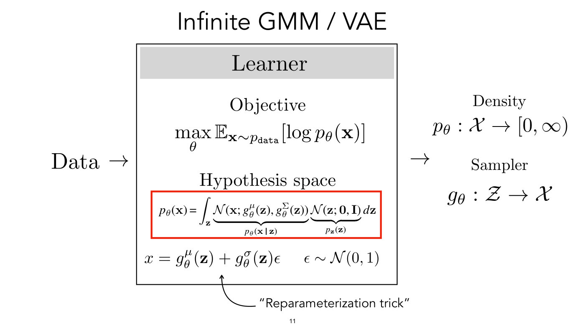

*Slide 11 — The whole model as a learner: maximum likelihood over an infinite mixture of Gaussians, which gives both a density and a sampler; the line at the bottom is the reparameterization trick. [Deck](https://ocw.mit.edu/courses/6-7960-deep-learning-fall-2024/mit6_7960_f24_lec15.pdf)*

"You could pause here and you could say you understand what VAEs are doing. They're … maximizing the data likelihood by
fitting an infinite mixture of Gaussians to the data … That's one layer of understanding. But then there's this integral — so
the rest of the lecture is actually how do we approximate that integral" (≈26:35).

## The obstacle: an intractable integral

To maximize the likelihood by gradient descent, every update would need the integral, which has no closed form. Approximating
it well takes many latent samples, and since $g$ sits inside the integral, "one step of backprop is running my neural network
forward many, many, many times to get a good estimate of this integral, and then I still have to backprop that … It's an
intractable integral" (≈23:28–24:17). Slide 12 writes the training problem with $L$ for the data log likelihood, summed over
the $N$ training points because maximizing the joint probability of independent points means maximizing the sum of their log
probabilities (≈26:35–27:22):

$$\theta^{\ast} = \arg\max_{\theta} L(\lbrace \mathbf{x}^{(i)} \rbrace_ {i=1}^{N}, \theta) = \arg\max_{\theta} \sum_{i=1}^{N} \log \int_{\mathbf{z}} \mathcal{N}(\mathbf{x}^{(i)}; g^{\mu}_ {\theta}(\mathbf{z}), g^{\Sigma}_ {\theta}(\mathbf{z})) \mathcal{N}(\mathbf{z}; \mathbf{0}, \mathbf{I}) d\mathbf{z}$$

## Trick #1: estimate the integral by sampling

The marginal likelihood is an expectation over the prior, and an expectation can be estimated by averaging samples
(slide 13, ≈28:08–28:57):

$$p_{\theta}(\mathbf{x}) = \int_{\mathbf{z}} p_{\theta}(\mathbf{x} \vert \mathbf{z}) p_{\mathbf{z}}(\mathbf{z}) d\mathbf{z} = \mathbb{E}_ {\mathbf{z} \sim p_{\mathbf{z}}(\mathbf{z})} \left[ p_{\theta}(\mathbf{x} \vert \mathbf{z}) \right] \approx \frac{1}{M} \sum_{i=1}^{M} p_{\theta}(\mathbf{x} \vert \mathbf{z}^{(j)}), \qquad \mathbf{z}^{(j)} \sim p_{\mathbf{z}}$$

The slide prints the sum's index as $i = 1$, as reproduced here, while its summand and the samples use $j$; $j = 1$ is
meant, and slide 14 prints it. "As M goes to infinity … this is an unbiased estimator of that integral" (≈28:57–29:44). Each term is easy:
sample a unit-Gaussian vector and evaluate a Gaussian density. "I got rid of the integral, I don't know how to write integrals
in PyTorch. But now I've got it into a form where we can write it in PyTorch" (≈29:44–30:31). Fitting the infinite mixture is
then (slide 14)

$$\theta^{\ast} = \arg\max_{\theta} \sum_{i=1}^{N} \log \frac{1}{M} \sum_{j=1}^{M} \mathcal{N}(\mathbf{x}^{(i)}; g^{\mu}_ {\theta}(\mathbf{z}^{(j)}), g^{\Sigma}_ {\theta}(\mathbf{z}^{(j)}))$$

Pausing on this slide, the lecturer says "I think there's a typo here. So that 1 over M should be inside the log, I suppose.
Yeah, that's probably an important typo … So log 1 over M" (≈31:18). The slide as printed already has the $\frac{1}{M}$ inside
the log, so what he took to be wrong is not clear from the recording; the slide file records both.

Slide 14's plot is a frame of a Colab that runs this optimization on a two-dimensional target. For the picture it samples the
latents along a grid rather than at random, and at initialization the network's weights are near zero, so every grid point maps
to a Gaussian near the same spot; as training runs, "the different points in z-space learn to map to different parts of the
data distribution, so they cover the data distribution" (≈31:18–32:53). Three questions follow. Why not multiply each term by
$p_{\mathbf{z}}(\mathbf{z})$? Because the prior "comes in through the sampling procedure. So higher probability samples … will be
overrepresented in this sum, so don't need to double-weight them" (≈32:53). How is $p_{\theta}(\mathbf{x} \vert \mathbf{z})$
computed — by drawing a sample? No: "this thing has a closed-form analytical form", the Gaussian density, "some exponential of
the difference from the mean divided by the variance" (≈33:39–34:24). How does the error scale with $M$? "I don't know. That's a
great question" (≈34:24).

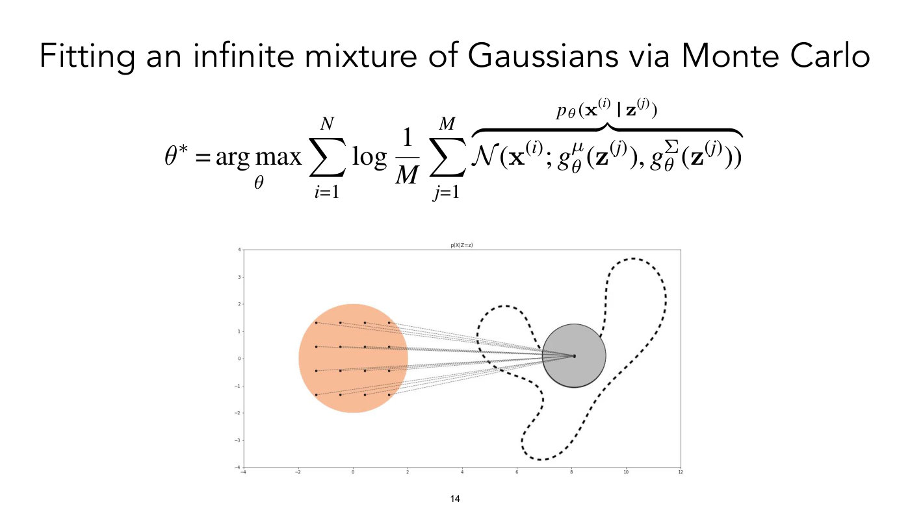

*Slide 14 — Trick #1 at initialization: the Monte Carlo objective, and the Colab's first frame, where every latent point maps to the same Gaussian; training spreads them over the target. [Deck](https://ocw.mit.edu/courses/6-7960-deep-learning-fall-2024/mit6_7960_f24_lec15.pdf)*

**Why one trick is not enough.** About a hundred samples fit the two-dimensional example, but a model of high-dimensional data
needs a high-dimensional latent space, and the class votes thumbs down on a hundred samples covering a hundred-dimensional one
(≈35:10–35:57). A student answers that a Monte Carlo estimator's variance falls as $1/M$, nominally independent of dimension,
"but in practice, somewhat dimensional"; the lecturer's intuition is that "you need exponentially more samples to get a good
approximation to the integral in high dimensions, but we should talk about that more offline to see if that's really true"
(≈35:57–38:16). The recording leaves the scaling unsettled; what it states firmly is that "in practice, this doesn't work in
high dimensions" (≈38:16).

## Trick #2: importance sampling

"We're not going to just sample randomly, we're going to sample intelligently" (≈38:16). To estimate the likelihood of one data
point $\mathbf{x}$ with random samples from the prior, "almost every single px given z for most of the z's will place nearly zero
probability on that data point x" (≈39:02). Slide 15 draws seven samples from $p_{\mathbf{z}}$, each mapped by $g_{\theta}$ to one
Gaussian, and only one of the seven Gaussians covers $\mathbf{x}$; slide 16 shades that one and writes what the average becomes:

$$p_{\theta}(\mathbf{x}) \approx \frac{1}{M} \left( 0 + p_{\theta}(\mathbf{x} \vert \mathbf{z}^{(2)}) + 0 + \ldots \right)$$

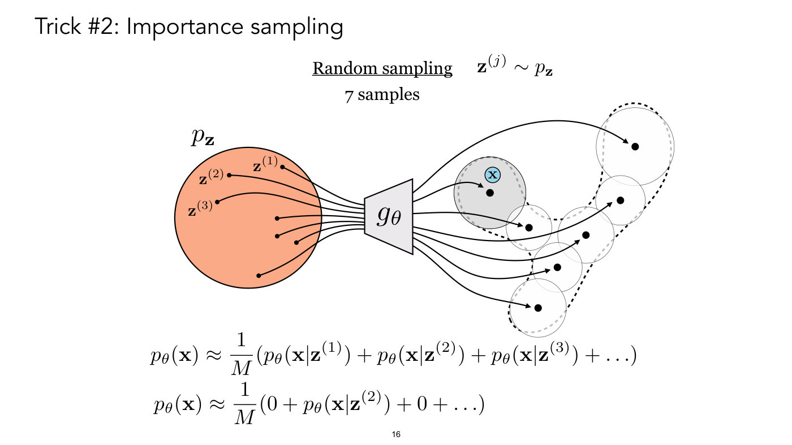

*Slide 16 — Why random sampling wastes samples: of seven latent samples only the second lands on a component near the data point, so the other terms of the average are about zero. [Deck](https://ocw.mit.edu/courses/6-7960-deep-learning-fall-2024/mit6_7960_f24_lec15.pdf)*

"Almost all the terms are nearly 0 except for … the z's that map to Gaussians that place high density over this x" (≈39:48). So
sample from another density $q_{\mathbf{z}}$ that puts its mass on those $\mathbf{z}$, and correct for it (slide 17):

$$p_{\theta}(\mathbf{x}) = \int_{\mathbf{z}} q_{\mathbf{z}}(\mathbf{z}) \frac{p_{\mathbf{z}}(\mathbf{z})}{q_{\mathbf{z}}(\mathbf{z})} p_{\theta}(\mathbf{x} \vert \mathbf{z}) d\mathbf{z} = \mathbb{E}_ {\mathbf{z} \sim q_{\mathbf{z}}} \left[ \frac{p_{\mathbf{z}}(\mathbf{z})}{q_{\mathbf{z}}(\mathbf{z})} p_{\theta}(\mathbf{x} \vert \mathbf{z}) \right]$$

Multiplying by $q_{\mathbf{z}} / q_{\mathbf{z}}$ is multiplying by one, valid "as long as qz is non-zero everywhere, which is just a
technical condition" (≈40:33). The two expectations are equal, but the second "requires fewer samples to get a good estimate of
the true integral … I'm sampling from a distribution that gives more importance to the points that matter" (≈41:19). Which $q$
is best? "I won't prove this, but I'll just assert that the optimal distribution to sample from … I think the distribution that
minimizes the variance over my estimator of this expectation, is to sample z's from exactly the density p Z given x" (≈41:19), so
slide 17 sets $q_{\mathbf{z}} = p_{\theta}(Z \vert \mathbf{x})$. Then one sample does the work of seven (slide 18, ≈42:09–42:55):

$$p_{\theta}(\mathbf{x}) = \mathbb{E}_ {\mathbf{z} \sim p_{\theta}(Z \vert \mathbf{x})} \left[ \frac{p_{\mathbf{z}}(\mathbf{z})}{p_{\theta}(\mathbf{z} \vert \mathbf{x})} p_{\theta}(\mathbf{x} \vert \mathbf{z}) \right]$$

Slide 19 sets the two side by side: random sampling, seven samples; importance sampling, one sample. And this scales: "for high
dimensions, the volume is exponential in D, but the area of z-space that actually maps to any given point x might be very small"
(≈44:28). "But the problem is, I don't know p Z given x" (≈44:28).

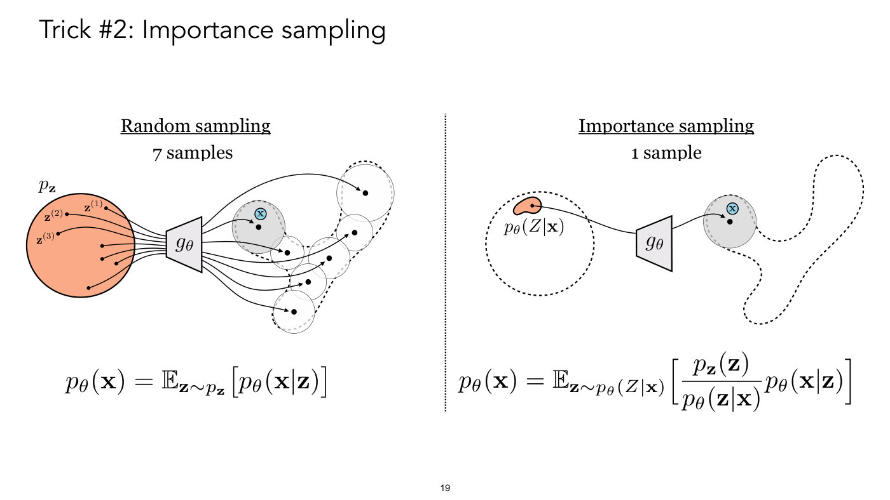

*Slide 19 — Random sampling against importance sampling: seven samples from the prior, or one sample from where the data point's latents are. [Deck](https://ocw.mit.edu/courses/6-7960-deep-learning-fall-2024/mit6_7960_f24_lec15.pdf)*

## Trick #3: an encoder predicts the sampling distribution

The third trick is to "train a model that will take x as input and output a density over Z" (slides 20 and 21, ≈44:28–45:13).
"So now we get to where it starts to look like an autoencoder … That's an encoder. That's a mapping from x to a distribution over
z-space" (≈45:13). For simplicity that density is also Gaussian (slide 22):

$$q_{\psi}(Z \vert \mathbf{x}) = \mathcal{N}\left(f^{\mu}_ {\psi}(\mathbf{x}), f^{\Sigma}_ {\psi}(\mathbf{x})\right)$$

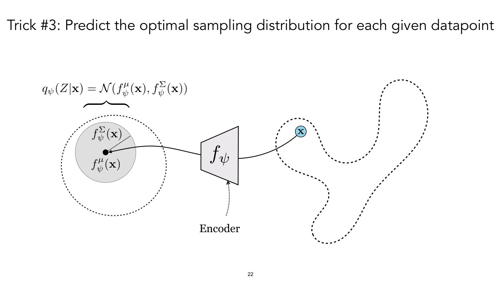

*Slide 22 — Trick #3: the encoder maps a data point to a Gaussian over the latent space, its prediction of where the useful samples are. [Deck](https://ocw.mit.edu/courses/6-7960-deep-learning-fall-2024/mit6_7960_f24_lec15.pdf)*

"q has parameters psi, which is a new set of weights and biases of this encoder function" (≈46:01). It is trained to make
$q_{\psi}(Z \vert \mathbf{x})$ match $p_{\theta}(Z \vert \mathbf{x})$, using the KL divergence as "a particular divergence measure
of how different our two distributions" are (≈46:47). Slide 23 writes the encoder's objective, "We are fitting this to model
this":

$$J_q(\mathbf{x}, \psi) = -\mathtt{KL}\left(q_{\psi}(Z \vert \mathbf{x}) \parallel p_{\theta}(Z \vert \mathbf{x})\right) = \mathbb{E}_ {\mathbf{z} \sim q_{\psi}(Z \vert \mathbf{x})}\left[-\log q_{\psi}(\mathbf{z} \vert \mathbf{x}) + \log p_{\theta}(\mathbf{x} \vert \mathbf{z}) + \log p_{\mathbf{z}}(\mathbf{z})\right] - \log p_{\theta}(\mathbf{x})$$

Predicting "the distribution over latent variables that will explain a given data point x" is what "we call …
inference sometimes" (≈48:21). The last term does not depend on $\psi$, so it can be dropped from the maximization, and what is
left, the expectation, is named $J$: "this equation here will be J, it will come back in a minute" (≈48:21). It too is an
expectation, estimated by sampling (≈49:10). Slide 24 puts the two learning problems together: the encoder's, maximizing the
average of $J$ over the training set with respect to $\psi$, and the generator's, now using $q_{\psi}$ as its importance-sampling
distribution:

$$J_p(\mathbf{x}, \theta) = \log \mathbb{E}_ {\mathbf{z} \sim q_{\psi}(Z \vert \mathbf{x})}\left[\frac{p_{\mathbf{z}}(\mathbf{z})}{q_{\psi}(\mathbf{z} \vert \mathbf{x})} p_{\theta}(\mathbf{x} \vert \mathbf{z})\right], \qquad \theta^{\ast} = \arg\max_{\theta} \frac{1}{N} \sum_{i=1}^{N} J_p(\mathbf{x}^{(i)}, \theta)$$

(≈49:10–50:43). "All of this derivation is in the reading for today, so these slides follow that almost exactly. And additionally,
in the problem set, you'll get to work through some of this yourself" (≈50:43); the slides do not name the reading.

## The evidence lower bound

One step remains (slide 25). A Monte Carlo estimate of the log of an expectation "is a biased estimator", so "we're going to pull
the log inside the expectation so that then we just have expectation of some function, and then a Monte Carlo estimate of that
expectation is an unbiased estimator". Jensen's inequality says the log of an expectation is at least the expectation of the log
(≈50:43–51:31):

$$J_p(\mathbf{x}, \theta) \geq \mathbb{E}_ {\mathbf{z} \sim q_{\psi}(Z \vert \mathbf{x})}\left[\log\left(\frac{p_{\mathbf{z}}(\mathbf{z})}{q_{\psi}(\mathbf{z} \vert \mathbf{x})} p_{\theta}(\mathbf{x} \vert \mathbf{z})\right)\right] = \mathbb{E}_ {\mathbf{z} \sim q_{\psi}(Z \vert \mathbf{x})}\left[-\log q_{\psi}(\mathbf{z} \vert \mathbf{x}) + \log p_{\theta}(\mathbf{x} \vert \mathbf{z}) + \log p_{\mathbf{z}}(\mathbf{z})\right] = J$$

The slide labels $J$ the "VAE objective", and boxes its rearranged form in red as "J = Evidence Lower-Bound (ELBO)":

$$J = \mathbb{E}_ {\mathbf{z} \sim q_{\psi}(Z \vert \mathbf{x})}\left[\log p_{\theta}(\mathbf{x} \vert \mathbf{z})\right] - \mathtt{KL}\left(q_{\psi}(Z \vert \mathbf{x}) \parallel p_{\mathbf{z}}\right)$$

"It's a lower bound to the thing we actually care about, which is the likelihood of the data under the model", and an unbiased
estimate of it can be had by sampling, so "maximizing the lower bound will increase my objective" (≈52:18–53:06). On the name:
"this is the evidence that the model provides for the data. Anyway, yeah, don't worry about the name too much" (≈53:06). The same
$J$ is also, up to the dropped term, the encoder's objective, so "Now, p and q share the same exact objective!" (slide 25): "in
order to learn the parameters of the encoder that give me the best importance sampling distribution for estimating the likelihood
the decoder places on the data, it actually works out that I can just maximize this evidence lower bound with respect to the
encoder and decoder parameters jointly" (≈53:54). Slide 25 writes the joint problem as
$\theta^{\ast}, \psi^{\ast} = \arg\max_{\theta, \phi} \frac{1}{N} \sum_{i=1}^{N} J(\mathbf{x}^{(i)}, \theta, \phi)$, with $\phi$ on the
right where the left side and every other slide write the encoder's parameters as $\psi$; $\psi$ is meant (Homework 5 calls
them $\phi$).

The two terms read naturally. The first is "how much probability does the model place on the data?" The second pays for
having sampled from the wrong distribution: "I was estimating how much probability the model places on the data … with taking
samples with respect to this other distribution. So I have to somehow account for that, so I'll penalize the difference between
this other distribution in my prior, the unit Gaussian pz" (≈54:43). So "the encoder is trying to make these things as similar as
possible, and the decoder is trying to just learn parameters theta that will maximize the probability placed on the data" (≈55:29).

Two slides draw one step of the estimate. In slide 26 the encoder maps $\mathbf{x}$ to a Gaussian in latent space and one sample
is taken from it ("one important sample"); in slide 27 the generator decodes that sample to a Gaussian in data space, to "see what
probability the model did place on the data" (≈55:29–56:16).

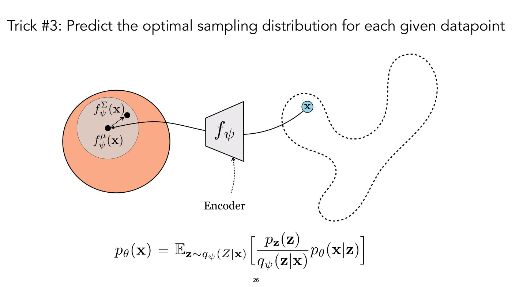

*Slide 26 — One importance sample, first half: encode the data point to a Gaussian over the latents and draw one sample from it. [Deck](https://ocw.mit.edu/courses/6-7960-deep-learning-fall-2024/mit6_7960_f24_lec15.pdf)*

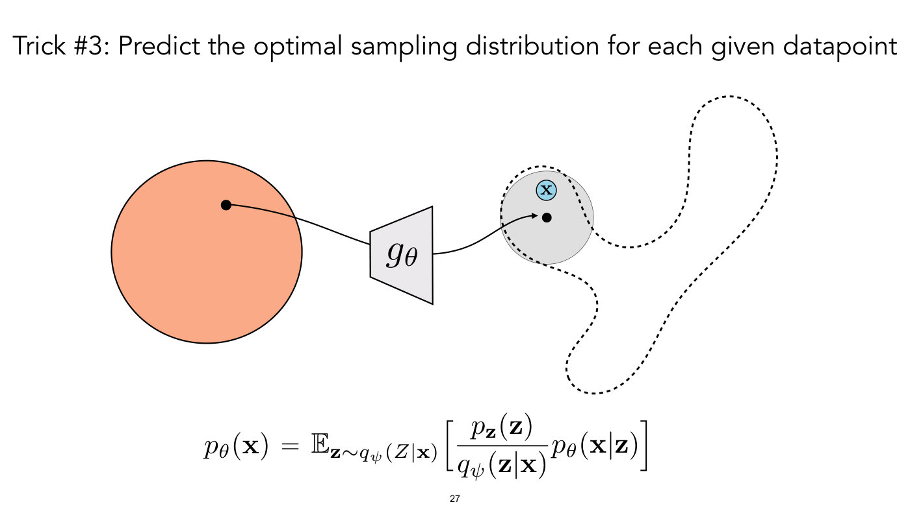

*Slide 27 — One importance sample, second half: decode the sample to a Gaussian in data space and measure how much density it puts on the data point. [Deck](https://ocw.mit.edu/courses/6-7960-deep-learning-fall-2024/mit6_7960_f24_lec15.pdf)*

## It looks like an autoencoder

Slide 28 ("Looks like an autoencoder!") writes the model as one network, for one-dimensional $x$ and $z$. The encoder gives
$\mu_z = f^{\mu}_ {\psi}(x)$ and $\sigma_z^2 = f^{\Sigma}_ {\psi}(x)$; one sample from $q$ is $\mu_z + \epsilon\sigma_z$, "a sample
from a normal distribution centered at mu z with variance sigma z squared. OK, I think I'm getting the squared versus not squared
term correct now"; and the decoder gives $\mu_x = g^{\mu}_ {\theta}(\mu_z + \epsilon\sigma_z)$ and
$\sigma_x^2 = g^{\Sigma}_ {\theta}(\mu_z + \epsilon\sigma_z)$ (≈56:16–57:02). "This looks just like an autoencoder except one
step, which is this noise I added in the latent space" (≈57:49). With one sample, the ELBO's two terms become

$$\log \frac{1}{\sigma_x \sqrt{2\pi}} - \frac{(x - \mu_x)^2}{2\sigma_x^2} - \frac{1}{2}\left(\mu_z^2 + \sigma_z^2 - \log(\sigma_z^2) - 1\right)$$

The slide underlines the first two terms in magenta, captioned "data likelihood under 1 importance sample", marks the squared
difference "reconstruction error", and underlines the last term in teal, captioned "squash encodings toward origin".

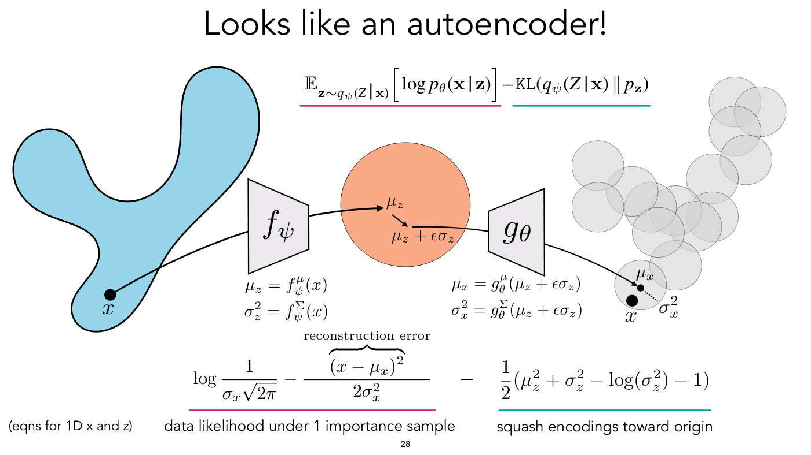

*Slide 28 — Looks like an autoencoder: encode to a mean and variance, add noise, decode; the ELBO becomes a reconstruction error (magenta) plus a KL term that squashes the encodings toward the origin (teal). [Deck](https://ocw.mit.edu/courses/6-7960-deep-learning-fall-2024/mit6_7960_f24_lec15.pdf)*

**The first term is a reconstruction error**, which the slide captions "data likelihood under 1 importance sample": the log of a
Gaussian density "will be just the squared error … So how different is my decoded point from my input observation x?" The other
parts are the Gaussian's normalization (≈57:49–58:35). Fix every component's variance to one — "a perfectly valid modeling
choice" — and those parts become constants, leaving "exactly the autoencoder objective of minimizing the mean squared error
between my reconstructions and my input observation. So VAEs often will also model the variance of this Gaussian, but vanilla
autoencoders … just kind of implicitly set it to be constant" (≈58:35–1:00:08).

**The second term is the KL divergence** between the encoder's Gaussian and the unit-Gaussian prior, which has a closed form; "in
the readings, we posted the original VAE paper, and in the appendix, there's a nice derivation of that form" (≈1:00:08–1:00:55).
With the variance fixed again, all that is left is $\mu_z^2$: "all of this term is saying is squash the means toward the origin"
(≈1:01:43), the slide's caption "squash encodings toward origin". Without it, a two-dimensional autoencoder could take $f$ and $g$
to be the identity, reconstruct perfectly, and learn nothing (≈1:02:29). "In a normal autoencoder, I need to make sure the
dimensionality of the latent space is low so that I'm doing compression … In a variational autoencoder, it helps to have a
low-dimensional latent space, but it's less critical because there's this other term" (≈1:02:29–1:03:14).

**Why does it not collapse to a point?** A student: "That's trivial." And then the reconstruction fails: "if everything goes to
0, then there's ambiguity. So in order to reconstruct the input, I need to preserve information … And that's the fundamental
tension of the variational autoencoder" (≈1:04:00). "It's like I have some Play-Doh, and I'm trying to squish it down, but there's
also this physical force which is preventing it from going to a black hole … Eventually it gets to this unit shape" (≈1:04:00–1:04:46).

## Autoencoder and variational autoencoder

Two slides sum up the difference. An **autoencoder** "encodes and decodes the data" through a "low-dimensional bottleneck", and its
latent shape can be anything, the wiggly blob of slide 7 (slide 29).

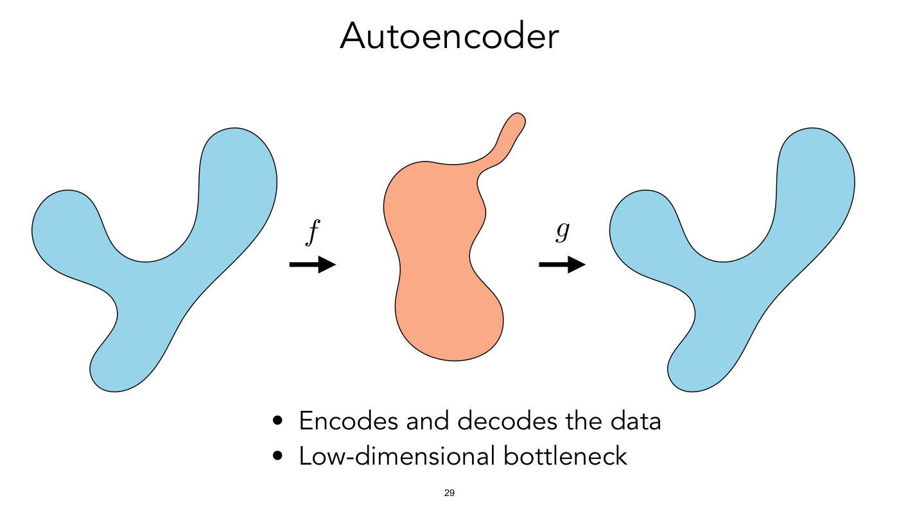

*Slide 29 — An autoencoder: a low-dimensional bottleneck of any shape. [Deck](https://ocw.mit.edu/courses/6-7960-deep-learning-fall-2024/mit6_7960_f24_lec15.pdf)*

A **variational autoencoder** does the same through a "Gaussian bottleneck (can sample; disentangled)", so its latent space is a
circle (slide 30).

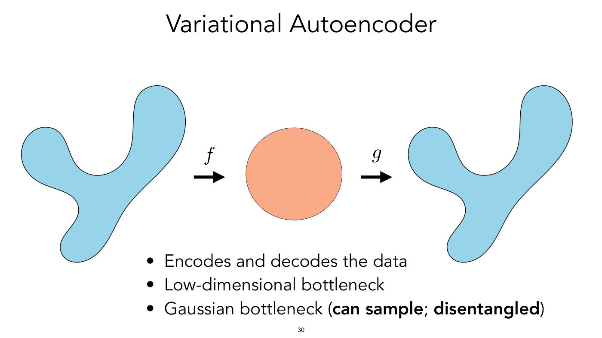

*Slide 30 — A variational autoencoder: the same, with a Gaussian bottleneck that can be sampled. [Deck](https://ocw.mit.edu/courses/6-7960-deep-learning-fall-2024/mit6_7960_f24_lec15.pdf)*

Slides 31 and 32 are frames of the Colab's animation, which the recording plays (≈1:04:46–1:06:18). At initialization "everything
maps to 0", in the encoder and in the decoder. During training the decoder's Gaussians come to cover the data, and the encoder's
Gaussians "pop out and then squish back together", because "I want to spread out these Gaussians so that if I go from x to z and
reconstruct, I'll know where I came from … but I also want to be near the unit sphere". The lecturer compares it to sphere
packing: "If two different data points map to the same point, or overlapping Gaussians, then there's ambiguity … you don't want
them to overlap too much, but you want them to squish down at the same time … And then the solution is that they'll spread out to
evenly tile the unit Gaussian" (≈1:05:31–1:06:18). Plotted as heat maps, the model "really did learn a good density model", and the
density over the latent space "becomes kind of a unit Gaussian in two dimensions" (≈1:06:18). Each slide shows one frame of it: slide 31 the start, every data point encoded to the same Gaussian and every
latent point decoded to the same one; slide 32 the same start for the decoder (left) and the encoder (right), with a heat map
under each, most likely the density in data space and the density over the latent space, though neither the page nor the
recording says which is which.

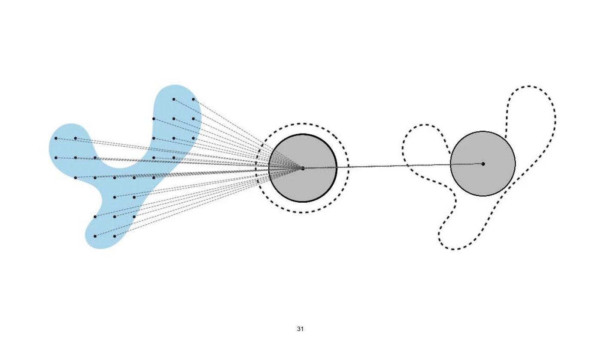

*Slide 31 — The training animation's first frame: at initialization every data point encodes to the same Gaussian, and it decodes to a single component. [Deck](https://ocw.mit.edu/courses/6-7960-deep-learning-fall-2024/mit6_7960_f24_lec15.pdf)*

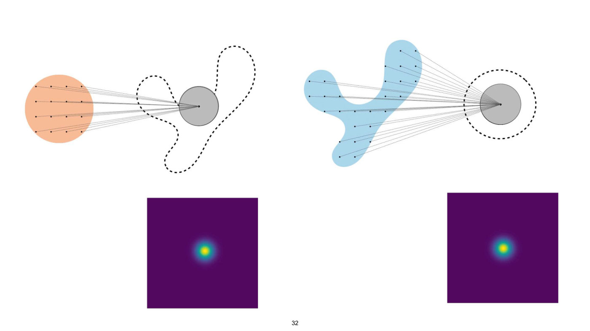

*Slide 32 — The same start for the decoder and the encoder, with heat maps of a density under each. [Deck](https://ocw.mit.edu/courses/6-7960-deep-learning-fall-2024/mit6_7960_f24_lec15.pdf)*

## Three tricks, and the training loop

"VAE — three tricks" (slide 33): approximate an infinite mixture with samples; sample efficiently via importance sampling; predict
the optimal sampling distribution for each data point. "Then jointly optimize the whole thing and it looks like an autoencoder"
(≈1:06:18–1:07:04). Slide 34 gives the steps "you would write in PyTorch": sample one or more $\mathbf{x}$ from the training set,
encode them with a forward pass through $f_{\psi}$, create one or more noisy latent codes for each from the distribution the encoder
parameterizes, decode them through $g_{\theta}$, and compute the losses — the squared error and the KL term — and backpropagate to
update $\theta$ and $\psi$ (≈1:07:04–1:07:50). "Even though I would really want to take a lot of important samples to get a better
estimate, usually people just take one … and that seems to be sufficient" (≈1:07:50).

**How do you backpropagate through sampling?** "That's why that reparameterization trick was important, because the stochastic
element comes in through the side of the graph and you don't actually have to backprop through that sampling procedure … You're
just backpropping through the mean and the variance of a distribution" (≈1:07:50–1:08:36).

**Does the encoder need to predict a variance?** "Oftentimes you can get away with those types of things. Like, you can just take an
autoencoder, add a little noise to the latent space and do nothing else, and it might be fine. Or maybe you add this KL penalty …
penalize the means for being far from the origin, and add a little noise, and it'll give you a VAE and it might be fine. But your
mileage will vary" (≈1:08:36–1:09:21). The simplest version "captures the full idea": "smooth out the latent space and make it dense
by penalizing the encodings from being far from the origin, and smooth it out by adding some noise so that it has finite
information capacity" (≈1:09:21–1:10:08).

### Why squash toward the origin

A student asks whether pushing the latents to zero is good for any reason beyond the mathematics. The lecturer's intuition is
sphere packing again: "I want it to be the case that every single point in z-space, if I sample from that point, it will lead to a
valid image … And if I don't pack things in … then there might be gaps." With unlimited capacity the means could fly apart "to
infinity … it's perfectly information-preserving, it's invertible, well, that wouldn't be good because there'd be all these gaps.
Where if I now take a sample from my z-space, I might end up in a gap … the decoder has never seen that sample and it will not know
what data point to reconstruct" (≈1:10:08–1:11:40). This is the representation-learning answer promised at ≈8:37.

## Disentanglement

The last part asks what kinds of representations generative models learn (≈1:11:40). Slide 35 brings back the river program, and
slide 36 trains a learner on its tiles to get an encoder $f_{\psi}$ and a generator $g_{\theta}$, whose samples look like rivers
(≈1:12:29). "But now let's look at the encoder … Is a VAE a good representation learner?" (≈1:12:29–1:13:15). Moving along one
axis of the learned latent space "ends up causing this kind of smooth variation in the output space where the curvature of the
river changes. If I move along another dimension of latent space, it ends up changing the color of the grass" (slides 37 and 38,
≈1:13:15; slide 38 labels this axis "Background color").

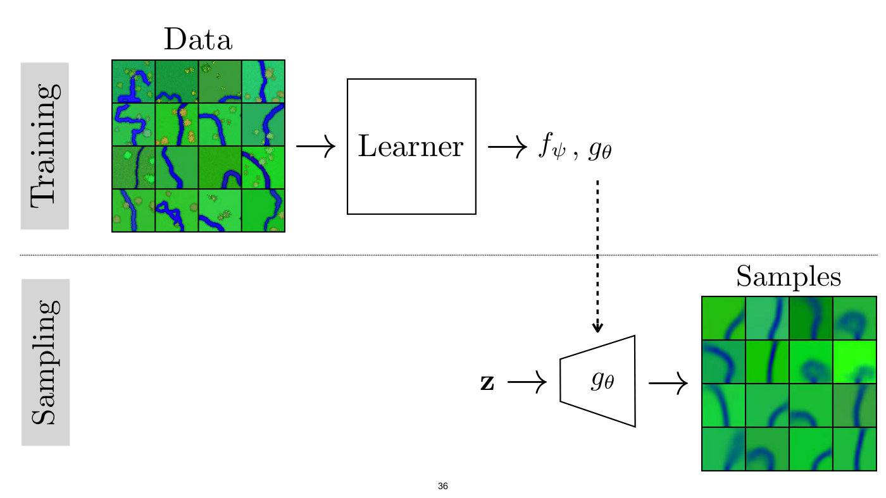

*Slide 36 — A VAE trained on the river tiles of lecture 14's program, and the samples its generator produces. [Deck](https://ocw.mit.edu/courses/6-7960-deep-learning-fall-2024/mit6_7960_f24_lec15.pdf)*

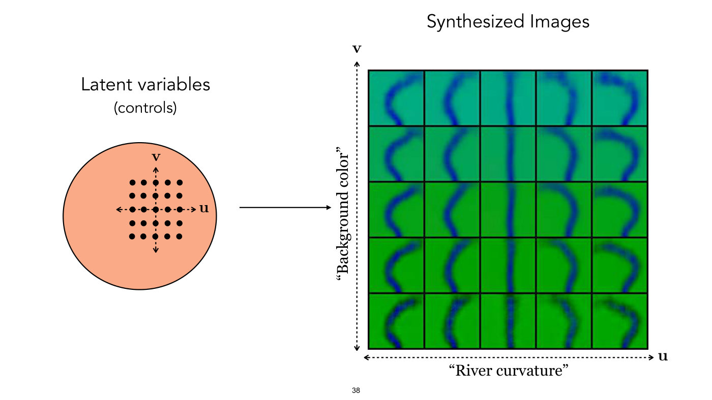

*Slide 38 — Disentanglement: one latent direction bends the river and another changes the background colour, independently of each other. [Deck](https://ocw.mit.edu/courses/6-7960-deep-learning-fall-2024/mit6_7960_f24_lec15.pdf)*

One of these directions matches a real cause: the program draws the grass colour from a normal distribution, "and the VAE actually
recovers that. So it identifies that true … causal factor in the data" (≈1:14:00). The other does not: "the curvature of the river,
actually does not correspond to any of the underlying variables in my Python code", which drew the river from a sequence of
Bernoulli coin flips. "Somehow, the VAE learned this abstracted, intuitive physics of the world … that there should be a factor of
variation in this data that controls the curvature of the river" (≈1:14:47). This is **disentanglement**: "different dimensions of
latent space that control different independent factors of variation … if I vary the river or curvature dimension, it does not
affect the color, and if I vary the color, it does not affect the river curvature … but those two factors don't necessarily map on
to actually the causal mechanisms underlying how this world was defined. They might be more abstracted from it" (≈1:15:34).

Other generative models do it too. Slide 39 shows BigGAN [Brock et al. 2018], a [GAN](generative-adversarial-networks.md), with
"one direction in latent space that controls the orientation of the bird and one direction that controls the background color"
(≈1:16:20–1:17:06); its photographs are excluded from OCW's licence, so the slide has no image here. A GAN has no encoder, "but
nonetheless, the latent variables, if you sample random latent variables or sample along a grid of latent variables … model
structure in a similar way to the VAE" (≈1:16:20). The same holds for a diffusion model's noise and for directions in the
activation space of a layer (≈1:17:06). "It has to learn some kind of factors that can parsimoniously explain the data … So
generative modeling forces you to explain the world. Explaining the world is done well by actually capturing independent components
and things that we have physical names for, like background color, but sometimes things are more abstracted, like low-frequency
curvature of the river" (≈1:17:06–1:17:52).

## Seams and tendrils

The last picture (slide 40) colours each input point of the two-dimensional example by its coordinates and plays the training
(≈1:17:52). The points "get remapped to the sphere, but not like in a disorganized way. It's smooth, it's a smooth map", which is
meant to show how latent dimensions "might map to smooth properties of the input space" (≈1:18:37). But the map does not fill one
gap, "and you'll see this when you're training generative models, that in the latent space, things will be smooth and nice and there
will be a seam because it's like you're mapping this complicated topology onto a sphere, and you're going to have cuts and seams …
If you're navigating through VAE latent space or diffusion model activation space on some layer of the network, you'll come across
these weird jumps where it's smooth moves, nice variation, and then suddenly it switches to a different category" (≈1:18:37–1:19:23).
"Also, these tendrils … You can't really cut, so you get this tendril of probability" (≈1:19:23).

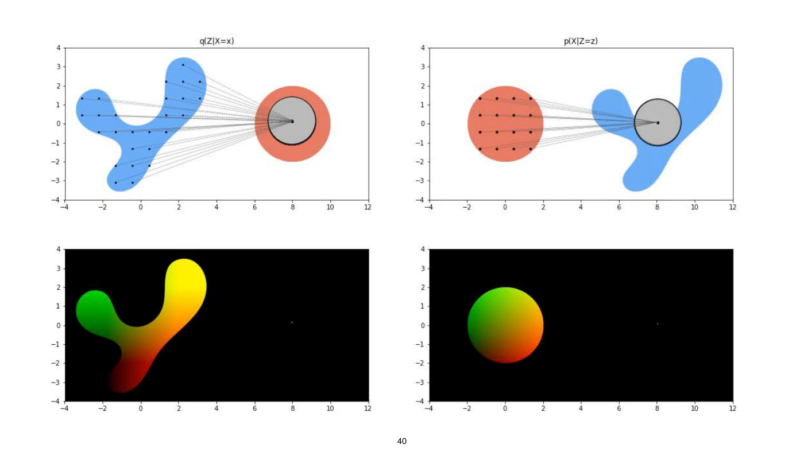

*Slide 40 — The coloured map before training: each point is coloured by its coordinates, so that training shows where each part of the data lands in the latent space, and where a seam opens. [Deck](https://ocw.mit.edu/courses/6-7960-deep-learning-fall-2024/mit6_7960_f24_lec15.pdf)*

## Comparing the families

Slide 41 compares the models of lectures 14 and 15, "a rough categorization of vanilla versions of each model", by whether each has
latent variables, gives a density or energy, and gives a generator:

| Method | Latents? | Density/Energy? | Generator? |
| --- | --- | --- | --- |
| [Energy-based models](energy-based-models.md) | ✗ | ✓ (energy only) | ✗ |
| Gaussian | ✗ | ✓ | ✗ |
| [Autoregressive models](autoregressive-models.md) | ✗ | ✓ | ✓ (slow) |
| [Diffusion models](diffusion-models.md) | ✓ (high-dimensional) | ✗ | ✓ (slow) |
| [GANs](generative-adversarial-networks.md) | ✓ | ✗ | ✓ |
| [VAEs](variational-autoencoders.md) | ✓ | ✗ | ✓ |

The table and slide 11 differ on one cell: slide 11 lists a density $p_{\theta}$ among a VAE's outputs, while the table marks VAEs ✗
for a density. In the lecture's derivation that density is an integral that cannot be computed, and training maximizes a lower bound
on it; the recording does not go through the table cell by cell, and the slide's footnote asterisk has no anchor.

"I think the most popular right now is diffusion models. The most complete, like full picture, that encompasses everything is VAEs.
The most cute and fun is GANs. The ones that are popular in language modeling is autoregressive. And they all have different
trade-offs" (≈1:19:23–1:20:09). See [generative models](generative-models.md).

## The problem set

On OCW, this lecture's material is the first section of **Homework 5**, "Variational Autoencoders" (14 points). It states the ELBO
as two terms, the expected log-likelihood of the data under the encoder's distribution minus the KL divergence from that distribution to a
fixed prior $\mathcal{N}(\mathbf{0}, \mathbf{I})$, citing Kingma and Welling (2019), and names the encoder's parameters $\phi$ where the
lecture writes $\psi$. It asks what each of the two terms does; whether, for a perfectly trained VAE,
decoding only the means of the embeddings recovers the data distribution, and whether those means are themselves Gaussian; whether a
perfect ordinary autoencoder, $g(f(\mathbf{x})) = \mathbf{x}$, makes $g(\mathbf{z})$ follow the data distribution when
$\mathbf{z} \sim \mathcal{N}(\mathbf{0}, \mathbf{I})$; and then to implement a VAE in a Colab, train it on FashionMNIST, and plot a
$10 \times 10$ grid of decoded images over a pair of latent dimensions with the others set to zero. Its second section, on diffusion
models, belongs with [lecture 14](14-generative-models-basics.md#the-problem-set). The handout's header prints "Fall 2025"
([sources](../sources.md)).

## Pointers to other lectures

The deck prints no lecture number but its own, on the title slide. The recording points back to "the noise that we talked about last
class" (lecture 14, ≈2:19), to fitting a Gaussian by maximum likelihood "last Thursday" (lecture 14, ≈10:08), to "the example I gave
last class", the river program (lecture 14, ≈18:01), to GANs, "covered … very briefly last lecture" (lecture 14, ≈1:16:20), to the
representation-learning lectures and their cartoons (lectures 11–13, ≈0:47, ≈3:06), and to "those diagrams I showed before" of data
remapped layer by layer (lecture 11, ≈3:06). It closes on "the models that we've seen in the last two lectures" (lectures 14 and 15,
≈1:19:23). It names no later lecture. See the [course map](course-map.md).

## See also

- [Variational autoencoders](variational-autoencoders.md) — the model on its own page: the infinite mixture, the three tricks, the
  ELBO and its two terms, and disentanglement.
- [Autoencoders](autoencoders.md) — the model a VAE turns out to be, with one change.
- [Generative models](generative-models.md) — the hub page: latent variables, maximum likelihood, and the comparison of families.
- [Representation learning](representation-learning.md) — the direction a VAE's encoder runs, and what a disentangled representation is.
- [Generative adversarial networks](generative-adversarial-networks.md) and [diffusion models](diffusion-models.md) — the other
  families the lecture compares, and how they relate to a VAE.
