# Lecture 18 — Transfer Learning: Models

**Lecturer:** Sara Beery ·
**Video:** [youtube.com/watch?v=tNfuZ9Imt3M](https://www.youtube.com/watch?v=tNfuZ9Imt3M) (86 min) ·
**Slides:** [`mit6_7960_f24_lec18.pdf`](https://ocw.mit.edu/courses/6-7960-deep-learning-fall-2024/mit6_7960_f24_lec18.pdf)
(77 pages; the deck is titled "Lecture 18: Transfer Learning I"; transcribed slide by slide in [`raw/slides/18-transfer-learning-models.md`](../raw/slides/18-transfer-learning-models.md)) ·
**Transcript:** [`raw/transcripts/18-transfer-learning-models.md`](../raw/transcripts/18-transfer-learning-models.md)

## What this lecture establishes

Transfer learning is how a network learns "even if you don't have very much data" (≈0:46): it starts from what another
network already learned, instead of from a blank slate. The lecture opens the course's "little two lecture mini series"
on it (≈0:00) by asking what, exactly, can be transferred, and sorts the answers into three kinds of knowledge: about the
**mapping** from inputs to outputs, about the **outputs**, and about the **inputs**. This lecture covers the first two and
leaves the inputs to the next (≈1:31).

Knowledge about the mapping is transferred by **finetuning**, initializing a new network with the weights of a pretrained
one and training on, plus whatever glue the new inputs and outputs need, and by **domain adaptation**, which also aligns
the representations of a labelled source domain and an unlabelled target domain. Knowledge about the outputs is transferred
by **knowledge distillation**, training a student network to match a teacher's whole distribution of predictions rather than
the one-hot label, which carries information about similarity that the label lacks. The last part is about **foundation
models**, models so broadly useful that many tasks need no training at all, only the right question: "just ask". Prompting
a language model or CLIP, learning a soft prompt or a visual prompt, and plugging foundation models together are all ways of
adapting a fixed model with little or no data. Along the way the lecturer argues that these models are not free, in money,
energy or water (≈1:00:29–1:04:24).

**Notation on this page** follows the slides. An input is $\mathbf{x}$ and a label or vector of class scores is
$\mathbf{y}$; $\hat{\mathbf{y}}$ is a network's prediction. A network is $f$, and in distillation $f^T$ is the teacher,
$f^S$ the student, and $\mathbf{y}^T$, $\mathbf{y}^S$ their outputs. $\mathbf{W}$ and $\mathbf{b}$ are a network's weights
and biases. $\mathcal{X}$ and $\mathcal{Y}$ are the input and output spaces of the pretraining task, $\mathcal{X}'$ and
$\mathcal{Y}'$ those of the new task.

## Where this lecture sits

"We talked about distribution shifts last week" (≈0:00): [lecture 17](17-generalization-out-of-distribution.md) ended
with domain adaptation as one answer to distribution shift and promised it for this lecture. The idea of transfer is older
in the course: [lecture 11](11-representation-learning-reconstruction-based.md) gave it as the main reason to learn
representations, with the same music example and finetuning recipe this lecture opens with, and [lecture
12](12-representation-learning-similarity-based.md) taught the contrastive learning that the pretraining, distillation and
CLIP examples here build on. The next lecture, Transfer Learning: Data, takes up knowledge about the inputs and meta
learning (≈1:31, ≈1:11:28), and "next Thursday" Phillip Isola lectures on scaling laws (≈2:19). See [transfer
learning](transfer-learning.md) for the thread across lectures and the [course map](course-map.md) for the schedule.

## Learning with little data

### Why deep learning

The lecture begins with a chart credited to Andrew Ng (slide 3): performance against amount of data, for "Older learning
algorithms", which flatten, and "Deep learning", which keeps rising. "Many learning algorithms, older learning algorithms,
saturate. With some amount of data, you just don't see performance continuing to improve. But we have really not seen that
type of saturation as we scale the amount of data" (≈2:19). One analysis, the lecturer says, suggests that current models
have "far more capacity than data": even datasets of billions of points, "on the order of scale of the entire internet",
do not reach "the actual computational capacity of these models" (≈2:19–3:08).

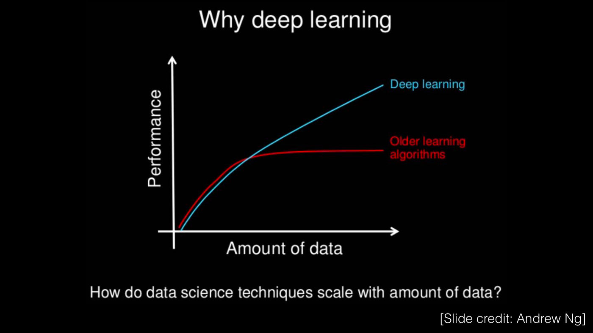
*Slide 3 — Andrew Ng's chart: older learning algorithms plateau as data grows, while deep learning keeps improving.*

### Few-shot learning, and the ambiguity of one example

**Few-shot learning** "is the idea that you can maybe learn even if you have very little data", and "humans are shockingly
good at this" (≈3:08). Slide 4 shows one made-up handwritten symbol: "This is a 'dax'. Which of the below symbols are also
daxes?" Slide 5 does the same with a two-wheeled vehicle in a box and eight pictures of wheeled vehicles below, and the class picks the
one most like it; the lecturer calls both Segways (≈3:54; the slide prints no names). Then she points out the catch: with a
single example, the answer was a guess at "probably most similar because the orientation of the wheels and the structure",
but "maybe the thing I was looking for was … all the things that had two wheels instead of four or one". "With less data, it
can be harder to understand without ambiguity what the boundaries … of the categories of interest are"; three examples, a
Segway, a scooter and a bicycle, would have pinned the concept down (≈4:41–5:28).

### Prior knowledge

Most of the course so far trained from "an empty slate", learning concepts for one task from one dataset. "What humans do
instead … is we really have a lot of prior knowledge coming from our experience in the world": physics and structure from
being embodied, measures of similarity from education and life (slide 6, which sets a blank blackboard, "Deep learning",
against a head full of gears labelled "Representations", "Models" and "Skills"; ≈5:28–6:14). Different people have
different mental models, which matters when data is labelled by people from different cultures, and "there really isn't a
concept of which mental model of the world is correct" (≈6:14–7:01). College, she adds, is largely "learning how to learn"
(≈7:01–7:48).

So: "How can we give deep nets prior knowledge? Just 'pretrain' them on prior tasks! Then transfer knowledge from the
pretrained nets to solve novel tasks" (slide 7). "You can send your neural network to school", training it on a huge amount
of data for categories that may not be the ones you care about but that "you have data for at scale" (≈7:48). Slide 7's last
line is the lecture's thesis: "One view: the **point** of deep learning is to enable problem solving with little data"
(≈8:33).

## What can be transferred

A model "will map some set of inputs to some set of outputs in some very fun, complex, nonlinear way" (≈8:33), and slide 8
draws it as a box with dotted arrows from an "Inputs" face to an "Outputs" face, beside the lecture's plan: "1. Knowledge about
the mapping", "2. Knowledge about the outputs", "3. Knowledge about the inputs". The lecturer lists other things one could
transfer, "knowledge about biases in a model", "about an optimizer", about "potential error modes or ethical risks or societal
implications of models", and some nobody yet knows how to transfer, such as an agent's learned "intrinsic motivation about how
to explore in the world" (≈9:21–10:51). The lecture keeps to "pretty simple mechanisms", "brute force knowledge transfer".

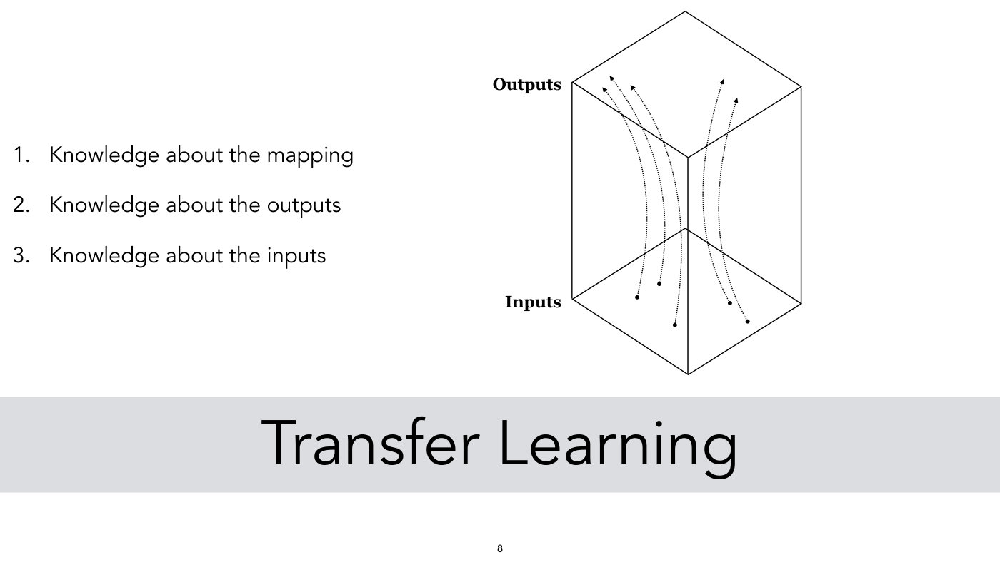
*Slide 8 — a model as a mapping from inputs to outputs, and the three kinds of knowledge the lecture sets out to transfer.*

A student asked whether the bottleneck is the algorithms or computation, recalling that the 2012 breakthrough came largely from
GPUs speeding up training. "I think it's a little bit of everything": GPUs were a huge breakthrough across deep learning, but
"I would not say that we have good algorithms for sampling data efficiently or for learning from that sample data efficiently
… there's a lot of room to improve" (≈10:51–11:37).

## Knowledge about the mapping: finetuning

### Pretrain, adapt, test

Slide 9 bolds the first kind of knowledge, and slide 10 gives the example, in three panels. **Pretraining** on genre
recognition, with "A lot of data", trains a network $f$ whose outputs are genres (classical, hip hop, rock, metal, alternative,
rap). **Adapting** to preference prediction, with "A little data", produces a network $f'$ whose outputs are "Like", "Neural"
and "Dislike" (as printed). **Testing** applies $f'$ to new music (≈12:24–13:57). Recognizing genre teaches "something about the
structure of music, something about what makes different songs similar"; genre recognition can be trained on "the entire cadre
of music on Spotify", while your preferences are known only for the songs you have listened to (≈12:24–13:11). "This is kind of
that broad, simple thing in terms of what we call fine-tuning" (≈13:11).

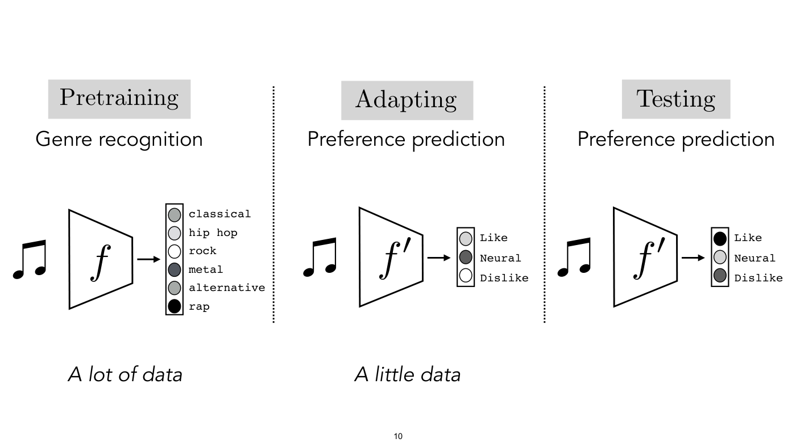
*Slide 10 — pretrain on genre recognition with a lot of data, adapt to preference prediction with a little, then test.*

### The recipe

Slide 11 states it. "Pretrain a network on task A, resulting in parameters **W** and **b**"; "Initialize a second network with
some or all of **W** and **b**"; "Train the second network on task B, resulting in parameters **W'** and **b'**". "How much
knowledge about the mapping you want to transfer" is a choice: the final layer is "pretty specific to the pretraining task", so
it is usually cut off, especially if the output shape differs, and replaced, and sometimes only the early layers are kept
(≈13:57–14:42). "The 'learned representation' is the *encoder* (its weights and biases) so that's what we transfer" (slide 11):
the representation "encoding something useful about your data", which the second network learns to make use of downstream
(≈14:42).

Empirically, as long as the input data are of the same kind, images and images, "a lot of the structure in the models, like
weights and biases, actually stays the same, particularly in those early layers after you've done the fine-tuning", even
without a low learning rate or frozen layers, "which does seem to argue that some of that is just universal in some sense …
for, let's say, images or audio" (≈15:30).

### Self-supervised pretraining

Slides 12 and 13 recall lecture 12's case: pretrain by **self-supervised contrastive learning**, which trains the model "to
learn something about data similarity" rather than any task (two photographs of a tiger pass through copies of one network
and land at the same point), then test or finetune on a new recognition task. Its main benefit is that it needs no labels, so it
can pretrain on "a lot, a lot, a lot of data": "the amount of data that exists without any specific label is much larger than
any … labeled or clean data set" (≈16:19–17:04). Slide 12 tests the pretrained network directly; slide 13 relabels the
second phase "Finetuning", the step that transfers the representation to the new task (≈17:04). See [contrastive
learning](contrastive-learning.md) and [self-supervised learning](self-supervised-learning.md).

### When the inputs or outputs do not match

"What if the input/output dimensions don't match?" (slide 14). A model pretrained on RGB photographs of fields to tell "wheat"
from "corn" is wanted for greyscale images and three classes, "wheat", "corn" and "soybeans": $\mathcal{X}' \neq \mathcal{X}$
and $\mathcal{Y}' \neq \mathcal{Y}$ (slide 15, ≈17:04–18:38). The answer is "a glue into the model" (≈18:38). Slide 16 splits
the network into three blocks, $f_1$ from the input to a representation $\mathcal{Z}_ 1$, $f_2$ from $\mathcal{Z}_ 1$ to
$\mathcal{Z}_ 2$, and $f_3$ from $\mathcal{Z}_ 2$ to the output. When finetuning, new blocks $f_1'$ and $f_3'$ map the new inputs
and outputs to the same intermediate dimensions, while $f_2$, "the vast majority of the structure", is carried over unchanged
(≈18:38–19:23). The glue goes only where it is needed: to add one output class you can learn a reprojection of the old output
layer, or swap the final mapping from the encoder to the classes for a new one (≈19:23). Slide 17 shows the finetuned network
with all three blocks updated, $f_1'$, $f_2'$ and $f_3'$.

The lecturer's examples come from practice. Image models are pretrained on ImageNet "or, these days, LAION", RGB data, but a
roboticist has RGB-D: people "learn some … additional encoding that takes that and maps it into three dimensions" (≈20:11). With
hyperspectral satellite data and too little of it, "sometimes, people will just run something like PCA and take … the three most
informative principal components" over all the bands as a three-channel input, because learning all "380 different input
layers" is expensive and has many parameters (≈20:56). A larger input image can be handled the same way, by a small $f_1$ that
maps it to the size the pretrained model expects (≈21:42). Asked about widening the pretrained blocks themselves, she answers
that the point is to treat them as "modular building blocks": "a really well-trained building block is still useful", but "as
soon as you start actually trying to mess with that building block … it gets more complicated", and adding to it may erode "the
value of the pretraining" (≈22:28–23:13).

New blocks are initialized from scratch, "a lot less parameters" than training end to end, or, with very little data, by copying
weights: for RGB-D, people sometimes "staple on an additional channel" initialized with, for example, the blue channel's
parameters (≈23:59–24:46). "No one really knows. No [one] has a perfect set of heuristics", which is why a benchmark for your own
data, to compare these choices, "starts to become really important" (≈24:46).

### Forgetting

Trained to saturation on a little data, the whole model runs into "that catastrophic forgetting problem again": "the model's
weights get changed too much, and you essentially lose capacity", more with small models than big ones (≈25:31). Slide 18 lists
the balancing acts, between specializing to the new task and keeping the general representation:

- "Freeze most of the network, train only the final layers" (and the new initial blocks);
- "Use a small learning rate", "not letting the model move too much in any direction at any training step";
- "Early stopping", keeping the weights that do best on a validation set, "before it can forget too much";
- "Continue to train on the original data as well", which works "pretty well" but needs care with data balance, and is harder
  when the pretraining used other inputs or another objective, such as contrastive pretraining (≈26:18–27:50).

"All assume that you have a good, representative validation set for your task (not always possible when you may see
distribution shift)" (slide 18). From there the lecturer gets "on a soapbox": machine learning is "obsessed with the idea of
bolded numbers and tables", as if one number captured "every dimension of importance"; people "pick the metric that their model
does best on". "I really love it in a machine learning paper when people are honest about their flaws", with a realistic
limitations section; "you do not want me to be your reviewer number two" (≈27:50–29:24).

## Knowledge about the mapping: domain adaptation

### Aligning a source and a target

**Domain adaptation** has a source domain and a target domain and wants to do well on the target "but … also … make sure that
the representation spaces of the source and target domain are well aligned" (≈29:24–30:10). Slide 19 draws it as two circles of
shapes, a source domain of solid shapes and a target domain of hollow ones, merged by "Domain Adaptation" into one region where
the shapes of each kind sit together. It applies to distribution shift and to some kinds of finetuning; forcing the feature
spaces to align may let the mapping be learned "with much less data". One way is to learn a projection from the target domain
into the source domain, where there was a lot of data, and reuse the source model (≈30:10–30:57).

### Domain adversarial training

"One kind of large set of them takes an adversarial approach" (≈30:57). In **Domain Adversarial Neural Networks**, DANN
(slide 20, from arXiv 1505.07818), a **feature extractor** $G_f(\cdot; \theta_f)$ maps the input $\mathbf{x}$ to features
$\mathbf{f}$, which feed two heads: a **label predictor** $G_y(\cdot; \theta_y)$ with loss $L_y$, and a **domain classifier**
$G_d(\cdot; \theta_d)$ with loss $L_d$, predicting which domain the input came from. Between the features and the domain
classifier sits a **gradient reversal layer**. In the backward pass the label loss sends $\frac{\partial L_y}{\partial \theta_y}$
to its head and $\frac{\partial L_y}{\partial \theta_f}$ to the feature extractor, while the domain loss sends
$\lambda \frac{\partial L_d}{\partial \theta_d}$ to the domain classifier but $-\lambda \frac{\partial L_d}{\partial \theta_f}$,
with its sign reversed, to the feature extractor. "They flip the gradient from the domain predictor. So you're essentially trying
to train the model to be as good as possible at predicting the category, while being as bad as possible at predicting the
domain, which tries to force, essentially, the representations across the two domains to align" (≈31:44). The lecturer's
example is a dataset of computer hardware photographed for Amazon, "very nice and clean", and for eBay, "on their messy desk"
(≈30:57–31:44). The same trick works when the target has domain labels but no category labels, or very few (≈31:44–32:30).

### Unsupervised domain adaptation

In **unsupervised domain adaptation** (slide 21) the target domain has data "but no labels" (≈32:30). The lecturer's example is
from her own research: sonar video of rivers, labelled in some rivers, used to count the fish swimming upstream "so we can make
good sustainable fishing policies"; it has to work on any river, and after the sensor moves (≈33:16). Slide 21 shows labelled
source images and unlabelled target images both feeding one "UDA model".

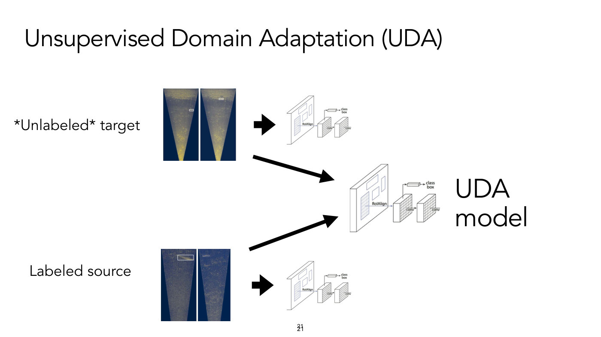

*Slide 21 — Unsupervised Domain Adaptation (UDA). [Deck](https://ocw.mit.edu/courses/6-7960-deep-learning-fall-2024/mit6_7960_f24_lec18.pdf)*

Slides 22 to 26 build the standard recipe one box at a time (≈34:02–36:25):

1. Run the target data through a model trained on the source and keep the predictions above a **threshold** as ground truth
   (slide 22). "It turns out it doesn't usually work very well."
2. Train a new **student** model on those thresholded predictions as weak supervision (slide 23), "a mechanism to do
   distillation". It gives small gains, but "this threshold is really, really finicky and hard to calibrate".
3. Let the model that makes the predictions become a **teacher** updated as an **exponential moving average** (EMA) of the
   student, so that it changes slowly (slide 24).
4. Train the student on the labelled source data as well, supervised by the ground truth (slide 25).
5. Replace the threshold with a softmax and the supervision with a **distillation** loss, matching "the distribution over the
   outputs" rather than the prediction, and add explicit **feature alignment** between source and target (slide 26).

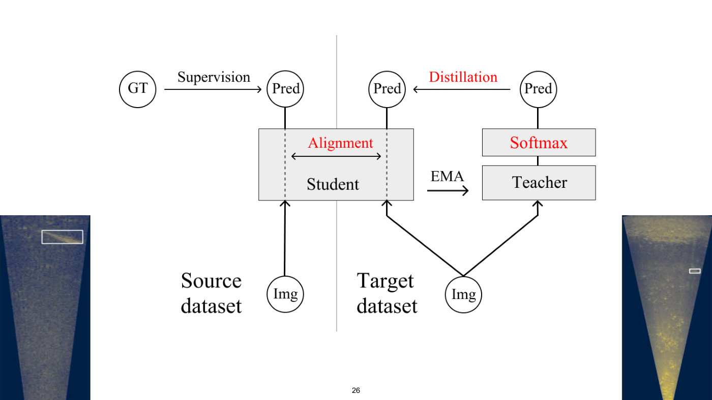
*Slide 26 — the finished recipe: a student trained on labelled source data and on a slowly updated teacher's soft predictions for the target, with its features aligned across domains.*

"Basically every modern domain adaptation architecture is some combination of these components" (≈36:25). **Align and Distill**
(ALDI, slide 27, Kay et al.) draws the whole recipe as one framework: a supervised loss $L_{sup}$ on the source, an alignment loss
$L_{align}$ inside the student, a distillation loss $L_{distill}$ between the student's target predictions and the teacher's
post-processed ones, and an EMA teacher, each with its own augmentations and batch sizes. Slide 28 redraws five earlier methods
(SADA, PT, AT, UMT and MIC) in the same form, each a different choice of those components. "If you can centralize and unify the
ways that people are actually doing these experiments, … you can often be more optimal than any previous approach" (≈36:25).
These methods "are almost never as effective as having labeled data", but built carefully they "start to get pretty close";
the intuition is that the model learns "something about the statistics of the target domain" (≈36:25–37:12).

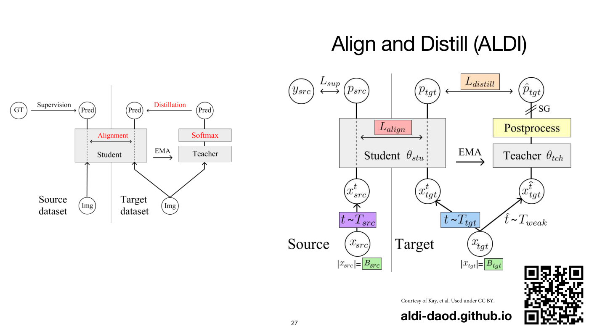

*Slide 27 — Align and Distill (ALDI): the recipe of slides 22 to 26 redrawn as one framework, with its losses, teacher and augmentations. [Deck](https://ocw.mit.edu/courses/6-7960-deep-learning-fall-2024/mit6_7960_f24_lec18.pdf)*

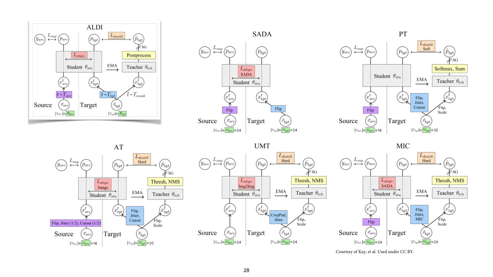
*Slide 28 — ALDI beside five earlier methods (SADA, PT, AT, UMT and MIC), each drawn as a choice of the same components.*

### How do you know it worked?

A student asked how performance is measured when the target has no labels at all. "This is actually the elephant in the room for
most of the domain adaptation literature": papers report their bold number "on labeled validation data for the target domain",
which begs the question, "if you have to label data to do model selection …, why don't you just use that labeled data for
training?" (≈37:12–37:59). Asked whether the point is saving cost, the lecturer gives the better motivation: places where the data
cannot easily reach a human. Her rivers are in the remote Arctic, reached by flying to Anchorage, taking a seaplane and hiking,
with no connectivity to send data to the cloud; navigation on the moon or in the deep sea is similar (≈38:47–39:33). Without
quality control, a model learning from its own unlabelled data can "veer off in some catastrophic way", getting "worse and worse"
(≈39:33). And domain adaptation depends heavily on its starting point, so it complements building the most general representation:
"a mechanism to fine-tune if you have a lot of data that doesn't have labels, instead of maybe a little bit of data that does"
(≈40:20).

## Knowledge about the outputs: distillation

### From cross-entropy to a teacher

Slide 29 bolds the second kind of knowledge, and the next slide recalls how a classifier is trained with cross-entropy: a network $f$
maps $\mathbf{x}$ to a prediction $\hat{\mathbf{y}}$, a vector of scores over classes, and the loss compares it with the one-hot
label $\mathbf{y}$,

$$L(\hat{\mathbf{y}}, \mathbf{y}) = - \sum_i \mathbf{y}_ i \log \hat{\mathbf{y}}_ i$$

where $i$ runs over the classes (slide 30, ≈41:06–41:51). The slide labels $\mathbf{y}$ "Teacher" and $\hat{\mathbf{y}}$
"Student", in quotation marks: "you could argue that this is also kind of a teacher and a student" (≈41:51). See [softmax and
cross-entropy](softmax-and-cross-entropy.md).

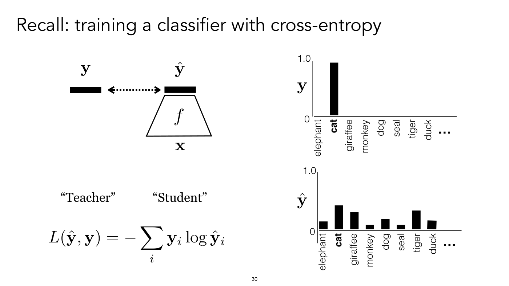
*Slide 30 — cross-entropy as a teacher and a student: the one-hot label against the network's predicted distribution.*

**Knowledge distillation** (Hinton, Vinyals and Dean, 2015) replaces the label with a big pretrained, fixed ("locked")
teacher $f^T$ and trains a student $f^S$ to match the teacher's predictions:

$$L(\mathbf{y}^S, \mathbf{y}^T) = - \sum_i \mathbf{y}^T_ i \log \mathbf{y}^S_ i$$

In slide 31's bars the teacher gives "cat" the most probability and "tiger" nearly as much, and the student is trained toward
that whole distribution (≈42:37–43:26). "It's just between the teacher and the student outputs" instead of the binary category
(≈45:44).

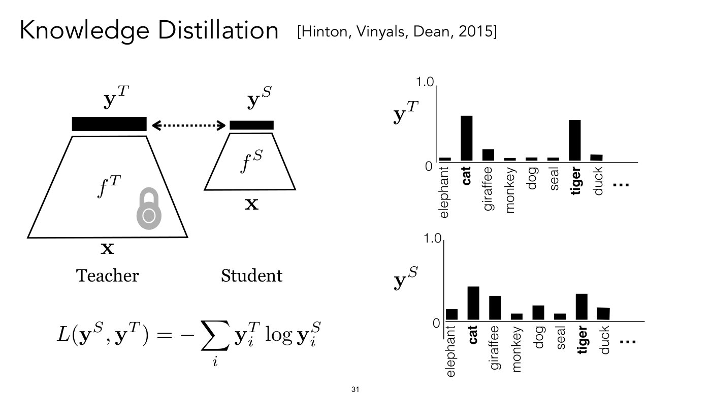
*Slide 31 — distillation: the locked teacher's distribution, high on both cat and tiger, is the student's target.*

### Why soft targets help

Asked why matching a distribution might help, students offered two answers. The student can be "smaller and quicker" (≈43:26);
and the teacher's spread tells the student which classes are similar, the answer the lecturer was after: "It's giving the model
some information about the similarity", and not only of categories but "of what's recognizable in a given input". An orange cat
in tall grass looks like the tigers a model has seen, so "what you're teaching the model is not just, this is a cat, … this is a
cat that looks a little bit like a tiger" (≈43:26–44:57). Slide 32 says it in words: the **soft target** says not just "this is a
dog" but "this is a dog that looks a bit like a cat and very different from a bear" (so maybe it's a small dog).

Slide 32's table, from Hinton's paper on speech recognition, shows the effect on generalization:

| System & training set | Train Frame Accuracy | Test Frame Accuracy |
| --- | --- | --- |
| Baseline (100% of training set) | 63.4% | 58.9% |
| Baseline (3% of training set) | 67.3% | 44.5% |
| Soft Targets (3% of training set) | 65.4% | 57.0% |

Trained on 3% of the data with soft targets, the model nearly matches the full-data baseline on the test set, with lower
training accuracy than the 3% baseline: "Hinton paper shows lower train accuracy but higher test accuracy on speech recognition
with soft targets" (slide 32). The lecturer adds the paper's other points: soft targets with high entropy "are giving a lot more
information per training case than hard targets", with "a lot less variance in the gradient between training cases", so a small
model can be trained on much less data with a much higher learning rate (≈46:29).

Distillation has a second edge "about the modern era of many closed source models": with access to a model's predictive scores
but not the model, "you could arguably learn a model that can match the predictive scores", "maybe one of the reasons that a lot
of those closed source models don't actually give you output predictions over the whole category set" (≈44:57–45:44).

### Across modalities, and from an ensemble

**Cross-modal distillation** (slide 33, Gupta, Hoffman and Malik, 2015) distills a teacher trained on one modality into a student
that sees another, for example from RGB images to depth: "Useful if you have labeled data for one domain but not the other"
(≈47:17). **SoundNet** (slide 34, Aytar, Vondrick and Torralba, 2016) distills from unlabelled video: image networks for objects
("ImageNet CNN") and scenes ("Places CNN") see the frames, and a deep 1D convolutional network on the raw sound waveform learns
to match their object and scene distributions, through KL losses (≈47:17–48:02).

**Distilling an ensemble** (slide 35): "Ensembling model outputs creates more accurate estimates. Why? Each model is imperfect in
different random ways. Errors cancel out, truth is shared." Ensembles are expensive to run, so one distills them into a single
model "for fast inference" (≈48:02–48:50). The limit: models share biases learned from the same data, so the student will not
get right "the types of corner cases that every single model in your ensemble gets incorrect" (≈48:50).

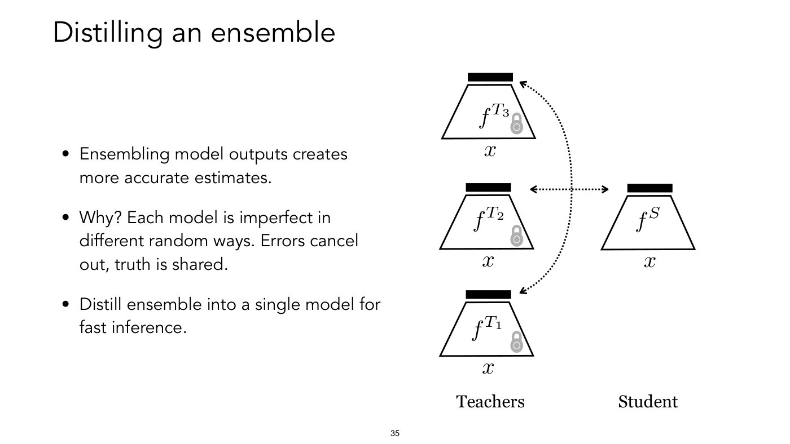

*Slide 35 — Distilling an ensemble. [Deck](https://ocw.mit.edu/courses/6-7960-deep-learning-fall-2024/mit6_7960_f24_lec18.pdf)*

### Contrastive representation distillation

To distill the representation rather than the outputs, **contrastive representation distillation** (slides 36 and 37, Tian,
Krishnan and Isola, 2020) matches embeddings inside the networks by contrastive learning. "Contrastive learning supervises
embeddings to be invariant to some viewing transformation"; here the "viewing transformation" is the teacher's view (a big net)
against the student's (a small net), so "the student will output embeddings that are the same as the teacher's" (slide 36,
≈49:35–50:21). Slide 37 shows the effect on CIFAR100: maps of the correlations between class output logits, student's minus
teacher's, over 100 by 100 classes, show "much, much cleaner behavior" under CRD than under standard knowledge distillation
(≈52:42–53:29). The lecturer said "CIFAR10" there; the slide prints CIFAR100, and its maps have 100 classes.

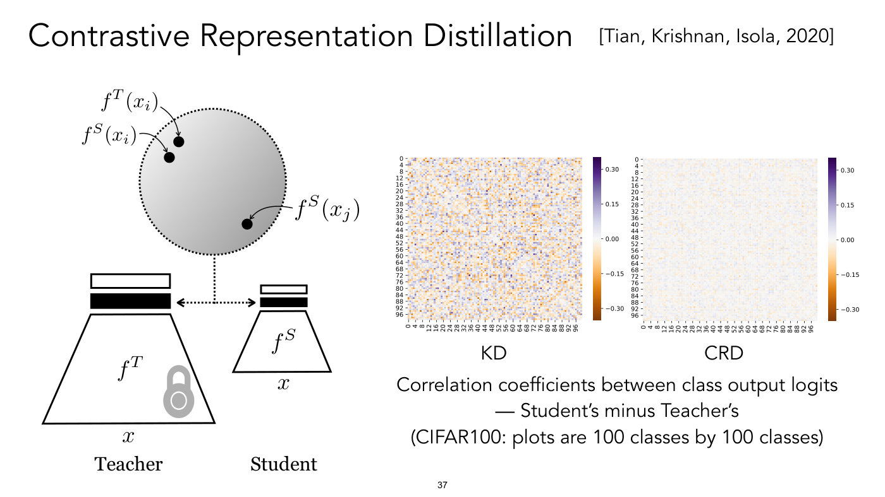
*Slide 37 — student's minus teacher's correlations between class logits on CIFAR100: a dense speckle under knowledge distillation (KD), nearly blank under contrastive representation distillation (CRD).*

Asked how much smaller the student is, she said it depends on the data and the task: "how small you can get a model to be and
still be useful often is really directly related to the complexity of the information you're trying to model". Phones need small
models, made by distillation and also by compression, quantization and pruning, often "some combination of all of the above"
(≈50:21–51:06). Asked whether the different sizes of commercial models come from such techniques, she did not know ("They don't
tell me their trade secrets"); they ship different sizes because users have different resources, and "you use the biggest model
you can afford" (≈51:53).

### Compression against distillation

"Both give us smaller models with similar accuracy to large ones". Distillation "uses SGD to train a smaller model to match
characteristics of a larger one", which can be computationally expensive; compression "uses *pruning* or *quantization* to
reduce the computational cost of a large model", which can be much cheaper (slide 38, ≈53:29–54:16). Slide 38's example is
Optimal Brain Compression (Frantar et al., 2023), which does both; pruning is "super computationally efficient because you're
just deleting stuff", while quantization can resemble distillation in asking intermediate representations to stay similar
(≈54:16–55:02). Cheap compression matters "if you can actually directly compress a model on something like a device", at the
edge rather than in the cloud (≈55:02).

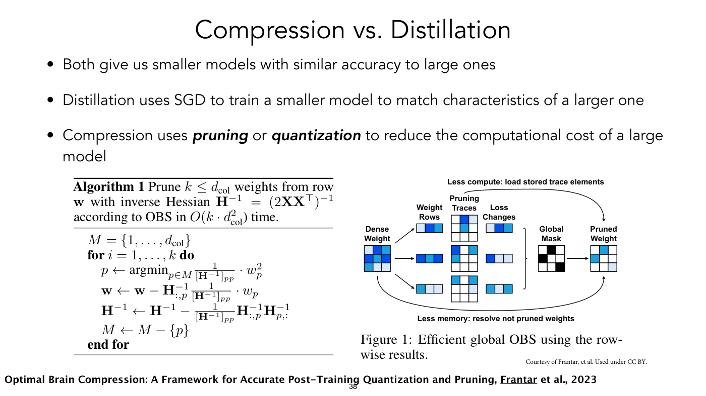

*Slide 38 — Compression vs. Distillation. [Deck](https://ocw.mit.edu/courses/6-7960-deep-learning-fall-2024/mit6_7960_f24_lec18.pdf)*

"We almost never need a truly generalist model in practice. Specialization can enable much higher rates of compression with the
same accuracy" (slide 39, Kuznedelev et al., 2023). A large ImageNet model and a small calibration set of shark images give a
sparse specialist: "if you don't need to keep as much of the original information, you can make the model much smaller"
(≈55:48).

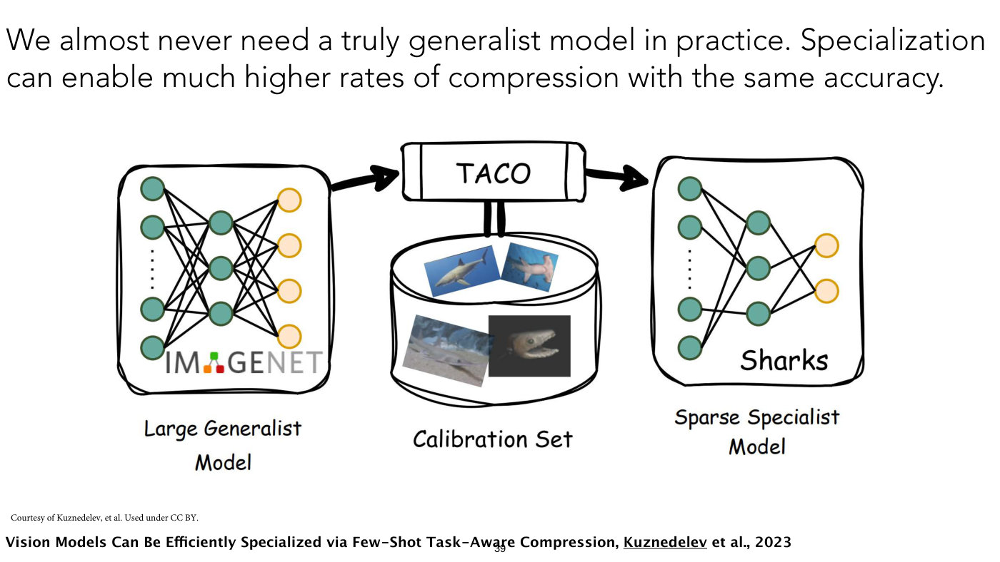

*Slide 39 — specialization: a large ImageNet model and a small calibration set of shark images become a sparse specialist model. [Deck](https://ocw.mit.edu/courses/6-7960-deep-learning-fall-2024/mit6_7960_f24_lec18.pdf)*

## Foundation models

### Standing on the shoulders of giants

**Foundation models**, a term "coined by the computer science department of Stanford" (slide 40 cites Bommasani et al. 2021),
name "the idea that you have some models that are so generally useful that they end up being really effective for a bunch of
different downstream tasks" (≈55:48–56:35). Some are representation learners, where the question is whether they need finetuning
at all; "as foundation models become more and more general, you need to fine-tune them less and less", and a model that needs
no finetuning "becomes more accessible". ChatGPT, CLIP and image generators are useful to most people "off the shelf", and "their
use is directly related to what percent of the things people want to do, this model can do off the shelf" (≈56:35–58:08). Slide
40 sets Newton's "If I have seen further it is by standing on the shoulders of Giants" beside Poussin's *Blind Orion Searching for
the Rising Sun*: "the bigger the foundation, maybe the further up we get as a starting point" (≈58:08).

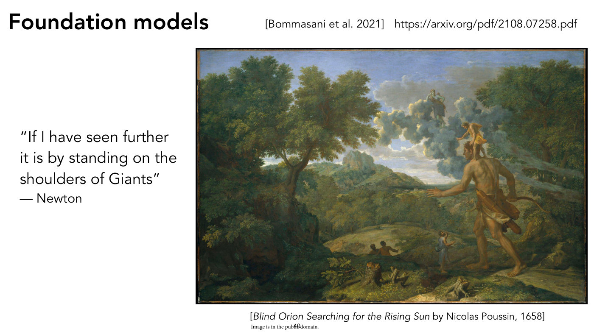

*Slide 40 — Foundation models. [Deck](https://ocw.mit.edu/courses/6-7960-deep-learning-fall-2024/mit6_7960_f24_lec18.pdf)*

### Bigger and bigger

Slide 41 is OpenAI's chart "AlexNet to AlphaGo Zero: A 300,000x Increase in Compute", the compute used to train notable models
from 2012 to 2018 on a log scale, with a trend line labelled "3.4-month doubling": "we're really seeing exponential growth"
(≈58:54). Slide 42 (Ahmed and Thompson, 2022) plots the number of parameters of models over time by academia, academia–industry
collaborations and industry: the first two stay "about the same", while industry's "is starting to scale pretty significantly",
because "they're often the only people who can afford it" (≈59:40–1:00:29).

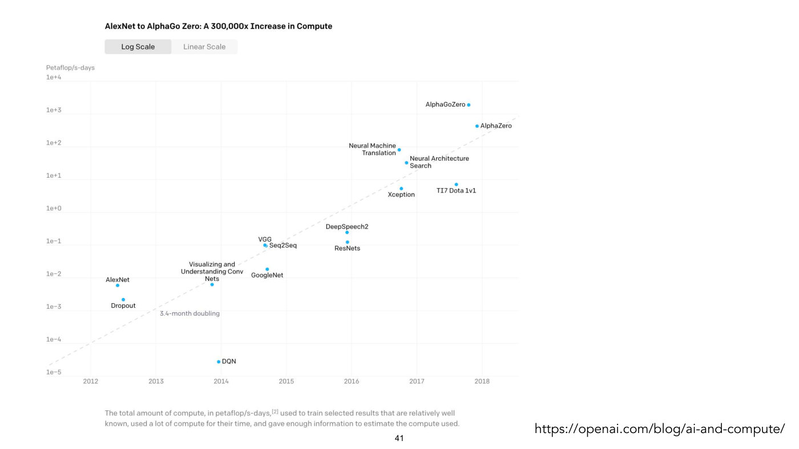
*Slide 41 — OpenAI's chart of the compute used to train notable models, 2012–2018, on a log scale, with a 3.4-month doubling.*

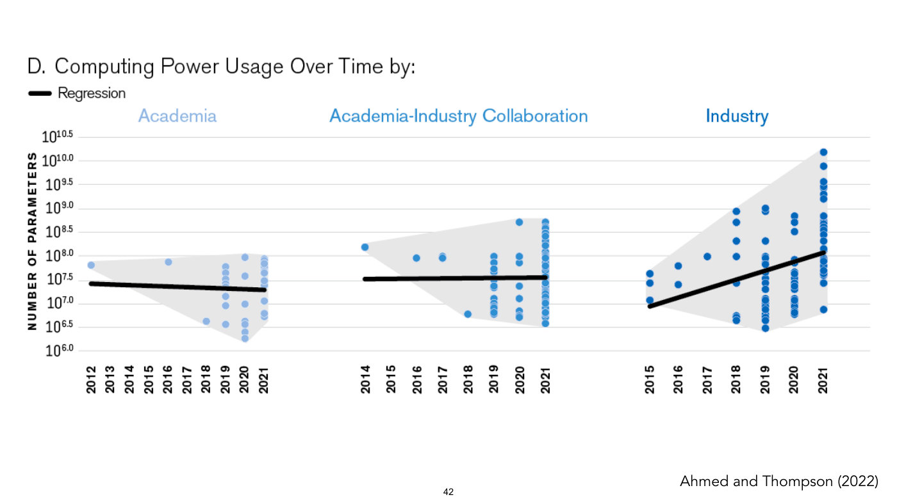
*Slide 42 — number of parameters of models over time by academia, academia–industry collaborations and industry: only industry's trend rises.*

### They are not free

"These foundation models aren't free" (≈1:00:29). Slide 43 shows a life-cycle analysis from a paper estimating the carbon
footprint of BLOOM, a 176-billion-parameter language model (Luccioni et al., 2023), which studied equipment manufacturing, model
training and model deployment, and a table comparing four models:

| Model name | Number of parameters | Datacenter PUE | Carbon intensity of grid used | Power consumption | CO2eq emissions | CO2eq emissions × PUE |
| --- | --- | --- | --- | --- | --- | --- |
| GPT-3 | 175B | 1.1 | 429 gCO2eq/kWh | 1,287 MWh | 502 tonnes | 552 tonnes |
| Gopher | 280B | 1.08 | 330 gCO2eq/kWh | 1,066 MWh | 352 tonnes | 380 tonnes |
| OPT | 175B | 1.09 | 231gCO2eq/kWh | 324 MWh | 70 tonnes | 76.3 tonnes |
| BLOOM | 176B | 1.2 | 57 gCO2eq/kWh | 433 MWh | 25 tonnes | 30 tonnes |

(Some of these numbers are printed in italics, which the paper's caption explains as "inferred based on data provided in the
papers describing the models"; the [slide file](../raw/slides/18-transfer-learning-models.md) marks which.) The lecturer's point
is the third column from the right: "even much smaller models can have a much, much higher carbon emission if they're being
trained on data centers that are not renewable power" (≈1:01:16–1:02:02). In the recording she attributes the 176-billion-parameter
model to Microsoft; the slide names it BLOOM and does not say who built it, and outside the course material BLOOM was trained by
the BigScience collaboration, not Microsoft.

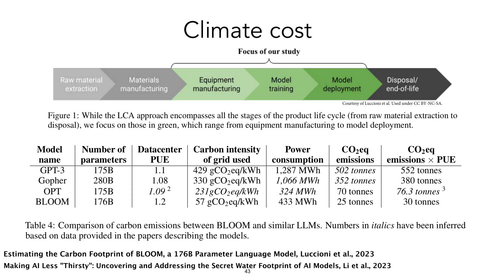
*Slide 43 — the life-cycle stages the BLOOM study covered, and the carbon emissions of four large language models.*

Water is "another really important dimension": she recalls that GPT-3 was trained mostly at data centers in Iowa, whose water use
"went up by 700%", and an estimate that "about 50 queries to ChatGPT is a bottle of water" (≈1:02:48); slide 43's second citation is
Li et al., 2023, on "the secret water footprint of AI models". The water is for cooling (≈1:03:35). Power demand is outstripping
capacity, to the point of reviving nuclear power (≈1:04:24; she names Google and Three Mile Island, a deal reported, outside the
course material, as Microsoft's). Her own position: "a lot of companies would have you believe that these foundation models are
so beneficial to society that it's necessary. But I am less clear on that", and she would like an opt-out from AI in search, "a
climate friendly search" (≈1:05:11). Asked whether one ChatGPT query costs less than ten searches, she did not know, and wished
for "more transparency about all of this from the side of companies" (≈1:05:57–1:06:45).

### What it takes

Slide 44: "Dalle-2: **650m training examples** (semi-curated image-text pairs)"; "GPT-3: ~**$4.6m to train *once***"; "PaLM:
**67 authors**". "And these numbers are increasing. But these numbers are small if we think of the result as foundational
infrastructure; compare to the cost of building the interstate highway system, or the cost of developing the Mac OS X operating
system" (≈1:07:31–1:08:17). The argument for scale is slide 45, performance on 58 tasks against the number of model parameters
for Gopher, Chinchilla, GPT-3 and PaLM, with lines for the average and the best human: red boxes on the slide mark the small
models as "Not working at all" and only the largest PaLM models as "Working as well as an average human" (≈1:08:17). "My
argument would be, OK. Now, let's do research into efficiency to get these back down" (≈1:09:04).

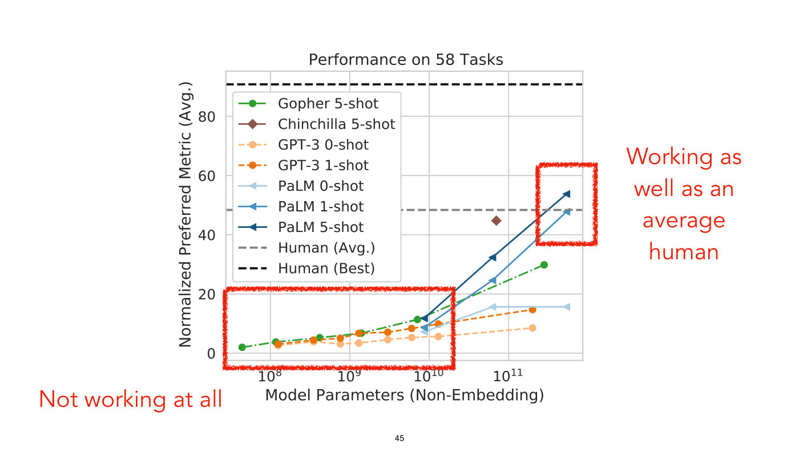
*Slide 45 — performance on 58 tasks against model size: small models "Not working at all", the largest PaLM models near the average human.*

### Learner and adaptor

Slide 46 is the lecture's picture of the new paradigm. On the left, "Learn foundation models": "Tons of data" feeds a "Learner"
that produces BERT, SimCLR, CLIP, GPT, AlexNet, DALL-E, WaveNet, BigGAN, StyleGAN and VQGAN. On the right, "Use/adapt foundations to
solve new problems": "Little or no data" feeds an "Adaptor" that produces an "App" (≈1:09:04). The adaptor might be an AI agent or
something as simple as pulling in CLIP; "a lot of the most recent set of startups in Silicon Valley have been some version of
this" (≈1:09:04). Slide 47 names it: "New paradigm: 'Deep Learning' with *No* Data. 'Just ask' (of course, this isn't really machine
*learning* anymore)". "It then turns into this kind of new paradigm of research that people call prompt engineering" (≈1:09:52).

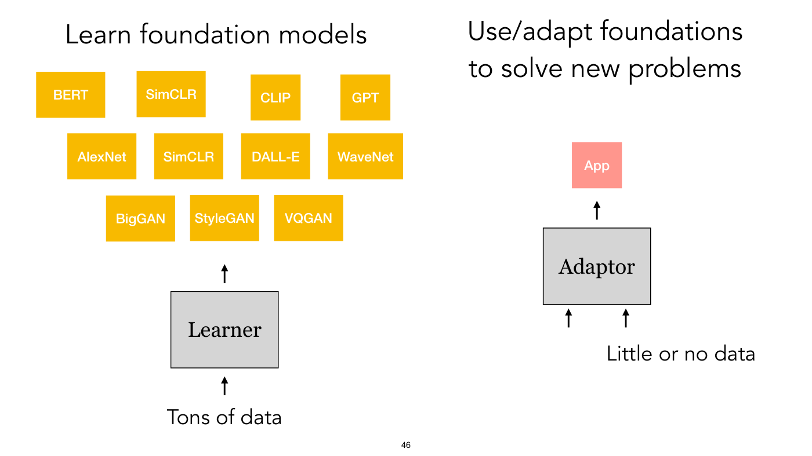
*Slide 46 — the new paradigm: a learner turns tons of data into foundation models; an adaptor turns them, with little or no data, into an app.*

## Prompting

### GPT-3: learner and adaptor

For GPT-3 (Brown et al., 2020), the learner is generative pretraining: a language model "trained autoregressively to predict the
next character", completing "Colorless green ideas sleep ____" with "furiously" (slide 48). The adaptor is prompt engineering:
give it "[Review] + 'The sentiment in this review is ____'" and it fills in "positive" (slide 49, ≈1:09:52). See [autoregressive
models](autoregressive-models.md).

"New capabilities by just asking": a prompt for the top ten dishes at a Cambridge restaurant gets a ranked list (slide 50), and a
started list of prime numbers is continued (slide 51; the recording says "primary numbers"). Whether that is "learning complex
patterns and learning to mathematically reproduce them, or … pattern matching", "essentially just a kernel machine" over its
training data, "depending on who you talk to" (≈1:10:41).

### In-context learning

Slide 52 (from the GPT-3 paper) draws **in-context learning** as two loops: an outer loop, "Learning via SGD during unsupervised
pre-training", and an inner loop in which each sequence, of sums, unscrambled words or English–French pairs, teaches its own
pattern from examples in the context. "Here's some examples of what I'd like you to do, and then ask it to continue to do them."
It "starts to feel flavored, like meta-learning", for the next lecture (≈1:11:28). The model can extrapolate, continuing a count
of elephant icons (slide 53), and translate from a few English–Spanish examples (slide 54, ≈1:11:28–1:12:14). "But again, what is
the model actually doing under the hood? Is it learning something, or is it finding the right kind of pattern to match within its
training data?" (≈1:12:14).

### Prompts are brittle

"Hand-crafting good prompts is tricky…" (slide 56). For sentiment on SST-2, the template "It was [MASK]." with the label words
"great/terrible" scores 92.7, with "cat/dog" 91.5, with "dog/cat" 86.2 and with the reversed "terrible/great" 83.2; on SNLI,
changing the template's punctuation or the order of its two sentences moves accuracy from 77.2 down to 62.9, and permuting
the label words to 60.6 (the full table is in the [slide file](../raw/slides/18-transfer-learning-models.md)). "The behavior of the system will be really sensitive to how the question is
asked", "a little bit like working with a genie in a lamp. You're like, if you asked the genie for no pain on Earth, it might kill
everybody" (≈1:12:14–1:13:02). Ensembling many prompts helps but is computationally expensive (≈1:13:02).

**Soft prompts**, or prompt tuning (slide 57), optimize "a small continuous task-specific vector while having language model
parameters frozen": "back to the normal learning framework", but optimizing the input instead of the model. Prefix-tuning learns
"little specializer tokens" prepended to the input; "the tokens might be somewhat gibberish, but they're really good at finding
the place in the distribution" (≈1:13:02–1:13:50).

**Chain-of-thought prompting** (slide 58, Wei, Wang, Schuurmans et al. 2022) demonstrates an answer that shows its reasoning. With
a standard prompt the model answers the cafeteria question (23 apples, 20 used, 6 bought) "The answer is 27", wrongly; shown a
worked answer first, it reasons "23 - 20 = 3 … 3 + 6 = 9. The answer is 9." On math word problems (GSM8K), PaLM 540B solves 18%
with standard prompting and 57% with chain-of-thought, against 33% for finetuned GPT-3 175B and 55% for the prior best (slide 59,
≈1:14:35–1:15:20). The same goes for "really dumb stuff" like telling the model "you're a scientist", which she reads not as
flattery working but as "finding the right part of the distribution", text "maybe from scientists, and maybe more likely to be
correct" (≈1:14:35–1:15:20).

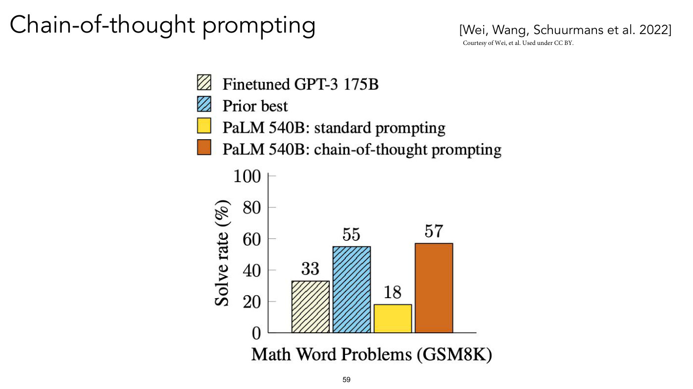

*Slide 59 — Chain-of-thought prompting. [Deck](https://ocw.mit.edu/courses/6-7960-deep-learning-fall-2024/mit6_7960_f24_lec18.pdf)*

### CLIP

"CLIP is also a foundation model" (≈1:15:20), learned by contrastive pretraining of an image encoder and a text encoder, so that
each image's embedding is most similar to its own caption's among all captions in a batch (slide 60, Radford et al., 2021). One
adaptor treats it as a representation learner: a "Linear classifer on top of image encodings" (slide 61, "classifer" as printed).
Slide 61's chart of average score against the number of labelled examples per class shows the linear probe on CLIP above
BiT-M, SimCLRv2 and ResNet50 at every number of examples, and zero-shot CLIP level with the CLIP probe trained on four examples
per class (≈1:15:20–1:16:08). The other adaptor is "Just ask" (slide 62): encode "A photo of a {object}." for every class name and
predict the class whose text embedding is most similar to the image's.

That is brittle too: the text embeddings of "a photo of a dog" and "photo of dog" differ enough to "massively change the
performance" of zero-shot classification (≈1:16:08–1:16:54). But asking can do new things: encode "A sketch of a banana" and "A
photo of a banana", and a drawing of bananas is closer, in cosine similarity, to the sketch (slide 63, ≈1:16:54). In the
lecturer's work on text queries over iNaturalist's images, CLIP models "are very good at simple concepts, but they're really bad at
composition … they're good at ors, and they're bad at ands", like a bag of words: "a juvenile bald eagle" finds juvenile things
and bald eagles. They are also bad at negation: "not a photo of a bald eagle" finds bald eagles (≈1:17:40–1:18:27).

## Prompting in other modalities

### Visual prompts

Prompts can be images too (slide 64). **Visual prompting** (Bahng, Jahanian, Sankaranarayanan and Isola, 2022) leaves CLIP's
encoders and text prompt fixed and learns a border of noise-like pixels added to every image, "the thing that you can add to your
image that will maximize the likelihood that this CLIP model will properly map the correct category" (slide 65, ≈1:18:27–1:19:13).
"It's kind of similar to adversarial noise", but "learning beneficial noise", and it helps whatever the input image, for a fixed
dataset or domain. "Kind of trippy, right?", and what it really says is "something weird about the underlying statistics of the
model itself" (≈1:19:13–1:19:59). The same idea with a vision model and a hard-coded mapping from its ImageNet classes to new ones
is **adversarial reprogramming** (slide 66). See [adversarial examples](adversarial-examples.md).

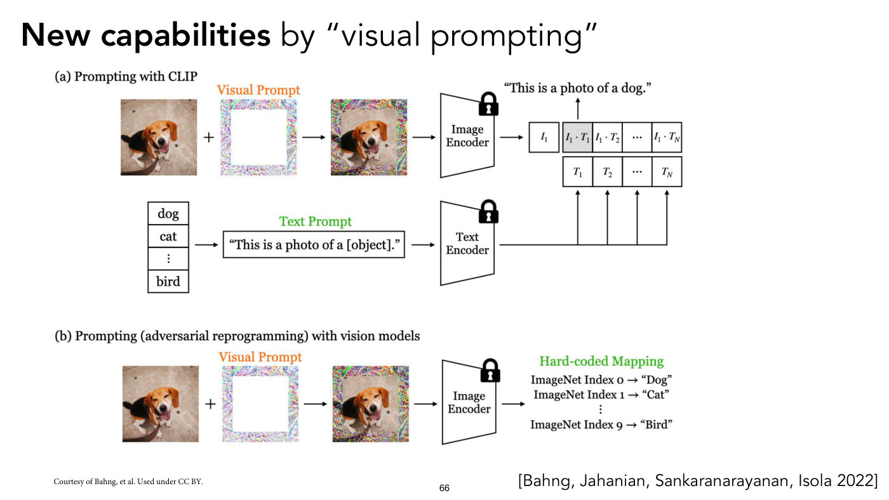
*Slide 66 — visual prompting: a learned border added to every image steers a frozen CLIP (a), or a frozen vision model through a hard-coded label mapping (b).*

The strangest result: "Adding a single pink pixel gives +3% acc boost" (slide 67), one pixel at the same place in every
satellite image, "for every class" (≈1:19:59–1:20:44). Slide 67's chart gives a change in score, "Δ Score (%)", per dataset, from +83.2 points on SVHN and +61.3 on CLEVR down to +0.6 on SUN397, and −0.9 on Food101 and OxfordPets. The lecturer's
reading: "this is not saying the best thing to do … is do one of these weird tricks like this. I think it's more enlightening about
what the heck these models are learning, how fragile and complex the statistical representations are" (≈1:21:30).

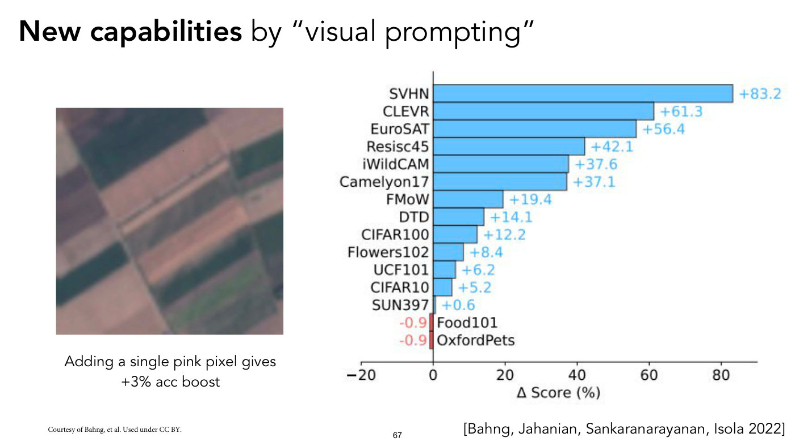
*Slide 67 — one pink pixel added at the same place in every image gives +3% (left); the same paper's score changes per dataset (right).*

### Inputs, mapping or outputs

"Adaptation can occur on inputs, mapping, or outputs" (slide 68): given a model pretrained on cats and dogs, a flower classifier
can be had by **fine-tuning** the model, by training a **linear probe** on the frozen model, or by **prompting**, adding a learned
visual prompt to the frozen model's input (≈1:21:30–1:22:15). Prompting needs no access to the weights or logits: "if you just add
things to the input, see what the output is, you don't need access to the underlying model" (≈1:22:15). **Visual prompt tuning**
learns prompt tokens fed into a frozen transformer, at every layer ("Deep") or at the input only ("Shallow"), with a tuned head
(slide 69). **Visual prompting via image inpainting** asks an inpainting model to fill the fourth cell of a two-by-two grid made of
an example input, its output and a query, which gets segmentation, edge detection, colorization, inpainting and style transfer
from a model never trained for them (slide 70, ≈1:22:15–1:23:48). Slide 71 lists further reading.

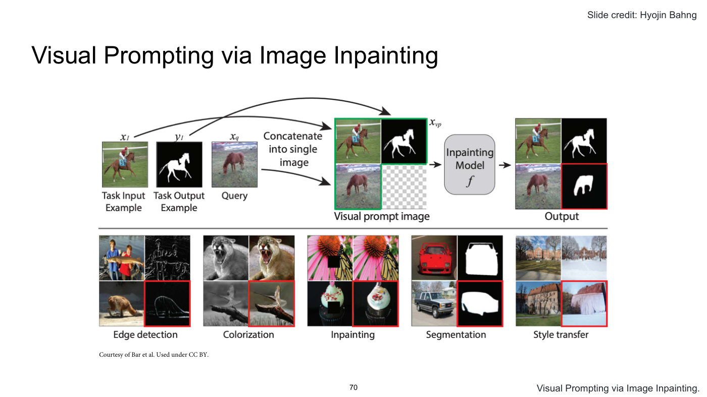

*Slide 70 — Visual Prompting via Image Inpainting. [Deck](https://ocw.mit.edu/courses/6-7960-deep-learning-fall-2024/mit6_7960_f24_lec18.pdf)*

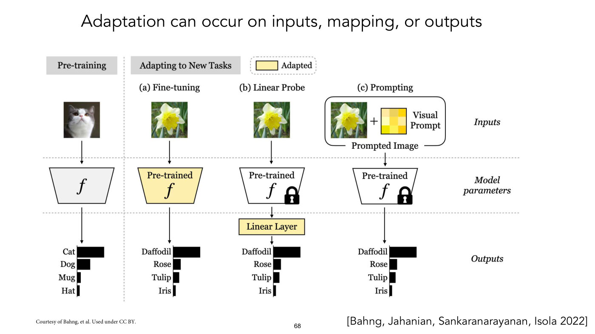
*Slide 68 — adapting a pretrained model by fine-tuning it, by a linear probe on the frozen model, or by prompting its input; yellow marks what is adapted.*

## Combining foundation models

Foundation models can also be plugged together (slide 72). Slide 73 repeats slide 46 with the app replaced by "Text-to-image":
VQGAN and CLIP linked (≈1:23:48). Slide 74, "New capabilities by plugging pretrained models together: CLIP+GAN", optimizes the
latent vector $z$ of an image generator so that CLIP's embedding of the generated image, $e_2$, has the largest dot product
$e_1 \cdot e_2$ with the embedding $e_1$ of a text prompt ("What is the answer to the ultimate question of life, the universe, and
everything?"): "optimize this little embedding vector, this latent space vector, to get an image that maximally matches that text
prompt" (≈1:23:48–1:24:36). DALL-E 2 (slide 75, Ramesh et al. 2022) builds on the same parts, a CLIP objective between text and
image embeddings and "this prior that helps them do decoding slightly more efficiently" (≈1:24:36).

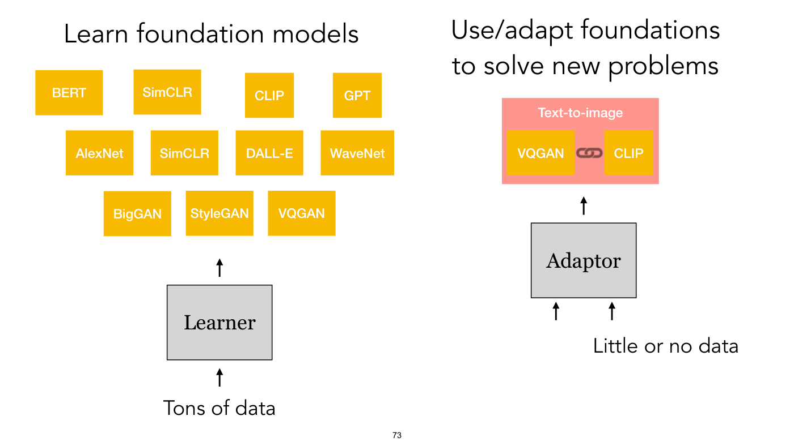

*Slide 73 — slide 46's picture with the app replaced by text-to-image: VQGAN and CLIP linked. [Deck](https://ocw.mit.edu/courses/6-7960-deep-learning-fall-2024/mit6_7960_f24_lec18.pdf)*

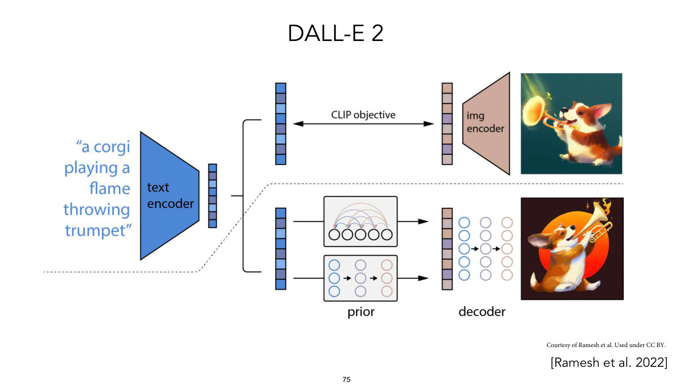
*Slide 75 — DALL-E 2: a CLIP objective links text and image embeddings, and a prior and a decoder generate the image.*

## Summary

"Today, we talked about learning with little data, transferring knowledge, about the mapping, the outputs, and a bit about
foundation models" (slide 76, ≈1:24:36). The lecture ends: "And don't be too sad, but think twice about ChatGPT."

## Pointers to other lectures

The deck prints no lecture number but its own, on the title slide ("Lecture 18: Transfer Learning I"), matching the "Lecture 18:
Models" in lecture 1's banner. The recording points back to distribution shifts "last week" (lecture 17, ≈0:00), to
similarity-based representation learning and rotation invariance (lecture 12, ≈16:19, ≈49:35), to catastrophic forgetting "when
we were talking about sequences" (probably lecture 10, which discusses forgetting in RNNs, ≈25:31) and to adversarial noise
(lecture 17, ≈1:18:27); and ahead to knowledge about the inputs and meta-learning "next Tuesday" (lecture 19, ≈1:31, ≈1:11:28) and
to "a lecture from Phil around some of these scaling laws" next Thursday (lecture 20, ≈2:19). "I think we showed this early on" (≈1:23:48)
probably means [lecture 2](02-how-to-train-a-neural-net.md), which optimized a GAN's input through CLIP the same way. See the [course map](course-map.md).

## See also

- [Transfer learning](transfer-learning.md) — finetuning, linear probes and the three phases across lectures 1, 2, 9, 11, 12,
  17 and this one.
- [Knowledge distillation](knowledge-distillation.md) — teachers, students, soft targets and their variants.
- [Domain adaptation](domain-adaptation.md) — aligning source and target, DANN and the unsupervised recipe.
- [Foundation models and prompting](foundation-models-and-prompting.md) — learner and adaptor, in-context learning, prompts
  textual and visual.
- [Contrastive learning](contrastive-learning.md) — the pretraining behind CLIP and contrastive representation distillation.
- [Softmax and cross-entropy](softmax-and-cross-entropy.md) — the loss distillation generalizes.
- [Out-of-distribution generalization](out-of-distribution-generalization.md) — the distribution shift domain adaptation answers.
- [Scaling laws](scaling-laws.md) — the growth of compute and parameters.
