# Lecture 20 — Scaling Laws

**Lecturer:** Phillip Isola ·
**Video:** [youtube.com/watch?v=7hbf4klU3ks](https://www.youtube.com/watch?v=7hbf4klU3ks) (38 min) ·
**Slides:** [`mit6_7960_f24_lec20.pdf`](https://ocw.mit.edu/courses/6-7960-deep-learning-fall-2024/mit6_7960_f24_lec20.pdf)
(52 pages; transcribed slide by slide in [`raw/slides/20-scaling-laws.md`](../raw/slides/20-scaling-laws.md)) ·
**Transcript:** [`raw/transcripts/20-scaling-laws.md`](../raw/transcripts/20-scaling-laws.md)

**The recording covers only the first third of the deck.** OCW's video and its published transcript both end at ≈38:01,
mid-sentence ("Finding two, the--"), as the lecturer recaps the findings after slide 17. Everything this page says about the later
slides comes from the deck alone, with no spoken explanation, and the sections that cover them say so; timestamps stop at slide 17.

## What this lecture establishes

Deep learning "works really well once you have a lot of scale", and "a remarkable thing that's been observed is that, sometimes, the
way that models behave as they scale is quite predictable" (≈0:47). A **scaling law** is such a prediction: "if I double my compute,
how will the model behave? If I double my model size, how will the model behave?" (≈1:33). The lecture's central object is the
empirical finding of Kaplan, McCandlish et al. (2020) that a language model's test loss falls as a **power law** in each of its
resources, data, parameters and compute, when the others are not the bottleneck, and its practical use: fit the law at small scale,
extrapolate it, and train only once at the scale that matters. The lecturer frames all of it as "ongoing science", "results that are
empirical in nature for which we don't know if these results will really hold up" (≈0:00).

The deck goes on, past the end of the recording, to Chinchilla's revision of how compute should be split between model size and data,
to a hypothesis that explains power laws through the dimension of the data manifold, to ways of beating power-law scaling, to the
**critical batch size** beyond which larger batches stop helping, and to "representational convergence": evidence that as vision and
language models grow, their representations become more alike.

**Notation on this page** follows the slides, and it overrides the course's usual notation, in which $N$ counts data points. Here $N$
is the number of **parameters**, $D$ the dataset size (in tokens for language models), $C$ the compute in floating-point operations
(FLOPs), $S$ the number of optimization steps, $B$ the batch size, and $L$ the test loss. "D is data points now. It's not depth. Just
these terms are all overloaded … here, D is not dimensionality" (≈12:30–13:15). The exponents of power laws are written $\alpha$, with a
subscript naming the resource.

## Where this lecture sits

Scaling laws have appeared three times before. [Lecture 3](03-approximation-theory.md) used Kaplan, McCandlish et al.'s figures to ask
whether a network's width or depth matters, and Chinchilla to show how confounders in training change the answer. [Lecture
9](09-hackers-guide-to-deep-learning.md) turned scale into practical advice (scale the data, the model and the compute, "the bitter
lesson"). [Lecture 18](18-transfer-learning-models.md) showed the same compute-growth chart that opens this lecture and previewed
it ("a lecture from Phil around some of these scaling laws"). This is a different subject from [lecture
7](07-scaling-rules-for-optimization.md)'s scaling *rules*, which keep the best learning rate fixed as a network is made wider or
deeper; see [scaling rules](scaling-rules.md). The batch-size section continues the stochastic gradient descent of [lecture
2](02-how-to-train-a-neural-net.md) and lecture 9's advice on batch size, and the closing section on representational convergence compares
representations through their kernels, the similarity matrices [lecture 6](06-generalization-theory.md) used, and continues the
representation learning of [lectures 11–13](representation-learning.md).
"A lot of the next few lectures will be of that flavor", the latest research (≈0:00). See [scaling laws](scaling-laws.md) for the thread
across lectures and the [course map](course-map.md) for the schedule.

## Why scale matters

### Compute keeps growing

Slide 2 is OpenAI's chart "AlexNet to AlphaGo Zero: A 300,000x Increase in Compute (Log Scale)": the petaflop/s-days used to train
fifteen landmark models from 2012 to 2018, from AlexNet and Dropout (about $10^{-3}$ to $10^{-2}$) to AlphaGoZero (about
$2 \times 10^{3}$), rising along a straight dashed line on the log axis labelled "3.4-month doubling". "As years go on, the amount of
compute that we use to train models is increasing as some kind of exponential", which "should be reminiscent of things like Moore's
law"; the lecturer recalls the doubling as "every three months, I think", and thinks "the slope is actually increasing a little bit"
since the chart ends in 2018 (≈1:33–3:06). "So deep learning, predictably, is using more and more scale as time goes on. And now, we
want to understand how that relates to the model performance" (≈3:06). [Lecture 18](18-transfer-learning-models.md) shows the same
chart.

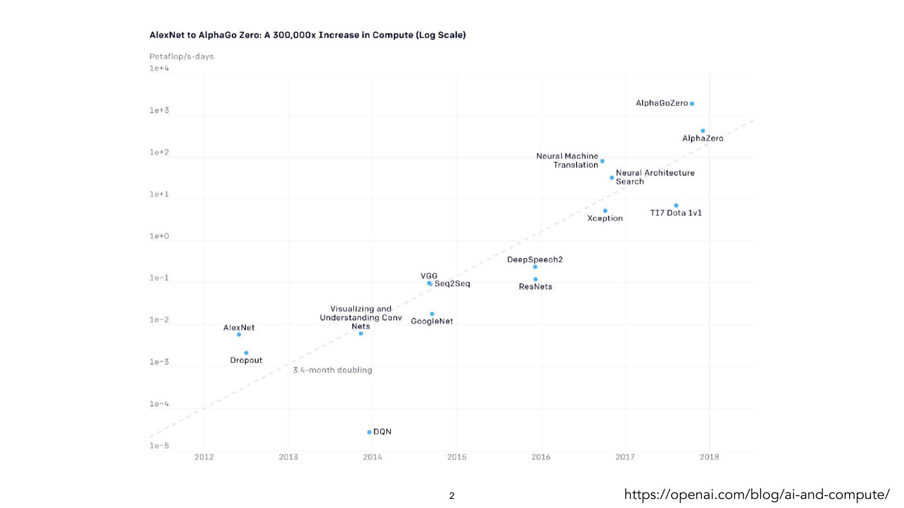

*Slide 2 — Training compute from 2012 to 2018: a straight line on a log axis, doubling about every 3.4 months.*

### The bitter lesson

Slide 3 reproduces the opening of Rich Sutton's essay "The Bitter Lesson" (March 13, 2019): "The biggest lesson that can be read from
70 years of AI research is that general methods that leverage computation are ultimately the most effective, and by a large margin."
The lecturer recommends it ("It's a one-pager. So you should all take a look at it"): it "caused quite a splash … A lot of people
really didn't like it. A lot of people loved it", but "I think there's a lot of truth to it" (≈3:06–3:52). His reading: "all of our
clever ideas and algorithms, most of them don't really pan out. And the only thing that systematically pans out is designing simple
algorithms that scale well." Whatever the ranking of models today, "what matters is how they'll scale because, eventually, as time
goes on, the one that scales better will win" (≈3:52–4:39).

Scaling laws are not new to computer science, he adds: asymptotic analysis and big-O notation are scaling laws, saying "how does my
time complexity of an algorithm scale as a function of the input complexity", as in the time to find a shortest path as a graph
grows. Resources might eventually saturate, "but we're not really anywhere near that point, so we need to be able to predict how
things will scale" (≈4:39–5:25).

### The question: how to spend a budget

Slide 4 states "one of the fundamental questions of the study of scaling laws" (≈6:16): "If you had a given budget of compute, what
model would you train on how much data?"

## Designing at small scale

Slide 5 is OpenAI's chart from the GPT-4 report, "OpenAI codebase next word prediction": bits per word (y) against compute (x, log
scale, from 100p to 1). Nine grey "Observed" dots of smaller models fall from about 5.6 to about 1.9 bits per word, a dashed
"Prediction" curve through them continues to the right, and GPT-4's green dot, at compute 1, lands on the end of the curve at about
1.25. Bits per word "is something related to the cross-entropy of the next-word prediction", so lower is better; compute is measured
in floating-point operations, into which the number of tokens, the depth of the transformer and everything else are folded (≈7:01).

The lecturer's point is the annotation he added: "Design model here", at the last grey dot, "Rather than here", at GPT-4, and between
them "10,000x savings". If the final run costs a great deal, "you might have thought, well, obviously, they did a hyperparameter
sweep … it must have taken \$100 million to design it". Instead "they design it at 1/1,000 the scale, or maybe in this case, it's
10,000, 1/10,000 the scale" (≈7:49). "They do all of their design and hyperparameter sweeps and ablations and model comparisons at
small scale. They do it at multiple small scales, and they find this curve that will predict performance as a function of compute,
and then extrapolate that curve to the scale that they'll train their final model at", and choose the variant whose curve predicts
the lowest loss there. "And then they only train once at that massive scale. So that's the strategy that a lot of companies are using
now" (≈8:39).

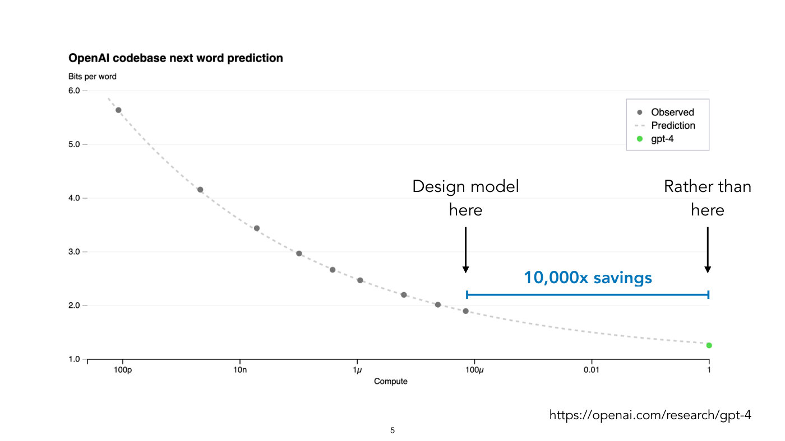

*Slide 5 — Fit the curve on small models, then extrapolate: GPT-4's loss was predicted from models with ten thousand times less compute.*

Two student questions sharpen what the axes mean. Compute is not time: "flops could be allocated sequentially or in parallel … twice
the compute can be twice the time, or it could be twice the number of GPUs in parallel" (≈9:24). And for a scaling law in compute,
"we will try to say we're going to predict the performance at a given compute level for the optimal amount of data for that compute
level. We'll optimize it for all other factors when we make one of these graphs" (≈10:10).

The same predictability holds beyond the loss (slide 6, "Capability prediction on 23 coding problems"): a mean log pass rate on coding
problems, measured on five smaller models, extrapolates to GPT-4's dot. "There are also fairly predictable trends in scaling laws for
the downstream performance, not just for the loss", and "these curves turn out to be power laws with respect to the underlying
resource" (≈10:56).

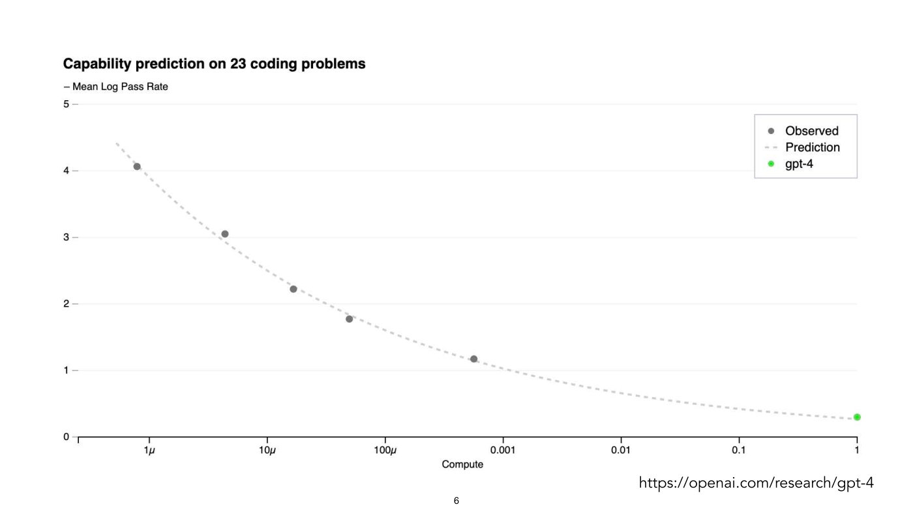

*Slide 6 — The same extrapolation for a downstream measure, the pass rate on coding problems.*

## Scaling laws as an optimization

Slide 7 states the problem: "minimize *test-loss(model size, data, batch size, steps,…)* such that *compute* within budget", or, for
"a given architecture, how much data / what model size would be needed for a target performance?", and "can we extrapolate from smaller
to larger models / experiments??" Its equation picks the best model size and dataset size for a compute budget $C$:

$$N_{opt}(C), D_{opt}(C) = \underset{N,D \text{ s.t. } \mathrm{FLOPs}(N,D)=C}{\arg\min} L(N, D)$$

The lecturer gives the uses: planning (if a self-driving system must be 99% accurate, "can I predict at what scale will I have that?"),
and "choosing parameters that maximize performance at a given scale" (≈11:44–12:30). Training a model of $N$ parameters on $D$ data
points costs "something like N times D amount of flops … every additional data point, I need proportionally more flops, every
additional parameter, I need proportionally more flops" (≈13:15). So the same budget buys "a really big model on a few data points" or
"a small model on a lot of data points": "Should I train a huge trillion-parameter transformer on 10 data points? Or should I train a 1
billion-parameter transformer on a million data points?" (≈14:01).

## Kaplan, McCandlish et al. (2020)

"The paper that really introduced or popularized the idea of scaling laws for neural nets" is by Jared Kaplan, Sam McCandlish and
colleagues at OpenAI (≈14:01–14:47). The lecturer notes that the team later split, part of it founding Anthropic, so that "the scaling
laws are a huge part of the philosophy behind those two companies and also part of their success" (≈14:47). The paper was assigned as
reading: "it's just a beautiful piece of science and full of insight. A lot of the findings have been modified since … But it's a good
lesson in how to do this kind of work" (≈16:19).

Slide 8 gives the setup. The model is an autoregressive Transformer trained on WebText2 (96GB of text, $2.29 \cdot 10^{10}$ tokens) with
a 1024-token context. They vary the model size (768 to 1.5 billion non-embedding parameters), the data (22M to 23B tokens), the shape
(depth, width and attention heads; the slide prints "with" for what is presumably width) and the batch size. Compute is counted as
"compute = 6 x #parameters x batchsize x #steps", in this page's symbols

$$C = 6 N B S,$$

that is, parameters times data points seen, since the data points seen are the batch size times the number of steps; "for some reason,
you multiply by 6. I don't quite know where that comes from. But that's the constant that turns the units into flops" (≈17:05). It is
reported in PF-days (petaflop/s-days), where 1 PF-day is $8.64 \cdot 10^{19}$ FLOPs. The training is a single epoch, each data point
visited exactly once, so the number of tokens processed equals the size of the dataset (≈20:09).

The citation printed under the deck's charts of this paper reads "Scaling Laws of Neural Language Models", but the paper's own title
block, pasted on slide 8, reads "Scaling Laws **for** Neural Language Models"; the citation's "of" is a slip.

## Finding #1: power laws

### What a power law says

"The main finding of this paper is that there is a power law relationship between the test loss and the resources, either the number
of parameters or the number of data points" (≈17:05–17:51). For a resource $X$, which "could be data or parameters or even compute",
slide 9 writes

$$L(X) = (1/X)^{\alpha} = X^{-\alpha},$$

where $\alpha$ "is a constant that will depend on other properties, properties of the data, the world, the task, the architecture"
(≈17:51). So scaling $X$ to $2X$ multiplies the loss by $2^{-\alpha}$ (slide 9). With $\alpha = 1$, doubling the data halves the loss
and quadrupling it quarters the loss; with $\alpha = 2$, doubling the resource cuts the loss to a quarter (≈18:38–19:23). On a log-log
plot a power law is a straight line "with a slope, which is equal to the exponent of the power law" (≈20:09).

### In the data

Slide 10 plots test loss against dataset size in tokens on log-log axes, with the parameters and compute "infinite": seven measured
points fall from about 4.1 to about 2.75 between about $2 \times 10^{7}$ and $1.4 \times 10^{9}$ tokens, almost exactly on a straight
line, "a great fit" (≈20:09). The fitted law is

$$L(D) = (D_c / D)^{\alpha_D}, \qquad \alpha_D \sim 0.095, \qquad D_c \sim 5.4 \times 10^{13} \text{ tokens}.$$

The exponent, "it turns out, empirically, to be about 0.1", and $D_c$ "is another parameter of the power law" that "just is going to
change the offset of this line", the y-intercept on the log-log plot (≈20:56–21:41). Asked whether $D_c$ means anything, the lecturer
says: "we have an equation with two free parameters … a slope and an offset on a log-log plot. And what's the interpretation of that
offset? I'm not sure if I have a crisp explanation" (≈24:00). The chart's legend writes the same law as $L = (D/5.4 \cdot 10^{13})^{-0.095}$,
with the constant below $D$ and a negative exponent; a student asks whether the two forms disagree, and the lecturer checks that the
negative sign makes them consistent (≈24:00–24:45).

Three answers to student questions set the limits of the claim. The loss function matters: "people have observed power laws with
respect to both cross-entropy as well as mean squared error, different loss functions will result in different power laws", and here
it is a cross-entropy loss on next-word prediction (≈21:41). The context length is held fixed; there could be scaling laws in context
length too, "but that's not what they're looking at here" (≈22:27). And the result describes one setting: "this transformer with this
context length with cross-entropy loss … will that hold for an RNN with an MSE loss? Maybe, maybe not … This is characterizing one
popular family of models" (≈23:14). Why a power law rather than an exponential decay? "I'll get to a theoretical model for why this
would emerge. But I would say I'm not sure how much I trust the theory behind this … it's more just, empirically, a power law fits the
data better than an exponential." The theory he has in mind "comes out of just high-dimensional statistics": fitting a function in a
high-dimensional space gives a dependence on the dimension, "and that will turn into the alpha" (≈24:45–25:32). That theory comes later
in the deck, past the end of the recording; see [below](#can-scaling-laws-be-explained).

### In the parameters

Slide 11 sets the dataset chart beside one for parameters (non-embedding), with the tokens and compute "infinite": about 22 points fall
from about 5.9 at roughly $6 \times 10^{3}$ parameters to about 2.3 at $1.5 \times 10^{9}$, again on a straight line,

$$L(N) = (N_c / N)^{\alpha_N}, \qquad \alpha_N \sim 0.076, \qquad N_c \sim 8.8 \times 10^{13} \text{ non-embedding parameters}.$$

"This sounds like some physical law that we're deriving from first principles. It's not, really. It's much more empirical … That could
have come out as some parabola or something crazy, but it turned out to come out as a line on a log-log plot" (≈26:17).

### In the compute, and the frontier

Slide 12 adds compute ("power law for all of them"):

$$L(C_{\min}) = (C_c^{\min} / C_{\min})^{\alpha_C^{\min}}, \qquad \alpha_C^{\min} \sim 0.050, \qquad C_c^{\min} \sim 3.1 \times 10^{8} \text{ PF-days}.$$

The compute chart's own legend prints the constant as $2.3 \cdot 10^{8}$, the equation as $3.1 \times 10^{8}$; both are as printed, and
the deck does not reconcile them. Each of the three laws "has a different constant offset and a different slope. So that will have
implications about how to optimally allocate our resources" (≈27:04).

The compute chart shows how such a law arises. Its many thin blue curves are individual training runs: "one blue line is I take one data
set, a fixed size, one model, a fixed number of parameters, and I train it with different amounts of compute", and each eventually
plateaus (≈28:40–29:27). The power law, the orange dashed line along the black envelope, is "the Pareto front, the frontier of all of
the different curves" (≈27:53). "So if you are starting to look for a power law, and you take one architecture, and you just scale the
compute, you won't see a power law. You'll see one of these blue curves. What you need to do is you need to tune the data set size and
parameters for every level of compute" (≈28:40). Finding #1, restated: "there's a power law relationship between each factor and
performance when all other factors are set optimally" (≈29:27).

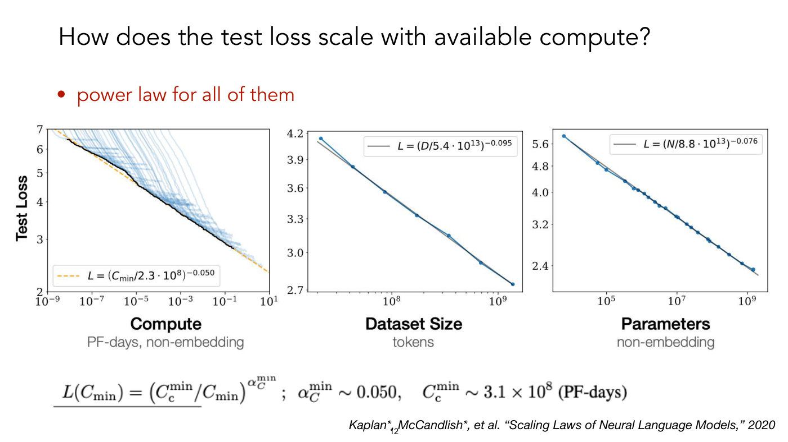

*Slide 12 — Kaplan et al.'s three power laws. In the compute panel, the thin blue curves are single training runs and the dashed line is the frontier they share.*

A student asked whether it is better to grow the dataset or the model. The lecturer first said "we'd prefer, in this case, to increase
our data set size", then "I might be saying that wrong. Let me wait until I get to the slide so I make sure to say it correctly"
(≈27:04–27:53). The answer comes with slide 15, below, and it is the other way round: Kaplan et al. give the parameters the larger
share of compute.

## Finding #2: data and parameters together

"Performance improves predictably as long as we scale up $N$ and $D$ in tandem, but enters a regime of diminishing returns if either
$N$ or $D$ is held fixed while the other increases" (slide 13, quoting the paper). The chart "Loss vs Model and Dataset Size" plots the
loss against the tokens in the dataset for six model sizes, from 393.2K to 708M parameters. The large models keep improving along a
power law, but the smallest flattens early, at about 4.2: "if the model is not very large, then adding more tokens to your data set
doesn't improve performance … if it's like a linear model, it can only find a linear fit. It just doesn't have enough capacity"
(≈30:14). So "you have to scale your model size in tandem with your data set size in order to observe the power law" (≈31:02). The
joint fit is

$$L(N, D) = \left[ \left( \frac{N_c}{N} \right)^{\frac{\alpha_N}{\alpha_D}} + \frac{D_c}{D} \right]^{\alpha_D},$$

with fitted constants $\alpha_N = 0.076$, $\alpha_D = 0.103$, $N_c = 6.4 \times 10^{13}$ and $D_c = 1.8 \times 10^{13}$ (slide 13's
table). "Is this something fundamental? Does theory predict this? Not in this paper. This is just a simple equation they found that
explains the data pretty well" (≈31:02).

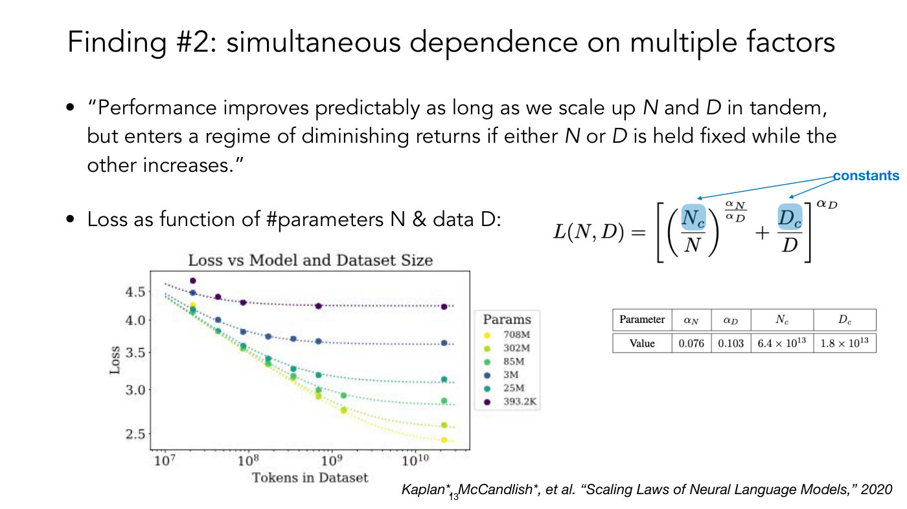

*Slide 13 — Loss against data for six model sizes. The smallest model flattens early, and only the large ones keep following the power law.*

The lecturer warns against over-reading such fits: "There might be a little bit of reading of tea leaves here." He quotes the physicist's
saying "with five parameters, I can fit an elephant" (a student attributes it to Anderson; he had guessed von Neumann) and counts the
constants of the fit as five (≈31:48–32:33); slide 13's table lists four. "Maybe there's other functional forms that could do just as
well" (≈32:33).

The same analysis in model size and optimization steps $S$ (slide 14), "our three fundamental resources" being model size, data and
compute, gives an even simpler form, "the sum of two power laws" (≈32:33–33:21):

$$L(N, S_{\min}) = \left( \frac{N_c}{N} \right)^{\alpha_N} + \left( \frac{S_c}{S_{\min}} \right)^{\alpha_S}.$$

Its chart, "Loss vs Model Size and Training Steps", shows the loss falling with steps for models of different sizes, larger models
lower; "if you increase the parameters sufficiently, then you'll reach a frontier that looks like a power law, just in terms of the
number of steps of gradient descent" (≈34:07).

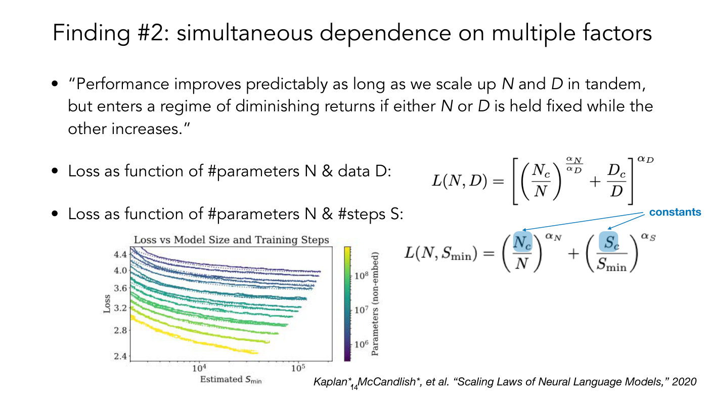

*Slide 14 — Loss against training steps; each curve is a model size, coloured by its parameter count.*

From these fits Kaplan et al. derive how to grow each resource with compute $C$ (slide 15, which prints "#params" and "data =
batch-size · #steps"):

$$N \propto C^{0.73}, \qquad D = B S \propto C^{0.27}.$$

"Take these numbers with a grain of salt because they change with different models and different eras" (≈34:54; the slide prints "Take
these exact equations/numbers with a grain of salt!"). The lecturer reads the exponent as "C to the 0.7". "The implication is,
essentially, I should train relatively big models on relatively small data. So I should train a billion-size parameter model on a
million-size data set" (≈34:54–35:43). Chinchilla's revision of these exponents comes later in the deck, past the end of the recording;
see [below](#two-years-later-chinchilla).

## Similar findings, and extrapolation

"These power laws have showed up in computer vision, in reinforcement learning, in a lot of areas" (≈35:43). Slide 16 shows Rosenfeld et
al. (2020), "A constructive prediction of the generalization error across scales": two 3D surfaces of log error against the log
fraction of data and the log fraction of model size, for language (WikiText-103 cross-entropy) and vision (CIFAR10 top-1 error). "There's
kind of a power law in both dimensions, but they interact in a weird way … But we do have a simple functional form, which is just the sum
of these two power laws" (≈36:30). The slide's fit function is

$$L(N, D) \approx \frac{a(N)}{D^{\alpha_1(N)}} + \frac{b(N)}{N^{-\alpha_2(D)}} + c_{\infty},$$

printed with a minus sign in the second denominator's exponent; read literally, that term would grow with $N$, unlike the first term,
which falls with $D$, so it is probably a slip on the slide. The recording does not read the formula out.

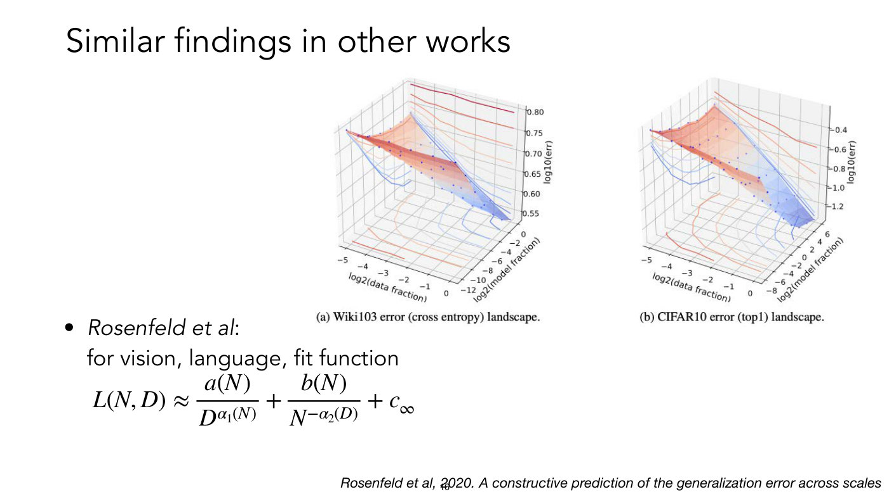

*Slide 16 — Error as a surface over data and model size, for language and for vision.*

"One of the questions that you might have with this kind of reading tea leaves concern is, do these power laws actually make predictions
that extrapolate across orders of magnitude?" "And the answer is yes" (≈36:30–37:15). Slide 17, "Extrapolation is possible!", shows how
Rosenfeld et al. tested it: they fit the law on a block of small configurations (the green circles of panel (a), small models with small
data fractions) and predicted the error of larger ones (the red circles), "this out-of-distribution held-out test" (≈37:15). The predicted
errors land close to the measured ones on ImageNet (mean deviation −4.5%) and WikiText-103 (0.5%). "So you can do cross-validation. We're
not just reading tea leaves" (≈38:01).

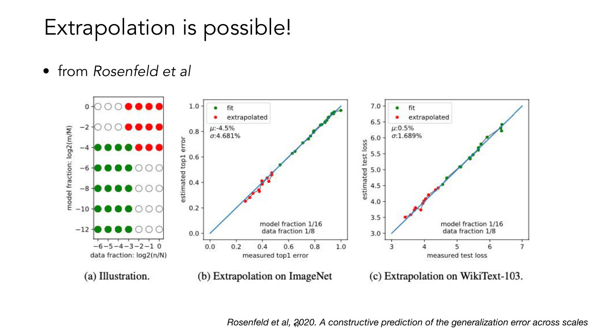

*Slide 17 — Fit on the green configurations, predict the red ones: the predictions land on the diagonal.*

The recording ends here, as the lecturer begins to recap: "So finding one, we have a power law relationship between resources and
performance. Finding two, the--" (≈38:01).

## Past the end of the recording

The rest of this page follows the deck alone. The lecturer's voice is gone, so nothing below says how he explained a slide, what he
stressed or what he would have added; it reports what the slides print and show, and marks any reading of a figure as a reading.

## Finding #3: model shape barely matters

Slide 18 quotes the paper: "Performance depends strongly on scale, weakly on model shape". Its left chart plots the loss increase (in
percent, against the best shape) against the aspect ratio $d_{\text{model}} / n_{\text{layer}}$, width over depth, for models of 50M,
274M and 1.5B parameters. Each curve is a shallow U, near 0% for aspect ratios of about 30 to 100 and only a few percent worse over a
far wider range, which the chart marks "A wide range of architectures achieve similar performance" (aspect ratios from about 9 to about
300). The right chart does the same for the attention head dimension $d_{\text{model}} / n_{\text{head}}$ at 25M parameters, with
curves near 0% until they rise by one or two percent at the largest head dimension, and the note "22% additional compute compensates for
1% loss increase". [Lecture 3](03-approximation-theory.md) made the same point with another figure from this paper, test loss against
parameters for networks of different depths.

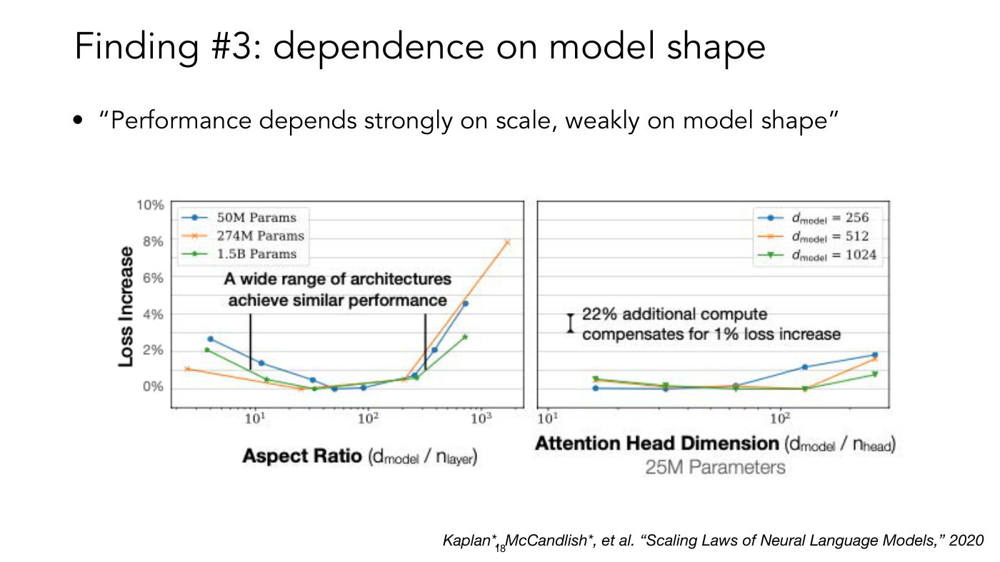

*Slide 18 — Width against depth: across a wide range of shapes, the loss changes by only a few percent.*

## Finding #4: larger models learn from fewer samples

Slide 19, "Larger models require **fewer samples** to reach the same performance", plots test loss against tokens processed for models
from $10^{3}$ to $10^{9}$ parameters. The larger models' curves drop earlier and further: the smallest flatten at a loss of about 6 to
6.5, the largest at about 2.5, still falling.

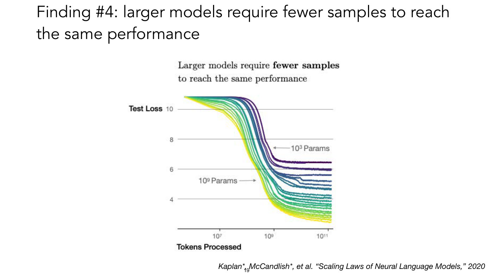

*Slide 19 — The same number of tokens buys a lower loss in a larger model.*

Slide 20 adds a related result, Li et al. (2020): "larger models train faster, not much loss via compression". Its diagram sets
"Common Practice", "Train Small Model → Stop Training When Converged → Lightly Compress", against "Optimal", "Train Large Model → Stop
Training Early → Heavily Compress". Its chart, "RoBERTa Pruning", plots MNLI validation accuracy against the number of parameters left
after pruning 0% to 90% of models with 3, 6, 12, 18 and 24 layers. The deeper models keep most of their accuracy when pruned hard: the
24-layer model pruned by 90%, at about 19M parameters, scores about 0.835, above the unpruned 6-layer model at about 70M (about 0.81).

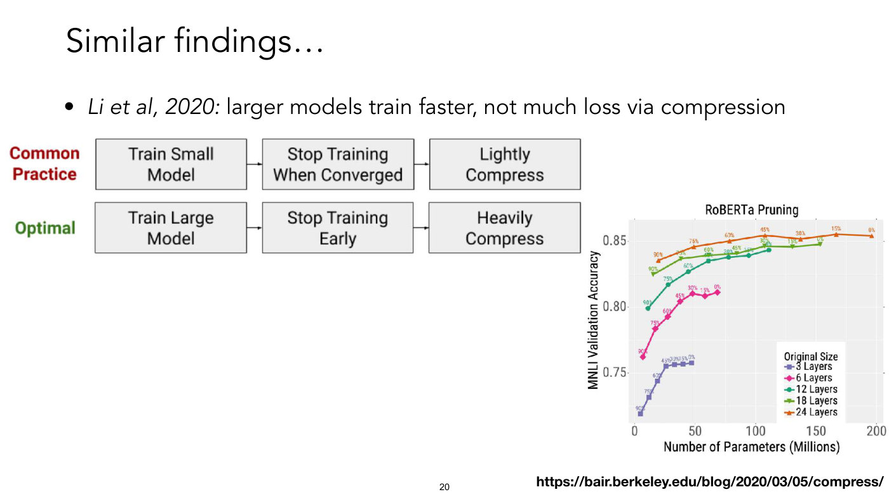

*Slide 20 — Train large, stop early, compress heavily: the pruned deep models stay above the small unpruned ones.*

## Kaplan et al.'s take-aways, and their caveats

Slide 21 sums up the paper:

- "test loss scales as power law as a function of data, parameter count, compute";
- "test loss is more sensitive to parameter count than data: with more compute, increase model by a larger factor than dataset size";
- "don't train to completion, rather make your model larger";
- "in general, scaling laws can help to 'optimally' allocate computation".

Slide 22 lists the paper's own "caveats": "… the scaling with D at very large model size still remains mysterious. Without a theory or
systematic understanding of the corrections to our scaling laws, it's difficult to determine in what circumstances they can be
trusted"; the small-data regime was not thoroughly investigated, and $L(N, D)$ fits poorly there; regularization and data augmentation
were not investigated; and not all hyperparameters were tuned, with "possibly better learning rates for short training runs".

The implication, slide 23, is what the field did next: "larger models, scale data only moderately". Its table:

| Model | Size (# Parameters) | Training Tokens |
| --- | --- | --- |
| LaMDA (Thoppilan et al., 2022) | 137 Billion | 168 Billion |
| GPT-3 (Brown et al., 2020) | 175 Billion | 300 Billion |
| Jurassic (Lieber et al., 2021) | 178 Billion | 300 Billion |
| Gopher (Rae et al., 2021) | 280 Billion | 300 Billion |
| MT-NLG 530B (Smith et al., 2022) | 530 Billion | 270 Billion |

The parameter counts grow nearly fourfold down the table while the training tokens stay near 300 billion. (The pasted table is cropped:
the image holds one more row, out of view on the page, for Chinchilla, at 70 billion parameters and 1.4 trillion tokens.)

## Two years later: Chinchilla

Slide 24 asks the allocation question again, "Finding the right predictions is not easy…": "spend compute on model size … or on data?",
with pictures of a gopher and a dinosaur on the side of model size and a chinchilla on the side of data, the namesakes of Gopher, the
280-billion-parameter model of slide 23's table, and of Chinchilla. (The dinosaur and chinchilla pictures are excluded from OCW's
licence, so the slide is not shown here.) It pastes the title block of the paper that answered it: Hoffmann, Borgeaud, Mensch et al.,
"Training Compute-Optimal Large Language Models", from DeepMind.

Slide 25, "Two years later…", quotes the paper's abstract: "We find that current large language models are significantly
under-trained, a consequence of the recent focus on scaling language models whilst keeping the amount of training data constant. By
training over 400 language models ranging from 70 million to over 16 billion parameters on 5 to 500 billion tokens, we find that for
compute-optimal training, the model size and the number of training tokens should be scaled equally: for every doubling of model size
the number of training tokens should also be doubled." Their model Chinchilla uses "the same compute budget as Gopher but with 70B
parameters and 4× more more data" (the doubled "more" is the slide's), and "uniformly and significantly outperforms Gopher (280B),
GPT-3 (175B), Jurassic-1 (178B), and Megatron-Turing NLG (530B)". The slide's summary: the paper "still assume[s] a power law, but
find[s] somewhat different equations / scaling", and it "still do[es] not train to minimum loss, but train[s] for many more tokens (&
steps), increase #parameters and data equally: 'smaller' models, train longer".

What differs from Kaplan et al. (slide 26): "different learning rate schedules (not explored in Kaplan et al), adapted to dataset size",
and "larger models (> 500M parameters)". The slide's chart, the paper's "Training curve envelopes" (its Figure A5), plots training loss
against FLOPs for models from 75 million to 10 billion parameters, with the frontier of their curves marked in black dots and three
dashed power-law fits, one to each third of the frontier. The caption names the fits orange, green and blue for the first, middle and
last thirds, but on the plot no line is orange (the shallowest is a salmon red), and the blue line follows the low-compute end of the
frontier while the red one follows the high-compute end; the caption is given as printed. Slide 29 shows the same figure again beside its remark
that there is "some concavity at high compute budgets"; the fit to the high-compute end is the shallowest of the three.

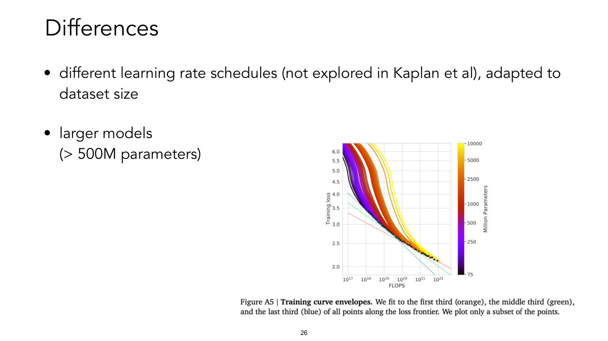

*Slide 26 — Chinchilla's training curves and their frontier; the three dashed lines fit different thirds of it.*

Slide 27 gives the paper's three ways to "minimize $L(N,D)$ with constraint $\mathrm{FLOPs}(N,D) = \text{budget}$":

1. "for each fixed model size, record entire training curve (=different #training tokens, as they use 1 epoch only)";
2. "fixed #FLOPs, use final training loss for different N,D";
3. "fit parametric loss function", the sum of an irreducible term and one power law each in $N$ and $D$:

$$\hat{L}(N, D) \triangleq E + \frac{A}{N^{\alpha}} + \frac{B}{D^{\beta}},$$

where $E$, $A$, $B$, $\alpha$ and $\beta$ are fitted constants (this $B$ is not the batch size).

"For all 3", the optimal scaling with compute is roughly

$$N \propto C^{0.49}, \qquad D \propto C^{0.51},$$

against Kaplan et al.'s $C^{0.73}$ for the parameters and $C^{0.27}$ for the data. So "existing large models would need much more
training data", and the "Better allocation: **smaller model, more data/steps**".

Slide 28 turns this into predictions: "For a given #FLOPs, how many parameters should we allocate? (compute = 6 x data x params)". On
log axes of parameters against FLOPs, the three approaches give nearly the same line (approaches 1 and 2 almost on top of each other,
approach 3 a little flatter), all much flatter than Kaplan et al.'s dashed line. Chinchilla's star sits on the new lines at about 70
billion parameters; GPT-3, Gopher and Megatron-Turing NLG sit by the Kaplan line, far above the new lines for their compute. Gopher
sits directly above Chinchilla, at the same compute, with four times the parameters (280 against 70 billion).

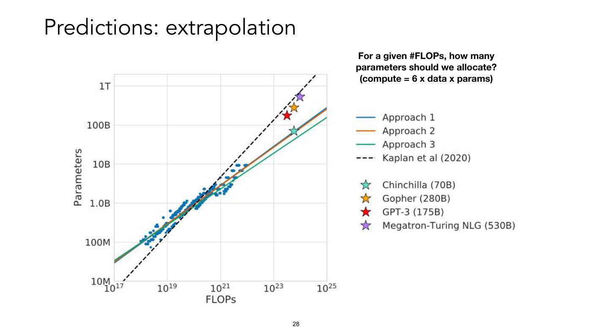

*Slide 28 — Chinchilla's three approaches agree on a flatter line than Kaplan et al.'s; the large models of the day sit near the old line.*

The slide's own limitations of the study (slide 29): it uses "(smoothed) training loss as a proxy for test loss"; "expensive
experiments: only two large-scale training runs (Gopher, Chinchilla), no additional tests at intermediate scales"; it assumes "a power
law for L(N) — but some concavity at high compute budgets, so it may not hold universally"; and "only one epoch of training (each data
point seen once)".

[Lecture 3](03-approximation-theory.md) showed this paper with a citation that reads "Hoffmann, Borgeau, Mensch et al (2020)"; this
deck's slide 24 prints the authors' names from the paper's own title block (Sebastian Borgeaud), and slide 25 places it "two years
later" than Kaplan et al.'s 2020.

## Many more scaling laws

Slide 30 points further. There were "many earlier works, too (Tan & Le 2019, Cho et al 2015, Miceli Barone et al 2017, Johnson et al
2018, Hestness et al 2017)". "Vision models tend to have better scaling in model size than transformers": $L(N) \propto 1/N^{\alpha}$
for vision models (CNNs), "with larger $\alpha \approx 0.5$" (Rosenfeld et al 2019, Sharma et al), against the $\alpha_N$ of about 0.076
for language transformers on slide 11. There is a "power law for L(D) across vision, language, speech tasks" (Hestness et al 2017), and
there are "power laws in theoretical bounds", in model size (Yarotsky, 2018) and data size (Liang et al, 2019).

## Can scaling laws be explained?

Slides 31 to 35 give "one hypothesis", from Sharma and Kaplan's "Scaling Laws from the Data Manifold Dimension" (slide 32): "neural
networks are doing regression on an embedded data manifold". It is the theory the lecturer promised when a student asked why the law
should be a power law rather than an exponential, which, he said, "comes out of just high-dimensional statistics … there's a dependence
on the dimensionality, and that will turn into the alpha", adding "I'm not sure how much I trust the theory behind this" (≈24:45–25:32).

**A toy model** (slide 33). Approximate a [Lipschitz](lipschitz-continuity.md) function $f(x)$ on the unit cube $[0,1]^{d}$ by a
piecewise constant function $c(x)$, constant on each of a grid of hypercubes of side $s$. That takes $N = s^{-d}$ regions, one value
each, so $N$ plays the part of the parameter count. The mean squared error is bounded by the square of the Lipschitz constant $\lambda$
times $s^2 d$:

$$L(s) = \int_0^1 \lvert f(x) - c(x) \rvert^2 d^d x \lesssim \lambda^2 (s^2 d),$$

and since $s = N^{-1/d}$, "up to constant factors",

$$L(N) \lesssim \frac{1}{N^{2/d}}.$$

"For piecewise linear approximations (ReLU), MSE and cross entropy scale as $s^4$, so" $L(N) \lesssim N^{-4/d}$. The slide's pictures show
the construction: in one dimension, a curve approximated by seven flat bars, one of them, $R_j$, highlighted; in two, a function built
from flat blocks. It is the same construction as [lecture 3](03-approximation-theory.md)'s proof of universal approximation, which
covered the unit cube with boxes and needed $(L/\epsilon)^d$ of them for error $\epsilon$ (see [representational
power](representational-power.md)); here the count is turned around into a loss that falls as a power of the number of pieces.

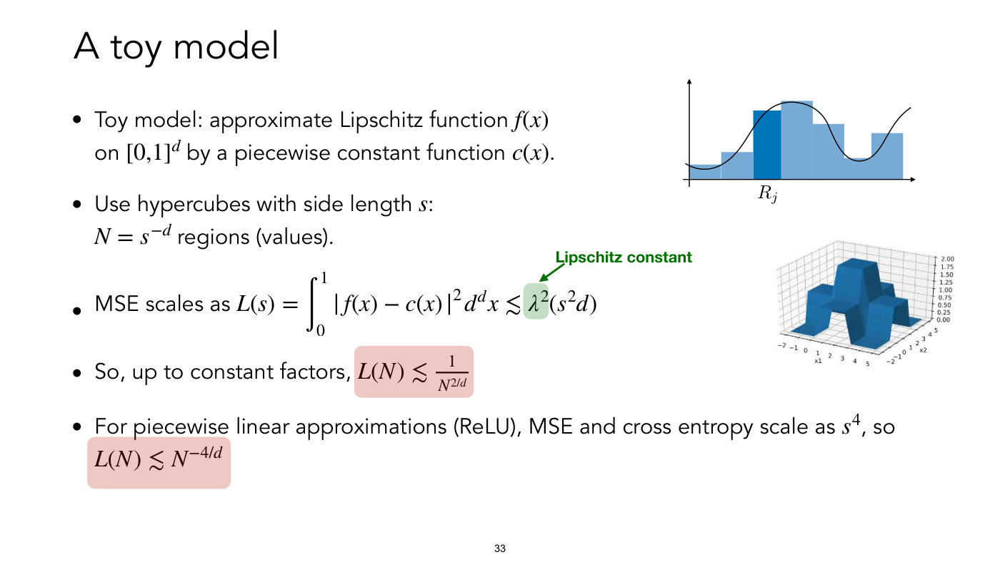

*Slide 33 — Approximating a function piece by piece: with N pieces in d dimensions, the error falls as a power of N whose exponent shrinks as d grows.*

**The hypothesis** (slide 34). "Common belief: NN map data into a low-dimensional 'manifold' that depends on data, loss/task". If $d$ is
taken to be the intrinsic dimension of that data manifold, rather than the dimension of the input, the toy model gives a scaling law,

$$L(N) \propto \frac{1}{N^{\alpha}} \quad \text{with} \quad \alpha \approx 4/d.$$

This "suggests that scaling exponent is strongly related to data and task: different models will scale similarly on the same data".

**The evidence** (slide 35): "measure intrinsic dimension of embedding and relate to scaling exponent $\alpha$". The chart plots the
measured intrinsic dimension against $4/\alpha$ on log axes, with the line where the two are equal. Teacher-student models and vision
models trained on MNIST, Fashion MNIST, SVHN and CIFAR10 lie on or near the line, at intrinsic dimensions between about 2 and 18. GPT
appears only as an arrow pointing up, at $4/\alpha$ of about 53 and an intrinsic dimension of at least about 90: a "Good fit for vision
models, only upper bound for transformer: $\alpha \gtrsim 4/d$ from upper bound on L(N)".

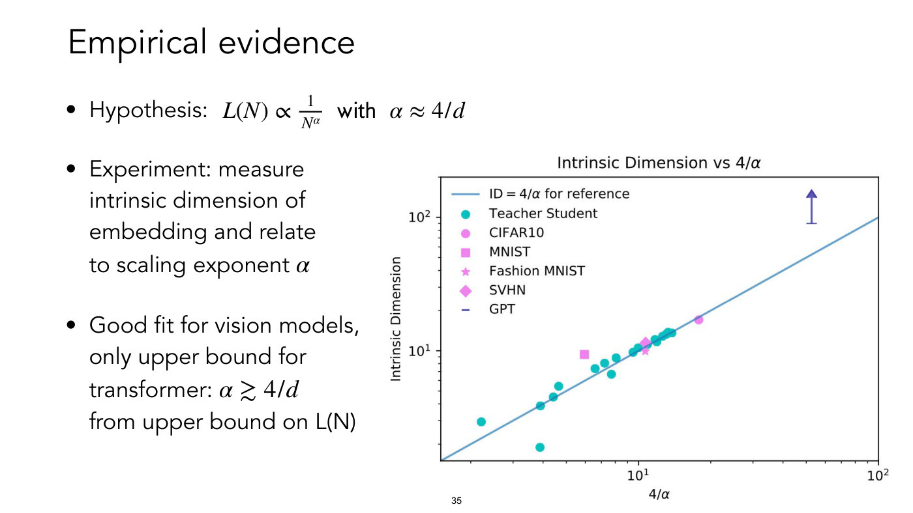

*Slide 35 — Where the exponent can be measured, the data's intrinsic dimension predicts it; for GPT the measurement gives only a bound.*

## Breaking power-law scaling

Slide 37 names the cost of a power law with a small exponent: "a small improvement in loss may need an order of magnitude more
data/parameters". (With slide 10's exponent of 0.095, ten times the data multiplies the loss by $10^{-0.095}$, about 0.8.) These are
"Diminishing returns", which "suggests that many training examples are highly redundant", and "Pruning intelligently can lead to better
scaling", citing Sorscher et al. (2022), "Beyond neural scaling laws: beating power law scaling via data pruning". The slide shows
Kaplan et al.'s dataset chart from slide 10 again, though its footer cites only Sorscher et al.

## Critical batch size

The batch size was one of the factors Kaplan et al. varied, and the lecturer promised to "come back to that at the end of this lecture"
(≈15:33). The recording does not reach it; slides 38 to 45 are the deck's treatment.

**The question** (slide 39). "Bigger batches are more costly but provide better estimates of the full-batch gradient." Sixteen SGD steps
with a batch of 16 cost the same FLOPs as one step with a batch of 256: "Which is yields better performance?" (printed so). And "FLOPs
aren't everything: one compute node can only handle some max batch size at once (in parallel). If you use bigger batches then you have
to split up across nodes or do sequential computation. Splitting incurs communication costs. Sequential computation incurs time cost."

Slide 40 shows how large batches can get: OpenAI's Dota 2 system was trained with a "Batch size: ~2 million". It pastes the first page
of McCandlish, Kaplan and Amodei's "An Empirical Model of Large-Batch Training" (2018), whose abstract says that "a simple and
easy-to-measure statistic called the *gradient noise scale* predicts the largest useful batch size across many domains and
applications", from batches of "tens of thousands in ImageNet to batches of millions in RL agents that play the game Dota 2". (Both
pictures on the slide are excluded from OCW's licence, so it is not shown here.)

**Why batch size matters** (slide 41, "adapted from Minyoung Huh"). Three panels show a loss surface, a circle and a star; the slide
labels neither, and read as drawn the circle is the current parameters and each star the minimum of the cost named above its panel.
Full-batch gradient descent on $J(\theta; \mathbf{X}_ {\text{train}})$, the cost over the whole training set, takes one long step toward its minimum.
SGD on a single example's cost, $J(\theta; \mathbf{x}_ {\text{train}}^{(1)})$, heads for that example's own minimum, a different star. In
the third panel the training cost is a random variable, $J(\theta; X_{\text{train}}^{RV})$, one for each possible mini-batch, so its
minimum is scattered (seven pale-red stars near the full-batch star), and the SGD steps zigzag where the full-batch step goes straight. The
caption: "Variability of solution as a function given your mini-batch size" (printed so).

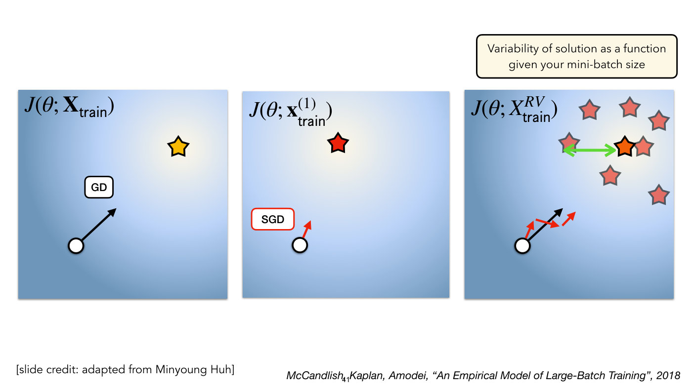

*Slide 41 — The full-batch gradient points at one minimum; each mini-batch has its own, so SGD's steps scatter around the full-batch path.*

**Gradient noise** (slide 42). The stochastic gradient $\nabla_{\text{sgd}}\theta$ splits into the true gradient and an error:

$$\nabla_{\text{sgd}}\theta = \nabla\theta + \left(\nabla_{\text{sgd}}\theta - \nabla\theta\right),$$

the first term labelled "Signal" and the bracket "Noise". In the slide's diagram the noise is the red arrow from the tip of the true
gradient to the tip of the stochastic one; its label is printed as $\nabla\theta - \nabla_{\text{sgd}}\theta$, the opposite sign of the
arrow and of the equation's noise term, and is given here as printed. A plot of two paths from "Start" to "Minimum" contrasts "Less
noise, larger steps", which takes about thirty long strides, with "More noise, smaller steps", a jagged path of many short ones that
wanders above and below the first and overshoots the minimum before settling.

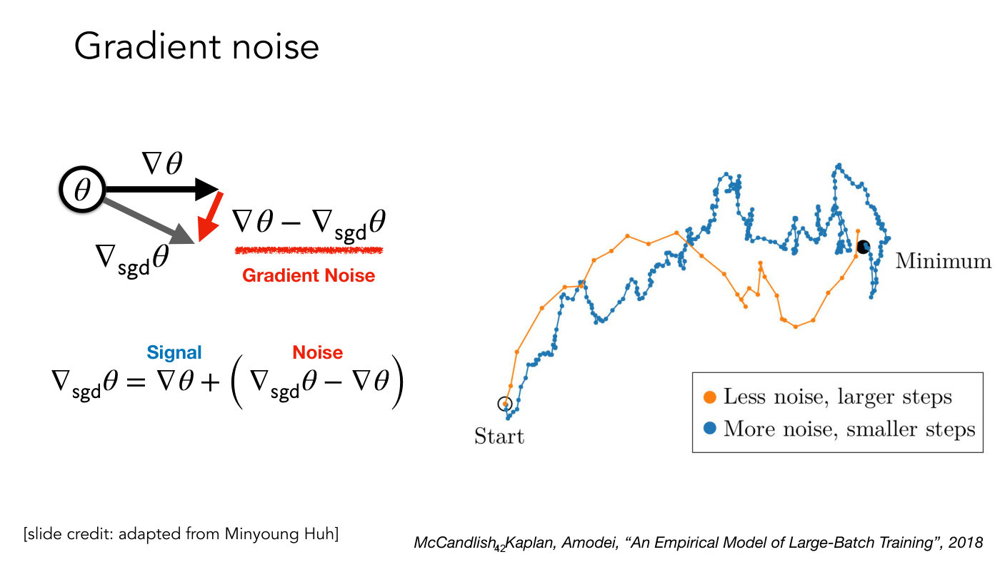

*Slide 42 — Signal plus noise; larger batches mean less noise, so larger steps can be taken.*

**How much one step can achieve** (slide 43, "Optimal learning rate for SGD?"). For a step of size $\eta$ along the stochastic gradient
$G_{\text{sgd}}$, with batch size $B$, the slide expands the expected loss:

$$\mathbb{E}\left[\mathcal{L}(\theta + \eta G_{\text{sgd}})\right] = \mathcal{L}(\theta) - \eta \lvert G \rvert^2 + \frac{\eta^2}{2}\left(G^T H G + \frac{\operatorname{trace}(H\Sigma)}{B}\right),$$

where $\Sigma$ is the "covariance of G_sgd, with B=1", the spread of a single example's gradient. The slide does not define $G$ or
$H$. In [lecture 7](07-scaling-rules-for-optimization.md)'s notation $H$ is the Hessian of the loss, and read that way the line is a
second-order expansion of the loss along the step, with $G$ the direction of descent (a reading; the slide does not say). Only the last
term depends on the batch size, which divides it. "Take the derivative and solve for the learning
rate":

$$\eta_{\text{opt}} = \frac{1}{1 + \mathcal{B}_ {\text{noise}} / B} \thinspace \eta_{\text{max}} \qquad \text{where} \qquad \mathcal{B}_ {\text{noise}} = \frac{\operatorname{trace}(H\Sigma)}{G^T H G},$$

and putting it back gives the best progress one step can make,

$$\Delta\mathcal{L}_ {\text{opt}} = \frac{1}{1 + \mathcal{B}_ {\text{noise}} / B} \thinspace \Delta\mathcal{L}_ {\text{max}} \qquad \text{where} \qquad \Delta\mathcal{L}_ {\text{max}} = \frac{1}{2} \frac{\lvert G \rvert^4}{G^T H G}.$$

The **noise scale** $\mathcal{B}_ {\text{noise}}$ is, read off the formula, the size of the gradient's noise over the size of its signal,
both weighted by $H$.

**The critical batch size** (slide 44). One step's progress is proportional to $1 / (1 + \mathcal{B}_ {\text{noise}} / B)$. "For small B,
second term of denominator dominates, so increasing B linearly increases progress"; "For large B, first term of denominator dominates,
so increasing B has little effect." The chart "Predicted Training Speed" plots that factor against $B / \mathcal{B}$ on log axes: a
straight rise labelled "Perfect scaling", bending at $B = \mathcal{B}_ {\text{noise}}$ (where the factor is one half), and a flat stretch
labelled "Ineffective scaling". The bend is marked "Critical batch size".

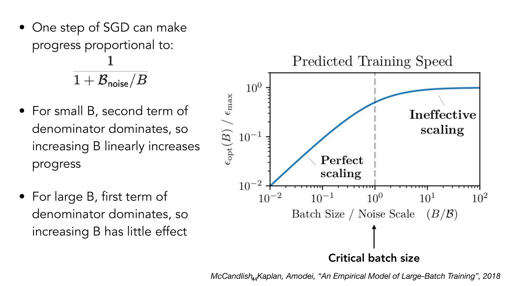

*Slide 44 — Below the noise scale, doubling the batch nearly doubles a step's progress; above it, extra batch buys almost nothing.*

Slide 45 (excluded from OCW's licence, so not shown) gives the practical trade-off from the same paper. A schematic plots "Compute Cost"
against "Training Time": a frontier curve, with "More Hardware (Larger Batches)" toward short time and high cost and "Less Hardware
(Smaller Batches)" toward long time and low cost; above it is "Technically Feasible", and a budget line and a deadline line cut out the
"Economically Feasible" corner. The measured Pareto fronts beside it, for two target scores on an Atari game, have the same shape, from
"4096 Parallel Players" (fast and expensive) to "16 Parallel Players" (slow and cheap).

## Representational convergence

The deck's last section (slides 46 to 50) asks whether models that scale come to represent the world alike. Its tool is the kernel of a
representation (slide 47): "Restrict our attention to **vector embeddings**" $f : \mathcal{X} \rightarrow \mathbb{R}^{n}$, and
"Characterize a representation in terms of its **kernel**" $K : \mathcal{X} \times \mathcal{X} \rightarrow \mathbb{R}$,

$$K(x_i, x_j) = \langle f(x_i), f(x_j) \rangle,$$

the inner product of two inputs' embeddings, so a kernel records which inputs a representation treats as similar. The slide draws a
vision model's kernel $\mathbf{K}_ {\text{vision}}$ over four pictures, an apple, an orange, an elephant and a giraffe, as a $4 \times 4$
heat map: the apple and the orange are similar to each other, so are the elephant and the giraffe, and fruits are dissimilar from
animals. Slide 48 sets it beside a language model's kernel $\mathbf{K}_ {\text{text}}$ over the words "apple", "orange", "elephant" and
"giraffe", with the same block structure, and writes $\text{sim}(\mathbf{K}_ {\text{vision}}, \mathbf{K}_ {\text{text}})$: two models, of
different modalities, can be compared by comparing their kernels. (Both slides' icons are excluded from OCW's licence, so neither is
shown.) This is the kind of kernel [lecture 6](06-generalization-theory.md) used to see whether a network clusters its data, not the
kernel of [kernel methods](kernel-methods.md); see [representation learning](representation-learning.md).

Slide 49, "Scaling laws for cross-modal alignment", measures that similarity. It plots "Alignment to VISION (DINOv2)" against "LANGUAGE
performance" for eleven language models, from bloom0.56b to llama65b, against four sizes of the vision model DINO (Small, Base, Large,
Giant). Every trend rises: the better the language model, the more its representation aligns with the vision model's, and the larger
the vision model, the higher the line. Three dashed arrows leave the end of one line, one rising, one nearly level and one curving
down; the slide does not label them, and they read as the open question of where the trend goes.

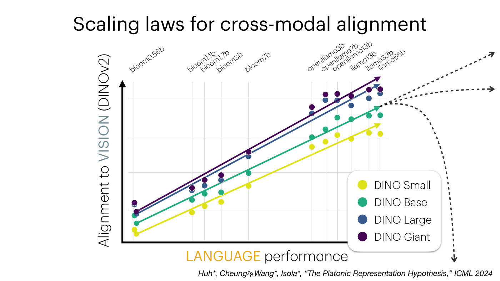

*Slide 49 — Better language models align more with vision models, and larger vision models align more with language models.*

Slide 50 is the diagram of "The Platonic Representation Hypothesis" (Huh, Cheung, Wang and Isola, ICML 2024; the lecturer is one of the
authors). One world, $Z$, a red sphere next to a blue cone, is observed two ways: as an image $X$, through a camera, and as a caption
$Y$, "A red sphere next to a blue cone." An encoder for each, $f_{\text{img}}$ and $f_{\text{text}}$, maps its observation to a vector.
The deck does not state the hypothesis in words, and the recording does not reach it; read with slides 47 to 49, the picture is of two
models of different modalities, trained on different observations of the same world, arriving at similar representations of it.

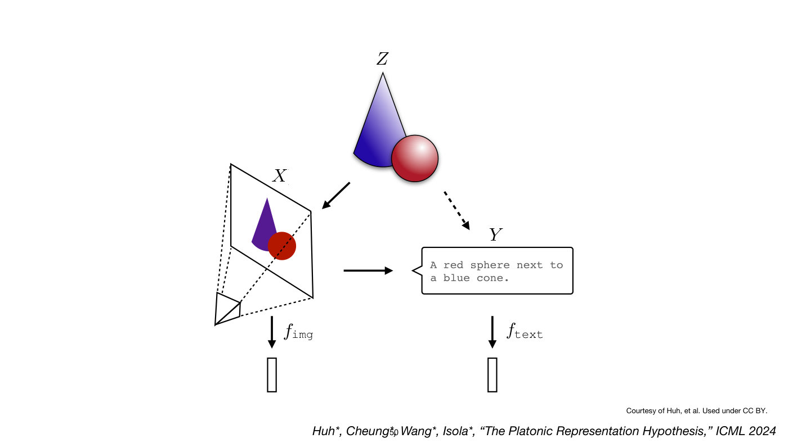

*Slide 50 — One world, two observations, two encoders.*

## Summary

Slide 51 sums up: "Neural scaling laws: predict test loss as a function of resources and model hyperparameters"; "Allows to
'optimally' allocate compute resources"; "Power law scaling in model size, data size across variety of models and tasks"; "Actual
parameters hard to measure, large extrapolation nontrivial".

## Pointers to other lectures

The deck prints no lecture number but its own, on the title slide ("Lecture 20: Scaling Laws"). The recording names no earlier lecture.
It points ahead to "the next few lectures", which "will be of that flavor", recent and empirical research (≈0:00), and, within this
lecture, to the batch size "at the end of this lecture" (≈15:33) and to a theoretical model of power laws (≈24:45), both past the end of
the recording. [Lecture 18](18-transfer-learning-models.md) previewed this lecture (its ≈2:19), and [lecture
3](03-approximation-theory.md) showed Kaplan et al. and Chinchilla first. See the [course map](course-map.md).

## See also

- [Scaling laws](scaling-laws.md) — the thread across lectures 3, 9, 18 and this one.
- [Scaling rules](scaling-rules.md) — lecture 7's different question: keeping the learning rate right as a network grows.
- [Gradient descent](gradient-descent.md) — SGD, batch size, gradient noise and the critical batch size.
- [Representational power](representational-power.md) — lecture 3's box construction, which slide 33's toy model turns into a power law.
- [Lipschitz continuity](lipschitz-continuity.md) — the function class of the toy model.
- [Representation learning](representation-learning.md) — kernels as a way to compare representations, and representational convergence.
- [Kernel methods](kernel-methods.md) — the other meaning of "kernel" in the course.
- [Foundation models and prompting](foundation-models-and-prompting.md) — GPT-3, Gopher, Chinchilla and the other large models of slides 23–28.
- [Softmax and cross-entropy](softmax-and-cross-entropy.md) — the loss behind "bits per word".
